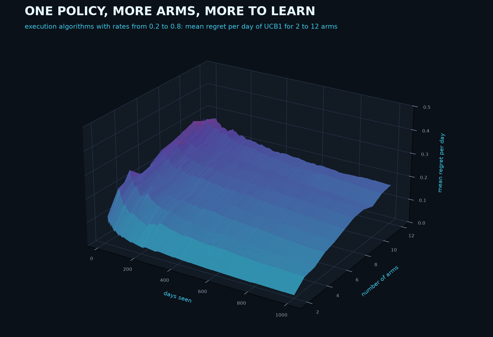
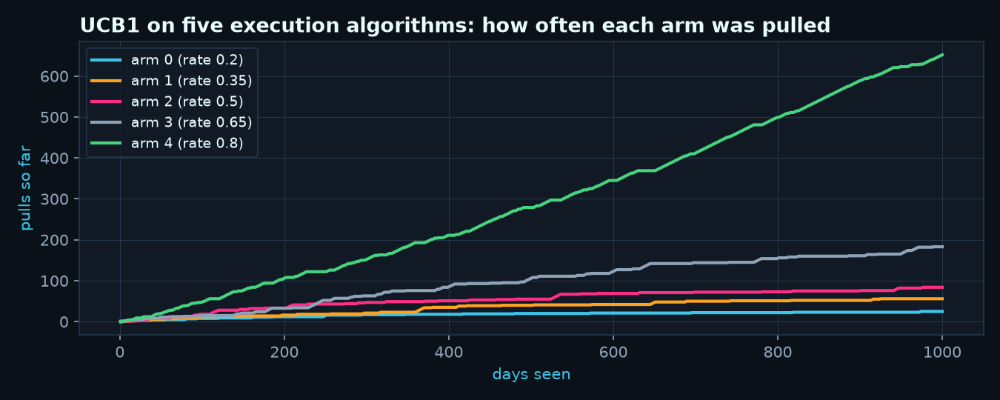

# The shared methods of every policy

[← Bandits](index.md)

Every bandit policy of the library comes from one base class, `BanditPolicy`, and inherits a set of methods that no page showed. They decide what a policy counts as a reward, how it is saved and copied, how its settings are changed, and one of them, `fit`, does not work on a bandit. A robot that tunes a controller gain uses the same methods, in the last section.



## 1. A first example: what a policy counts

A desk with three execution algorithms learns from rewards one at a time. A reward for an algorithm that does not exist, or a reward that is not a number, is not learned: it is counted apart.

```python
from dense_armor.core.online.bandit import EpsilonGreedy

desk = EpsilonGreedy(arms=["twap", "vwap", "pov"], epsilon=0.1, seed=0)
for arm, reward in (("pov", 1.0), ("pov", 1.0), ("vwap", 0.0)):
    desk.update(arm, reward)
desk.update("unknown", 1.0)
desk.update("pov", float("nan"))
print(desk.n_seen_, desk.n_missing_)
```

```
3 2
```

The three good rewards are learned: `n_seen_` is 3. The reward of an arm that is not in the set and the NaN reward are skipped and counted in `n_missing_`: 2. `update` also returns the policy itself, so calls can be chained. `pull` returns one of the arms and takes an optional `context` that the non-contextual policies ignore.



On five execution algorithms with rates 0.2, 0.35, 0.5, 0.65 and 0.8, UCB1 pulled the arms 25, 56, 84, 183 and 652 times in 1000 days: the best arm gets most of the pulls and the worst one the fewest, which is what `state_dict()["counts_"]` holds.

The picture follows the same 1000 days for UCB1 with 2 to 12 execution algorithms of rates between 0.2 and 0.8. Each point of the surface is the mean regret per day so far. After 50, 200 and 1000 days it reads 0.072, 0.03 and 0.014 with 2 arms, 0.189, 0.146 and 0.093 with 5 arms and 0.252, 0.223 and 0.168 with 12 arms: the more arms, the more there is to try before the best one is found.

| class | what it does |
|---|---|
| `BanditPolicy` | the base class of every policy: `pull`, `update`, the counters and the methods of `Root` |

## 2. Save, restore and copy a policy

`state_dict()` returns what the policy has learned, the attributes that end in an underscore. `clone()` builds a fresh policy with the same settings and nothing learned. `load_state_dict()` puts a saved state in a policy.

```python
from dense_armor.core.online.bandit import EpsilonGreedy

desk = EpsilonGreedy(arms=["twap", "vwap", "pov"], epsilon=0.1, seed=0)
for arm, reward in (("pov", 1.0), ("pov", 1.0), ("vwap", 0.0)):
    desk.update(arm, reward)
state = desk.state_dict()
copy = desk.clone()
print(copy.n_seen_, sorted(state))
copy.load_state_dict(state)
print(copy.n_seen_, copy.get_params()["epsilon"])
```

```
0 ['counts_', 'means_', 'n_missing_', 'n_seen_']
3 0.1
```

The clone starts with `n_seen_` equal to 0 and the same `epsilon`; after `load_state_dict` it has the 3 rewards of the saved policy.

## 3. Change a setting: `set_params`, not `mutate`

`get_params()` returns the settings (the constructor parameters) and `set_params()` changes them in place and returns the policy. `mutate()` is for attributes that the class declares mutable, and a bandit policy declares none.

```python
from dense_armor.core.online.bandit import EpsilonGreedy

desk = EpsilonGreedy(arms=["twap", "vwap", "pov"], epsilon=0.1, seed=0)
desk.mutate({"epsilon": 0.2})
print(desk.epsilon)
desk.set_params(epsilon=0.3)
print(desk.epsilon)
```

```
0.1
0.3
```

`mutate({"epsilon": 0.2})` does nothing and does not raise: the names that the class does not list as mutable are left alone, so `epsilon` stays at 0.1. `set_params(epsilon=0.3)` changes it.

## 4. Describe the policy, and the window

`describe()` returns a JSON-serialisable description of the policy, and `window_samples(seconds)` converts a window in seconds to a number of samples.

```python
from dense_armor.core.online.bandit import EpsilonGreedy

desk = EpsilonGreedy(arms=["twap", "vwap", "pov"], epsilon=0.1, seed=0)
d = desk.describe()
print(d["name"], sorted(d["parameters"]), d["methods"])
print(desk.window_samples(2.0), desk.budget_s, desk.memory_class)
```

```
EpsilonGreedy ['arms', 'epsilon', 'seed'] ['update']
2 0.001 O(n_arms)
```

The description lists the parameters (`arms`, `epsilon`, `seed`) and the learning method, `update`. A window of 2 seconds is 2 samples: when the policy has no sample period (`dt`), `window_samples` counts one sample per second. `budget_s` is the time budget of one call, 0.001 s, and `memory_class` says that the memory grows with the number of arms.

## 5. `fit` does not work on a bandit

Every estimator of the library inherits `fit`, which feeds a whole table to `learn_one` row by row. A bandit policy has `pull` and `update`, and no `learn_one`, so `fit` stops with an error.

```python
from dense_armor.core.online.bandit import EpsilonGreedy

desk = EpsilonGreedy(arms=["twap", "vwap", "pov"], epsilon=0.1, seed=0)
try:
    desk.fit([{"arm": "pov"}], [1.0])
except TypeError as e:
    print(e)
```

```
EpsilonGreedy has no learn_one
```

Use a loop of `pull` and `update`, as on the other pages, or `offline_replay` on a log.

## 6. The same methods on a controller gain

A controller has three candidate gains. The same counters, the same saved state and the same description apply to them.

```python
from dense_armor.core.online.bandit import UCB1

tuner = UCB1(arms=[0.5, 8.0, 30.0], seed=0)
for gain, reward in ((8.0, 1.0), (8.0, 1.0), (0.5, 0.0)):
    tuner.update(gain, reward)
tuner.update(99.0, 1.0)
print(tuner.n_seen_, tuner.n_missing_, tuner.clone().n_seen_, sorted(tuner.state_dict()))
```

```
3 1 0 ['counts_', 'means_', 'n_missing_', 'n_seen_']
```

The gain 99.0 is not one of the arms, so it is counted in `n_missing_`: 1. The clone has learned nothing.

## API reference

::: dense_armor.core.online.bandit.base.BanditPolicy

---

## Details

### Choices

- **What is shown here is the behaviour of the code:** the three zero results (`mutate` changes nothing, `fit` raises, a reward for an unknown arm is counted and dropped) are printed by the examples above, not stated from the docstrings.
- **The figures** are drawn with the library by `docs/assets/bandit/make_bandit_style_figures.py`.
