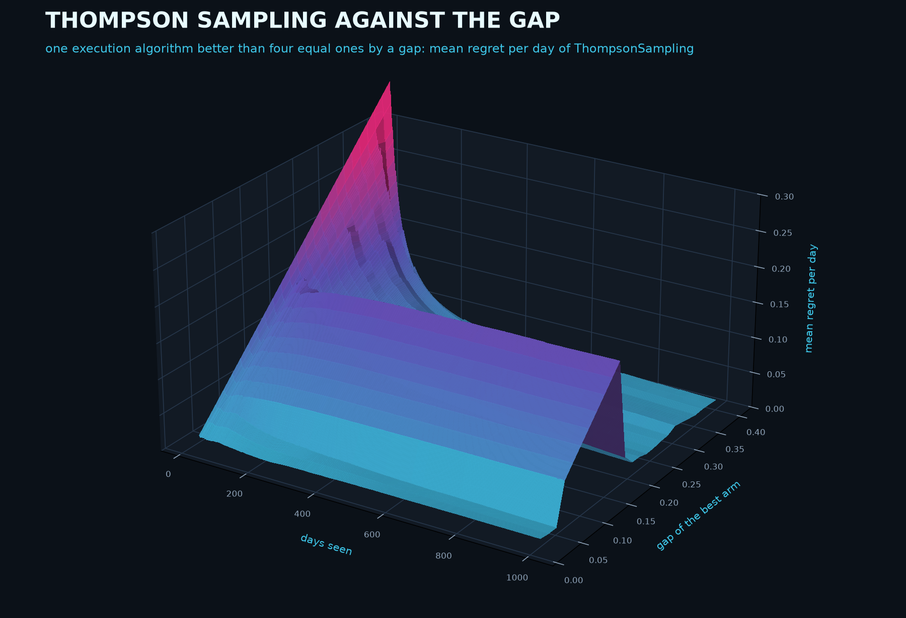
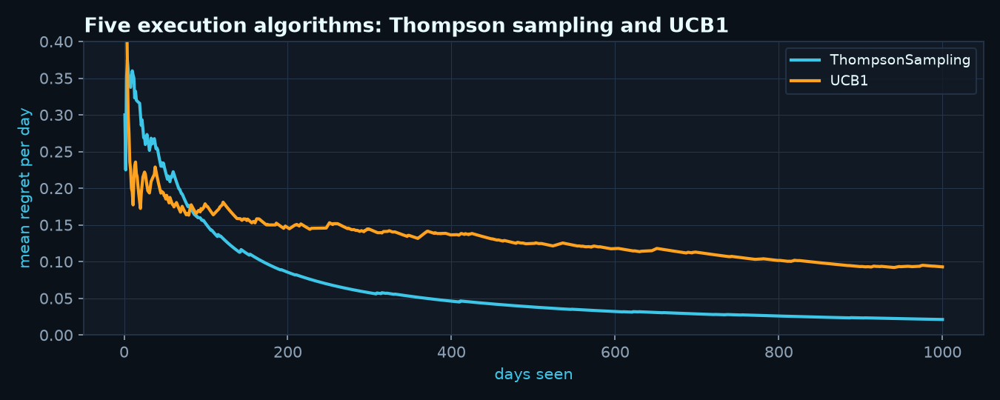

# Thompson sampling: draw from what you believe

[← Bandits](index.md)

A desk keeps, for each execution algorithm, a belief about how often it fills well. Every day it draws one possible rate from each belief and plays the algorithm with the highest draw, so the algorithms it is unsure about still get tried. A robot choosing a gain does the same, in the last section.



## 1. A first example: five execution algorithms, one desk

Three execution algorithms fill an order well with probability 0.2, 0.5 and 0.8. Each arm keeps a Beta posterior from its successes and failures.

```python
import numpy as np
from dense_armor.core.online.bandit import ThompsonSampling

rng = np.random.default_rng(0)
rate = {"twap": 0.2, "vwap": 0.5, "pov": 0.8}
desk = ThompsonSampling(arms=["twap", "vwap", "pov"], family="bernoulli", seed=0)
for _ in range(500):
    arm = desk.pull()
    desk.update(arm, float(rng.binomial(1, rate[arm])))
print(desk.pull())
```

```
pov
```

Sample `Beta(1 + S_j, 1 + F_j)` per arm and play the arm with the highest sample (Chapelle and Li 2011, Algorithm 2).



On five execution algorithms with rates 0.2, 0.35, 0.5, 0.65 and 0.8, Thompson sampling reads a mean regret per day of 0.225, 0.086 and 0.021 after 50, 200 and 1000 days, and UCB1 reads 0.189, 0.146 and 0.093: Thompson sampling starts slower and ends lower.

The picture follows the same 1000 days for 25 gaps between the best algorithm and four equal ones, from 0.02 to 0.4. Each point of the surface is the mean regret per day so far. With a gap of 0.4 it reads 0.168, 0.046 and 0.014 after 50, 200 and 1000 days; with a gap of 0.194 it reads 0.159, 0.137 and 0.033; with a gap of 0.02 it reads 0.015, 0.01 and 0.011.

| class or function | what it does |
|---|---|
| `ThompsonSampling` | plays the arm with the highest draw from its posterior |

## 2. What it does

At each step the policy draws a sample from the posterior of each arm's mean reward and plays the arm with the highest draw. For Bernoulli rewards the posterior is `Beta(1 + S_j, 1 + F_j)` with `S_j` and `F_j` the number of successes and failures of arm `j` (Beta(1, 1) prior, as the paper uses in its simulations); a reward counts as a success when it is `>= 0.5`, so a continuous reward in [0, 1] is binarised. For Gaussian rewards with known variance `sigma^2` the posterior is `N(mu_j, sigma^2 / n_j)` (a flat prior: `mu_j` is the running mean, not the mean under a `N(0, 1)` prior, and `n_j` the number of pulls); an arm never pulled is drawn from `N(0, 1)`.

**Source:** Chapelle, O., Li, L. (2011). An empirical evaluation of Thompson sampling. In NIPS 24. Algorithm 2, page 2: Thompson sampling for the Bernoulli bandit with a Beta(a, b) prior; the Gaussian posterior is on pages 5-6, algorithm 3.

## 3. The parameters

| Parameter | Meaning | Default |
|---|---|---|
| `arms` | the sequence of arms, any hashables | none |
| `family` | `"bernoulli"` or `"gaussian"` | `"bernoulli"` |
| `sigma` | known standard deviation of the Gaussian rewards; ignored for the Bernoulli family | 1.0 |
| `seed` | seed of the random generator | 0 |

`ThompsonSampling` raises `ValueError` if `family` is unknown or `sigma <= 0` for the Gaussian family. The methods that every policy shares (`pull`, `update`, `n_seen_`, `state_dict`, `clone`...) are on the [shared methods page](policy.md).

## 4. The same policy on a controller gain

A controller has three candidate gains and a good run is a reward of 1. The gain 8.0 works with probability 0.8.

```python
import numpy as np
from dense_armor.core.online.bandit import ThompsonSampling

rng = np.random.default_rng(0)
rate = {0.5: 0.2, 8.0: 0.8, 30.0: 0.5}
tuner = ThompsonSampling(arms=[0.5, 8.0, 30.0], family="bernoulli", seed=0)
for _ in range(500):
    kp = tuner.pull()
    tuner.update(kp, float(rng.binomial(1, rate[kp])))
print(tuner.pull())
```

```
8.0
```

After 500 tries the policy picks the gain 8.0.

## API reference

::: dense_armor.core.online.bandit.ts.ThompsonSampling

---

## Details

### Choices

- **The figures** are drawn with the library by `docs/assets/bandit/make_bandit_style_figures.py`. Five execution algorithms with success rates 0.2, 0.35, 0.5, 0.65 and 0.8 (or the stated gap), 1000 days, the regret of a day is the rate of the best algorithm minus the rate of the one that was pulled, and the surface is the mean over the days so far.
