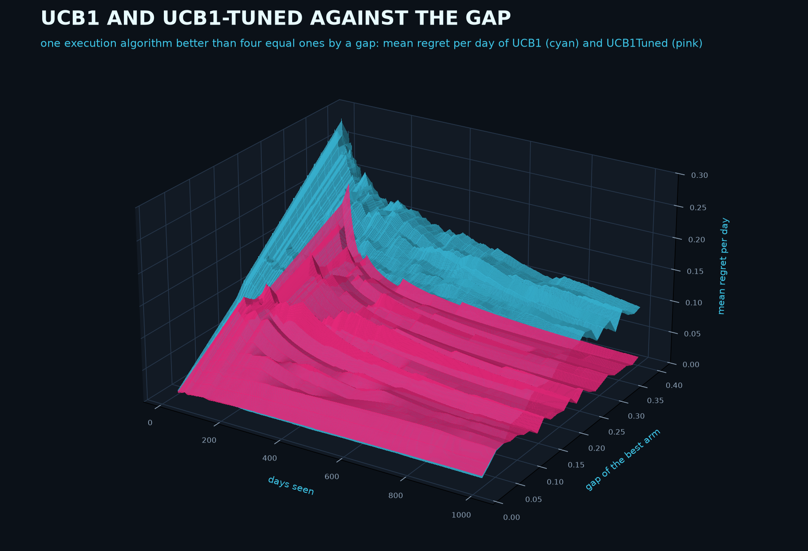
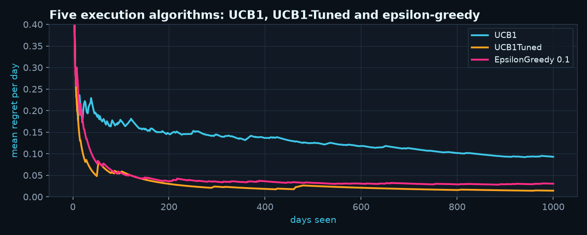

# UCB1 and UCB1-Tuned: an index that grows for the arms not tried enough

[← Bandits](index.md)

A desk has three execution algorithms. Instead of choosing at random to explore, it adds to the average of each one a bonus that is large for the algorithms tried few times, and plays the best sum. UCB1-Tuned shrinks the bonus for the algorithms whose rewards vary little. A robot choosing a gain does the same, in the last section.



## 1. A first example: five execution algorithms, one desk

Three execution algorithms fill an order well with probability 0.2, 0.5 and 0.8. UCB1 learns which one to use in 500 days; UCB1-Tuned does the same.

```python
import numpy as np
from dense_armor.core.online.bandit import UCB1

rng = np.random.default_rng(0)
rate = {"twap": 0.2, "vwap": 0.5, "pov": 0.8}
desk = UCB1(arms=["twap", "vwap", "pov"], seed=0)
for _ in range(500):
    arm = desk.pull()
    desk.update(arm, float(rng.binomial(1, rate[arm])))
print(desk.pull())
```

```
pov
```

The index of UCB1 is the mean of an arm plus `sqrt(2 ln n / n_j)`. Theorem 1 (page 3) bounds the regret.

```python
import numpy as np
from dense_armor.core.online.bandit import UCB1Tuned

rng = np.random.default_rng(0)
rate = {"twap": 0.2, "vwap": 0.5, "pov": 0.8}
desk = UCB1Tuned(arms=["twap", "vwap", "pov"], seed=0)
for _ in range(500):
    arm = desk.pull()
    desk.update(arm, float(rng.binomial(1, rate[arm])))
print(desk.pull())
```

```
pov
```

UCB1-Tuned reaches the same answer. Its bonus uses the variance of each arm; on this stream its regret falls faster in the picture.



On five execution algorithms with rates 0.2, 0.35, 0.5, 0.65 and 0.8, the mean regret per day of UCB1 reads 0.189, 0.146 and 0.093 after 50, 200 and 1000 days, UCB1-Tuned reads 0.048, 0.03 and 0.014, and epsilon-greedy with epsilon 0.1 reads 0.078, 0.036 and 0.03.

The picture follows the same 1000 days for 25 gaps between the best algorithm and four equal ones, from 0.02 to 0.4. Each point of the surface is the mean regret per day so far: cyan for UCB1, pink for UCB1-Tuned. With a gap of 0.4 UCB1 reads 0.208, 0.158 and 0.094 after 50, 200 and 1000 days and UCB1-Tuned reads 0.072, 0.032 and 0.014; with a gap of 0.02 they read 0.015, 0.016 and 0.015 and 0.013, 0.015 and 0.018, about the same: when the arms are almost equal there is little to lose.

| class or function | what it does |
|---|---|
| `UCB1`, `UCB1Tuned` | the arm with the highest mean plus an exploration bonus |

## 2. What it does

Each arm is played once; after that the policy plays the arm with the highest index `mean_j + sqrt(2 * ln(n) / n_j)`, where `n` is the total number of plays and `n_j` is the number of times arm `j` was played. When the rewards are in `[0, 1]` and `mu*` is the best expected reward, Theorem 1 of the paper bounds the expected regret after `n` plays by `8 * sum_{i: mu_i < mu*} ln(n) / Delta_i + (1 + pi^2 / 3) * sum_j Delta_j`, with `Delta_i = mu* - mu_i`.

`UCB1Tuned` is the same policy, but the exploration bonus is `sqrt((ln(n) / n_j) * min(1/4, V_j(n_j)))` with `V_j(s) = (1/s) * sum_{tau=1}^s X_{j,tau}^2 - mean_j(s)^2 + sqrt(2 ln(n) / s)`, the upper confidence bound on the variance of arm `j`. The paper reports better empirical performance than UCB1 but no proven bound.

**Source:** Auer, P., Cesa-Bianchi, N., Fischer, P. (2002). Finite-time analysis of the multiarmed bandit problem. Machine Learning 47(2-3), 235-256. For `UCB1`: Figure 1 and Theorem 1, page 3; the index `sqrt(2 ln(n) / n_j)` is stated explicitly on page 11. For `UCB1Tuned`: Section 4, "Experiments", page 11: the definition of `V_j(s)` and the substitution of `sqrt(2 ln(n) / n_j)` with `sqrt((ln n / n_j) * min{1/4, V_j(n_j)})`.

## 3. The parameters

| Parameter | Meaning | Default |
|---|---|---|
| `arms` | the sequence of arms, any hashables | none |
| `seed` | seed of the random generator | 0 |

`UCB1` and `UCB1Tuned` take the same two parameters. The methods that every policy shares (`pull`, `update`, `n_seen_`, `state_dict`, `clone`...) are on the [shared methods page](policy.md).

## 4. The same policy on a controller gain

A controller has three candidate gains and a good run is a reward of 1. The gain 8.0 works with probability 0.8. The same page also runs UCB1-Tuned on the same tries.

```python
import numpy as np
from dense_armor.core.online.bandit import UCB1

rng = np.random.default_rng(0)
rate = {0.5: 0.2, 8.0: 0.8, 30.0: 0.5}
tuner = UCB1(arms=[0.5, 8.0, 30.0], seed=0)
for _ in range(500):
    kp = tuner.pull()
    tuner.update(kp, float(rng.binomial(1, rate[kp])))
print(tuner.pull())
```

```
8.0
```

After 500 tries UCB1 picks the gain 8.0. The Tuned version is built the same way: `UCB1Tuned(arms=[0.5, 8.0, 30.0], seed=0)`.

## API reference

::: dense_armor.core.online.bandit.ucb.UCB1

::: dense_armor.core.online.bandit.ucb.UCB1Tuned

---

## Details

### Choices

- **The figures** are drawn with the library by `docs/assets/bandit/make_bandit_style_figures.py`. Five execution algorithms with success rates 0.2, 0.35, 0.5, 0.65 and 0.8 (or the stated gap), 1000 days, the regret of a day is the rate of the best algorithm minus the rate of the one that was pulled, and the surface is the mean over the days so far.
