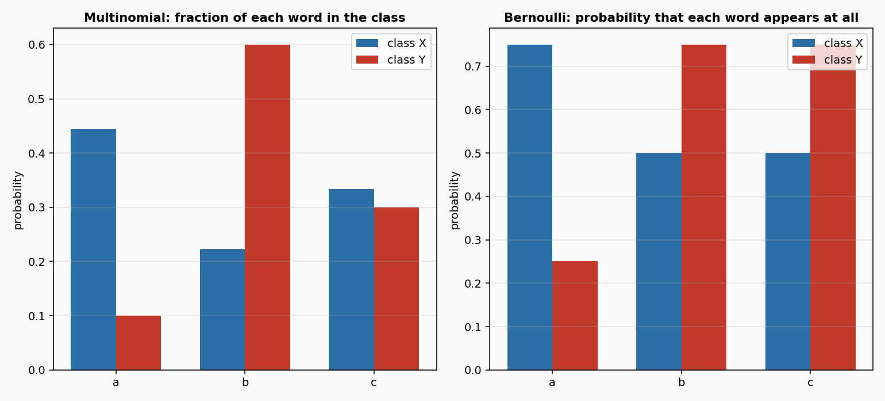
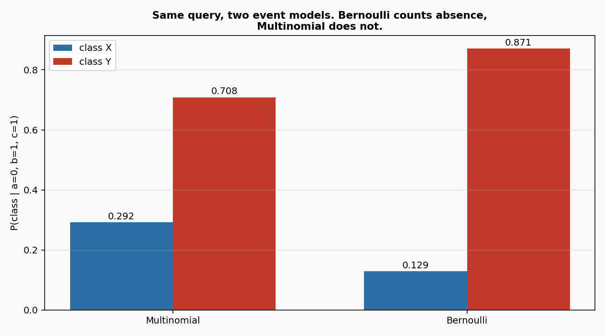

# Naive Bayes

**In plain words:** Four cheap classifiers that learn from counts. You show them a sample and its label, and they remember how often each feature goes with each class. When a new sample arrives, they add up those counts and answer with the most likely class. They never forget, they never grow with the stream, and they answer in microseconds.

## 1. What they are

Imagine you want to classify a document, or a stream of events, or the contact state of a robot foot. You cannot see the underlying cause; you only see a handful of signals, and you want to guess the class each time a new signal arrives. Naive Bayes answers with the simplest rule that works: assume the signals are independent once you know the class, count how often each one appears in each class, and pick the class whose counts explain the sample best.

This is a naive assumption, and it is often false. Two words in a sentence are not independent; two joints of the same arm are not independent. Yet the classifier still works, because classification only needs the *sign* of the decision, not a precise probability estimate. McCallum and Nigam (1998) made the assumption concrete for text, and the four variants here follow their event models.

## 2. The four variants

They differ in what a sample is and how a feature contributes.

- **MultinomialNB**: a sample is a bag of counts. Each feature has a count, and the class-conditional probability of a feature is the fraction of its occurrences that fall in that class, Laplace-smoothed (McCallum and Nigam 1998, eq. 5). Good for word counts, event counts, anything where the number matters.
- **BernoulliNB**: a sample is a set of presence flags. Each feature contributes either its probability of appearing (if present) or the complementary `1 - p` (if absent). McCallum and Nigam 1998, eq. 2. Good when you only care whether something is there.
- **ComplementNB**: the class-conditional probabilities are estimated from the *other* classes, not the one being scored. Rennie, Shih, Teevan and Karger (2003), eq. 6. Designed to correct the bias of MultinomialNB on imbalanced streams.
- **CategoricalNB**: a sample is a set of categorical values, not counts. Each feature has its own vocabulary of categories, and the class-conditional probability of a category is its count divided by the class's total. Good for labels like "color: red".

## 3. How the update works

Every sample is a dict. `learn_one(x, y)` adds one observation to the class `y`:

    MultinomialNB    counts[y][f] += x[f]
                     class_total[y] += sum(x.values())

    BernoulliNB      present[y][f] += (1 if x[f] > 0 else 0)
                     class_n[y] += 1

    ComplementNB     counts[y][f] += x[f]        (the other classes see it)
                     total[y] += sum(x.values())

    CategoricalNB    counts[y][f][x[f]] += 1
                     class_n[y] += 1

At prediction time, the class scores are sums of log-probabilities, and the answer is the argmax. All four use Laplace smoothing: every count starts with a small positive value, so a feature never seen before does not make a class impossible. The smoothing parameter is `alpha`, default 1.0 (the Laplace prior).

For MultinomialNB, the class-conditional probability of feature `f` is McCallum and Nigam, eq. 5:

    theta(f | c) = (1 + sum_i N_if P(c | x_i)) / (|V| + sum_f sum_i N_if P(c | x_i))

In words: the count of feature `f` in class `c`, plus one, divided by the total count of every feature in class `c`, plus the size of the vocabulary. For BernoulliNB, the same idea but on presence flags (eq. 3): `(1 + present) / (2 + n)`, where the 2 is the size of the boolean vocabulary.

## 4. Smallest example

Four documents, two features each. The first two are class `X`, the last two class `Y`:

```python
from dense_armor.utility.bayes import MultinomialNB

docs = [
    ({"a": 2, "b": 1, "c": 0}, "X"),
    ({"a": 1, "b": 0, "c": 2}, "X"),
    ({"a": 0, "b": 2, "c": 1}, "Y"),
    ({"a": 0, "b": 3, "c": 1}, "Y"),
]

nb = MultinomialNB(alpha=1.0)
for x, y in docs:
    nb.learn_one(x, y)

print(nb.predict_one({"a": 5, "b": 0, "c": 0}))
print(nb.predict_one({"a": 0, "b": 5, "c": 0}))
```

```
X
Y
```

After training, the counts inside the classifier are exact. For class `X`: feature `a` appears 3 times, `b` once, `c` twice, total 6. For class `Y`: `a` never, `b` 5 times, `c` twice, total 7. A new sample with five `a`s and no `b` or `c` therefore matches `X` far better than `Y`, with a posterior probability of 0.999. A sample with five `b`s and nothing else does the reverse, 0.993 for `Y`.

## 5. The two event models, seen



The same four documents, read by the multinomial model (left) and the Bernoulli model (right). The multinomial bars are the fraction of each feature within a class: `b` is rare in `X` and common in `Y`, which is what makes the classifier useful. The Bernoulli bars are the probability that each feature *appears at all* in a document of that class; the difference between the two is smaller, because the Bernoulli model throws away the counts.



Same query, two models. The query has `a = 0`, `b = 1`, `c = 1`. The multinomial model only looks at the present features, so it ignores `a`. The Bernoulli model additionally counts the absence of `a`, which is unusual for `X` and common for `Y`; that pushes the answer slightly further toward `Y`. This is the sense in which the Bernoulli model "counts absent words" and the multinomial model does not (McCallum and Nigam 1998, section 2).

## 6. Numbers

On `DriftStream` sudden drift, 2000 samples, 4 continuous features, median of 5 seeds, p99 of one `learn_one` + `predict_one` over 3000 samples on one CPU thread:

| classifier | accuracy | accuracy IQR | p99 | state |
|---|---|---|---|---|
| MultinomialNB | 0.088 | 0.157 | 0.036 ms | 421 B |
| BernoulliNB | 0.088 | 0.150 | 0.041 ms | 380 B |
| ComplementNB | 0.088 | 0.154 | 0.047 ms | 408 B |
| CategoricalNB | 0.943 | 0.000 | 21.5 ms | 244 311 B |
| OnlineGaussianNB (existing) | 0.970 | 0.042 | 32.0 us | -- |

The three count-based classifiers are at chance on this stream, and that is expected: `DriftStream` produces continuous features, and the count-based models assume each feature is a count of something. Their domain is text, events, contact flags, not real-valued signals. `CategoricalNB` handles the stream better because it treats each distinct value as a category, but then every continuous sample creates a new category, the map grows, and the p99 cost rises above 20 ms. On this stream the right tool is `OnlineGaussianNB`, not the naive Bayes family; the family here is a text and event classifier.

## Details

### References

- McCallum, A., Nigam, K. (1998). A comparison of event models for naive Bayes text classification. AAAI Workshop on Learning for Text Categorization. Eq. 2 (Bernoulli), eq. 3 (Bernoulli parameter estimate), eq. 5 (multinomial).
- Rennie, J. D. M., Shih, L., Teevan, J., Karger, D. R. (2003). Tackling the poor assumptions of naive Bayes text classifiers. ICML. Eq. 6 (complement parameter estimate) and the normalisation step.

### Choices stated explicitly

- **Complement sign.** Rennie et al. write the classification weight as `w_ci = log(theta_{~c i})` and select the class with the smallest score (`argmin`). This implementation uses the equivalent sign-flipped form `w_ci = -log(theta_{~c i})` with the standard `argmax`, so that `predict_one` and `predict_proba_one` behave like every other classifier in the library. The change is stated in the module docstring.
- **Normalisation.** `ComplementNB(norm=True)` divides the weight vector of each class by the sum of its absolute values, which is the normalisation described after eq. 6 in the paper. Set `norm=False` to keep the raw log probabilities.
- **Laplace default.** `alpha=1.0`, the Laplace prior. The same parameter appears in MultinomialNB, BernoulliNB, ComplementNB, and CategoricalNB. `alpha=0` is rejected: without smoothing a single unseen feature would make a class impossible.
- **Class prior.** By default the class prior is the observed frequency. `class_prior` can be passed as a dict to override it.
- **Feature keys.** `feature_keys=None` takes the sorted keys of the first sample seen.
- **Non-negative counts.** MultinomialNB, BernoulliNB, and ComplementNB treat a negative value as a missing sample and count it in `n_missing`. CategoricalNB treats a `None` or a non-finite float as missing; any other value (a string, a boolean) is a valid category.

### Measured cost

p99 of one `learn_one` plus one `predict_one` over 3000 samples, 4 features, one CPU thread: 0.036 ms (MultinomialNB), 0.041 ms (BernoulliNB), 0.047 ms (ComplementNB), 21.5 ms (CategoricalNB). `budget_s` is 0.001 s for the first three, 0.1 s for CategoricalNB. State size after 3000 samples: 421 B, 380 B, 408 B, 244 311 B. The three count-based classifiers are `O(c d)` in the state (one counter per class and feature). CategoricalNB is `O(c d v)` where `v` is the number of distinct values seen, which on continuous inputs grows with the number of samples; the declared `memory_class` is `"O(c d v)"`, honest about the growth.

### No pure form

The four classes do not provide an `init_state` / `step` pair. The state is a dict of counters per class, and its shape changes when a new class or a new feature appears; it is not a fixed-size array and would not survive `jax.lax.scan`. The two checks `check_step_is_pure` and `check_step_is_jittable` are skipped explicitly, with the reason stated in `_unit_test_skips`.

### Development diary

The three count-based classifiers are at chance on `DriftStream` because that stream has continuous features. This is not a bug: it is the boundary of the family. When the count-based model is the right tool (text, events, contact states), it is also the fastest: 0.036 ms per sample against 32 us for `OnlineGaussianNB`. The benchmark uses the same stream for every classifier, so the numbers are comparable even when the domain is wrong; the wrong-domain result is stated in the table rather than hidden by a different stream.
