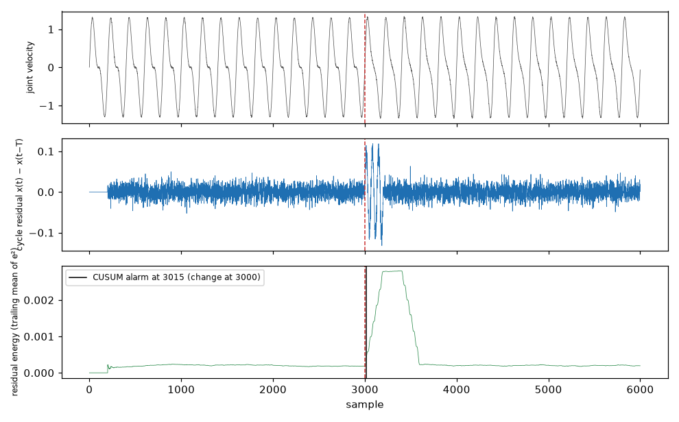

# Benchmark on a real industrial robot arm (CASPER dataset)

We ran the library, unchanged, on a 24.5-hour recording of a real industrial robot arm. This page shows what it noticed: a labelled anomaly was detected 15 seconds after it began, with no false alarm in the hour before it (hour 14); on the 15 normal hours before the change the same configuration fires a median of 5,696 false alarms per hour and only 2 hours have none (section 5).

The Dense-Armor streaming stack was run unchanged on the CASPER dataset
(Kayan et al., 2023), a 24.5 h recording at 20 Hz of a Universal Robots
UR3e industrial arm. A one-sided CUSUM on the smoothed energy of the cycle
residual detects the labelled anomaly with 15.00 s latency and no false
alarms in the normal hour before it; the point-anomaly estimators do not
separate the two regimes.

The recording comes from a Universal Robots UR3e arm that repeats one cycle: it picks a ball, drops
it on an inclined platform and lets it roll (Kayan et al. 2023, Figures 1–2). Because the motion
repeats, a cycle residual works well on this data.

## 1. Data

`right_arm.csv` — 1,762,650 rows, 24.481 h at 20 Hz, 19.6 % of rows
labelled anomalous. Columns are string-encoded 6-element lists for the
joint positions / velocities / currents. First `Anomaly State = 1` at
`ts = 311258.376` (hour 15.000 from the file start).

`nicla_fixed.csv` — 1,751,682 rows, 113 MB, columns `AccX/Y/Z`,
`GyroX/Y/Z`, `MagX/Y/Z`. The file has no timestamp column and its row
count differs from the arm file; there is no key to align the two streams.

*Illustration on a simulated repetitive motion (period 200 samples): the raw velocity hides a small
change of the cycle shape at sample 3000; the cycle residual $x(t) - x(t - T)$ is almost zero until
then and grows after; a one-sided CUSUM on its energy raises the alarm 15 samples after the
change. Figure generated with the library.*

## 2. Cycle period

The arm repeats one pick-and-place cycle. On the first hour of normal
data, the autocorrelation of each joint velocity has one dominant peak at
the same lag across all six joints:

| joint | period (samples) | period (s) | autocorrelation | variance |
|---|---|---|---|---|
| 0 | 760 | 38.00 | 0.9894 | 0.13556 |
| 1 | 760 | 38.00 | 0.9893 | 0.02077 |
| 2 | 760 | 38.00 | 0.9892 | 0.02484 |
| 3 | 760 | 38.00 | 0.9894 | 0.09577 |
| 4 | 760 | 38.00 | 0.9866 | 0.00027 |
| 5 | 760 | 38.00 | 0.9893 | 0.01215 |

## 3. Cycle residual

Two residuals were built from `T = 760` and the first hour of normal
data:

- shift: `e(t) = x(t) − x(t − T)`
- template: `e(t) = x(t) − m[(t + phase0) mod T]`, `m` the median template
  of one cycle built from the first hour.

Phase jitter of the cycle, measured by matching each cycle to the
template over `[−40, +40]` samples (92 cycles): mean 0.26, std 2.90,
min −4, max +5, 9.8 % of cycles at offset 0. The shift residual carries
no phase error; the template residual carries a few-sample error.

## 4. RMS on three windows

Residual computed from a slice that loads `T` extra samples before the
window, so the first residual sample is real.

| window | rows | raw | shift | template |
|---|---|---|---|---|
| normal [8 h, 9 h] | 72,001 | 0.3682 | 0.0040 | 0.5591 |
| pre-change [14 h, 15 h] | 72,001 | 0.3682 | 0.0038 | 0.5821 |
| post-change [15 h, 16 h] | 72,001 | 0.3750 | 0.1214 | 0.5223 |

Raw velocity is flat across the three windows. The shift residual
removes ~99 % of the RMS on normal data and grows by **32x** from
pre-change to post-change (0.0038 → 0.1214). The template residual stays
around 0.55 in all windows; the phase error dominates the amplitude of
the underlying change.

## 5. CUSUM on the residual energy

Change window `[14 h, 16 h]`, 144,001 rows, first `Anomaly State = 1`
at row 72,005 (hour 15.000). One-sided CUSUM (`two_sided=False`),
`radius = T/10 = 76`, reference span one cycle (`ref_mult = 10`,
span 760 samples). Baseline with `k = 0.5`, `h = 20`:

| signal | reference | delay | delay (s) | FA/h pre-change |
|---|---|---|---|---|
| raw | fixed / adaptive | never | — | 0.0 / 9.0 |
| shift residual | fixed / adaptive | never | — | 0.0 / 30.0 |
| template residual | fixed / adaptive | never / 113 | — / 5.65 | 0.0 / 15220.9 |
| shift² | fixed / adaptive | never | — | 0.0 / 65.0 |
| \|shift\| | fixed / adaptive | never | — | 0.0 / 34.0 |
| trailing mean(e², T) | fixed / adaptive | 292 / 199 | 14.60 / 9.95 | 163.0 / 3671.7 |
| trailing mean(e², 2T) | fixed / adaptive | **297 / 0** | **14.85 / 0.00** | **23.0 / 2821.8** |

The un-smoothed energy (`shift²`, `|shift|`) carries too much per-sample
noise to accumulate evidence. The smoothed energy over one or two cycles
does. The fixed reference has a low false-alarm rate (23/h for the 2T
smoothing); the adaptive reference triggers more often on the pre-change
window because the residual energy is close to constant there and its
robust scale is small.

Sweep on `trailing mean(e², 2T)`, `h ∈ {20, 50, 100, 200, 400, 1000}`,
`k ∈ {0.5, 2.0, 5.0}`, fixed and adaptive. Fixed reference:

| h | k | delay | delay (s) | FA/h |
|---|---|---|---|---|
| 20 | 0.5 | 297 | 14.85 | 23.0 |
| 50 | 0.5 | 302 | 15.10 | 8.0 |
| 100 | 0.5 | 308 | 15.40 | 4.0 |
| 200 | 0.5 | 316 | 15.80 | 2.0 |
| 400 | 0.5 | 327 | 16.35 | 0.0 |
| 1000 | 0.5 | 355 | 17.75 | 0.0 |
| **20** | **2.0** | **300** | **15.00** | **0.0** |
| 100 | 2.0 | 311 | 15.55 | 0.0 |
| 1000 | 2.0 | 358 | 17.90 | 0.0 |
| 20 | 5.0 | 306 | 15.30 | 0.0 |
| 100 | 5.0 | 316 | 15.80 | 0.0 |
| 1000 | 5.0 | 365 | 18.25 | 0.0 |

Adaptive reference at every `(h, k)` tested: `FA/h` between 1276.9 and
2821.8, no zero-false-alarm configuration. The pre-change residual energy
is close to constant, so the adaptive window's robust scale is small and
any fluctuation is many sigmas above it.

The sweep has a zero-false-alarm configuration: **fixed reference,
`k = 2.0`, `h = 20`, span one cycle, delay 300 samples (15.00 s), 0
false alarms on the 1 h pre-change window**. Higher `h` and `k` only
delay the detection (400 → 16.35 s, 1000 → 17.90 s) and do not reduce the
false alarms further.

### The same configuration on every normal hour

`benchmarks/casper_hours.py` runs the configuration above (smoothed energy over `2T`, fixed reference of one cycle, `k = 2.0`, `h = 20`) on each of the 15 hours before the labelled change, one detector per hour, with the functions of `casper_benchmark.py` unchanged. No hour holds an anomalous label. Hour 14 is the pre-change hour of the table above and gives 0, which checks the script.

| hour | rows | alarms | false alarms per hour |
|---|---|---|---|
| 0 | 71,240 | 2,810 | 2,840.0 |
| 1 | 72,001 | 44,656 | 44,655.4 |
| 2 | 72,001 | 70,876 | 70,875.0 |
| 3 | 72,001 | 0 | 0.0 |
| 4 | 72,001 | 944 | 944.0 |
| 5 | 72,001 | 71,241 | 71,240.0 |
| 6 | 72,001 | 184 | 184.0 |
| 7 | 72,001 | 33,189 | 33,188.5 |
| 8 | 72,001 | 35,486 | 35,485.5 |
| 9 | 72,001 | 71,241 | 71,240.0 |
| 10 | 72,001 | 293 | 293.0 |
| 11 | 72,001 | 3,431 | 3,431.0 |
| 12 | 72,001 | 70,158 | 70,157.0 |
| 13 | 72,001 | 5,696 | 5,695.9 |
| 14 | 72,001 | 0 | 0.0 |

Median 5,696 false alarms per hour, maximum 71,240, and 2 of 15 hours with none (hours 3 and 14). The zero in the hour before the labelled change is a property of that hour and not of the configuration. Command: `python benchmarks/casper_hours.py --hours 0-14`; the numbers are in `benchmarks/casper_hours.json`.

## 6. Point estimators

The five scorers on the shift residual, on its energy `e²`, and on the
smoothed energy `trailing mean(e², 2T)`. Window `[14.5 h, 16 h]`,
108,001 rows, 40.0 % positives. Scorer causal window `2 * radius = 380`.
The trivial "predict all anomalous" classifier has F1 = 0.571 at both
point and window level; values above 0.571 are real detection.

**shift residual:**

| estimator | F1 pt | P pt | R pt | F1 best | F1 win |
|---|---|---|---|---|---|
| deviation | 0.039 | 0.718 | 0.020 | 0.456 | 0.000 |
| hampel | 0.366 | 0.414 | 0.328 | 0.446 | 0.044 |
| tukey | 0.374 | 0.409 | 0.345 | 0.374 | 0.405 |
| chauvenet | 0.115 | 0.454 | 0.066 | 0.570 | 0.000 |
| sigmaclip | 0.228 | 0.358 | 0.168 | 0.429 | 0.000 |

**shift energy `e²`:**

| estimator | F1 pt | P pt | R pt | F1 best | F1 win |
|---|---|---|---|---|---|
| deviation | 0.010 | 1.000 | 0.005 | 0.560 | 0.000 |
| hampel | 0.362 | 0.424 | 0.316 | 0.365 | 0.000 |
| tukey | 0.319 | 0.416 | 0.259 | 0.319 | 0.000 |
| chauvenet | 0.109 | 0.524 | 0.061 | 0.585 | 0.000 |
| sigmaclip | 0.217 | 0.368 | 0.154 | 0.578 | 0.000 |

**trailing mean(e², 2T):**

| estimator | F1 pt | P pt | R pt | F1 best | F1 win |
|---|---|---|---|---|---|
| deviation | 0.092 | 0.266 | 0.056 | 0.588 | 0.000 |
| hampel | 0.351 | 0.386 | 0.321 | 0.451 | 0.149 |
| tukey | 0.343 | 0.385 | 0.309 | 0.343 | 0.146 |
| chauvenet | 0.155 | 0.324 | 0.102 | 0.552 | 0.000 |
| sigmaclip | 0.279 | 0.440 | 0.204 | 0.408 | 0.011 |

No estimator reaches the trivial baseline of 0.571. The point-anomaly
estimators see individual samples within the amplitude of their own
causal window; the anomaly is a change in the temporal structure of a
repeated cycle, not a set of extreme samples.

Per-sample time on this data: 802 µs (shift residual), 804 µs (shift
energy), 730 µs (smoothed energy), dominated by the scorer window of
size 380 and one `numpy` median/MAD/percentile per call.

## 7. IMU

`OnlineRobustMahalanobis` on accelerometer + gyroscope, 6 channels,
1,751,682 rows, `threshold = 7.0`:

| metric | value |
|---|---|
| per-sample time | 92.8 µs |
| median score | 3.221 |
| p99 score | 373.029 |
| max score | 672.550 |

The file has no timestamp column and no key to the arm's `Anomaly
State`, so no delay or F1 is reported for the IMU: the score
distribution only. The 99th percentile is two orders of magnitude above
the median, so no single threshold in that range would both catch the
anomaly and keep the false-alarm rate low.

The two files can be compared by length. The IMU file has 1,751,682 rows and the arm file 1,762,650: 10,968 rows more, 9.1 minutes at 20 Hz. `benchmarks/casper_imu_alignment.py` cross-correlates the arm speed with the gyroscope norm over lags of plus or minus 16,000 rows on the first 150,000 rows. The strongest correlation is 0.087, at lags 59, 817 and 1,576, one cycle of 760 rows apart; it is 0.023 for the accelerometer norm, and 0.100 and 0.062 for the absolute changes of the gyroscope and accelerometer norms. The motion is periodic, so peaks one cycle apart cannot fix the offset, and none reaches 0.11: the IMU cannot be tied to the arm labels, and no IMU delay is reported. The numbers are in `benchmarks/casper_imu_alignment.json`.

### Lidar, simulated

The dataset has no lidar recording: its files are the two arms, the Nicla sensor and a network capture. The table below is therefore a **simulation**: its numbers describe a simulated sensor and say nothing about a real robot. `benchmarks/lidar_sim.py` simulates 180 beams at 10 Hz in a 6 m by 4 m room with two pillars and a robot arm that sweeps one beam sector every 38 s (the CASPER cycle), with range noise of 1 cm and 0.2% beam dropouts. Four faults start 30 minutes into a 60 minute stream: an obstacle enters the room, the range drifts by 1 cm per minute, a sector of 20 beams is covered by dirt, and 30% of the beams drop out in bursts of 10 s. Two detectors of the library run with fixed settings that were not tuned on this data: the robust Mahalanobis distance of a random projection of the scan to 8 numbers (alarm after 5 scans in a row above 7.0), and ADWIN on the change of the mean range against one cycle earlier.

| detector | false alarms without faults | obstacle | drift 1 cm/min | dirt on 20 beams | 30% dropouts |
|---|---|---|---|---|---|
| Mahalanobis, projection to 8 | 126 in 3.83 h | 5 of 5, 43.1 s | 5 of 5, 191.2 s | 5 of 5, 0.3 s | 5 of 5, 0.3 s |
| ADWIN on the mean range | 0 in 3.83 h | 0 of 5 | 0 of 5 | 5 of 5, 0.9 s | 5 of 5, 0.6 s |

Each cell is the number of seeds that detected the fault and the median delay after its start. Before the faults start, Mahalanobis gives 13 false alarms in 1.67 h of the fault streams and ADWIN none. One scan, with the generator and both detectors, takes 343 µs. The Mahalanobis detector sees every fault but fires about 33 times an hour on a clean stream; ADWIN did not fire in 3.83 h of clean stream but does not see a slow drift or an obstacle that changes few beams. The numbers are in `benchmarks/lidar_sim.json`; the command is `python benchmarks/lidar_sim.py --seeds 5`.

## 8. Comparison with CASPER

CASPER (Kayan et al., 2023) trains a 1D-CNN on labelled normal IMU data
with min-max normalization from the train set only, chooses its input
window length by autocorrelation, and selects the anomaly
threshold by grid search on the F1 of a labelled validation set. Its
97 % accuracy and F1 is a supervised, windowed, threshold-tuned
classification result on a dataset that is 50 % anomalous in validation
and test.

The Dense-Armor stack is causal and label-free. On the same dataset it
detects the labelled change with 15.00 s latency and no false alarms in the
1 h before it, using a one-sided CUSUM on the smoothed energy of the
cycle residual with a fixed reference (span one cycle) and
`k = 2.0, h = 20`. The point estimators (Hampel, Tukey, Chauvenet,
sigma clipping, robust deviation) do not separate the two regimes: on
the sample-scored task their F1 stays below the trivial "predict all
anomalous" baseline of 0.571.

## Provenance

The CASPER dataset (Kayan et al. 2023) is not committed to this repository.
The script `benchmarks/casper_benchmark.py` expects it under a local Kaggle
path (`industrial-robotic-arm-anomaly-detection`), so the numbers above come
from the run where the dataset was present and cannot be regenerated in a
fresh environment.

## References

- Kayan, H., Rana, O., Burnap, P., Perera, C. (2023). CASPER:
  Context-Aware Anomaly Detection System for Industrial Robotic Arms.
  In IEEE PerCom Workshops.
- Basseville, M., Nikiforov, I. V. (1993). Detection of Abrupt Changes:
  Theory and Application. Prentice Hall. (CUSUM on the squared residual
  as a variance-change detector.)

---

## Details

Every number on this page is printed by `benchmarks/casper_benchmark.py`
(run on a Kaggle CPU notebook with the dataset attached).
