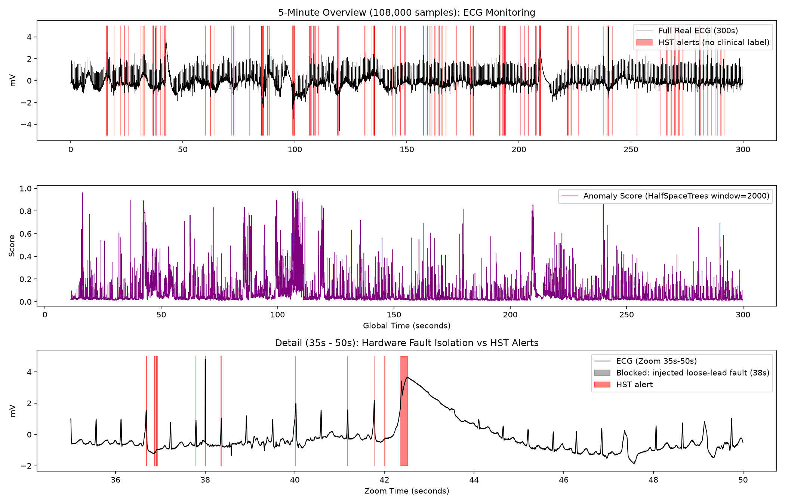

# ECG lead guard

A wearable ECG records 360 numbers per second. When an electrode comes loose, the signal jumps for a few samples and then comes back. This page shows how to block those jumps before they reach the model, and how to score every other sample with an unsupervised detector.

**This is a technical demonstration. It is not a medical device, and the alerts have no clinical label.**

## The scene

The data is the five minutes of MIT-BIH ECG that `scipy.datasets.electrocardiogram` ships: 108 000 samples at 360 Hz, in millivolts. Three loose-lead faults are written into it, at 38, 120 and 240 seconds: four samples each, at +4.8, -4.6 and +4.9 mV. The rest of the signal is untouched.

Three tools of Dense-Armor watch the stream, one after the other:

| Tool | Its one job | In this page |
|---|---|---|
| A step shield | Blocks a sudden jump from the last clean sample | The three injected faults |
| `CycleResidual` + `SDFT` | Describe each sample: the distance from the heartbeat template and two frequency bands | Three features per sample |
| `HalfSpaceTrees` | Scores how unusual a sample is | One score per sample, higher is more unusual |



*Top: the whole ECG with the HST alerts in red. Middle: the anomaly score. Bottom: a zoom on 35-50 s, with the blocked fault at 38 s in gray.*

## 1. The stream

```python
from scipy.datasets import electrocardiogram

ecg = electrocardiogram()
print(len(ecg), round(float(ecg.min()), 2), round(float(ecg.max()), 2))
```

```
108000 -3.48 3.65
```

The real signal stays between -3.48 and 3.65 mV. The injected faults are written over it with `ecg[idx:idx + 4] = value`.

## 2. Block the jump

A loose lead is a jump: the signal goes from the baseline to a large value in one sample. A real heartbeat is not. Measured on this ECG, the largest change from one sample to the next is 0.64 mV.

```python
import numpy as np

d = np.abs(np.diff(ecg))
print(round(float(d.max()), 2))
```

```
0.64
```

The injected faults enter with jumps of 5.27, 3.64 and 6.05 mV. The shield flags a sample when it differs from the last clean sample by more than 2.0 mV, and replaces it with that clean sample. If more than 10 samples in a row are flagged, the shield accepts them: a lasting step is a change of level, not a loose lead.

## 3. Describe the sample

The cleaned sample goes to two readers.

`CycleResidual` finds the period of the heartbeat from the autocorrelation of the first 1000 samples, keeps the last four cycles, and returns the difference between the sample and the median of those cycles at the same phase.

```python
from dense_armor.core.online.timeseries.cycle import CycleResidual

cr = CycleResidual(max_period=500, search=40)
for v in ecg[:1005]:
    cr.transform_one({"ecg": float(v)})
print(cr.period)
```

```
196
```

`SDFT(90)` is a sliding Fourier transform of the last 90 samples. At 360 Hz each bin is 4 Hz wide: the feature `baseline` is the mean of bins 0 and 1 (0 and 4 Hz), and `qrs` is the mean of bins 3 to 8 (12 to 32 Hz). The third feature, `cycle_jump`, is the absolute residual of the cycle reader.

## 4. Score the sample

`HalfSpaceTrees` (Tan, Ting and Liu, IJCAI 2011) receives the three features. It scores a sample first and learns it afterwards, as in Algorithm 3 of the paper. A sample blocked by the shield is scored but not learned.

```python
from dense_armor.core.online.anomaly.hst import HalfSpaceTrees

hst = HalfSpaceTrees(n_trees=25, depth=8, window=2000, range_init=1000,
                     threshold_quantile=0.992, threshold_window=4000,
                     threshold_warmup=1500, seed=42)
```

The first 1000 samples find the period, the next 1000 fix the feature ranges, the next 2000 fill the reference window, and 1500 more scores set the threshold: alerts are active from sample 5500, 15.3 s into the stream.

## 5. Run it

The script is `pipelines/biomedical/ecg_lead_guard.py`. It downloads the ECG on the first run (it needs `pooch` and a connection), runs the stream, and saves the figure of this page in the current folder.

```bash
pip install "dense-armor[biomedical]"
python pipelines/biomedical/ecg_lead_guard.py
```

```
Processed 108000 real samples in 131.51 s (1217.7 us/sample)
Estimated period: 196 samples
Loose-lead faults blocked:   12 samples
HST alerts (no clinical label): 1157 samples (1.07%)
Alerts active from sample 5500 (15.3 s); HST n_missing: 0
Alert episodes: 180; starting between 35 s and 50 s: [36.68 36.69 36.87 36.91 37.79 38.36 40.02 41.18 41.77 42.01 42.36]
```

## 6. What the numbers mean

| Quantity | Value | How to read it |
|---|---|---|
| Faults blocked | 12 of 12 | The three injected faults, at 38, 120 and 240 s |
| Estimated period | 196 samples | About 0.54 s per heartbeat |
| Alerts | 1157 samples, 180 episodes | 1.07% of the stream |
| Time | 1.2 ms per sample | On one run, Windows |

The shield does what the table says: all the injected faults are blocked and nothing else is. The alerts are a different matter. The threshold is the 0.992 quantile of the recent scores, so about 0.8% of the samples are above it whatever the signal. The 1.07% measured is of that order, and it says nothing about arrhythmias. In the zoom, one alert starts at 42.36 s, on the rising edge of the tall wave that follows (the signal reaches 3.65 mV there); most of the other alerts of the zoom fall on ordinary beats. The page does not say what the wave at 42.4 s is, because the dataset of scipy has no beat annotations, and there is no AUC for the same reason.

## Details

### References

- Tan, S. C., Ting, K. M., Liu, T. F. (2011). Fast anomaly detection for streaming data. IJCAI, 1511-1516. Algorithms 1 to 3 and the anomaly score `r * 2^k`.
- Jacobsen, E., Lyons, R. (2003). The sliding DFT. IEEE Signal Processing Magazine 20(2), 74-80.
- Moody, G. B., Mark, R. G. (2001). The impact of the MIT-BIH Arrhythmia Database. IEEE Engineering in Medicine and Biology Magazine 20(3), 45-50.

### Choices stated explicitly

- **The faults are injected.** Their number, position, length and value are a choice of this page.
- **The shield thresholds** (2.0 mV, 10 samples) were chosen from the measured maximum step of this ECG (0.64 mV) and the steps of the injected faults (3.64 mV and above), not tuned on a separate signal.
- **The period is estimated** from the first 1000 samples, with `max_period=500` and a phase search of 40 samples. The heartbeat is not perfectly regular: on this ECG about a quarter of the intervals between R peaks differ by more than 40 samples from the median, so the template is not aligned on every beat.
- **The HST ranges** come from the first 1000 samples with a margin of 10%. A later value outside the range falls in the outermost leaves.
- **The threshold is a quantile.** 0.992 on the last 4000 scores. There is no ground truth to tune it on.
- **A blocked sample is scored but not learned**, and its `cycle_jump` is set to 0.

### Measured cost

The 108 000 samples take 131.5 s on one Windows machine, 1.2 ms per sample, with the figure not included in the timing.

### Development diary

The first version had a fixed period of 270 samples and a shield on the residual above 3.8 mV. It blocked 63 samples instead of 12: it missed the fault at 120 s (its residual was 3.55 mV, because the spike fell in a valley of the template), and it blocked 44 consecutive samples around 42.5 s, the tall wave of the zoom, as if it were a hardware fault, so the detector never saw it. The period estimated from the data is 196 samples, not 270 (a rough peak detector gives a median R-R interval of 211 samples). Replacing the residual shield with a step shield blocks exactly the three faults and lets the tall wave through.
