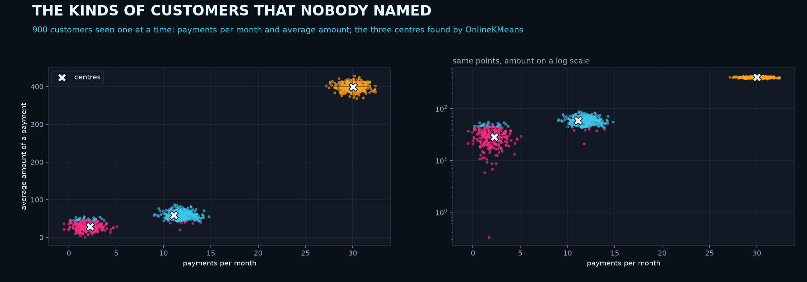

# Clustering: incremental partitioning and density-based data stream models

This page shows how a system can automatically group similar data points together in real time, one by one, without needing any pre-assigned categories. It covers standard tracking, groups that shift positions over time, filtering out noise, and translating image patches into visual signatures.

## The map of clustering

Click a page to open it, or the job on the left (or the button at the top) to go back to the [map of the library](../index.md#the-library-folder-by-folder).

<object type="image/svg+xml" data="../assets/maps/cluster.svg" style="width:100%"></object>

## Gamestory

London, deep night. On the young detective's table lies a giant map of the city. Every minute, reports of suspicious movements arrive, but nobody wrote down who the culprit is: they are just anonymous pins to stick on the map one at a time.

To find out where the gangs are hiding without knowing anything beforehand, the detective uses three tricks to make groups on the fly (Clustering):

- **1. The moving flags (OnlineKMeans):** The detective knows there are exact k gangs operating in the city (for example, 3). First he waits for a few initial reports (warmup) to place k flags as far apart from each other as possible. Then, every time a new pin arrives, he assigns it to the nearest flag and moves the flag a little bit toward it. And what if a gang changes neighborhood? With the halflife rule, old pins fade away and the flag follows the moving gang!
- **2. Circles on the map and false alarms (DenStream):** Sometimes a gang hides along a crooked alley, while pranksters drop random pins to throw him off track (outliers). So the detective draws tiny circles of radius eps: if many nearby pins land inside a circle, that group becomes a real hideout (macro_clusters); if instead a pin stays isolated, over time it fades away and disappears!
- **3. The dictionary of disguises (BagOfVisualWords):** When camera photos arrive, the detective cuts each photo into many tiny squares (patch_size) and groups the ones that look alike (vertical stripes, horizontal stripes, polka dots) into a small visual vocabulary (n_words). By counting how many squares of each kind appear (hist), he immediately recognizes the gang's uniform!

In the end, what is Clustering? It is the art of making groups automatically as data arrives one piece at a time, without anyone telling you the labels beforehand: it puts together things that look alike, follows groups that move, and throws away isolated clues!

## A first example: kinds of customers

A bank looks at its customers through two numbers: how many payments they make in a month and the average amount of a payment. Nobody tells it the kinds of customers. It sees 900 customers, one at a time, and asks `OnlineKMeans` for 3 groups; the customers are drawn around three kinds, with `(2, 30)`, `(12, 60)` and `(30, 400)` payments and euros.

```python
import numpy as np
from dense_armor.core.online.cluster.kmeans import OnlineKMeans

rng = np.random.default_rng(0)
kinds = np.array([[2.0, 30.0], [12.0, 60.0], [30.0, 400.0]])
km = OnlineKMeans(k=3)
for _ in range(900):
    customer = kinds[rng.integers(0, 3)] + rng.normal(0, [1.0, 10.0])
    km.learn_one({"x": customer.tolist()})
print(sorted([round(float(v), 1) for v in c] for c in km.centers_))
```

```
[[2.3, 28.4], [11.1, 59.1], [30.0, 399.4]]
```

Each centre is the mean of the customers that joined its group, so the three printed centres are the three kinds that the bank did not know, close to the ones the customers were drawn from. The groups are in the order they were found.



The picture shows the same 900 customers, coloured by the group they joined, with the three centres on top. On the right the amount is on a log scale, so that the two small kinds are as easy to see as the large one.

## The pages of the section

| Page | What it is for |
|---|---|
| [OnlineKMeans](kmeans.md) | k groups, one point at a time; a half-life lets the groups move |
| [DenStream](denstream.md) | groups of any shape, with outliers left out |
| [Visual vocabulary](visual_vocabulary.md) | image patches grouped by `OnlineKMeans` into words, a frame as a histogram of words |
