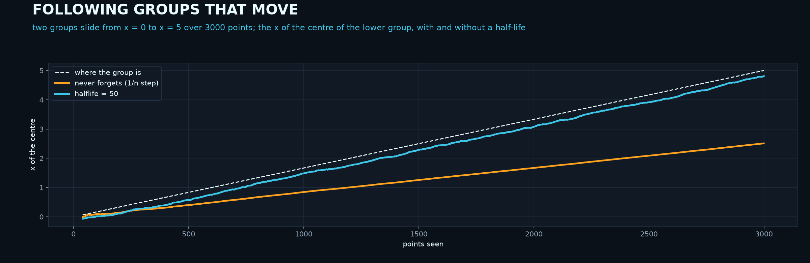

# OnlineKMeans: k groups, one point at a time

`OnlineKMeans` is the sequential k-means (the MacQueen scheme): each new point joins the nearest centre and that centre moves a little towards it, so memory is fixed by `k` and the number of dimensions. The overview of the section is on [Clustering](index.md).

## One point at a time

Each new point joins the nearest centre, and that centre moves a little towards it.

```python
from dense_armor.core.online.cluster.kmeans import OnlineKMeans

km = OnlineKMeans(k=2, warmup=4)
for v in [0.0, 0.1, 10.0, 10.1, 0.2, 9.9]:
    km.learn_one({"x": [v]})
print(km.predict_one({"x": [0.05]}), km.predict_one({"x": [10.05]}))
print([round(float(c[0]), 3) for c in km.centers_])
```

```
1 0
[10.0, 0.1]
```

Two groups, around 0 and around 10; each centre is the mean of the points that joined it. The
first `warmup` points (here 4, default 10 per centre) are kept aside; the centres are chosen
among them one at a time, each the point farthest from those already chosen (the minimax rule of
Roth et al. 2021, eq. 5); then learning goes on one point at a time. Starting from the first
points instead could put two centres in the same group.

With the points above, the four points 0.0, 0.1, 10.0, 10.1 wait in the buffer. Their mean is 5.05, and 0.1 and 10.0 are the same distance from it (4.95): the first centre is the buffered point nearest to the mean, and here the rounding of the two distances decides for 10.0, which is why the first printed centre is the one near 10. The second centre is the buffered point farthest from it, 0.0. The other two buffered points join their nearest centre: 10.1 moves the first centre to 10.05 and 0.1 moves the second to 0.05. Then 0.2 moves the second centre to 0.1 and 9.9 moves the first to 10.0, the means of the points in each group. The update rule moves the assigned centre by a
fraction of the distance, one over the number of points that centre already has:
$$c_j \leftarrow c_j + \frac{1}{n_j}\,(x - c_j)$$

where $c_j$ is the centre of group $j$, $x$ is the new point, and $n_j$ is how many points have
already joined group $j$.

## Three groups, recovered in one pass

The online method sees each point once and recovers the three groups of a synthetic stream.

```python
import numpy as np
from collections import Counter
from dense_armor.core.online.cluster.kmeans import OnlineKMeans

rng = np.random.default_rng(0)
centres = np.array([[0.0, 0.0], [10.0, 0.0], [0.0, 10.0]])
y = rng.integers(0, 3, 600)
X = centres[y] + rng.normal(0, 0.5, (600, 2))
km = OnlineKMeans(k=3)
for x in X:
    km.learn_one({"x": x.tolist()})
pred = np.array([km.predict_one({"x": x.tolist()}) for x in X])
mapping = {p: Counter(y[pred == p]).most_common(1)[0][0] for p in set(pred)}
mapped = np.array([mapping[p] for p in pred])
print(round(float((mapped == y).mean()), 4))
```

```
1.0
```

The code gives each group the most frequent true label among its points and prints the share of the 600 points whose group matches the true one: 1.0. The points are drawn around three well separated centres (distance 10, σ = 0.5) and each point is seen exactly once, in the order it comes.

## Following groups that move

With a half-life the step stays constant, $1 - 2^{-1/h}$, so old points fade and the centres
follow a drifting stream.

```python
import numpy as np
from dense_armor.core.online.cluster.kmeans import OnlineKMeans

rng = np.random.default_rng(1)
km = OnlineKMeans(k=2, halflife=50)
for i in range(3000):
    shift = i / 3000 * 5.0
    c = [shift, 0.0] if i % 2 == 0 else [shift, 10.0]
    km.learn_one({"x": (np.array(c) + rng.normal(0, 0.3, 2)).tolist()})
print(sorted([round(float(c[0]), 2), round(float(c[1]), 2)] for c in km.centers_))
```

```
[[4.78, 9.99], [4.81, -0.01]]
```

Both groups slid from $x = 0$ to $x = 5$ over 3000 steps, and each point of the stream belongs
to a group whose position keeps changing. With a `halflife` the step is a constant
$1 - 2^{-1/h}$ instead of $1 / n_j$, so the influence of a point is halved after `halflife`
samples and the centre follows the group rather than averaging over its whole history. The
final centres end near $x = 5$, where the groups are now.



The picture follows the centre of the lower group while the groups slide from x = 0 to x = 5. With the `1/n` step (orange) the centre averages the whole history and ends at 2.51, half way; with `halflife = 50` (blue) it ends at 4.81, close to the group.

## The parameters

| Parameter | Meaning | Default |
|---|---|---|
| `k` | number of clusters | (required) |
| `halflife` | exponential half-life in samples: `None` uses the step `1/n_j`, a positive number uses `1 - 2^(-1/halflife)` | `None` |
| `warmup` | number of points buffered before the centres are chosen | `10 * k` |
| `seed` | reserved for a future random initialisation | 0 |

## API reference

::: dense_armor.core.online.cluster.kmeans

---

## Details

- `OnlineKMeans` buffers the first `warmup` points (default `10 * k`) and picks the centres by
  greedy farthest-first selection (Roth et al. 2021, eq. 5). Bhattacharjee et al. (2021) compare
  the online loss $\sum_t d(x_t, S_{t-1})^2$ with the best `k` fixed centres in hindsight; their
  lower bound (Theorem 2, p. 4) applies to any online method, their upper bound (Theorem 1, p. 3)
  needs a randomised algorithm with more than `k` centres and does not apply to this simple
  scheme.
- Sources: Bhattacharjee, R., Dasgupta, S., Imola, J. J., Moshkovitz, M. (2021), "Online k-means clustering on arbitrary data streams", arXiv:2102.09101. Roth, K. et al. (2021), "Towards total recall in industrial anomaly detection", arXiv:2106.08265.
