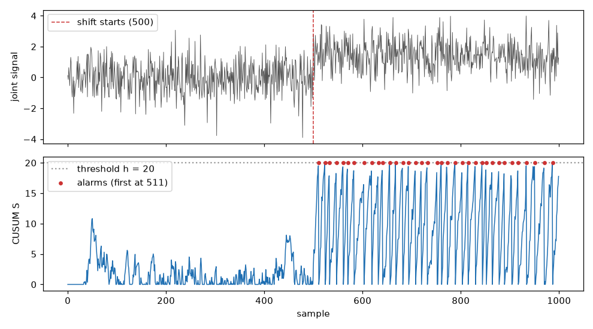

# CUSUMDriftDetector: the piggy bank that fills while a stream drifts

[← CUSUM](index.md)

`CUSUMDriftDetector` watches a stream one value at a time. Every value that is a little higher than usual drops a coin in a piggy bank, and the normal noise drops nothing. When the bank is full the detector says that the stream has drifted. It is the tool for a change that is too small to be seen in any single value.

## First example

```python
import numpy as np
from dense_armor.core.online.drift.detector import CUSUMDriftDetector

rng = np.random.default_rng(0)
x = np.concatenate([rng.normal(0, 1, 500), rng.normal(1.5, 1, 500)])
det = CUSUMDriftDetector(reference="fixed")
print(next(i for i, v in enumerate(x) if det.update(v).drift_detected))
```

```
511
```

In this example the first 500 samples are normal noise, for instance the daily cost of an order after removing its usual level; from sample 500 the mean moves up by 1.5 standard deviations, the kind of step that a change in the market produces. The detector raises its first alarm at sample 511, eleven samples after the change. `update(v)` returns the detector itself, and `drift_detected` is `True` only on the sample where the alarm fires. The detector needs the streaming extra; the install command is on the bridge page of the API reference.



The figure shows the same kind of run on a joint signal: the mean shifts at sample 500 (top), and the CUSUM total (bottom) fills up and crosses the threshold at sample 511.

## How it works

Every new sample adds its surprise and pays a small fee; the total never goes below zero.

```python
z = [0.2, -0.4, 0.1, 1.8, 2.1, 1.9, 2.3]
k, h, s = 0.5, 5.0, 0.0
for t, zt in enumerate(z, start=1):
    s = max(0.0, s + zt - k)
    print(t, round(s, 2), s > h)
```

```
1 0.0 False
2 0.0 False
3 0.0 False
4 1.3 False
5 2.9 False
6 4.3 False
7 6.1 True
```

The rule is

$$S_t = \max(0,\; S_{t-1} + z_t - k), \qquad \text{alarm when } S_t > h,$$

where:

- $z_t$ is how surprising sample $t$ is, in units of the normal noise (0 means "exactly as usual", 2 means "two noise-widths above usual");
- $k$ is the fee paid at every sample (the *slack*): small surprises are eaten by the fee and the total stays at zero, so ordinary noise never accumulates;
- $h$ is the size of the piggy bank (the *threshold*): when the total passes it, the alarm fires and the total starts again from zero;
- $S_t$ is the total after sample $t$.

In the run above the first three values are small, so the fee keeps the total at zero. From the fourth value the readings sit about 2 above normal: each one adds roughly $2 - 0.5 = 1.5$, and the total passes $h = 5$ at the seventh sample. A detector like this also watches the other direction (readings that drop) with a second total, which is what "two-sided" means.

### Where the surprise $z_t$ comes from

The detector measures each value against a window of the recent past, without looking at the future. The centre of the window is its median and its width is $S = 1.4826 \cdot \mathrm{MAD}$ (the median absolute distance from the median; the factor 1.4826 makes $S$ equal to the standard deviation when the noise is normal, see [anomaly detection](../../anomaly/streaming/index.md)). Then $z_t = (x_t - \text{median}) / S$.

Two ways to choose the window:

- `reference="fixed"`: the median and width are measured once, on the first `radius * ref_mult` samples, and kept. Best for a sustained step, like the run in the first example.
- `reference="adaptive"`: they are re-measured on a sliding window at every sample. The window follows a new level, so the detector reacts to the leading edge of a drift and then goes quiet. For a sustained step, the detection floor is roughly 2.2 robust sigmas at `h` = 20.

Non-finite samples do not count towards the window. With `fixed`, the buffer keeps only the last `radius * ref_mult` finite values, so a long flat start does not make it grow without bound, and the reference is retried on every new sample until a usable one is found.

## One alarm, or one per sample

By default the detector keeps signalling for as long as the total stays above `h`. With `reset_on_alarm=True` the total and the reference restart after each alarm, so a sustained step gives one alarm. The same stream as in the first example, with three settings:

```python
import numpy as np
from dense_armor.core.online.drift.detector import CUSUMDriftDetector

rng = np.random.default_rng(0)
x = np.concatenate([rng.normal(0, 1, 500), rng.normal(1.5, 1, 500)])
for kw in ({"reference": "fixed"}, {"reference": "fixed", "reset_on_alarm": True}, {"reference": "adaptive"}):
    det = CUSUMDriftDetector(**kw)
    alarms = [i for i, v in enumerate(x) if det.update(v).drift_detected]
    print(kw, len(alarms), alarms[:3], det.n_alarms_)
```

```
{'reference': 'fixed'} 36 [511, 524, 533] 36
{'reference': 'fixed', 'reset_on_alarm': True} 1 [511] 1
{'reference': 'adaptive'} 0 [] 0
```

The `fixed` detector without reset gives 36 alarms in the 500 samples after the change; with the reset it gives 1, at the same sample 511. The `adaptive` one gives none on this step of 1.5 standard deviations, because its window catches up with the new level. `n_alarms_` counts the alarms. The restart rule is a choice of this implementation: Reynolds (1975) gives the run length of the two-sided CUSUM but does not fix a restart.

## Both directions

A fall of 1.5 standard deviations instead of a rise:

```python
import numpy as np
from dense_armor.core.online.drift.detector import CUSUMDriftDetector

rng = np.random.default_rng(1)
x = np.concatenate([rng.normal(0, 1, 500), rng.normal(-1.5, 1, 500)])
for two in (True, False):
    det = CUSUMDriftDetector(reference="fixed", two_sided=two)
    print(two, next((i for i, v in enumerate(x) if det.update(v).drift_detected), None))
```

```
True 508
False None
```

With `two_sided=True` the second total catches the fall at sample 508; with `two_sided=False` only upward shifts are monitored, so there is no alarm (`None`).

## Many samples at once, and missing values

```python
import numpy as np
from dense_armor.core.online.drift.detector import CUSUMDriftDetector

rng = np.random.default_rng(0)
x = np.concatenate([rng.normal(0, 1, 500), rng.normal(1.5, 1, 500)])
det = CUSUMDriftDetector(reference="fixed")
print(type(det.update_many(x)).__name__, det.n_alarms_)
det = CUSUMDriftDetector(reference="fixed")
det.update(float("nan")), det.update(float("nan"))
print(det.n_missing_, det.drift_detected)
```

```
CUSUMDriftDetector 36
2 False
```

`update_many` runs `update` on each value and returns the detector. A value that is not a number (`nan`) raises no alarm: `n_missing_` counts them.

A stream that starts with missing readings does not poison the `fixed` reference: the values that are not finite do not count towards the window, so the reference is measured on the first usable ones.

```python
import numpy as np
from dense_armor.core.online.drift.detector import CUSUMDriftDetector

rng = np.random.default_rng(0)
x = [float("nan")] * 10 + list(rng.normal(0, 1, 300)) + list(rng.normal(3, 1, 300))
det = CUSUMDriftDetector(reference="fixed", radius=5, ref_mult=4)
first = next(i for i, v in enumerate(x) if det.update(v).drift_detected)
print(first, det.n_missing)
```

```
315 10
```

The step starts at index 310 (10 NaN followed by 300 normal samples). The detector raises its first alarm at 315, five samples after the step, and reports ten skipped readings in `n_missing`.

## The parameters

| Parameter | Default | What it does |
|---|---|---|
| `radius` | 10 | with `ref_mult`, the window has `radius * ref_mult` samples |
| `ref_mult` | 3 | see `radius` |
| `k` | 0.5 | the slack, the fee paid at every sample, in robust-sigma units |
| `h` | 20.0 | the threshold, the size of the piggy bank, in accumulated robust-sigma units |
| `two_sided` | `True` | if `False`, only upward shifts are monitored |
| `eps` | 1e-9 | guard against a window with no noise (a degenerate scale), the same as in `cusum_detector` |
| `reference` | `"adaptive"` | `"fixed"` measures median and width once; `"adaptive"` re-measures them at every sample |
| `reset_on_alarm` | `False` | if `True`, the total and the reference restart after each alarm |

The two numbers that the detector predicts for its own settings are on the pages [expected_false_alarm_run](expected_false_alarm_run.md) and [expected_detection_delay](expected_detection_delay.md). The same alarms on a recorded series are on the page [cusum_detector](cusum_detector.md).

## API reference

The reference of `CUSUMDriftDetector` and of the batch functions is on the [index of the section](index.md#api-reference).

## Details

- **Sources.** Page, E. S. (1954), "Continuous inspection schemes", *Biometrika* 41, for the CUSUM rule; the `fixed` reference is Page's original scheme. Reynolds, M. R. (1975), *Technometrics* 17(1), for the run length of the two-sided CUSUM.
- **Optimality.** When the distributions before and after the change are known, Page's CUSUM is asymptotically optimal as the false-alarm rate goes to zero (Lorden 1971) and exactly optimal in Lorden's sense (Moustakides 1986), as recalled by Xie et al. (2021); here the reference is estimated from the first samples, so these results are a guide, not a guarantee.
- **Missing or flat start.** Before this version a stream that started with missing or flat readings left the detector without a usable reference, and silent forever. Now non-finite samples do not count towards the reference span; the reference is retried on a sliding window of the last `span` finite values until its robust scale is usable.
- **What is different from the textbook.** The `adaptive` reference is not Page's scheme: it re-measures median and scale on a sliding window, so a sustained shift is caught at its leading edge and the total stops growing when the window has caught up. It is meant for slow drifts, not for a fixed target.
