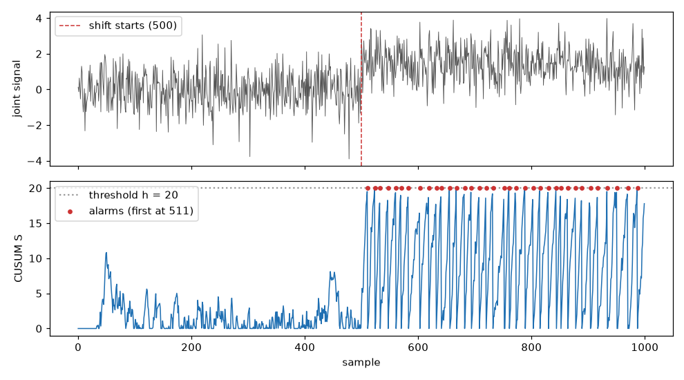

# CUSUM: sequential analysis for sub-clinical data stream drift detection

## The map of CUSUM

Click a page to open it, or the item on the left (or the button at the top) to go back to the [map of the library](../../index.md#the-library-folder-by-folder).

<object type="image/svg+xml" data="../../assets/maps/cusum.svg" style="width:100%"></object>

## Gamestory

### The Puppet's Piggy Bank (CUSUM)

Once upon a time in Naples there was a master puppeteer and his young helper, who every evening made a wooden puppet (CUSUMDriftDetector) dressed in a white smock and a pointed hat dance.

Every evening the puppet's wooden joints wore down by one millimeter (slow drift / drift), but so little that the young helper, watching one dance at a time, noticed nothing and always said: "Everything is fine!".

The master, however, was smarter and had tied a small piggy bank (CUSUM) to the puppet's belt. Every time the puppet took a step, the master listened to the creaking of the wood (surprise z). If the creak was small and normal, the master put nothing into the piggy bank (fee k), so a gust of wind never made it ring by mistake. When, however, the joints really began to wear out and creaked a little more than usual, the master slipped a coin into the piggy bank (total s).

Evening after evening, coin after coin, the piggy bank became so full and heavy that it exceeded the limit (threshold h) and jingled loudly (drift_detected). Hearing that sound, the helper immediately understood that all those small wears had added up and ran to repair the puppet before it broke.

To decide how strange each creak was, the master could compare it with the sound of the brand-new puppet from the first day (reference="fixed") or only with the sounds of the last evenings (reference="adaptive"), even managing to calculate how many shows were left before the piggy bank filled up (ARL).

So, in simple words: CUSUM is precisely that smart piggy bank that puts together small problems one after another until the alarm rings, while ARL is the count of the days (or steps) needed to fill it up and trigger the bell!

This page explains how to detect slow, gradual changes in a system. While a standard detector looks at one reading at a time and misses small shifts, CUSUM accumulates these tiny anomalies over time and triggers an alert as soon as the total deviation confirms a real structural trend.

The cost of executing orders creeps up a little every day. Each single day still looks normal, so a detector that judges one day at a time never complains. Together, though, the days have moved. CUSUM ("cumulative sum") notices this: it keeps a running total of the small surprises, like coins dropped one by one into a piggy bank, and raises an alarm when the bank is full. For the other three detectors and a benchmark on a real robot arm, see [Drift detectors](../detectors.md).

## The pages of the section

| Page | What it shows |
|---|---|
| [CUSUMDriftDetector](detector.md) | the detector that takes one value per call: the piggy bank as a formula, the two references, one alarm or one per sample |
| [one_sided_arl](one_sided_arl.md) | the average run length of a CUSUM that watches one direction |
| [two_sided_arl](two_sided_arl.md) | the average run length of the two-direction CUSUM, the one of the detector |
| [detectability_report](detectability_report.md) | the same estimate in the units of your series |
| [expected_false_alarm_run](expected_false_alarm_run.md) | the samples between false alarms of a detector, against the measured ones |
| [expected_detection_delay](expected_detection_delay.md) | the samples to detect a shift of a detector |
| [cusum_detector](cusum_detector.md) | the same alarms on a whole recording in one call |
| [Results](results.md) | CUSUM against Page-Hinkley and ADWIN on 20 seeded streams |

## The same on a robot

A robot joint wears out a little every day. Each single reading still looks normal, so a detector that judges one sample at a time never complains. Together, though, the readings have moved: CUSUM keeps the running total of the small surprises and raises the alarm when the bank is full. For a joint whose noise is 0.02 rad/s, a shift of 0.04 rad/s is a shift of 2 noise-widths, and `detectability_report` gives about 14 samples to the alarm (see [detectability_report](detectability_report.md)).

## API reference

::: dense_armor.core.online.drift.cusum

::: dense_armor.core.online.drift.detector

## Details

- **Real-world check of the ARL estimate.** `detectability_report` was validated on two real
  physical domains before being promoted from Dense-Evolution-Discovery. On real lidar (Sydney
  Urban Objects, 7 independent points) the real detection was always faster than the predicted
  mean ARL, a consistent bias in one direction. On a real accelerometer (UCI HAR, 5 points) the
  result was mixed: 2 points faster than predicted, 3 slower. The estimate assumes independent
  Gaussian noise; use it to reason before a benchmark, then measure the real rates.
- **Very quiet sensors.** When the local noise is extremely small the raw formula can predict a
  fractional ARL, which has no physical meaning; the docstring of `detectability_report` explains
  the floor applied.
- **Relation to the Arbiter.** The [Arbiter](../../protect/arbiter.md) judges each point against an
  per-point threshold; CUSUM is its complement for slow, sustained changes.
- **Sources.** Reynolds, M. R. (1975), "Approximations to the Average Run Length in Cumulative Sum
  Control Charts", *Technometrics* 17(1), equation (6). Siegmund, D. (1985), *Sequential
  Analysis*, for the 1.166 boundary correction. Page, E. S. (1954), "Continuous inspection
  schemes", *Biometrika* 41, for the CUSUM rule.
