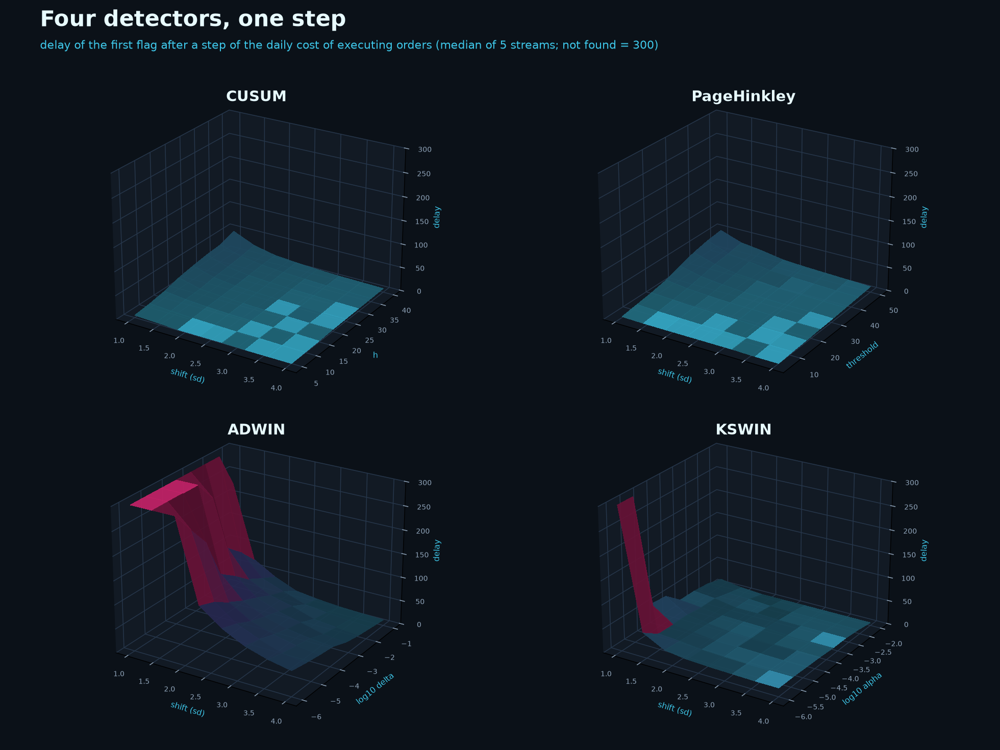
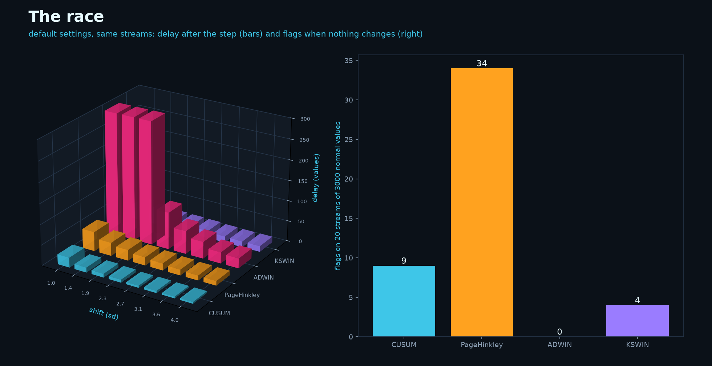

# The four detectors side by side

[← Drift detectors](index.md)

The four detectors read the same stream and answer the same question, but not in the same way. The figure shows how long each one takes to flag a step of the daily cost of executing orders. One axis is the size of the step, from 1 to 4 standard deviations; the other is the parameter that decides how cautious the detector is: `h` for CUSUM, the threshold for PageHinkley, `delta` for ADWIN and `alpha` for KSWIN. A low surface is a fast detector.

## The same step, four detectors

CUSUM and PageHinkley are flat and low. A step of 4 standard deviations is flagged after 0 to 8 values by CUSUM and after 0 to 12 by PageHinkley, whatever the parameter. The parameter matters for the small steps: a step of 1 standard deviation takes from 5 to 49 values for CUSUM and from 2 to 51 for PageHinkley as `h` or the threshold go from the lowest value to the highest. The low values are faster and pay for it with more false alarms; the measured cost for CUSUM is on the page [expected_false_alarm_run](../cusum/expected_false_alarm_run.md).

ADWIN is the one with a cliff. When it is cautious (a very small `delta`), a step of 1 or 2 standard deviations is not found at all in the 300 values after it, and the surface climbs to the top of the figure; from about 2.3 standard deviations it falls quickly. KSWIN is low almost everywhere: 6 to 28 values for most of the figure, with one corner where it is blind, a step of 1 standard deviation with the smallest `alpha`, which it does not find.

To compare them fairly, the next figure puts the four detectors with their default settings on the same streams (CUSUM with a fixed reference). The bars are the delay for each size of the step. The columns on the right count the flags when nothing changes, on 20 streams of 3000 normal values.

CUSUM wins the race: it is the fastest at every size of the step, 24 values for a step of 1 standard deviation and 4 for a step of 4, and it flags 9 times on the quiet streams. PageHinkley is slower (47 and 11 values) and is the one that cries wolf the most: 34 flags. ADWIN never cried wolf (0 flags) and pays for it: it does not see the steps below 2 standard deviations, it needs 90 values for a step of 2.3 and 24 for a step of 4. KSWIN is the steady one: 28 values for a step of 1, 18 for a step of 2.3 and 14 for a step of 4, with 4 flags. If a false alarm is expensive and only large changes matter, ADWIN is the quiet choice; if every change has to be seen quickly and a few false alarms can be tolerated, CUSUM is the quick one; KSWIN is the one in between. The figures come from the script `docs/assets/drift/make_compare_figures.py`.

## On a robot stream

The last test runs the four detectors, [CUSUM](../cusum/index.md), [PageHinkley](page_hinkley.md), [ADWIN](adwin.md) and [KSWIN](kswin.md), on the CASPER dataset: a UR3e arm sampled at 20 Hz, with a labelled change somewhere in the recording. The signal used here is the squared shift residual of joint 5, averaged over 76 s with a causal trailing mean; it is the same series the original CASPER benchmark uses. The four detectors are run with their default settings, untouched, through `evaluate_events`.

| detector | delay (s) | missed | false alarms / h |
|---|---|---|---|
| Page-Hinkley | 3.9 | 0 | 1041 |
| KSWIN | 7.8 | 0 | 217 |
| CUSUM (fixed reference) | 17.2 | 0 | 1188 |
| ADWIN | 17.7 | 0 | 1.4 |

The figure above is a synthetic illustration of the same behaviour on a clean step: each marker is the first alarm of one detector, and the change is the dotted line. ADWIN has no marker: on a 2σ step with a window of 100 samples its bar is never crossed, as [its page](adwin.md) shows (0 streams out of 20).

All four catch the change, none of them misses it. The false alarms are counted over the whole recording. For the CUSUM they all come after the labelled event — zero before the change — because a fixed reference keeps firing while the level stays away from it. The CUSUM row matches the original benchmark function `run_cusum` exactly: 17.2 s of delay, zero false alarms before the change.

Faster is not automatically better. Page-Hinkley is the quickest to react, and also the one that fires the most on normal data; KSWIN takes about twice as long and produces five times fewer false alarms. CUSUM fixed is the slowest here and produces the most false alarms per hour, because once the level has moved, the fixed reference is permanently wrong and the detector keeps re-arming on every fluctuation. ADWIN is as slow as the fixed CUSUM, 17.7 s, and produces about one false alarm per hour, two orders of magnitude fewer than the others; its cost is the delay.

The CASPER dataset is not committed to this repository: `benchmarks/casper_benchmark.py` expects it under a Kaggle path (`industrial-robotic-arm-anomaly-detection`), so the numbers above are from the run where the dataset was present and cannot be rerun here.

The right choice depends on the cost of a missed change against the cost of a spurious alarm. For a robot, a false alarm may mean stopping the line for inspection; a missed change may mean a worn joint that keeps degrading for another shift. Both costs are real, and only the application knows which one is worse.

## Details

- **Benchmark.** Delays at 20 Hz; the table uses the trailing mean of e² over 2T = 1520 samples (76 s), the series the original CASPER benchmark uses; joint 5. The synthetic figure is generated by `docs/assets/drift/make_figure.py` from the library itself, on a clean Gaussian step for clarity.
- **Source.** Kayan, H., et al. (2023), *CASPER: a real-world dataset for anomaly detection in a robot arm*, IEEE PerCom Workshops.
