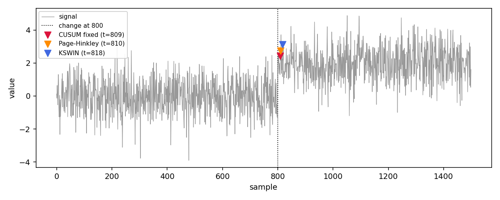

# The four detectors side by side

[← Drift detectors](index.md)

The last test runs the four detectors, [CUSUM](../cusum/index.md), [PageHinkley](page_hinkley.md), [ADWIN](adwin.md) and [KSWIN](kswin.md), on the CASPER dataset: a UR3e arm sampled at 20 Hz, with a labelled change somewhere in the recording. The signal used here is the squared shift residual of joint 5, averaged over 76 s with a causal trailing mean; it is the same series the original CASPER benchmark uses. The four detectors are run with their default settings, untouched, through `evaluate_events`.

| detector | delay (s) | missed | false alarms / h |
|---|---|---|---|
| Page-Hinkley | 3.9 | 0 | 1041 |
| KSWIN | 7.8 | 0 | 217 |
| CUSUM (fixed reference) | 17.2 | 0 | 1188 |
| ADWIN | 17.7 | 0 | 1.4 |

The figure above is a synthetic illustration of the same behaviour on a clean step: each marker is the first alarm of one detector, and the change is the dotted line. ADWIN has no marker: on a 2σ step with a window of 100 samples its bar is never crossed, as [its page](adwin.md) shows (0 streams out of 20).

All four catch the change, none of them misses it. The false alarms are counted over the whole recording. For the CUSUM they all come after the labelled event — zero before the change — because a fixed reference keeps firing while the level stays away from it. The CUSUM row matches the original benchmark function `run_cusum` exactly: 17.2 s of delay, zero false alarms before the change.

Faster is not automatically better. Page-Hinkley is the quickest to react, and also the one that fires the most on normal data; KSWIN takes about twice as long and produces five times fewer false alarms. CUSUM fixed is the slowest here and produces the most false alarms per hour, because once the level has moved, the fixed reference is permanently wrong and the detector keeps re-arming on every fluctuation. ADWIN is as slow as the fixed CUSUM, 17.7 s, and produces about one false alarm per hour, two orders of magnitude fewer than the others; its cost is the delay.

The CASPER dataset is not committed to this repository: `benchmarks/casper_benchmark.py` expects it under a Kaggle path (`industrial-robotic-arm-anomaly-detection`), so the numbers above are from the run where the dataset was present and cannot be rerun here.

The right choice depends on the cost of a missed change against the cost of a spurious alarm. For a robot, a false alarm may mean stopping the line for inspection; a missed change may mean a worn joint that keeps degrading for another shift. Both costs are real, and only the application knows which one is worse.

## Details

- **Benchmark.** Delays at 20 Hz; the table uses the trailing mean of e² over 2T = 1520 samples (76 s), the series the original CASPER benchmark uses; joint 5. The synthetic figure is generated by `docs/assets/drift/make_figure.py` from the library itself, on a clean Gaussian step for clarity.
- **Source.** Kayan, H., et al. (2023), *CASPER: a real-world dataset for anomaly detection in a robot arm*, IEEE PerCom Workshops.
