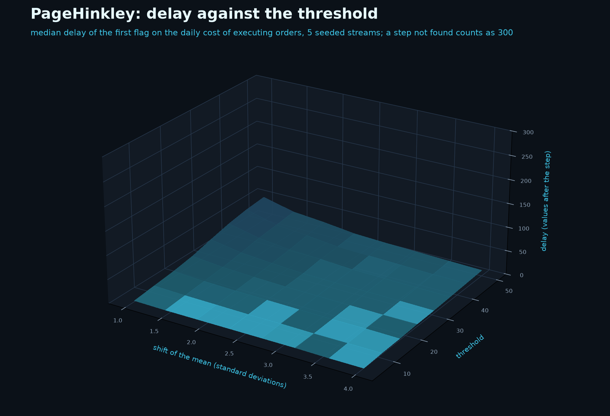

# PageHinkley: the same idea, units do not matter

[← Drift detectors](index.md)



`PageHinkley` compares every value with the average of the stream so far, measured in standard deviations, and adds up how far the values stay above it. Because the comparison is in standard deviations, the same settings work whether the stream is a cost in dollars or a tiny squared error.

## First example

```python
import numpy as np
from dense_armor.core.online.drift.page_hinkley import PageHinkley

rng = np.random.default_rng(0)
x = list(rng.normal(0, 1, 500)) + list(rng.normal(3, 1, 500))
for scale in (1.0, 1e-4):
    det = PageHinkley(delta=0.05, threshold=20.0)
    print(scale, next(i for i, v in enumerate(x) if det.update(scale * v).drift_detected))
```

```
1.0 506
0.0001 506
```

In this example the first 500 values are normal noise, for instance the daily cost of an order after removing its usual level, and from the value 500 the mean moves up by 3 standard deviations. The detector fires at the value 506 in both runs, once with the signal as it is and once with the signal multiplied by $10^{-4}$. The alarm does not move, because the test works in standard deviations.

## How it works

The statistic is Page's cumulative sum. Each value is compared with the running mean, divided by the running standard deviation, and the accumulated deviation, minus the slack $\delta$, is compared with its own running minimum:

$$W_n = S_n - \min_{0 \le j \le n} S_j, \qquad S_n = \sum_{i \le n} \Big(\frac{x_i - \bar x_i}{\sigma_i} - \delta\Big), \qquad \text{alarm when } W_n > \text{threshold}$$

$\bar x_i$ and $\sigma_i$ are the mean and the standard deviation of all the values since the start, not of a window. The first `warmup` values only feed them: the test starts after that. With `two_sided=True` a second total, with the sign changed, watches the falls. Xie et al. (2021) write the same construction as equation 2, with the log-likelihood ratio in place of the standardized deviation.

An alarm restarts only the total that fired. The mean and the standard deviation are kept, so a step that lasts keeps firing:

```python
import numpy as np
from dense_armor.core.online.drift.page_hinkley import PageHinkley

rng = np.random.default_rng(0)
x = list(rng.normal(0, 1, 500)) + list(rng.normal(3, 1, 500))
det = PageHinkley(delta=0.05, threshold=20.0)
alarms = [i for i, v in enumerate(x) if det.update(v).drift_detected]
print(len(alarms), alarms[:4])
```

```
29 [506, 514, 523, 531]
```

The same step gives 29 alarms in the 500 values after it, the first at 506, and none before it. To get one event per change, act on the first alarm, or start a new detector after it.

With the default settings, `delta` = 0.005 and `threshold` = 50, the first alarms on the same stream are later:

```python
import numpy as np
from dense_armor.core.online.drift.page_hinkley import PageHinkley

rng = np.random.default_rng(0)
x = list(rng.normal(0, 1, 500)) + list(rng.normal(3, 1, 500))
det = PageHinkley()
print([i for i, v in enumerate(x) if det.update(v).drift_detected][:3])
```

```
[515, 534, 561]
```

## Both directions

A fall of 3 standard deviations instead of a rise:

```python
import numpy as np
from dense_armor.core.online.drift.page_hinkley import PageHinkley

rng = np.random.default_rng(0)
x = list(rng.normal(0, 1, 500)) + list(rng.normal(-3, 1, 500))
for two in (True, False):
    det = PageHinkley(delta=0.05, threshold=20.0, two_sided=two)
    print(two, next((i for i, v in enumerate(x) if det.update(v).drift_detected), None))
```

```
True 504
False None
```

With `two_sided=True` the second total catches the fall at 504; with `two_sided=False` only the rises are watched, so there is no alarm (`None`). A value that is not a number does not move the totals: `n_missing` counts it.

## The parameters

| Parameter | Default | What it does |
|---|---|---|
| `delta` | 0.005 | the slack, in standard deviations; the classical choice is half the shift worth detecting |
| `threshold` | 50.0 | the alarm threshold on the total above its running minimum, in standard deviations |
| `two_sided` | `True` | if `False`, only rises are watched |
| `warmup` | 30 | values before the first check; they feed the running mean and standard deviation |

For the same idea with a reference that is measured once and with a slack in the units of the noise see [CUSUMDriftDetector](../cusum/detector.md).

## API reference

::: dense_armor.core.online.drift.page_hinkley

## Details

- **Source.** Page, E. S. (1954), "Continuous inspection schemes", *Biometrika* 41(1-2), 100-115, for the cumulative sum. Hinkley, D. V. (1971), "Inference about the change-point from cumulative sum tests", *Biometrika* 58(3), 509-523, who turned Page's chart into an estimator of when the change happened. The formulation of the code is the one of Xie, Zou, Xie, Veeravalli (2021), *Sequential (quickest) change detection: classical results and new directions*, Section II-C2, equations 2 and 3.
- **What is the choice of the library.** Dividing by the running standard deviation is the choice of this library, so that the settings do not depend on the units of the stream.
