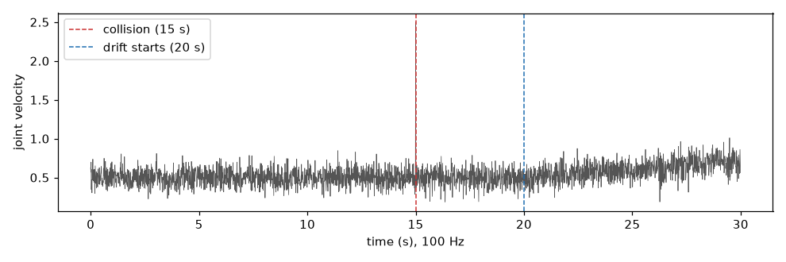

# Drift detection: statistical methods for non-stationary process drift isolation

This section defines the analytical boundaries between localized point-anomaly detection and macro-level drift monitoring, focusing on statistical methodologies designed to isolate persistent shifts in the structural mean of data streams.

**In plain words:** While anomaly detection tools spot a single, sudden weird reading, drift detection tools look at the bigger picture. They notice when the baseline level of a system is slowly drifting over time, accumulating tiny, subtle changes that would look perfectly normal if judged on their own.

Anomaly detection flags samples. Drift detection flags **a change of the average** —
something that happens over many samples, each of which looks plausible on its own.

A worn gear makes a joint move a little less smoothly over hours: no single sample is
unusual, but the average has moved. A per-sample detector misses this by construction:
every sample is inside the local window's amplitude, so nothing fires. A drift detector
accumulates the small deviations and raises one alarm when the accumulated evidence is
too large to be explained by noise.

## The signal

The same 100 Hz joint velocity: a worn gear starts shifting the average at sample 2000
(second 20) and pushes it up by 0.2 rad/s over the next 10 seconds. The spike at sample
1500 is the anomaly detector's job; the drift from sample 2000 onward is the drift
detector's.

## Pages

- **[CUSUM and ARL theory](cusum.md)** — the cumulative-sum detector (accumulate small
  deviations, alarm when the sum passes a threshold), its streaming version, and how
  long it takes to fire — or to false-alarm — before running it.
