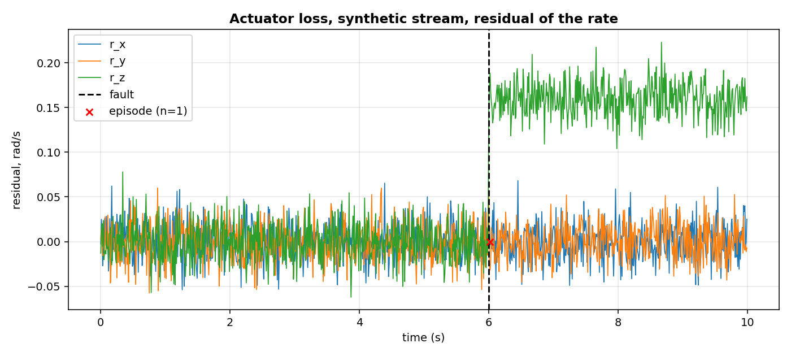
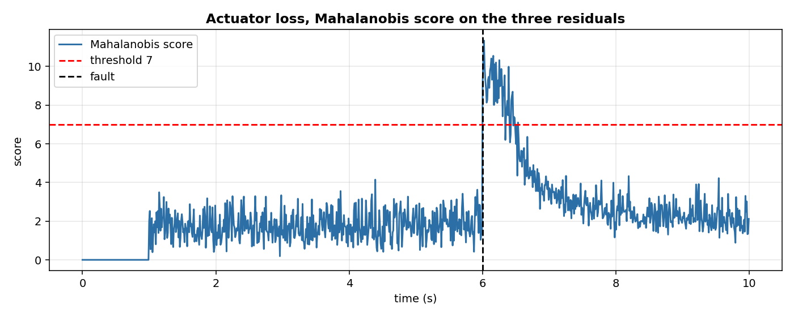

# Actuator fault: which part of the drone broke, and how many seconds after?

A quadrotor flies a hover plus a slow circle. At some moment one actuator loses part of its authority: the motor still spins, but the commanded rate and the measured rate stop agreeing. The pilot sees nothing until the drone drifts; the onboard computer sees the residual at once. This page shows the residual, the detector that turns it into a single alarm episode, and the second detector that scores the same three numbers.

## The scene

A quadrotor with four motors. The controller asks the body to rotate at a certain rate on each axis; the gyroscope measures the rate the body actually has; the difference is the residual. When one motor loses 80% of its thrust, the body still turns, but slower than commanded on that axis. The residual on that axis is no longer noise: it has a bias.

A single-sample threshold would fire on every sample after the fault. A drift detector fires once, when the change becomes statistically clear, and stays quiet. An operator wants a count: how many episodes, and how long after the fault the first one arrived.

## What is in the box

| Tool | Its one job | Example |
|---|---|---|
| Residual | commanded minus gyro, three components | [0.001, 0.002, 0.040] rad/s after the fault |
| CUSUMDriftDetector | Fire once, when the residual norm changes | One episode, 20 ms after the fault |
| OnlineRobustMahalanobis | Score the three residuals together | Score 11.3, above the threshold 7 |



*Synthetic stream, 1000 samples at 100 Hz. Black dashed: the fault. Red cross: the single episode the detector raised, 20 ms after the fault.*

## 1. The residual

The flight controller sends a rate setpoint on each body axis; the gyroscope measures the rate the body has. The residual is their difference, one three-vector per sample.

```python
from pipelines.drones.io import synthetic_flight
from pipelines.drones.actuator_fault import _residual

stream = list(synthetic_flight(n=1000, seed=0, fault="actuator_loss"))
r = _residual(stream[600])
print(round(float(r[2]), 3))
```

```
0.146
```

On the yaw axis the fault multiplies the commanded rate by 0.2, so the residual is about 80% of the commanded rate. The other two axes carry only noise. The fault model is the input-multiplicative one of Garg and Fan 2023, section II, equation (4), page 2.

## 2. A drift detector on the residual norm

A CUSUM accumulates the deviation from a reference and fires when the accumulated deviation passes a threshold. With reset_on_alarm=True the statistic and the reference restart after each alarm, so a sustained step gives one alarm, not one per sample.

```python
from pipelines.drones.io import synthetic_flight
from pipelines.drones.actuator_fault import run

stream = list(synthetic_flight(n=1000, seed=0, fault="actuator_loss"))
r = run(stream)
print(r.n_episodes, r.fault_index, [round(d, 3) for d in r.delays_s])
```

```
1 600 [0.02]
```

The fault starts at sample 600 (second 6.00); the detector raises one episode at sample 602 (second 6.02). Delay 20 ms. An episode is a rising edge of drift_detected: a sample with the flag on whose previous had it off (benchmarks/casper_hours_episodes.py, lines 74-76).

## 3. A second score on the same three numbers

The CUSUM works on the norm, so it does not know which axis changed. A robust Mahalanobis detector on the three residual components does: it estimates the covariance online and scores each sample by distance from the running centre.

```python
from pipelines.drones.io import synthetic_flight
from pipelines.drones.actuator_fault import run

stream = list(synthetic_flight(n=1000, seed=0, fault="actuator_loss"))
r = run(stream)
print(round(float(r.mahalanobis_scores[600]), 2),
      round(float(r.mahalanobis_scores[700]), 2))
```

```
9.16 3.71
```

At the fault sample the score is 9.2, above the default threshold 7; by sample 700 the score has fallen to 3.7, because the detector has learned the new centre. After a sustained fault the score returns towards normal: this is why the episode counter, not the score threshold, is the right output. After a sustained fault the score returns to normal: this is why the episode counter, not the score threshold, is the right output.



*Synthetic stream, same as above. Black dashed: fault. Red dashed: threshold 7. The score spikes at the fault and returns to the new centre.*

## 4. What the numbers mean

| Metric | Value on this synthetic stream |
|---|---|
| Samples | 1000 |
| Fault index | 600 (second 6.00) |
| Episodes (CUSUM with reset_on_alarm=True) | 1 |
| Detection delay | 0.02 s |
| Mahalanobis score at the fault | 9.16 |
| Samples above the threshold 7 | 46 |
| False alarms on the normal part | 0 |

A run with no fault gives zero episodes and a false-alarm rate of 0 per hour of normal flight. On a stream with the fault, it raises exactly one episode and the delay is the one the operator needs.

The run on ALFA is prepared in `kaggle/drones_alfa_actuator.py`; the numbers on this page are from the synthetic stream. ALFA publishes the commanded roll, pitch and yaw as angles, so on ALFA the residual is the commanded angle minus the measured angle, not the commanded rate minus the gyro. The ALFA fault model is a control-surface failure (Keipour, Mousaei and Scherer 2020, page 1); the processed flights are read by `pipelines/drones/alfa.py` from the one-CSV-per-topic layout of section 3.1, page 3.

## Details

### References

- Keipour, A., Mousaei, M., Scherer, S. (2020). *ALFA: A Dataset for UAV Fault and Anomaly Detection.* The International Journal of Robotics Research. arXiv:1907.06268v2. Metrics "Maximum Detection Time" and "Average Detection Time", section 4, page 5; fault types, page 1; platform Carbon-Z T-28 fixed-wing with modified ArduPilot, sections 2.1-2.2, page 2; telemetry tlog, section 3.1, page 3.
- Garg, K., Fan, C. (2023). *Neural Network-based Fault Detection and Identification for Quadrotors using Dynamic Symmetry.* arXiv:2309.09108. Actuator fault model, equation (4), section II, page 2.
- The episode convention (rising edge of drift_detected): `benchmarks/casper_hours_episodes.py`, lines 74-76.

### Choices stated explicitly

- The residual is commanded minus gyro. Garg and Fan define the fault as diag(Theta) times pi on the input u = (U1, U2, U3, U4), not on the body rate. Applying the same multiplicative structure to the commanded rate is an approximation, stated here.
- CUSUM parameters: reference=fixed, radius=20, ref_mult=5, k=0.5, h=20.0, two_sided=True, reset_on_alarm=True. The restart-on-alarm rule is a choice of this implementation; Reynolds 1975 gives the run length of the two-sided CUSUM but does not fix a restart.
- Mahalanobis parameters are the defaults of the class, with seed=0 so that the values in this page are reproducible: n_init=100, threshold=7.0, feature_keys=(r0, r1, r2), seed=0.
- Synthetic trajectory: hover plus a slow circle at omega = 0.2 rad/s, radius 5 m, with small roll and pitch oscillations. ALFA Figure 3 shows a sample trajectory, not this geometry.
- Synthetic fault actuator_loss multiplies the commanded yaw rate by Theta_yaw = 0.2. The value is my choice; Garg and Fan use Theta_i in [0, 1) without fixing a number in the section read.
- False-alarm rate is scaled on the normal part: false_alarms * 3600 / normal_seconds, same as `benchmarks/casper_hours_episodes.py`, lines 129-132.

### Measured cost

`run(...)` on 1000 samples completes in under a second. Per-sample cost: score_one of OnlineRobustMahalanobis (O(d^2) with d = 3) plus update of CUSUMDriftDetector (O(1) amortised). No JAX, no compilation.

### Development diary

The first version of the fault model used a motor command scaled to 0.2 on motor 0. Read against Garg and Fan, the model was the input-multiplicative one applied to the input, not to a motor; the synthetic stream now applies the same multiplicative structure to the commanded rate. The figure was regenerated after the change.
