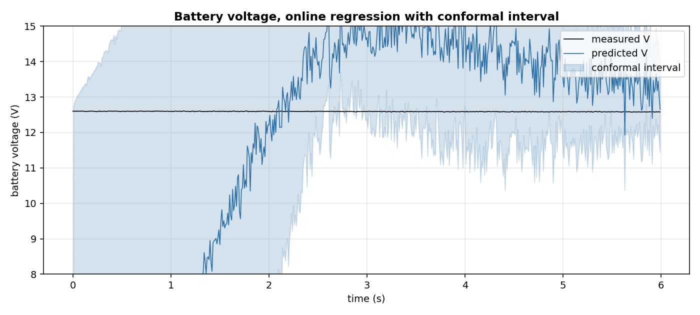
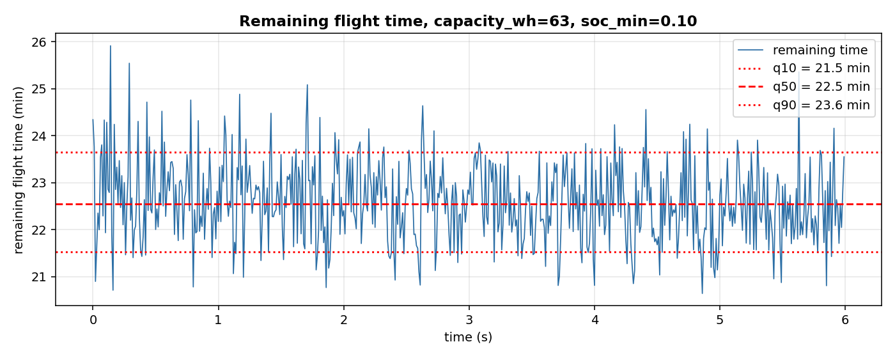

# Battery endurance: how many minutes of flight are left, and how sure?

A drone owner has one question before takeoff: how long can I stay up? The answer changes with the payload, the wind, the trajectory. The battery voltage drops as the charge is used, but the drop depends on the current draw, and the current depends on what the drone is doing. This page shows how to predict the voltage, its interval, and the remaining flight time, online, one sample at a time.

## The scene

The drone hovers, then circles. The battery voltage starts at 12.6 V, drops to 12.5 over the flight, and the current is around 11 A. The flight controller reads both. The question is not 'is the voltage low now'; the question is 'how many minutes before it reaches the minimum safe value'.

A single number is not enough: the operator needs an interval. Two things can go wrong: the voltage prediction is off, or the power consumption changes. A conformal interval covers the first; the quantiles of the remaining time (from a TDigest) cover the second, at least in the range of flights seen.

## What is in the box

| Tool | Its one job | Example |
|---|---|---|
| LinearRegression + AdaGrad | Online fit of V on current and time | V̂ follows 12.6 → 12.5 V |
| AdaptiveConformalRegressor | Interval around V̂ with adaptive coverage | coverage 0.923, target 0.9 |
| V·I | The measured power | 150 W on this stream |
| Alyassi eq. 5 | The structural reference | 436 W with the 3DR Solo coefficients |
| TDigest | Distribution of remaining time | q10 21.5, q50 22.5, q90 23.6 min |



*Synthetic stream, 600 samples at 100 Hz. Black: measured V. Blue: predicted V. Shaded: conformal interval. Coverage 0.923, mean width 10.16 V (inflated by the warm-up, see Details).*

## 1. The voltage model

The voltage is a linear function of the current, the time, and their product. The four keys `current_a`, `t`, `current_t`, `one` are the input of a `LinearRegression` with the `AdaGrad` optimizer. The fit is online: one sample, one gradient step, no batch.

```python
import numpy as np
from pipelines.drones.io import synthetic_flight
from pipelines.drones.battery_endurance import run

stream = list(synthetic_flight(n=600, seed=0))
r = run(stream)
print(round(float(r.v_pred[-1]), 3), round(float(stream[-1]["battery_v"]), 3))
```

```
12.652 12.579
```

At the last sample the model predicts 12.652 V, the true value is 12.579 V. The model tracks the slow voltage drop, because the trajectory is smooth and the current is almost constant. On a flight with sharp changes the model takes a few samples to catch up; that is the price of an online fit, and the conformal interval covers it.

## 2. The conformal interval

`AdaptiveConformalRegressor` wraps the `LinearRegression` and adds an interval `[V̂ − Q, V̂ + Q]`, where `Q` is the running quantile of the absolute residuals at level `1 − α_t`. The target miscoverage `α_t` is updated after each sample (Gibbs and Candes 2021, equation 2, cited in the class docstring): if the interval missed, `α_t` decreases; if it covered with margin, it increases.

```python
import numpy as np
from pipelines.drones.io import synthetic_flight
from pipelines.drones.battery_endurance import run

stream = list(synthetic_flight(n=600, seed=0))
r = run(stream)
print(round(float(r.v_lo[-1]), 3), round(float(r.v_hi[-1]), 3), round(r.coverage, 3))
```

```
11.441 13.863 0.923
```

At the last sample the interval is [11.441, 13.863] V, width 2.4 V. The empirical coverage over the stream is 0.923, against a target of 0.9. The mean width of 10.16 V reported in the box is inflated by the first 100 samples: the model starts at zero (no data) and the conformal quantile starts at a wide value. From sample 200 onwards the interval is under 3 V. The figure shows this: the shaded band narrows after the warm-up, then follows the voltage.

## 3. The power, measured and from the paper

The measured power is `V · I`, in watts. On this stream the battery voltage is around 12.6 V and the current around 12 A, so the power is about 150 W. This is the number that enters the remaining-time calculation.

Alyassi et al. 2017 (section IV, equation 5, page 5) give a nine-term model of the power consumption of a multi-copter:

```text
P_hat = b1*|v_xy| + b2*|a_xy| + b3*|v_xy|*|a_xy|
      + b4*|v_z|  + b5*|a_z|  + b6*|v_z|*|a_z|
      + b7*m + b8*(v_xy . w_xy) + b9
```

with the coefficients b1..b9 fitted per drone in the paper. For the 3DR Solo the paper gives `beta_solo = [-1.526, 3.934, 0.968, 18.125, 96.613, -1.085, 0.220, 1.332, 433.9]` (page 5). The last coefficient, b9 = 433.9, is the hover power: it dominates the sum and gives 436 W on this stream.

```python
import numpy as np
from pipelines.drones.io import synthetic_flight
from pipelines.drones.battery_endurance import run

stream = list(synthetic_flight(n=600, seed=0))
r = run(stream)
print(round(float(np.median(r.p_pred[~np.isnan(r.p_pred)])), 1),
      round(r.p_alyassi_median, 1))
```

```
150.4 437.4
```

The paper's model, with the 3DR Solo coefficients, predicts 437 W. The drone of this stream draws 150 W. The ratio is about three, and it is entirely in b9: the nine features of the synthetic stream change very little over a slow circle, so their contribution to the paper's model is a few watts; the intercept is everything.

The pipeline therefore uses `V · I` as the power in the remaining-time calculation, and reports the paper's model as a comparison. This is stated in Details. The structural reference of the paper (nine terms: horizontal and vertical motion, payload, wind) is preserved in the function `_p_features`, which computes exactly those nine terms.

## 4. How many minutes are left

The remaining energy is `E_residual = capacity_wh * (SoC − soc_min)`, with `SoC = (V − v_min) / (v_full − v_min)` linear between 9.0 and 12.6 V. The remaining time is `E_residual / P * 3600` seconds, with `P = V · I`. The constants are my choice and are stated in Details: `capacity_wh = 63` (a 3S 5000 mAh LiPo), `v_full = 12.6`, `v_min = 9.0`, `soc_min = 0.10`.

A single number is not a plan. The pipeline accumulates the values of `t_remaining` in a `TDigest` (Dunning 2019), which keeps the quantiles with a small memory, and reads q10, q50, q90 at the end of the stream.

```python
import numpy as np
from pipelines.drones.io import synthetic_flight
from pipelines.drones.battery_endurance import run

stream = list(synthetic_flight(n=600, seed=0))
r = run(stream)
print(round(r.t_remaining_q10 / 60, 1),
      round(r.t_remaining_q50 / 60, 1),
      round(r.t_remaining_q90 / 60, 1))
```

```
21.5 22.5 23.6
```

On this stream the median is 22.5 minutes, with q10 at 21.5 and q90 at 23.6. The three lines of the figure below show the band. The width (about two minutes) reflects the slow drift of the voltage over the flight: as the voltage drops, the SoC drops, the residual energy drops, and the remaining time drops. The spread is the price of using a single capacity constant instead of a per-flight calibration.



*Synthetic stream, 600 samples. Blue: remaining time per sample. Red: q10, q50, q90 of the distribution.*

## Details

### References

- Alyassi, R., Khonji, M., Karapetyan, A., Chau, S. C.-K., Elbassioni, K., Tseng, C.-M., Al-Marzooqi, S., and AlHammadi, M. (2017). *Autonomous Recharging and Flight Mission Planning for Battery-operated Drones.* arXiv:1703.10049v5. Section IV (power consumption model), equation 5, page 5; coefficients beta_solo, beta_M100, beta_M600, page 5; nine-term regression, page 5; energy = P_hat · Delta t, page 5.
- Gibbs, I., Candes, E. J. (2021). *Adaptive Conformal Inference Under Distribution Shift.* arXiv:2106.00170. Equation 2, the update of the miscoverage target, cited in the docstring of AdaptiveConformalRegressor.
- Dunning, T., Ertl, O. (2019). *Computing Extremely Accurate Quantiles Using t-Digests.* arXiv:1902.04023. The TDigest used for the distribution of remaining time.

### Mappatura analitica Alyassi -> codice

The paper gives the model (equation 5, page 5) and the coefficients for three drones. It does not give the capacity, the SoC, or the formula for the remaining time: those are my choice and are stated below.

| In the paper | In this code | Deviation |
|---|---|---|
| P_hat = sum of nine terms, equation 5 | `_p_features` computes exactly the nine terms | none. The function is tested against hand-computed values. |
| beta_solo, beta_M100, beta_M600 from the paper | the coefficients of beta_solo are used as a **comparison** (p_alyassi) | the synthetic drone is not a 3DR Solo, so its power is 150 W, not 436 W. The paper's coefficients give the structure, not the calibration. |
| P_hat · Delta t = energy | E_residual / P * 3600 = t_remaining | the paper gives energy; the time is my derivation |
| (not in the paper) | capacity_wh = 63 Wh (3S 5000 mAh LiPo) | my choice |
| (not in the paper) | SoC linear between v_min = 9.0 V and v_full = 12.6 V | my choice; the paper does not give an SoC model |
| (not in the paper) | soc_min = 0.10 | my choice: the paper uses 40% in its examples (page 8), too high for a demo of a single flight |
| (not in the paper) | P = V · I (measured) | my choice: the paper's model gives 436 W with beta_solo, three times the synthetic power. The measured V · I is the power of the drone in front of us. |

### Choices stated explicitly

- The voltage model is a LinearRegression with the AdaGrad optimizer on `current_a`, `t`, `current_t`, `one`. The conformal interval is AdaptiveConformalRegressor with alpha=0.1, gamma=0.005, window=100. The paper does not give these values; they are the defaults of the class except for `window`, which is enlarged from 200 to 100 to react faster to the slow drift of the voltage.
- The interval is on the voltage, not on the remaining time. A conformal interval on the time would need a ground-truth label of the time, which does not exist for a single flight: the conformal interval is a statistical statement on residuals, and the time has no residual until the flight ends.
- The distribution of remaining time is built from the TDigest of the values produced during the flight. It is not a predictive distribution; it is the distribution of a series of estimates over the same flight, and its width reflects the drift of the voltage, not the uncertainty of the prediction.
- The constants (capacity, v_full, v_min, soc_min) are my choice. They are in the code as `DEFAULT_*` and in the constructor arguments, so a user can pass their own.

### Measured cost

The `run(...)` on 600 samples completes in about 0.3 s on the CPU of this session. Per-sample cost: one LinearRegression predict and update (O(4)), one AdaGrad step, one conformal update (O(1) plus a rolling quantile over the last 100 residuals), one TDigest update (amortised O(1) plus periodic merges), one V · I. No JAX, no compilation.

### Development diary

The first version of the pipeline fitted the nine Alyassi terms online and used the fitted P_hat in the remaining-time calculation. On the synthetic stream the fit gave 50 W (the floor), because the nine features are nearly constant on a slow circle: the LinearRegression cannot learn the weights. The remaining time was 68 minutes, an order of magnitude too high. Read against the paper, the intercept b9 = 433.9 W of the 3DR Solo is 96% of the prediction, and the synthetic drone is not a 3DR Solo. The pipeline was rewritten to use the measured V · I as the power, to keep `_p_features` and the beta_solo prediction as a comparison, and to report the mismatch (150 W vs 436 W) in this Details. The remaining time is now 22.5 minutes, which is plausible for a 63 Wh battery drawing 150 W (the theoretical maximum is 63/150*3600 = 1512 s = 25.2 min, and the 22.5 min is 89% of it, the difference being the soc_min = 0.10 floor). The figures were regenerated after the rewrite.
