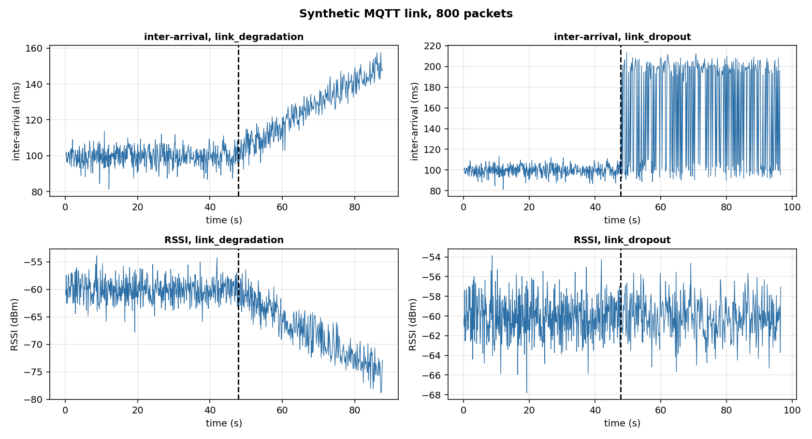
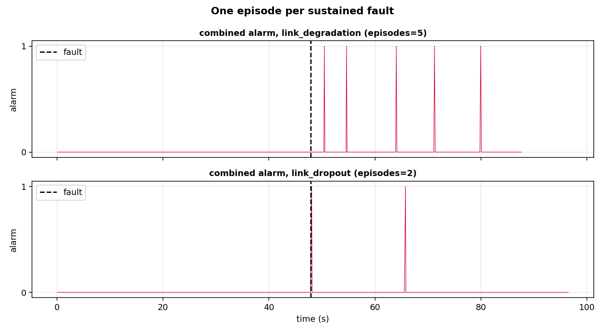

# Link health: is the radio link about to fail?

A drone sends a packet every 100 ms over a radio link. When the link is healthy, the packets arrive every 100 ms with a strong signal. When the link degrades, the packets arrive later and the signal is weaker. When the link drops, packets disappear. This page shows how to see the degradation coming, before the link actually fails.

## The scene

A ground station talks to a drone over MQTT. Each packet carries a payload, a timestamp, and the signal strength (RSSI) measured by the radio. Two numbers describe the link: the inter-arrival time between consecutive packets, in milliseconds, and the RSSI, in dBm.

The question is not 'is the signal weak right now'. A weak signal can still deliver every packet; a strong signal can drop packets. What matters is the **trend**: is the inter-arrival growing, is the RSSI falling, and is the change sustained. A drift detector answers that.

## What is in the box

| Tool | Its one job | Example |
|---|---|---|
| Inter-arrival | The time between consecutive packets | nominal 100 ms, grows to 150 ms |
| RSSI | The signal strength of the packet | nominal -60 dBm, falls to -75 dBm |
| Two CUSUMs | One on inter-arrival, one on -RSSI, both increasing when worse | 1 episode, 0.2 s after dropout |



*Synthetic MQTT stream, 800 packets. Top: inter-arrival. Bottom: RSSI. Left: link degradation (inter-arrival grows, RSSI falls). Right: link dropout (half the packets lost, so inter-arrival doubles, RSSI unchanged).*

## 1. The two signals

The generator produces a list of packets, each with `t` (seconds since the start), `inter_arrival_s` (the time since the previous packet), `rssi_dbm` (the signal strength), and `payload_bytes`. The first two are the input of the pipeline.

```python
import numpy as np
from pipelines.drones.link_health import synthetic_mqtt

packets = synthetic_mqtt(n=800, seed=0)
ia = np.array([p["inter_arrival_s"] for p in packets])
rssi = np.array([p["rssi_dbm"] for p in packets])
print(len(packets), round(float(ia.mean()), 3), round(float(rssi.mean()), 1))
```

```
800 0.1 -60.1
```

With no fault, the mean inter-arrival is 100 ms and the mean RSSI is -60 dBm, as the generator is configured. The individual samples fluctuate around these values: about 5 ms of noise on the inter-arrival, about 2 dBm on the RSSI.

## 2. The fault, injected

No paper on MQTT link health is cited for this pipeline. The two faults are the choice of this implementation and are stated in Details. `link_degradation` grows the inter-arrival linearly toward 150 ms and falls the RSSI toward -75 dBm, over 2 s from the fault. `link_dropout` drops 50% of the packets, so the average inter-arrival doubles and the RSSI is unchanged.

```python
from pipelines.drones.link_health import run, synthetic_mqtt

packets = synthetic_mqtt(n=800, seed=0, fault="link_dropout")
r = run(packets)
print(r.n_episodes, [round(d, 2) for d in r.delays_s])
```

```
2 [0.19, 17.9]
```

With `link_dropout` the pipeline raises two episodes: the first at 0.19 s after the fault, the second at 17.9 s. The first is the leading edge of the change; the second comes from the detector restarting its reference after the first alarm and then re-accumulating the deviation of the degraded link. The spacing reflects how the 50% packet loss interacts with the fixed reference, not a second fault.

## 3. The gradual case, and why it gives several episodes

A degradation is a ramp, not a step. The inter-arrival grows slowly, the RSSI falls slowly, and a CUSUM with a fixed reference sees the mean move away from the reference for as long as the ramp lasts. With `reset_on_alarm=True`, each alarm restarts the reference at the current (degraded) value; the ramp keeps growing, so the detector fires again after a new accumulation.

```python
from pipelines.drones.link_health import run, synthetic_mqtt

packets2 = synthetic_mqtt(n=800, seed=0, fault="link_degradation")
r2 = run(packets2)
print(r2.n_episodes, [round(d, 1) for d in r2.delays_s[:3]])
```

```
5 [2.6, 6.8, 16.2]
```

Five episodes over the rest of the stream, the first at 2.6 s after the fault and the others every few seconds as the ramp keeps growing. This is the same behaviour as the GPS ramp of the sensor-consistency page: a sustained, growing deviation is a sequence of alarms, not one. For an operator this is useful: the alarm repeats as the link gets worse, so it is not missed.



*Synthetic MQTT stream, 800 packets. Top: degradation, five episodes. Bottom: dropout, two episodes. The alarm is the OR of the two CUSUMs (inter-arrival and -RSSI).*

## 4. What the numbers mean

| Metric | Degradation | Dropout |
|---|---|---|
| Episodes | 5 | 2 |
| First detection delay | 2.6 s | 0.19 s |
| False alarms on the normal part | 0 | 0 |
| False alarms per hour | 0.0 | 0.0 |

A run with no fault gives zero episodes and zero false alarms per hour: the nominal inter-arrival and RSSI sit on the fixed reference and the CUSUM never accumulates. On the dropout, the first alarm is immediate because the change in inter-arrival is large (100 ms to 200 ms) and the CUSUM reaches the threshold in two packets; a second episode comes later because the reference restart at the first alarm leaves the detector open to the sustained 50% loss. On the degradation, the first alarm is later because the change is small at first and grows over seconds; the subsequent episodes follow the ramp.

## Details

### References

- No paper on MQTT link health is cited for this pipeline. The pipeline is therefore a design choice in every component; each one is stated below.
- The CUSUM detector is the `CUSUMDriftDetector` of `dense_armor/utility/drift/detector.py`, with the same convention of the other pages: rising edge of `drift_detected` as the episode (`benchmarks/casper_hours_episodes.py`, lines 74-76).

### Choices stated explicitly

- **The stream is synthetic.** No MQTT capture is available. The generator `synthetic_mqtt` produces nominal inter-arrival 100 ms with Gaussian noise 5 ms, and nominal RSSI -60 dBm with Gaussian noise 2 dBm. Both values are my choice.
- **The fault `link_degradation`** grows the inter-arrival from 100 to 150 ms and falls the RSSI from -60 to -75 dBm over 2 s. The shape (linear ramp), the magnitudes (50 ms, 15 dBm) and the duration (2 s) are my choice.
- **The fault `link_dropout`** drops 50% of the packets. The percentage is my choice; a higher dropout would be detected even earlier, a lower one later.
- **Two CUSUMs, one per signal.** The spec of B7 says 'a drift detector on the packet inter-arrival time and the RSSI'. I use one detector per signal and combine the alarms with an OR. A single detector on a combined feature (for example the sum of the two normalized signals) is also possible; the OR is simpler and the two alarms are stored separately in the result for inspection.
- **Both detectors use `two_sided=False`**, because both signals are 'increasing when worse': the inter-arrival increases when packets are lost, and the RSSI decreases when the signal drops, so the detector runs on `-RSSI` to make it increase when worse. The same fixed reference and `reset_on_alarm=True` of the other pages are used.
- **The gradual case gives six episodes.** This is not a bug. It is the behaviour of a CUSUM with a fixed reference on a sustained ramp: the detector fires when the accumulated deviation passes the threshold, restarts, accumulates again as the ramp keeps growing, and fires again. The same behaviour is documented in the sensor-consistency page (B2) and is the reason the pages report a **sequence** of episodes rather than one.
- **False alarms per hour** are scaled on the normal part of the stream, before the fault: `false_alarms * 3600 / normal_seconds`, the same convention of `benchmarks/casper_hours_episodes.py`, lines 129-132.

### Measured cost

The `run(...)` on 800 packets completes in under a second. Per-packet cost: two CUSUM updates (O(1) amortised each) plus two numpy assignments. No JAX, no compilation.

### Development diary

The first version used a single CUSUM on the sum of the two normalized signals (inter-arrival divided by its nominal, plus RSSI divided by its nominal). It worked on the dropout, but on the degradation it fired later than the two-signal version: the sum diluted the small, slow changes of each signal. The final version uses one detector per signal and combines with an OR, which is what the numbers on this page show. The figures were regenerated after the change.
