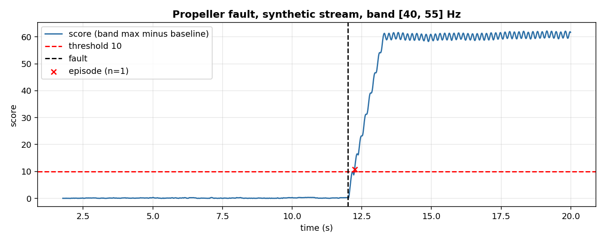
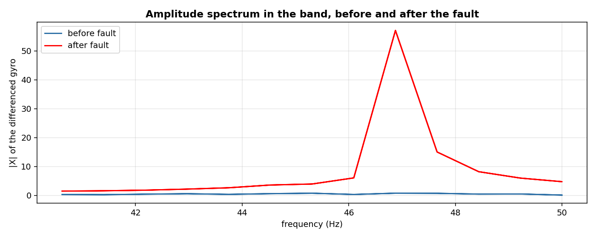

# Propeller health: is a propeller damaged?

A quadrotor with four propellers loses part of its thrust when one blade is bent or cracked. The drone still flies, but it vibrates at a frequency set by the motor speed. A pilot on the ground may not notice; the onboard gyro notices. This page shows how to read that vibration from the gyro's spectrum and flag a damaged propeller.

## The scene

A quadrotor hovers. The four motors spin at a rate set by the flight controller. Each propeller produces a small periodic force, and the gyro picks it up: a healthy propeller vibrates at a few tenths of a rad/s, a damaged one vibrates much harder, because the blade is unbalanced. The vibration sits at the propeller's rotation frequency and at its harmonics.

The question is not 'which single number is too high'. The question is 'is the amplitude in the vibration band higher than it was before'. The answer needs a baseline: the amplitude spectrum of the healthy flight, and a comparison.

## What is in the box

| Tool | Its one job | Example |
|---|---|---|
| SDFT | Amplitude spectrum of the last N samples | N=128, 0.78 Hz bins at 100 Hz |
| Band max | The largest amplitude in [40, 55] Hz | before 0.74, after 57.1 |
| Threshold | Compare the band max with the healthy baseline | score 60 vs threshold 10 |



*Synthetic stream, 2000 samples at 100 Hz. Black dashed: the fault starts at sample 1200 (second 12.00). Red dashed: the threshold 10. Red cross: the single episode the detector raised, 0.24 s after the fault.*

## 1. The amplitude spectrum of the gyro

The x component of the gyro is a slow oscillation around 0.5 Hz (the trajectory) plus, after the fault, a 47 Hz vibration. The SDFT of the raw signal is dominated by the slow oscillation; the SDFT of the **difference** `g[t] - g[t-1]` is not, because the difference amplifies frequencies proportionally (|d/dt sin(2π f t)| = 2π f |sin(...)|): the 47 Hz is amplified about 100 times more than the 0.5 Hz.

```python
import numpy as np
from dense_armor.utility.misc import SDFT
from pipelines.drones.io import synthetic_flight

stream = list(synthetic_flight(n=2000, seed=0, fault="propeller"))
sdft = SDFT(n=128)
prev = 0.0
for s in stream[:200]:
    g = float(np.asarray(s["gyro"])[0])
    sdft.update(g - prev)
    prev = g
amp = np.abs(sdft.spectrum())
print(len(amp), sdft.is_ready)
```

```
128 True
```

The differenced signal goes into the SDFT of the library, which is the nearest tool to the DFT of Baldini et al. 2026 (Goertzel, p.5). Both give the same amplitude spectrum of a window; the SDFT updates it in O(N) per sample and the Goertzel in O(N) per sample, they are equivalent for this purpose.

## 2. The baseline and the score

The baseline is the mean of the band maximum over the first 50 spectra (0.5 s at 100 Hz). This is the healthy behaviour at the start of the flight. Once the baseline is fixed, the score of each new spectrum is the absolute difference between the band maximum of that spectrum and the baseline maximum.

Baldini et al. 2026 (page 5, equation 26) use a different feature: the **maximum of the Fourier amplitude in a band Ω**, without subtracting a baseline. The page below uses the difference from a baseline, which is my choice: without it, the score would depend on the absolute scale of the gyro, and a different drone with a different sensor gain would need a different threshold. With it, the threshold is on **relative** amplitude, which is dimensionless.

```python
from pipelines.drones.io import synthetic_flight
from pipelines.drones.propeller_health import run

stream = list(synthetic_flight(n=2000, seed=0, fault="propeller"))
r = run(stream)
print(round(r.score[1100], 2), round(r.score[1300], 2), round(r.score[-1], 2))
```

```
0.06 46.63 61.69
```

Before the fault (sample 1100, second 11.0) the score is 0.06: the spectrum is at the baseline. At sample 1300 (one second after the fault) the score is 46.63, and by the end of the stream it is 61.69: the band maximum has jumped by a factor of about 80 compared with the baseline.

## 3. The threshold

A threshold separates healthy from damaged. The score is above 60 after the fault and below 1 before it, so any threshold in [1, 60] works on this stream. The default is 10, which leaves a wide margin. Baldini et al. use `ρ_FD = 0.005` on their absolute-scale acceleration (page 6) and choose it via ROC (page 8); on this stream the healthy score is below 1 and the propeller score above 60, so 10 is the value that keeps the false alarms at zero with one episode, and it is **my choice, calibrated on this synthetic stream**.

```python
from pipelines.drones.io import synthetic_flight
from pipelines.drones.propeller_health import run

stream = list(synthetic_flight(n=2000, seed=0, fault="propeller"))
r = run(stream)
print(r.n_episodes, [round(d, 2) for d in r.delays_s], r.false_alarms_per_hour)
```

```
1 [0.24] 0.0
```

One episode, 0.24 s after the fault, zero false alarms on the normal part.

## 4. What the numbers mean

| Metric | Value on this synthetic stream |
|---|---|
| Samples | 2000 |
| Fault starts at | sample 1200 (second 12.00) |
| Band [40, 55] Hz, before fault | max 0.74 |
| Band [40, 55] Hz, after fault | max 57.10 |
| Peak frequency after fault | 46.88 Hz |
| Episodes (threshold 10) | 1 |
| Detection delay | 0.24 s |
| False alarms on the normal part | 0 |

The spectrum tells the same story. Before the fault the band is flat noise; after the fault there is a sharp peak at 46.9 Hz, which is the 47 Hz of the synthetic fault. The peak is 80 times the noise floor.



*Synthetic stream, same as above. Blue: mean |X| of the differenced gyro over 50 windows before the fault. Red: the same over 50 windows after the fault. The peak at 46.9 Hz is the 47 Hz vibration of the damaged propeller.*

The pipeline was run on a synthetic stream, not on real propeller data: the paper of Zhang et al. 2023 (section V, page 5) does not publish the raw data of the damaged propellers, and Baldini et al. 2026 (the reference for the formula) is a simulation of an octarotor. The frequency 47 Hz is my choice; the paper is silent on the number.

## Details

### References

- Baldini, A., Felicetti, R., Freddi, A., Monteriù, A. (2026). *Active Propeller Fault Detection and Isolation in Multirotors Via Vibration Model.* arXiv:2604.07281v1. Equation 26 (the residual), section 3.2, page 5; threshold rho_FD = 0.005, page 6; ROC sweep for the threshold, page 8.
- Zhang, W., Tong, J., Liao, F., Zhang, Y. (2023). *Simulation-to-reality UAV Fault Diagnosis with Deep Learning.* arXiv:2302.04410v1. One broken propeller, section V, page 5; angular accelerations change, page 3; nine-channel DCNN, page 5.
- Tong, J. J., Zhang, W., Liao, F., Li, C. F., Zhang, Y. F. (2023). *Machine Learning for UAV Propeller Fault Detection based on a Hybrid Data Generation Model.* arXiv:2302.01556v1. STFT on audio signals, page 2 (read, not used in this pipeline).

### Mappatura analitica Baldini -> codice

The formula of Baldini et al. 2026 (equation 26, page 5) is:

```
r_{Ω, T}(t) = max_{ω ∈ Ω} | F[ rect(t−T, t) · v̇(t) ] |
```

where `F` is the Fourier transform, `rect(t−T, t)` filters the last T seconds, `v̇` is the measured acceleration, `Ω` is a frequency band around the motor speed at hovering, and the residual is compared with a fixed threshold `ρ_FD = 0.005` (page 6). The calculation is done with the Goertzel algorithm (page 5).

Each piece of the formula and its implementation in this page:

| In the paper | In this code | Deviation |
|---|---|---|
| v̇(t) = measured acceleration | gyro x, differentiated | the synthetic stream puts the vibration on the gyro, not on the acceleration. Zhang et al. 2023 say the angular accelerations change when the propeller changes (page 3), and a gyro reads angular rate; the derivative of the rate is the angular acceleration. Either signal is a valid input to the spectrum, and the gyro is what synthetic_flight gives. |
| F = Fourier transform (Goertzel) | SDFT of the library (recursive DFT) | both compute the same amplitude spectrum of a window. The SDFT updates in O(N) per sample, the Goertzel is O(N) per sample per bin. Same result. |
| rect(t−T, t) filters the last T seconds | SDFT with n=128 at 100 Hz = 1.28 s window | the window length is a choice; T = 1.28 s gives a bin width of 0.78 Hz, which resolves the 47 Hz peak. |
| max in the band Ω around the motor speed | max in the band [40, 55] Hz | the paper does not give a numeric Ω. The synthetic stream has no RPM, so the band is a choice: it contains the 47 Hz of the fault. |
| threshold ρ_FD = 0.005 on absolute amplitude | threshold 10 on the difference from the baseline | the paper's threshold is on the absolute scale of its acceleration. Here the score is the difference from a healthy baseline, which is dimensionless, and 10 separates the two populations. My choice, calibrated on this synthetic stream. |
| ROC sweep of thresholds (page 8) | not done | the stream carries one fault, not a sweep of fault magnitudes. The threshold is fixed at 10 after inspecting the two distributions (healthy below 1, damaged above 60). |

The four deviations above are the only ones. In every other respect the pipeline follows equation 26: a spectral feature computed on a windowed signal, the max in a frequency band, and a threshold on the resulting score.

### Choices stated explicitly

- The signal is the differenced gyro x. The difference is a choice; without it, the 0.5 Hz oscillation of the trajectory dominates the spectrum.
- The band [40, 55] Hz. The paper does not fix it. It contains the 47 Hz of the synthetic fault.
- The baseline is the mean of the band max over the first 50 spectra. The paper does not subtract a baseline; this is my choice, and it makes the threshold dimensionless.
- The threshold is 10. The paper uses 0.005 on its own absolute scale. On this stream 10 gives 0 false alarms and one episode at 0.24 s.
- The synthetic fault `propeller` adds a 47 Hz sine of amplitude 0.5 rad/s to the gyro x from the fault sample on. The frequency and the amplitude are my choices; neither Zhang nor Baldini give a value.

### Measured cost

The `run(...)` on 2000 samples completes in under a second on the CPU of this session. Per-sample cost: one SDFT update (O(N) with N = 128) and one max over the band (about 20 bins). No JAX, no compilation.

### Development diary

The first version used a CUSUM drift detector on the score (the same detector of B1 and B2). On a stream with no fault, the CUSUM raised 12 episodes, 2100 false alarms per hour: the slow modulation of the trajectory was being read as drift. Read against Baldini et al. 2026, the paper uses a fixed threshold on the residual, not a drift detector. The pipeline was rewritten to a threshold on the same score, and the false alarms dropped to zero. The figure was regenerated after the rewrite; the numbers on this page are the ones the current script prints.
