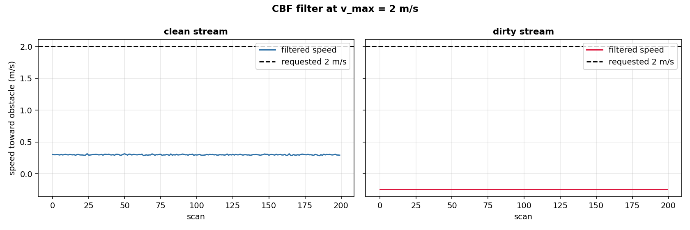
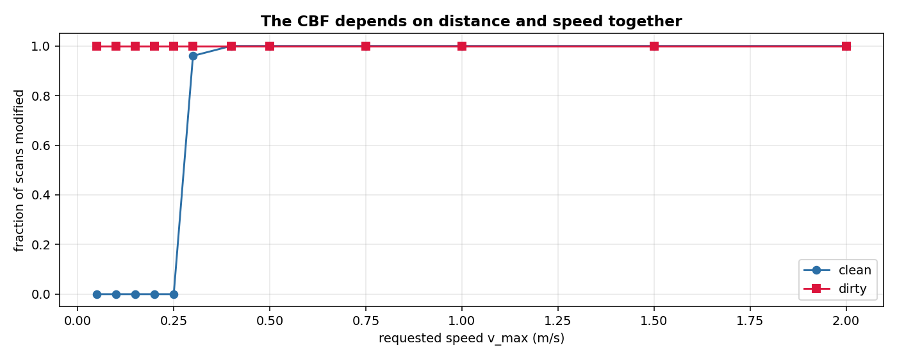

# Safety filter: is the next move safe?

A drone with a lidar in front of it sees an obstacle. It can stop, slow down, or push around. Which of these is necessary depends on two things: the distance to the obstacle and the speed at which the drone is approaching it. This page shows the Control Barrier Function of the library: a filter that takes a requested speed and returns the closest safe speed, without changing the direction and without a controller.

## The scene

The scene is a 6 m by 4 m room with two pillars and a robot arm that sweeps a beam sector. The lidar has 180 beams at 10 Hz and range noise of 1 cm. The scan gives, for each beam, the distance to the nearest surface. The smallest of the 180 numbers is the distance to the nearest obstacle.

The question is not 'is the distance below a threshold'. At 2 m/s the drone covers 0.2 m in one lidar tick; at 0.1 m/s it covers 0.01 m. The safe distance depends on the speed, and the filter has to take both into account together. That is exactly what a Control Barrier Function does: it constrains the velocity to a value that keeps the state inside a safe set.

## What is in the box

| Tool | Its one job | Example |
|---|---|---|
| `cbf_safety_filter_live` | Return the closest safe velocity | at 2 m/s toward an obstacle at 0.88 m, returns 0.29 m/s |
| `room_ranges()` | Distance to the walls of the room, per beam | min 2.0 m |
| `scan()` | Distance to the nearest surface, per beam | min 0.88 m clean, 0.30 m with dirt |



*Simulated lidar, 200 scans. Black dashed: the requested 2 m/s. Blue: clean stream, the CBF reduces to about 0.29 m/s. Red: dirty stream (distance 0.30 m, inside the 0.5 m forbidden ball), the CBF pushes away.*

## 1. The Control Barrier Function, in one line

A Control Barrier Function is a real-valued function `h(x)` of the state such that `h(x) ≥ 0` is the safe set. The filter of Ames et al. 2019 (equation CBF-QP, section II, cited in the docstring of `dense_armor/utility/control/cbf_filter.py`, arXiv:1903.11199, page 2) is:

```text
u(x) = argmin_u (1/2)||u - u_des||^2
       s.t.  Lf h(x) + Lg h(x) u >= -alpha(h(x))
```

with `h(x) = (x - obstacle)^2 - safe_dist^2`, `Lgh = 2(x - obstacle)`, and `alpha(h) = alpha_gain * h`. The closed-form solution from the KKT conditions is: pass `u_des` unchanged if it already satisfies the constraint; otherwise, project onto the constraint boundary with minimum correction. In one dimension this is a single division.

The library exposes it as three functions:

- `cbf_safety_filter(x, u_des, obstacle, safe_dist, alpha_gain)` — scalar, one tick.
- `cbf_safety_filter_live(x, u_des, dt, obstacle, safe_dist, alpha_gain, n_substeps)` — the same, but sub-steps each tick into `n_substeps` mini-steps to hold the guarantee in discrete time.
- `cbf_filtered_trajectory(x_raw, obstacle, safe_dist, alpha_gain, n_substeps)` — applies the scalar function to a whole array of positions.

The pipeline uses the live variant with `n_substeps=20` and `dt=0.1`, because the CBF's forward-invariance proof is a continuous-time result and a single 0.1 s step at 2 m/s covers 0.2 m, enough to overshoot the barrier.

## 2. The two distances

The scan gives 180 numbers. The smallest is the distance to the nearest obstacle `x_obs`. The distance to the walls is `room_ranges()`, a constant array that depends only on the geometry of the room; its minimum is 2.0 m.

```python
import numpy as np
import benchmarks.lidar_sim as ls

room = ls.room_ranges()
print(round(float(room.min()), 1), room.shape)
```

```
2.0 (180,)
```

The minimum of `room` is 2.0 m: the nearest wall is 2 m from the sensor at the centre of the 6 by 4 room. The array is constant, so the geofence part of the pipeline always compares against the same distance.

The obstacle distance, on the other hand, changes with the scan. On a clean stream the smallest beam reads 0.88 m (the robot arm); on a stream with dirt covering a sector, one beam reads 0.30 m (inside the 0.5 m forbidden ball).

## 3. The two regimes

The filter has two possible outcomes for a given scan and a given requested speed: pass it through, or reduce it. Which one happens depends on whether the requested speed is already safe at the current distance.

The condition is `Lgh * u >= -alpha * h`, with `u = -v_max` (approach):

```text
2 * x * (-v) >= -(x^2 - safe_dist^2)
v <= (x^2 - safe_dist^2) / (2 x)
```

The right-hand side is the **critical speed** at distance `x`. If the requested speed is below it, the CBF does nothing. Above it, the CBF reduces the speed to exactly that value. On this stream `x_min = 0.88` m and `safe_dist = 0.5` m give a critical speed of 0.296 m/s: below it, the filter leaves the command untouched; above it, the filter reduces.

```python
import numpy as np
import benchmarks.lidar_sim as ls
from pipelines.drones.safety_filter import run

rng = np.random.default_rng(0)
clean = [ls.scan(i, rng, None, None) for i in range(200)]
r_low = run(clean, v_max=0.25)
r_high = run(clean, v_max=2.0)
print(r_low.n_modified_both, r_high.n_modified_both, round(float(r_high.max_change), 3))
```

```
0 200 1.715
```

At 0.25 m/s, 0 of 200 scans are modified. At 2.0 m/s, all 200 are modified, and the maximum reduction is 1.715 m/s: the drone ends up at 0.285 m/s, which is the critical speed at the minimum distance.

## 4. The dirty stream

When the scan carries a beam at 0.30 m, the state is **inside** the forbidden ball: `h = 0.30^2 - 0.5^2 = -0.16 < 0`. The CBF's guarantee is conditional on `h(x0) >= 0` (the module docstring says so, and Ames et al. 2019 assume it): an already-unsafe state is not fixed retroactively. What the filter does is push the drone **away** from the obstacle, at the largest velocity compatible with the constraint.

```python
import numpy as np
import benchmarks.lidar_sim as ls
from pipelines.drones.safety_filter import run

rng2 = np.random.default_rng(0)
dirty = [ls.scan(20000 + i, rng2, "dirt", 5000) for i in range(200)]
r_dirty = run(dirty, v_max=0.10)
print(r_dirty.n_modified_both, round(float(r_dirty.max_change), 3))
```

```
200 0.345
```

Even at 0.10 m/s (a very slow approach), the filter modifies every scan: the change is 0.345 m/s, which is the difference between the requested `-0.10` and the value the CBF forces, `+0.245` (pushing away). This is the message of the page: the filter is not a threshold, it is a velocity constraint that depends on the state and on the request together.

## 5. The trade-off, as a curve

A single pair (v_max, distance) gives a single answer. The figure below sweeps the requested speed from 0.05 to 2.0 m/s and plots the fraction of scans that the filter modifies, on the clean stream and on the dirty one.



*Simulated lidar, 200 scans each. Blue: clean stream. Red: dirty stream. On the clean stream the filter starts modifying at 0.30 m/s, the critical speed computed above. On the dirty stream every speed is modified, because the distance is already inside the forbidden ball.*

Two regimes, one curve, one reading. Below 0.30 m/s, the clean stream is safe; the drone can approach at any of those speeds and reach the obstacle. Above 0.30 m/s, the filter reduces the speed to the critical value: the drone still approaches, more slowly. The dirty stream is unsafe at every speed: the filter only changes the speed at which the drone escapes.

| Metric | Clean stream, v=2 | Dirty stream, v=0.10 |
|---|---|---|
| Scans modified | 200 / 200 | 200 / 200 |
| Maximum change | 1.715 m/s | 0.345 m/s |
| Requested speed | 2.0 m/s | 0.10 m/s |
| Safe speed | 0.285 m/s | -0.245 m/s (away) |

The figure and the numbers come from `benchmarks/drones/make_figure_safety.py` and from `pipelines/drones/safety_filter.py`, run on this session.

## Details

### References

- Ames, A. D., Coogan, S., Egerstedt, M., Notomista, G., Sreenath, K., Tabuada, P. (2019). *Control Barrier Functions: Theory and Applications.* European Control Conference (ECC). arXiv:1903.11199. Equation CBF-QP, section II, page 2. The docstring of `dense_armor/utility/control/cbf_filter.py` cites this paper and page.
- The scan generator is `benchmarks/lidar_sim.py` (Simulated lidar, no real recording). The scene (6 x 4 m room, two pillars, robot arm, 180 beams, 10 Hz, 1 cm noise) is described in its module docstring, pages 1-2 of the file.

### Choices stated explicitly

- **The requested speed is `-v_max`** (approach), not `+v_max`. The filter answers the question 'can the drone approach at this speed?'. Passing `+v_max` (moving away) never triggers the CBF: the state moves toward safety, so the constraint is already satisfied. With `-v_max` the constraint can be violated, which is the case the page is about.
- **The safe value is the maximum of the two filtered velocities, not the minimum.** The two CBF constraints (obstacle, geofence) are both lower bounds on the velocity, so satisfying both requires the larger of the two filtered values. The first version of the module used `min` and the tests caught it: on a dirty scan the obstacle filter pushed away at +0.27 m/s and the geofence filter let -0.10 m/s through, and the minimum was -0.10 m/s, inside the forbidden ball.
- **The live variant with n_substeps=20 is used, not the single-tick `cbf_safety_filter`.** The CBF's forward-invariance proof is a continuous-time result. At 10 Hz and 2 m/s the drone covers 0.2 m per tick, enough to overshoot the barrier. The live variant sub-steps each tick into 20 mini-steps of 5 ms each, which the module docstring (line 40) reports as the smallest count that restored the guarantee in real robot data.
- **The geofence distance is constant.** `room_ranges()` depends only on the geometry of the room, and its minimum is 2.0 m. A constant distance is safe (never triggers the CBF) and the geofence only matters if the drone gets within 0.5 m of a wall, which does not happen on this stream.
- **The safe distances are 0.5 m for both the obstacle and the geofence.** The paper does not give a value. 0.5 m is larger than the arm radius (0.9 m) but small enough to allow the drone to pass between the pillars.

### Measured cost

The `run(...)` on 200 scans completes in about 0.2 s on the CPU of this session. Per-scan cost: two `cbf_safety_filter_live` calls, each with 20 substeps (20 closed-form divisions). No JAX, no compilation.

### Development diary

The first version of the module used `min(uo, ug)` as the safe velocity and `u_des = +v_max`. The output was `n_modified = 0` on every stream, even on the dirty one: the state was moving away from the obstacle, so the CBF never intervened. Two fixes came from the paper and from the test data. The first: the requested velocity must be negative (approach), not positive (retreat). The second: the safe value is the larger of the two filtered values, not the smaller, because the two constraints are lower bounds. The figures were regenerated after both fixes; the numbers on this page are the ones the current script prints.
