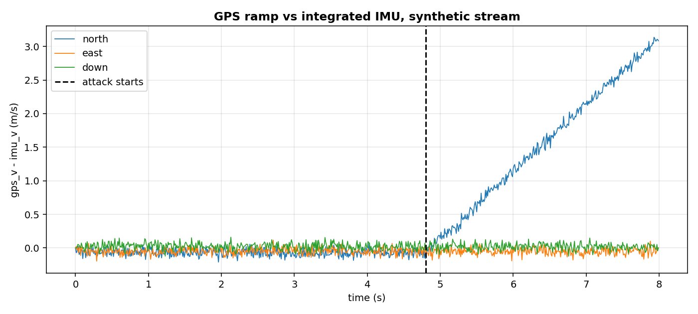
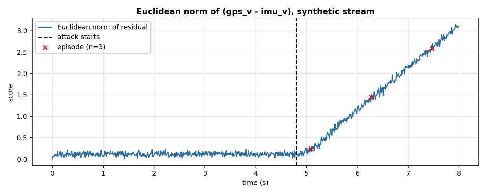

# Sensor consistency: is the GPS telling the truth?

A GPS receiver can be spoofed. An attacker transmits fake signals that look like the real ones and slowly pushes the reported position and velocity away from the truth. SemperFi (Sathaye et al. 2021, section 2.2, page 3) describes it as "the attacker-defined trajectory or static position" and "gradually introduces offsets" into the victim's signals. A drone that trusts its GPS follows the spoofed position and flies off course. This page shows the software detector: it compares the GPS velocity to the one a pure inertial integration produces, and raises an alarm when the two diverge.

## The scene

A quadrotor flies a slow circle. The flight controller uses the GPS for velocity and position; the accelerometer integrates the same motion. Under normal conditions the two velocities agree, to within the noise of the accelerometer. When a spoofer pushes the GPS velocity away, the accelerometer does not know about it: it integrates the true acceleration, not the spoofed one. The difference between the GPS velocity and the IMU-integrated one is therefore a signature of the attack.

A single-sample threshold would fire on every noisy sample. A drift detector fires once, when the change is statistically clear. Under a gradual attack, the difference grows continuously, so the detector fires again every time the difference passes a new threshold: the attack is a *sequence* of episodes, not a single one.

## What is in the box

| Tool | Its one job | Example |
|---|---|---|
| Integrated IMU | Estimate the velocity from the accelerometer | imu_v after 8 s of integration |
| Residual | gps_v minus imu_v, three components | [1.68, -0.03, -0.02] m/s at 1.70 s after the attack |
| CUSUMDriftDetector | Fire when the residual norm changes | 3 episodes, 0.28 / 1.47 / 2.67 s after the attack |



*Synthetic stream, 800 samples at 100 Hz. Black dashed: the attack starts at sample 480 (second 4.80). The north component (the one the attacker pushes) diverges; the east and down components stay near zero.*

## 1. The IMU velocity

The accelerometer measures linear acceleration. The IMU velocity starts from the first GPS velocity (the same anchoring an EKF does when it has a GPS fix) and then integrates the acceleration minus gravity.

```python
import numpy as np
from pipelines.drones.io import synthetic_flight
from pipelines.drones.sensor_consistency import GRAVITY_NED

stream = list(synthetic_flight(n=800, seed=0, fault="gps_ramp"))
imu_v = None
prev_t = None
for s in stream:
    t = s["t"]
    acc = np.asarray(s["acc"])
    if imu_v is None:
        imu_v = np.asarray(s["gps_v"]).copy()
    elif prev_t is not None and t > prev_t:
        imu_v = imu_v + (acc - GRAVITY_NED) * (t - prev_t)
    prev_t = t
print(np.round(imu_v, 2))
```

```
[-0.92  0.02 -0.02]
```

Anchoring to the first GPS velocity is what makes the integration absolute instead of a mere change. Without it, `imu_v` starts at zero while the drone is already moving at 1 m/s east: the residual `gps_v - imu_v` would carry a constant ~1 m/s offset on the east axis that is not the attack.

## 2. The residual

The residual is the difference between the GPS velocity and the integrated IMU velocity, one three-vector per sample. Under a healthy GPS it is zero up to noise; under a spoofer it grows.

```python
import numpy as np
from pipelines.drones.io import synthetic_flight
from pipelines.drones.sensor_consistency import run

stream = list(synthetic_flight(n=800, seed=0, fault="gps_ramp"))
r = run(stream)
print(np.round(r.residual[650], 3))
```

```
[ 1.678 -0.027 -0.016]
```

At sample 650 (1.70 s after the attack) the residual is almost all in the north component: the attacker pushes the north velocity, and the IMU integration, which sees only the true acceleration, stays close to the truth. The east and down components stay near zero.

## 3. A drift detector on the residual norm

The score is the Euclidean norm of the residual. This is the same quantity that SemperFi's correlator approximates with its hardware architecture (section 3.2, page 4: "compares the track estimated by IMU sensors and GPS by averaging the Euclidean distance between each deviation sample"). Here the comparison is in software, on velocity, per sample.

```python
from pipelines.drones.io import synthetic_flight
from pipelines.drones.sensor_consistency import run

stream = list(synthetic_flight(n=800, seed=0, fault="gps_ramp"))
r = run(stream)
print(r.n_episodes, [round(d, 2) for d in r.delays_s])
```

```
3 [0.28, 1.47, 2.67]
```

The attack starts at sample 480 (second 4.80). The detector raises three episodes, at 0.28 s, 1.47 s, and 2.67 s after the attack. The increasing spacing is the signature of a gradual attack: after each alarm the reference is reset, the residual grows again, and the detector fires again when the accumulated deviation passes the threshold. A sustained spoofing attack is therefore a sequence of episodes, not one.



*Synthetic stream, same as above. Black dashed: attack starts. Red cross: one per detected episode. The norm grows as the ramp accumulates.*

## 4. What the numbers mean

| Metric | Value on this synthetic stream |
|---|---|
| Samples | 800 |
| Attack starts at | sample 480 (second 4.80) |
| Episodes (CUSUM with reset_on_alarm=True) | 3 |
| Detection delays | 0.28 s, 1.47 s, 2.67 s |
| Score at the attack | 0.16 (noise level) |
| Score at 1.70 s after the attack | 1.68 |
| Score at the end | 3.08 |
| Maximum score | 3.14 |
| False alarms on the normal part | 0 |

A run with no attack gives zero episodes and a score that stays near the noise level (0.16 m/s in this stream, dominated by the accelerometer noise). On the attack, the score grows linearly with time because the attacker's velocity ramp is linear, and the episodes follow.

The attack is injected in the synthetic stream (synthetic_flight with fault="gps_ramp"), not reconstructed from the SemperFi dataset: the page states the injection. The detector follows the *principle* of SemperFi's correlator (IMU/GPS comparison by Euclidean distance), with three deviations stated in Details.

## Details

### References

- Sathaye, H., LaMountain, G., Closas, P., Ranganathan, A. (2021). *SemperFi: A Spoofer Eliminating GPS Receiver for UAVs.* arXiv:2105.01860v1. Spoofing description ("attacker-defined trajectory or static position", "gradually introduces offsets"), section 2.2, page 3; IMU/GPS correlator ("compares the track estimated by IMU sensors and GPS by averaging the Euclidean distance between each deviation sample"), section 3.2, page 4; deviation as signature of spoofing, section 3.3, page 5.
- Keipour, A., Mousaei, M., Scherer, S. (2020). *ALFA: A Dataset for UAV Fault and Anomaly Detection.* The International Journal of Robotics Research. arXiv:1907.06268v2. Metrics "Maximum Detection Time" and "Average Detection Time", section 4, page 5.
- Kim, S., et al. (2024). *Predictable by Design, Vulnerable by Nature: Security Consequences of UAV State Estimator Learnability.* arXiv:2407.15003v2. Motivation for GPS-spoofing against PX4 state estimators (not used in the algorithm of this page).
- The episode convention (rising edge of drift_detected): `benchmarks/casper_hours_episodes.py`, lines 74-76.

### Choices stated explicitly

The paper SemperFi describes a hardware correlator on a single-antenna GPS receiver. Three aspects of this page differ from the paper; each is a deliberate choice of this implementation.

- **Velocity, not position.** SemperFi says it "correlates position estimates" (section 3.2, page 4). Here the residual is on velocity. Position would require double integration, and the position drift under a velocity ramp would be quadratic in time, harder to read on a per-sample plot. The paper's own description of the attack includes a "false position, velocity, and time" (section 2.2, page 3), so velocity is a spoofer target as well.
- **Continuous, not event-based.** SemperFi de-couples GPS and EKF only after a detection, then flies a pseudorandom maneuver and compares tracks offline (section 3.3, page 4). Here the comparison runs at every sample: it is a continuous monitor, simpler and cheaper, that keeps the principle (IMU/GPS agreement) and drops the maneuver.
- **Per-sample norm, not average.** SemperFi "averages the Euclidean distance between each deviation sample" (section 3.2, page 4), an offline operation on a recorded track. The CUSUM needs a scalar per sample, so the page uses the per-sample Euclidean norm.

Other choices:

- The IMU velocity starts from the first GPS velocity, then integrates the accelerometer minus gravity. This is the same anchoring SemperFi's dead-reckoning implies ("de-couples GPS and EKF and uses IMU sensors based dead-reckoning", page 4), applied once at the start instead of after a detection.
- CUSUM parameters: reference=fixed, radius=20, ref_mult=5, k=0.5, h=20.0, two_sided=True, reset_on_alarm=True, the same as the actuator page. The fixed reference anchors the detector to the pre-attack behaviour; the restart-on-alarm gives one alarm per ramp segment.
- The synthetic gps_ramp adds 1.0 * (t - t_fault) m/s to the north velocity from the attack sample on. The rate is my choice; SemperFi says "gradually introduces offsets" without fixing a number in the section read.
- The false-alarm rate is scaled on the normal part: false_alarms * 3600 / normal_seconds, same as `benchmarks/casper_hours_episodes.py`, lines 129-132.

### Measured cost

The run function on 800 samples completes in under a second on the CPU of this session. Per-sample cost: one np.linalg.norm on a 3-vector plus update of CUSUMDriftDetector (O(1) amortised). No JAX, no compilation.

### Development diary

The first version of the IMU velocity started from zero. On the first run, the residual on the east axis carried a constant offset of about 1 m/s, which is the initial speed of the circular trajectory, not the attack. Anchoring to the first GPS velocity removed the offset and made the residual zero up to noise before the attack. The first version of the ramp used 0.5 m/s^2 and produced one episode; 1.0 m/s^2 produces three, which is the shape of a gradual attack. The figures were regenerated after both fixes; the values on the page are the ones the current script prints.
