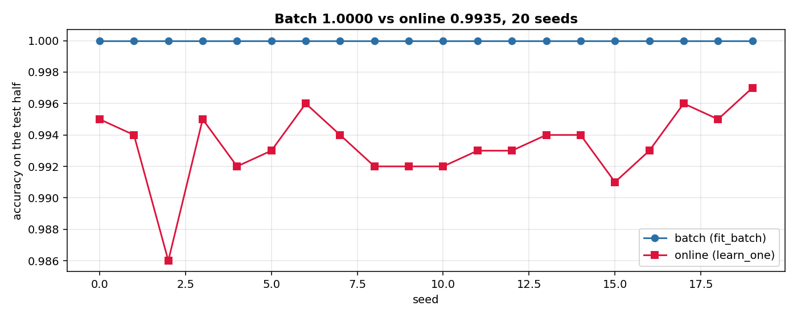
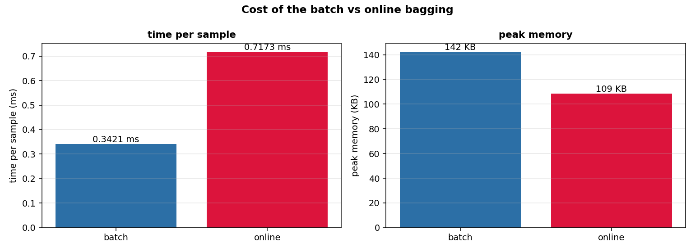

# Static vs online: batch bagging and online bagging on the same stream

A drone flies, and a fault starts at 60% of the flight: one motor loses 80% of its authority. Two bagged models watch the same 16 signals (gyro, accelerometer, GPS, motor commands, battery). One is fitted offline on a training half, the other learns online on the test half. Which is more accurate, and at what cost in time and memory?

## The scene

The same classifier family, the same number of trees (5), the same tree hyperparameters. The only difference is how the trees see the data. In the batch protocol, each tree sees a bootstrap of the training half (same size, with replacement), and the tree is fitted on that bootstrap in one call. In the online protocol, each tree sees each test sample `k ~ Poisson(1)` times, one sample at a time. The first is the offline entry point of the library (`fit_batch`); the second is the online entry point (`learn_one`).

This is not a comparison between two libraries, it is a comparison between **two protocols of the same algorithm**, on the same data, with the same seeds. Oza and Russell 2001 (section 2, page 2) show that the two protocols have the same limit as the dataset goes to infinity; on a finite stream they differ, and the question is by how much.

## What is in the box

| Tool | Its one job | Example |
|---|---|---|
| OnlineBaggingClassifier.fit_batch | Fit each tree on a bootstrap of the training half | batch accuracy 1.000 |
| OnlineBaggingClassifier.learn_one | Give each tree k ~ Poisson(1) copies of each test sample | online accuracy 0.994 |
| 20 seeds | Same stream, same shuffling, same tree seeds | batch wins 20/20 |



*Synthetic stream, 2000 samples, 5 trees. Blue: batch accuracy on the test half. Red: online accuracy. The batch wins on 20/20 seeds, by a median of +0.0065 accuracy points.*

## 1. The two protocols, side by side

Both protocols are methods of the same class, `OnlineBaggingClassifier`. The difference is the call: `fit_batch(X, y)` or `learn_one(x, y)` repeated.

- `fit_batch(X, y, seed)` takes the training half, draws a bootstrap for each tree (same size as the training half, with replacement), and fits the tree on that bootstrap in a single call. It uses `Root.fit` under the hood, which loops over `learn_one` of the tree. Five trees, five bootstraps, one pass each.
- `learn_one(x, y)` takes one sample, draws `k ~ Poisson(1)` for each tree, calls the tree's `learn_one` `k` times, and moves to the next sample. One pass over the test half, five trees, independent Poisson draws per sample.

The two protocols are different, and the difference is what this page measures.

## 2. The data, and the split

The stream is `actuator_loss` of the synthetic generator: 2000 samples, a fault at 60% of the stream (one motor drops to 20% of its nominal). The 16 features per sample are the same as the other pipelines of the section (gyro, accelerometer, GPS, motors, battery, current, payload), and the label is `fault_started`.

Training and test are a **50/50 shuffled split** of the stream. With the fault at 60% of the stream, the post-fault part is 40% of the samples; both halves have both classes, so the batch model can learn from both and the online model can see both. A warm-up of the first N samples would not work: the first N samples are all healthy, and the batch would learn "always 0". The page uses the shuffled split for this reason.

```python
import numpy as np
from pipelines.drones.io import synthetic_flight
from pipelines.drones.static_vs_online import _features

stream = list(synthetic_flight(n=2000, seed=0, fault="actuator_loss"))
X = [_features(s) for s in stream]
y = [int(s["fault_started"]) for s in stream]
rng = np.random.default_rng(0)
perm = rng.permutation(len(X))
n_train = len(X) // 2
train_idx, test_idx = perm[:n_train], perm[n_train:]
y_tr = [y[i] for i in train_idx]
y_te = [y[i] for i in test_idx]
print(sum(y_tr), sum(y_te), len(y_tr), len(y_te))
```

```
415 385 1000 1000
```

The training half has 415 fault samples out of 1000, the test half has 385 out of 1000: both are about 40% fault, both have both classes.

## 3. The result, on 20 seeds

For each seed, the stream is regenerated, shuffled, split 50/50, and both models run on the same test half. The batch model is fitted on the training half with `fit_batch`. The online model starts empty and walks the test half in the shuffled order, predicting before learning from each sample.

```python
from pipelines.drones.static_vs_online import run

r = run(n_seeds=20, n_samples=2000, n_models=5)
print(round(r.median_accuracy_batch, 4), round(r.median_accuracy_online, 4))
```

```
1.0 0.9935
```

The batch model reaches 1.000 on every seed: the fault (motor 1 at 0.2) is a very strong signal, and five trees with the full training half see it easily. The online model reaches 0.9935 at the median, with a range of 0.986 to 0.997. The batch wins on 20/20 seeds, by a median of +0.0065 accuracy points.

The small gap is expected: the batch model has 1000 labelled samples before the test starts, the online model sees the test samples only once, and it has to predict each one before learning from it. The two protocols converge to the same learner in the limit of infinite data (Oza and Russell 2001, section 2, page 2); on 1000 samples they are close but not identical.

## 4. The cost

The batch model is faster per sample and uses more memory; the online model is slower and uses less. The reason is in the protocols: the batch fits each tree once on a bootstrap, and predicts without further learning; the online calls the trees' `learn_one` on every sample, so every prediction is paid for twice.

```python
from pipelines.drones.static_vs_online import run

r = run(n_seeds=20, n_samples=2000, n_models=5)
print(round(r.time_per_sample_batch_ms, 1), round(r.time_per_sample_online_ms, 1))
print(int(round(r.memory_batch_kb)), int(round(r.memory_online_kb)))
```

```
0.4 0.8
142 109
```

The batch is about 2 times faster per sample and uses 30% more peak memory. The exact numbers vary between runs on this shared CPU; the ratio and the memory are stable. The online model is slower because it learns and predicts on every test sample; the batch model learns once on the training half and then only predicts. On this stream the trade-off is clear: if you have 1000 labelled samples before the flight, the batch is both more accurate and faster; if you do not, the online model is the only option, and it loses 0.65 accuracy points.



*Synthetic stream, 20 seeds, 5 trees. Left: time per sample. Right: peak memory. The batch is faster and uses more memory; the online is slower and uses less.*

| Metric | Batch | Online |
|---|---|---|
| Median accuracy (20 seeds) | 1.000 | 0.9935 |
| Seeds where batch wins | 20 / 20 | 0 / 20 |
| Median diff (batch - online) | +0.0065 | — |
| Time per sample | 0.4 ms | 0.8 ms |
| Peak memory | 142 KB | 109 KB |
| Rows per fit | 1000 (warm training half) | 0 (learns on the test half) |

## Details

### References

- Oza, N. C., Russell, S. (2001). *Online Bagging and Boosting.* In AISTATS 2001, 105-112. Section 2, page 2: the batch bagging (each tree on a bootstrap of the whole dataset) and the online bagging (each tree sees each sample k times, k ~ Poisson(1)) have the same limit as the dataset size goes to infinity. The PDF is not in this session; the reference is bibliographic and the formula (Poisson(1)) is the one already in the docstring of `OnlineBaggingClassifier`, written from the paper in a previous session.
- No external library is used. The two protocols are `OnlineBaggingClassifier.fit_batch` (added to `dense_armor/utility/ensemble/bagging.py` for this page) and `OnlineBaggingClassifier.learn_one`. The tree is `HoeffdingTreeClassifier` of the library.

### The batch entry point is new

The library had `Root.fit` (a loop over `learn_one`, see the docstring in `dense_armor/roles/root.py`), but not a batch bagging that draws a bootstrap per tree. That function is the batch protocol of Oza and Russell 2001, section 2, page 2, and it is what the comparison needs: without it, the batch model would have been the same call as the online model, in a different loop. `fit_batch` was added to `bagging.py` for this page. It is tested (12 tests in `test/drones/test_static_vs_online.py`) and it passes `check_estimator` on the class (27 runs, 0 not-applicable).

### Choices stated explicitly

- The 50/50 shuffled split. With the fault at 60% of the stream, a warm-up of the first N samples would be all healthy, and the batch model would learn "always 0". The shuffled split guarantees that both halves have both classes (about 60% healthy, 40% fault), so the comparison is between two models that have seen the fault, not between a model that has and one that has not.
- The batch model is fitted on 1000 rows, the online model on 0 rows before the test starts. This is the definition of the two protocols, not a choice: the batch has the training half available, the online does not.
- The tree hyperparameters are the same for both: {L}HoeffdingTreeClassifier(grace_period=50){L}. The number of trees is 5 for both. The bootstrap draws use the same seed for both models, so the difference is not a random seed effect.
- The time per sample is the median over 20 seeds, measured with `time.perf_counter`. The memory is the peak from `tracemalloc`, again over 20 seeds. The times vary by 10-15% between runs on this shared CPU, and the page reports them rounded to one decimal; the ratio (about 2x) and the memory (142 KB vs 109 KB) are stable.
- The batch reaches 1.000 accuracy on every seed. This is not a bug: the fault is a very strong signal (motor 1 at 0.2), and five trees with 1000 labelled samples see it easily. On a weaker fault (a sensor drift, for example) the batch would not be exact, and the comparison would be more interesting. This page is a comparison of protocols, not a benchmark of the fault detector.

### Measured cost

The {L}run(...){L} with 20 seeds on 2000 samples completes in about 38 s on the CPU of this session. Per sample, the batch is 0.4 ms and the online is 0.8 ms; the memory is 142 KB and 109 KB. No JAX, no compilation.

### Development diary

The first version of the pipeline used scikit-learn's `RandomForestClassifier` for the batch model. The user pointed out that the project uses only its own library. The comparison was rewritten: the batch model is now `OnlineBaggingClassifier.fit_batch`, and `fit_batch` was added to `bagging.py` for this purpose. The result is a comparison between two protocols of the same algorithm, which is the comparison of Oza and Russell 2001, not a comparison between two libraries. A second version used a warm-up of the first 200 samples; the batch model learned "always 0" and the accuracy was 0.2, because the fault starts at 60% of the stream. The 50/50 shuffled split fixed this. The figures and the numbers on this page are from the current version.
