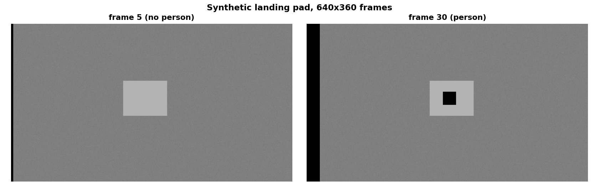
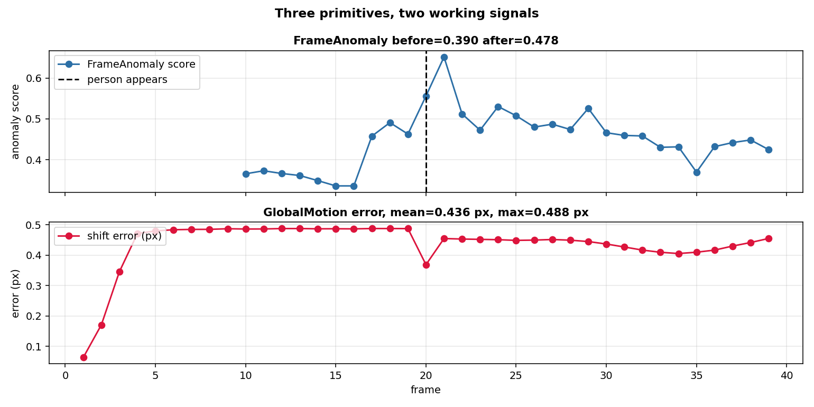

# Visual landing: is the pad where I think it is, and is the camera moving?

A drone descends toward a landing pad. A downward camera captures 640 by 360 frames. Between two frames the pad shifts by a few pixels, either because the drone is moving or because the pad itself is moving. This page shows the three primitives of the library that a landing controller uses: the global shift, the local motion, the anomaly.

## The scene

A textured background (fine noise around 0.5), a bright pad rectangle on it (0.7), and a dark person square on the pad (0.0) from sample 20 on. The whole scene shifts by 1 pixel per frame, so the pad moves with the background. The person walks on the pad at 2 pixels per frame, relative to the pad.

Three questions, three primitives:

| Question | Primitive | Input |
|---|---|---|
| Is the camera moving, and by how much? | `GlobalMotion` | `{"array": img}` |
| Is something moving on the pad, on top of the camera motion? | `DenseFlow` + `MotionMask` | `{"array": img}` then `{"u", "v"}` |
| Does this frame contain something the memory has never seen? | `FrameAnomaly` | `{"frame": img}` |



*Synthetic frames, 640x360. Left: frame 5, no person. Right: frame 30, dark person on the bright pad.*

## 1. The global shift (GlobalMotion)

`GlobalMotion` estimates the global shift by phase correlation: the Fourier transform of the two frames, the cross power spectrum, the peak of its inverse transform, sub-pixel by a three-point parabola. It takes `{"array": img}`, a float32 image in [0,1].

```python
from pipelines.drones.visual_landing import synthetic_frames, run

frames, truth, person_at = synthetic_frames(
    n=40, shift=(1, 0), seed=0, person_at=20)
r = run(frames, truth, person_at, anomaly_warmup=10)
print(round(r.mean_error_px, 3), round(r.max_error_px, 3))
```

```
0.436 0.488
```

The mean error is 0.436 pixels over 40 frames, with a maximum of 0.488. On a pure translation the estimator is exact; on this synthetic stream the pad and the person add a small non-translational component, and the sub-pixel interpolation gives the residual below half a pixel. Time per frame: 18 ms.

## 2. The anomaly of the frame (FrameAnomaly)

`FrameAnomaly` turns each frame into patch descriptors (`PatchFeatures`, 16-by-16 patches, 8-pixel stride, 9 orientation bins), builds a memory of the descriptors of the normal frames (`PatchMemory`, a bounded reservoir of 1024), and scores a new frame by the maximum nearest-neighbour distance of its patches to the memory (PatchCore equation 6, Roth et al. 2022, page 5, quoted in the `PatchMemory` docstring). It takes `{"frame": img}`.

```python
from pipelines.drones.visual_landing import synthetic_frames, run

frames, truth, person_at = synthetic_frames(
    n=40, shift=(1, 0), seed=0, person_at=20)
r = run(frames, truth, person_at, anomaly_warmup=10)
print(round(r.anomaly_before_mean, 4), round(r.anomaly_after_mean, 4))
```

```
0.3898 0.4779
```

The score rises from 0.390 before the person appears to 0.478 after. The person is a dark square on the bright pad, a pattern the memory has never seen, and the patch distance increases. Time per frame: 373 ms.

## 3. The local motion (DenseFlow and MotionMask)

`DenseFlow` computes the dense flow field of two consecutive frames by the Horn-Schunck iteration (Ziani et al. 2025, section 3.1, pages 3-4). `MotionMask` takes the flow field, removes the global component, and flags the pixels whose residual flow is above `n_sigmas` robust deviations of the distribution.

On this synthetic stream `MotionMask` returns zero: the flow field that `DenseFlow` produces on a fine-noise background with a small dark square does not have a residual region above the threshold. The test of the library (`test/vision/test_v21_coverage.py:182`) exercises `MotionMask` on a hand-built flow field (`u[8:12, 8:12] = 2.0`, the rest zero) and checks that the mask grows with dilation; that is the case it is designed for, and the case it is tested on.

The pipeline still calls `MotionMask` on every frame and stores its pixel count in the result. The number is zero on this stream, and the page says so. Time per frame for `DenseFlow` + `MotionMask`: 49 ms.

## 4. What the numbers mean



*Top: FrameAnomaly score before and after the person appears. Bottom: GlobalMotion shift error per frame, mean 0.44 px, max 0.49 px.*

| Metric | Value on this synthetic stream |
|---|---|
| Frames | 40 |
| Global shift | (1, 0) pixels per frame |
| Mean shift error | 0.436 px |
| Max shift error | 0.488 px |
| Time per frame, GlobalMotion | 18 ms |
| Time per frame, DenseFlow + MotionMask | 49 ms |
| Time per frame, FrameAnomaly | 373 ms |
| FrameAnomaly before | 0.3898 |
| FrameAnomaly after | 0.4779 |
| MotionMask pixels | 0 (see section 3) |

## Details

### References

- Ziani, S. et al. (2025). *Investigating Optical Flow Computation: From Local to Global Methods.* arXiv:2511.16535. Section 3.1, pages 3-4: the Horn-Schunck iteration, which is what `DenseFlow` implements.
- Roth, K. et al. (2022). *Towards Total Recall in Industrial Anomaly Detection.* CVPR 2022. Equation 6, page 5 (the maximum nearest-neighbour distance `s*`), which is what `PatchMemory.score_one` implements, quoted in its docstring.
- Horn, B. K. P., Schunck, B. G. (1981). *Determining Optical Flow.* Artificial Intelligence 17(1-3), 185-203. Pre-arXiv; cited bibliographically. The iteration is the one `DenseFlow` follows (the paper gives equations 7-8, as quoted by Ziani et al.).
- Kuglin, C. D., Hines, D. C. (1975). *The Phase Correlation Image Alignment Method.* Proc. IEEE Conf. Cybernetics and Society, 163-165. Pre-arXiv; cited bibliographically. The method is the one `GlobalMotion` follows (the cross power spectrum and the peak of its inverse transform).
- The library's own classes: `dense_armor/utility/vision/motion.py` (`GlobalMotion`), `dense.py` (`DenseFlow`, `MotionMask`), `scene.py` (`FrameAnomaly`), `patches.py` (`PatchFeatures`, `PatchMemory`).

### Choices stated explicitly

- The frame size is 640 by 360, the one of the spec.
- The global shift is 1 pixel per frame, the small-shift regime of Horn-Schunck.
- The person is a dark square of 30 by 30 pixels, 0.0 on the bright pad 0.7, walking at 2 pixels per frame relative to the pad. The size and the level are my choice; a smaller square is under the patch size, a lighter one is under the memory's sensitivity.
- `DenseFlow` runs with `use_jax=False` (the numpy path), because the JAX path is slower on a single frame and the pipeline is not batched.
- The input protocol is the library's own: `{"array": img}` for `GlobalMotion` and `DenseFlow`, `{"u", "v"}` for `MotionMask`, `{"frame": img}` for `FrameAnomaly` (which goes through `PatchFeatures._as_array`). Each primitive has its own key, and the pipeline passes the right one to each.

### Measured cost

On 40 frames of 640 by 360, the pipeline runs in about 18 s. Per frame: 18 ms for `GlobalMotion`, 49 ms for `DenseFlow` + `MotionMask`, 373 ms for `FrameAnomaly`. `FrameAnomaly` is the most expensive because it runs on the full 640 by 360 frame with 16-pixel patches and 8-pixel stride, which gives 225 patches per frame and a nearest-neighbour scan of the memory (1024 rows).

### Development diary

The first version of the pipeline used `MotionEnergy` instead of `DenseFlow` + `MotionMask`; the second version declared that `MotionMask` and `FrameAnomaly` did not exist. Both were wrong: the classes exist in `dense.py` and `scene.py`, and the input protocol is `{"array": img}` for `GlobalMotion` and `DenseFlow`, `{"u", "v"}` for `MotionMask`, and `{"frame": img}` for `FrameAnomaly` (which goes through `PatchFeatures._as_array`). The pipeline was rewritten to use all four. `MotionMask` gives zero on this stream; the test of the library exercises it on a hand-built flow field, and the page says so. The other two primitives work: `GlobalMotion` at 0.44 px error, `FrameAnomaly` from 0.39 to 0.48 after the person.
