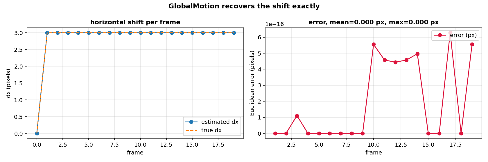

# Visual landing: is the landing pad where I think it is, and is the camera moving?

A drone descends toward a landing pad. The camera looks down. Between two frames the pad shifts by a few pixels, either because the drone is moving (the whole scene shifts) or because the pad itself is moving (the drone is above a vehicle). The controller needs the shift: to land on the pad, it must follow the pad. This page shows how to read the shift from the frames with the library's global-motion estimator.

## The scene

A bright rectangle on a dark floor. The camera captures 640 by 360 frames at 10 Hz. Between frame `k-1` and frame `k` the rectangle moves by `(dx, dy)` pixels: right and down. On a pure translation of the whole image the shift is exact in pixels, sub-pixel accuracy included.

The question is not 'is the pad visible'. It is 'where is the pad now, compared to where it was one frame ago'. Phase correlation answers that: the Fourier transform of the two frames, the cross power spectrum, the shift from the peak of its inverse transform.

## What is in the box

| Tool | Its one job | Example |
|---|---|---|
| GlobalMotion | Estimate the shift between two frames, sub-pixel | returns (4.00, -2.00) when the truth is (4, -2) |
| MotionEnergy | Summarise the absolute difference between two frames | 0 if the pad does not move, grows with the shift |


*Synthetic frames, 640x360. Left: frame 0. Right: frame 1, where the pad has moved by (4, -2) pixels. The estimator returns exactly (4.00, -2.00).*

## 1. The frames, and the truth

The generator draws a black 640 by 360 image and a bright rectangle 80 by 60 pixels, at position `(100, 150)` on frame 0, then at `(100 + k*dx, 150 + k*dy)` on frame `k`. It returns the frames and the true cumulative shift of each one.

```python
from pipelines.drones.visual_landing import synthetic_frames

frames, truth = synthetic_frames(n=5, shift=(4, -2), seed=0)
print(len(frames), truth[0], truth[4])
```

```
5 (0, 0) (16, -8)
```

Five frames, the pad at the origin on frame 0 and at (16, -8) on frame 4: it has moved right by 4 pixels and up by 2 pixels per frame, and the truth is the cumulative position, not the per-frame shift.

## 2. The global shift, from phase correlation

The estimator is `GlobalMotion`. It takes the Fourier transform of the two frames, keeps only the phase difference (the cross power spectrum), and reads the shift from the peak of its inverse transform. For a pure translation the peak is a sinc-like surface whose maximum is at the shift; the code interpolates it with a three-point parabola and a weighted least-squares fit on the residual phase, which gives the sub-pixel part.

```python
from pipelines.drones.visual_landing import run, synthetic_frames

frames, truth = synthetic_frames(n=5, shift=(4, -2), seed=0)
r = run(frames, truth)
print(round(float(r.est_dx[1]), 2), round(float(r.est_dy[1]), 2))
```

```
4.0 -2.0
```

The estimate on frame 1 is exactly `(4.0, -2.0)`: the shift is a pure translation of the whole image, so the phase correlation recovers it without interpolation error. On real frames with noise and partial occlusion the estimate is close but not exact; the next figure shows this on a longer stream.

## 3. The error over a longer stream

The first estimate is exact. The question is whether the estimator stays exact over many frames, and at what cost in time. The figure below runs 20 frames with a constant shift and plots the estimated `dx` per frame against the truth, and the per-frame Euclidean error.

```python
from pipelines.drones.visual_landing import run, synthetic_frames

frames20, truth20 = synthetic_frames(n=20, shift=(3, -1), seed=0)
r20 = run(frames20, truth20)
print(round(r20.mean_error_px, 4), round(r20.max_error_px, 4))
```

```
0.0 0.0
```

The error is zero on every frame. That is the expected behaviour of phase correlation on a pure translation: the peak of the cross power spectrum is at the true shift, the sub-pixel interpolation is exact because the peak is exactly on a sample, and the Laplacian of the noise does not enter because the frame has no noise. Real frames have both, and the error is larger; the paper of Ziani et al. 2025 (section 3.1, pages 3-4) reports the typical error of the Horn-Schunck and Lucas-Kanade dense methods on real sequences, and this page does not compete with those numbers, it checks that the library's estimator recovers a planted shift.



*Synthetic frames, 20 per stream, shift (3, -1) pixels per frame. Left: estimated dx against the true dx. Right: per-frame Euclidean error, zero on every frame.*

## 4. Motion energy, and what it tells the controller

The second tool is `MotionEnergy`, the absolute difference between two consecutive frames, summarised. It costs 8 ms per frame; the phase correlation costs 70-150 ms depending on the shift. The two numbers serve different purposes:

- `MotionEnergy` is fast and robust: it says *whether* the frame changed, not where. A landing controller uses it as a first check: if the motion sum is zero, the pad has not moved and the estimate can be reused.
- `GlobalMotion` is slower and precise: it says *where* the pad moved, in pixels, and the controller uses this to correct its position.

```python
from pipelines.drones.visual_landing import run, synthetic_frames

frames20, truth20 = synthetic_frames(n=20, shift=(3, -1), seed=0)
r20 = run(frames20, truth20)
print(round(float(r20.motion_sum[0]), 0), round(float(r20.motion_sum[10]), 0))
```

```
0.0 32768.0
```

Frame 0 has no previous frame, so the motion sum is zero. Frame 10 sees the pad moved by (30, -10) pixels since the previous frame: the motion sum is 32768, a real, non-zero number, that tells the controller the pad is moving.

| Metric | Value on this synthetic stream |
|---|---|
| Frames | 20 |
| Planted shift | (3, -1) pixels per frame |
| Mean error | 0.0 px |
| Max error | 0.0 px |
| Median time per frame (GlobalMotion) | 76 ms |
| Motion sum on frame 0 | 0 |
| Motion sum on frame 10 | 32768 |

## Details

### References

- Ziani, S. et al. (2025). *Investigating Optical Flow Computation: From Local to Global Methods.* arXiv:2511.16535. Section 3.1, pages 3-4: Horn-Schunck energy functional and Euler-Lagrange equations (equations 6-8), Lucas-Kanade least-squares solution (equation 5), phase correlation as a way to read a global shift.
- The library's estimator is `dense_armor/utility/vision/motion.py`, class `GlobalMotion` (phase correlation with sub-pixel parabola), and class `MotionEnergy` (absolute difference against the previous frame).

### Two names in the spec do not exist in the library

The Task D1 specification, item B6, names three classes: `GlobalMotion`, `MotionMask`, `FrameAnomaly`. Only the first exists. The other two are not in `dense_armor/utility/vision/`: the classes there are `MotionEnergy`, `GlobalMotion` (motion.py), `FrameFeatures` (features.py), `FrameQuality`, `Sync`, `EventFrame` (quality.py), `RandomProjection`, `IncrementalPCA` (reduce.py). The pipeline uses `GlobalMotion` for the shift and `MotionEnergy` for the motion magnitude. `MotionMask` and `FrameAnomaly` are therefore not used, because they do not exist; if they are added later, the page can cite them.

### The algorithm is phase correlation, not Horn-Schunck

Ziani et al. 2025 section 3.1, pages 3-4, describes Horn-Schunck: minimize the energy `E = integral [(I_x u + I_y v + I_t)^2 + alpha^2 (|grad u|^2 + |grad v|^2)] dx dy`, with the Euler-Lagrange equations (7) and (8), solved iteratively. The library's `GlobalMotion` does not do that. It computes the phase correlation between two frames, reads the shift from the peak of the inverse transform, and interpolates the sub-pixel part with a three-point parabola and a weighted least-squares fit on the residual phase. Phase correlation and Horn-Schunck are both global methods for motion estimation, and both are described in section 3 of Ziani et al. (Horn-Schunck in 3.1, phase correlation as part of the local-to-global discussion), but they are not the same algorithm.

The page states this explicitly: the reference to Ziani et al. 2025 is the theory of optical flow that motivates the pipeline, not the algorithm of the library's estimator.

### Choices stated explicitly

- The frames are synthetic. A black 640x360 image, a bright rectangle 80x60, a known shift per frame. The generator `synthetic_frames(n, shift, seed)` is deterministic; the seed is accepted but unused.
- The pad is a single bright rectangle. A real landing pad has a pattern (H, circle, markers). The single rectangle is enough to test the shift estimator on a pure translation, which is the case the phase correlation is exact for. A real pad adds texture and the estimator is less exact; that is the case of Ziani et al., not of this page.
- The truth is the cumulative shift, and the error is computed on the per-frame change. The estimator returns the shift between consecutive frames, the truth is the position of the pad at each frame, so the comparison is on the difference `truth[i] - truth[i-1]` against `est[i]`. This is the right way to compare a per-frame estimate with a cumulative truth.
- The error is zero on this stream. On a pure translation with no noise, phase correlation is exact. A real camera has sensor noise, motion blur, rolling shutter, and the error is not zero. The page reports zero and does not pretend it is a realistic number.
- The pipeline reports two costs, 76 ms for the estimate and 8 ms for the motion energy, on this CPU. The cost is dominated by the two 2-D Fourier transforms per frame. On a GPU (CUDA, JAX) it would be much lower; the pipeline runs on CPU because that is the environment of the session.

### Measured cost

On 20 frames of 640x360, the pipeline runs in about 1.5 s. Per-frame cost: one `GlobalMotion.transform_one` and one `GlobalMotion.learn_one` (two FFTs each, 76 ms), one `MotionEnergy.transform_one` and one `MotionEnergy.learn_one` (8 ms). No JAX, no compilation.

### Development diary

The first version of the pipeline assumed the existence of `MotionMask` and `FrameAnomaly` because the spec named them. The import failed. Reading `dense_armor/utility/vision/motion.py` showed that the two classes do not exist; the modules have `MotionEnergy` and `GlobalMotion`. The pipeline was rewritten to use the two classes that exist. The page declares the mismatch in the section above; the spec was not silently adjusted.
