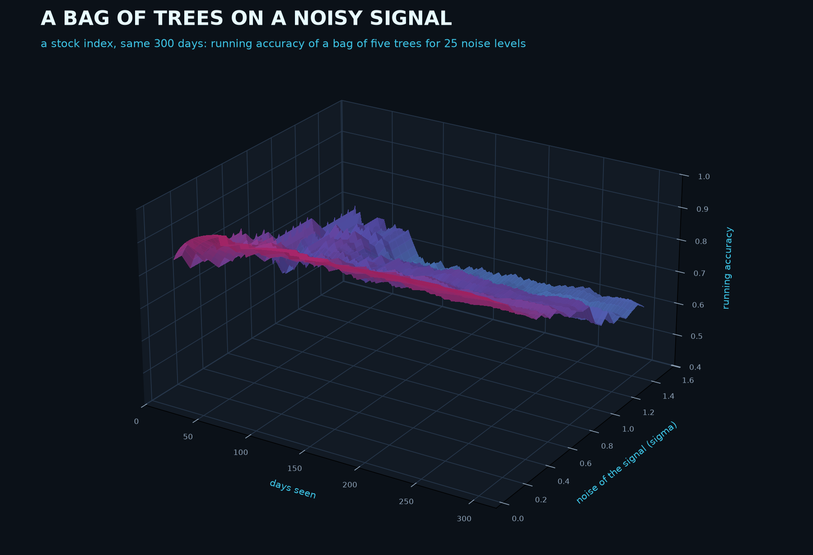
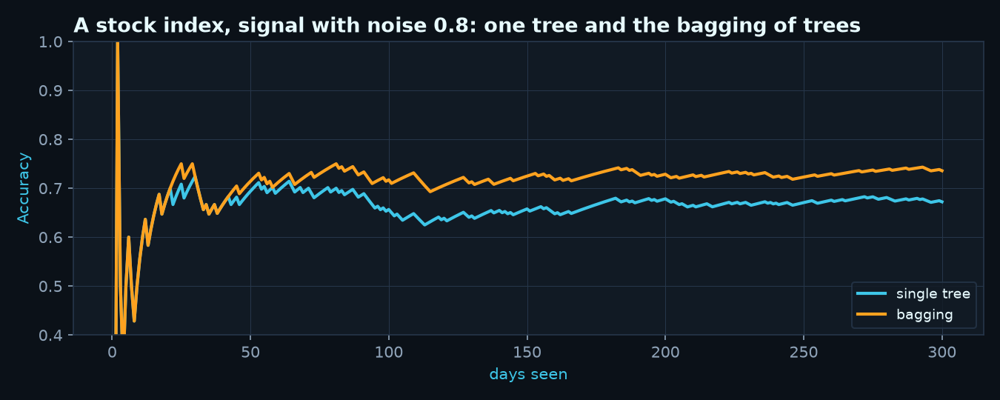

# Bagging: a different sample for every member

[← Ensembles](index.md)

A desk learns whether a stock goes up from a daily signal. If every tree saw exactly the same days, they would make the same mistakes; bagging shows each tree the days a different number of times, so their mistakes differ and the vote of the group is steadier. A robot controller with the same problem is in the last section.



## 1. A first example: a stock signal that separates two regimes

On calm days the signal is around 0 and the index falls; on strong days the signal is around 4 and it rises. The label is 1 when the signal is above 2. Five trees learn it from 500 days, each seeing a day a random number of times.

```python
import numpy as np
from dense_armor.core.online.ensemble import OnlineBaggingClassifier
from dense_armor.core.online.tree.hoeffding import HoeffdingTreeClassifier

rng = np.random.default_rng(0)
bag = OnlineBaggingClassifier(
    lambda: HoeffdingTreeClassifier(grace_period=20), n_models=5, seed=1)
for _ in range(500):
    signal = float(rng.normal(0.0 if rng.random() < 0.5 else 4.0, 0.5))
    bag.learn_one({"signal": signal}, int(signal > 2.0))
print(bag.predict_one({"signal": 0.1}), bag.predict_one({"signal": 4.0}))
```

```
0 1
```

The Poisson draw is what makes the members differ. On the drifted stream of the cost section of the [index](index.md#what-the-ensembles-cost) the bag of
five trees answers correctly more often than one tree in the median of 20 seeds (0.947 against
0.942, paired p = 0.003). The gain is small on this stream: the members share the same data,
and the diversity the Poisson draw gives is limited.



On a stock index with a signal of noise 0.8 the bag of five trees reads 0.714, 0.725 and 0.736 after 50, 150 and 300 days, and one tree reads 0.694, 0.658 and 0.672.

The picture follows the same 300 days of a stock index, where the desk sees a signal equal to the return plus a noise, for 25 levels of noise from 0.05 to 1.5. Each point of the surface is the running accuracy of the bag of five trees, scored before it learns each day. After 300 days it reads 0.967 for the noise 0.05, 0.736 for 0.78 and 0.595 for 1.5.

| class | what it does |
|---|---|
| `OnlineBaggingClassifier` | members that train each sample a Poisson number of times |

## 2. What the ensemble does

`OnlineBaggingClassifier` follows Oza and Russell (2001), Section 2. Every member sees every
sample, but for each arriving sample it draws `k` from a `Poisson(1)` distribution and trains on
the sample `k` times. On average a sample reaches each member once, and a few samples reach it
twice or not at all, which is what a bootstrap sample of the batch algorithm does in the limit.

**Source:** Oza, N. C., Russell, S. (2001). Online bagging and boosting. In Artificial Intelligence and Statistics 2001, 105-112. Section 2 for the Poisson sampling.

The
bagging counts are the part for which the paper proves that the expected counts of the online
and batch algorithms are equal.

## 3. The parameters

| Parameter | Meaning | Default |
|---|---|---|
| `model` | a callable returning a fresh base classifier, or one classifier to clone; every member is built with it | none |
| `n_models` | number of members, at least one | 10 |
| `seed` | seed of the Poisson draw; `None` uses a fresh random state | `None` |

`OnlineBaggingClassifier` raises `ValueError` if `n_models < 1`.

## 4. The same ensemble on a robot joint

A joint controller learns that a velocity `qd` above 2 is a fast joint (the label 1), from a stream where the velocity is around 0 or around 4.

```python
import numpy as np
from dense_armor.core.online.ensemble import OnlineBaggingClassifier
from dense_armor.core.online.tree.hoeffding import HoeffdingTreeClassifier

rng = np.random.default_rng(0)
bag = OnlineBaggingClassifier(
    lambda: HoeffdingTreeClassifier(grace_period=20), n_models=5, seed=1)
for _ in range(500):
    qd = float(rng.normal(0.0 if rng.random() < 0.5 else 4.0, 0.5))
    bag.learn_one({"qd": qd}, int(qd > 2.0))
print(bag.predict_one({"qd": 0.1}), bag.predict_one({"qd": 4.0}))
```

```
0 1
```

A velocity of 0.1 is slow (0) and a velocity of 4.0 is fast (1).

## API reference

::: dense_armor.core.online.ensemble.bagging.OnlineBaggingClassifier

---

## Details


### Choices

- **The Poisson draw of bagging.** The paper draws `Poisson(1)` per member per sample. The class
  draws one `k` per member and calls `learn_one` `k` times, which is the same rule.
