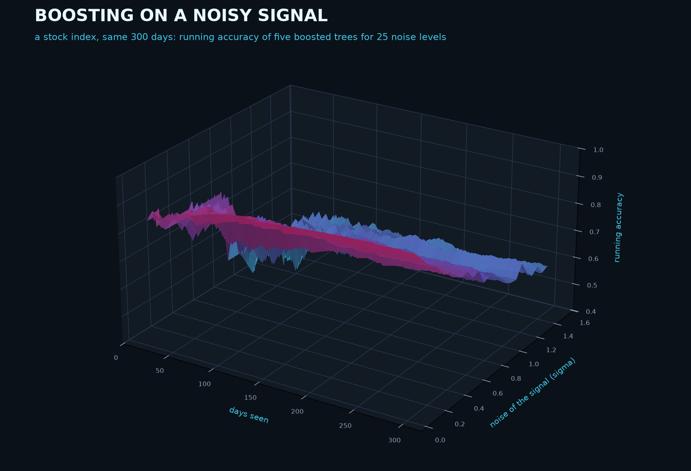
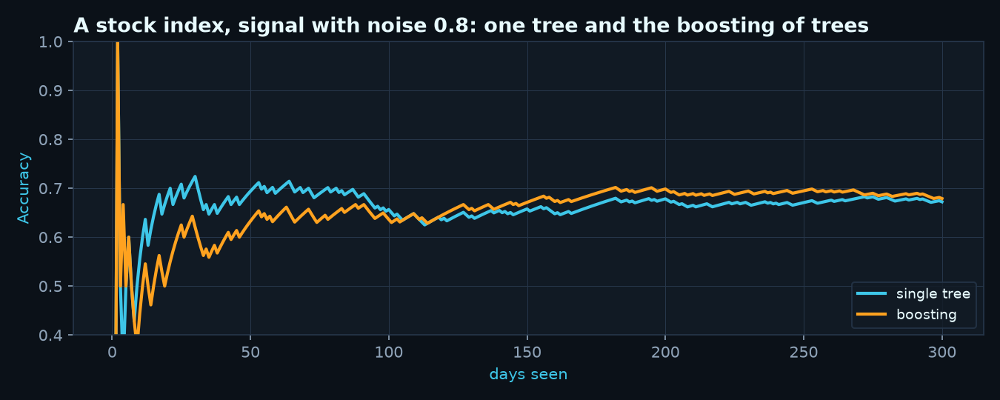

# Boosting: weight the samples the members miss

[← Ensembles](index.md)

A desk learns whether a stock goes up from a daily signal. Boosting makes each tree pay attention to the days the earlier trees got wrong, and the final vote trusts more the trees that have been right more often. A robot controller with the same problem is in the last section.



## 1. A first example: a stock signal that separates two regimes

On calm days the signal is around 0 and the index falls; on strong days the signal is around 4 and it rises. The label is 1 when the signal is above 2. Five boosted trees learn it from 500 days.

```python
import numpy as np
from dense_armor.core.online.ensemble import OnlineBoostingClassifier
from dense_armor.core.online.tree.hoeffding import HoeffdingTreeClassifier

rng = np.random.default_rng(0)
boost = OnlineBoostingClassifier(
    lambda: HoeffdingTreeClassifier(grace_period=20), n_models=5, seed=1)
for _ in range(500):
    signal = float(rng.normal(0.0 if rng.random() < 0.5 else 4.0, 0.5))
    boost.learn_one({"signal": signal}, int(signal > 2.0))
print(boost.predict_one({"signal": 0.1}), boost.predict_one({"signal": 4.0}))
```

```
0 1
```

Boosting is the strongest of the four ensembles of this page on the drifted stream: 0.982
against 0.942 for the single tree, on 19 seeds out of 20 (the cost section of the [index](index.md#what-the-ensembles-cost)). The price is the highest
cost per sample of the four, because every member trains on every sample with a weight, and the
weight depends on the mistakes of the member before it.



On a stock index with a signal of noise 0.8 the five boosted trees read 0.633, 0.671 and 0.679 after 50, 150 and 300 days, and one tree reads 0.694, 0.658 and 0.672: on this short noisy stream boosting starts below one tree and ends about level with it.

The picture follows the same 300 days of a stock index, where the desk sees a signal equal to the return plus a noise, for 25 levels of noise from 0.05 to 1.5. Each point of the surface is the running accuracy of the five boosted trees, scored before it learns each day. After 300 days it reads 0.963 for the noise 0.05, 0.689 for 0.78 and 0.575 for 1.5.

| class | what it does |
|---|---|
| `OnlineBoostingClassifier` | members that pass their mistakes to the next one |

## 2. What the ensemble does

`OnlineBoostingClassifier` follows the same paper, Section 3 and Figure 2. Each member has two
counters, one for the samples it classified correctly and one for the wrong ones. The weight of
the incoming sample for the next member grows with the fraction of its mistakes, so a sample a
member got wrong reaches the next member more often. The final vote weights each member by
`log(1 / beta_m)`, with `beta_m = eps_m / (1 - eps_m)` and `eps_m` the error rate of that member.

**Source:** Oza, N. C., Russell, S. (2001). Online bagging and boosting. In Artificial Intelligence and Statistics 2001, 105-112. Section 3 and Figure 2 for the boosting weight update.

The boosting update is the one of Figure 2 of Oza and Russell: the weight of the sample for the
next member is multiplied by `N / (2 * lambda_s)`, with `N` the number of samples seen so far
and `lambda_s` the accumulator of the member for the samples it classified correctly or wrongly.
The paper gives no equivalence and no convergence rate for the boosting weights: it builds the
algorithm to correspond to batch AdaBoost.M1 and then shows, with experiments, that online
boosting starts worse and approaches AdaBoost as the number of examples grows (Figure 4).

## 3. The parameters

| Parameter | Meaning | Default |
|---|---|---|
| `model` | a callable returning a fresh base classifier, or one classifier to clone | none |
| `n_models` | number of members, at least one | 10 |
| `seed` | seed of the Poisson draw; `None` uses a fresh state | `None` |

`OnlineBoostingClassifier` raises `ValueError` if `n_models < 1`.

## 4. The same ensemble on a robot joint

A joint controller learns that a velocity `qd` above 2 is a fast joint (the label 1), from a stream where the velocity is around 0 or around 4.

```python
import numpy as np
from dense_armor.core.online.ensemble import OnlineBoostingClassifier
from dense_armor.core.online.tree.hoeffding import HoeffdingTreeClassifier

rng = np.random.default_rng(0)
boost = OnlineBoostingClassifier(
    lambda: HoeffdingTreeClassifier(grace_period=20), n_models=5, seed=1)
for _ in range(500):
    qd = float(rng.normal(0.0 if rng.random() < 0.5 else 4.0, 0.5))
    boost.learn_one({"qd": qd}, int(qd > 2.0))
print(boost.predict_one({"qd": 0.1}), boost.predict_one({"qd": 4.0}))
```

```
0 1
```

A velocity of 0.1 is slow (0) and a velocity of 4.0 is fast (1).

## API reference

::: dense_armor.core.online.ensemble.boosting.OnlineBoostingClassifier

---

## Details
