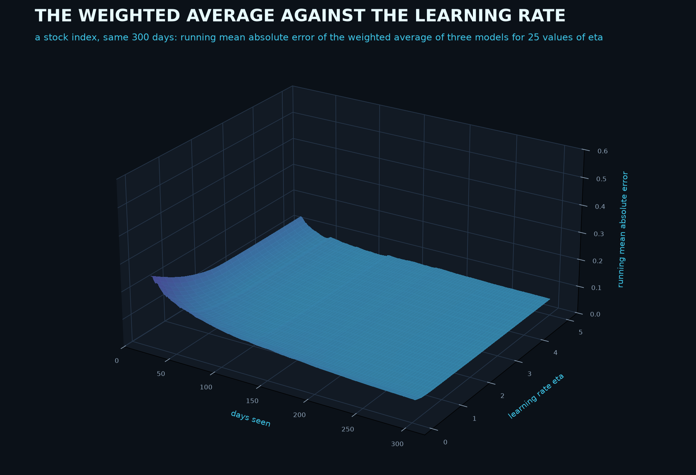
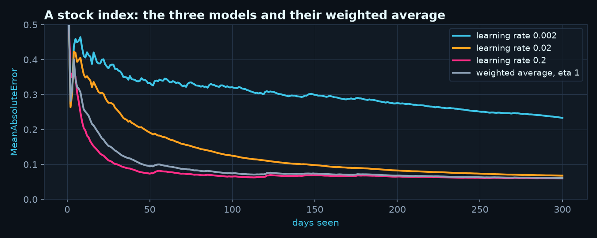

# Exponentially weighted average: a regressor

[← Ensembles](index.md)

Three analysts forecast the same price, and the desk does not know in advance which one to trust. The weighted average gives each forecast a weight that falls when that analyst has been wrong, so the average moves towards the best one by itself. A robot controller that blends three torque models is in the last section.



## 1. A first example: three analysts and a price

Three analysts forecast a price of 0, 50 and 90, and the true price is 100 every day for 30 days. The weighted average learns whom to trust.

```python
from dense_armor.roles import Regressor
from dense_armor.core.online.ensemble import ExponentiallyWeightedAverageRegressor


class Analyst(Regressor):
    def __init__(self, price):
        self.price = float(price)

    def learn_one(self, x, y, t=None):
        return self

    def predict_one(self, x, t=None, return_std=False):
        return self.price


ewa = ExponentiallyWeightedAverageRegressor([Analyst(0.0), Analyst(50.0), Analyst(90.0)], eta=0.5)
for _ in range(30):
    ewa.learn_one({"day": 0.0}, 100.0)
print(round(ewa.predict_one({"day": 0.0}), 1))
```

```
90.0
```

Three constant members predict 0, 50 and 90 and the truth is 100. The simple average would give
46.7, the weighted average gives 90.0: the best member's weight dominates. The `bound()` method
returns the bound of equation 9 of the paper, which limits how much worse the ensemble can be
than its best member. On the regression stream of the cost section of the [index](index.md#what-the-ensembles-cost) the ensemble's cumulative loss is
above the best member's and below the bound, which is what the bound promises: it caps the loss,
it does not promise the ensemble wins.



On a stock index whose return is half the signal plus a small noise, three linear models with learning rates 0.002, 0.02 and 0.2 read a mean absolute error of 0.333, 0.191 and 0.074 after 50 days, 0.299, 0.098 and 0.069 after 150 days and 0.233, 0.068 and 0.06 after 300 days. Their weighted average (eta 1) reads 0.094, 0.074 and 0.061: close to the best one from the first days, without knowing in advance which one it is.

The picture follows the same 300 days for 25 values of the learning rate eta of the weighted average, between 0.1 and 5. Each point of the surface is the running mean absolute error, scored before the models learn each day. After 300 days it reads 0.072 for eta 0.1, 0.061 for eta 0.92 and 0.06 for eta 5: a larger eta moves the weight to the best model sooner, and from about 1 the error is the one of the best member.

| class | what it does |
|---|---|
| `ExponentiallyWeightedAverageRegressor` | the weighted average of regressors, with a bound on its loss |

## 2. What the ensemble does

`ExponentiallyWeightedAverageRegressor` is the regression version of the same idea. Each member
has a cumulative loss, and its weight is `exp(-eta * L_i)`, so a member that has been wrong
loses weight and its vote counts less. The prediction is the weighted average of the members'
predictions. This is the Hedge rule of Freund and Schapire (1997), Section 2.1.

**Source:**

- Freund, Y., Schapire, R. E. (1997). A decision-theoretic generalization of on-line learning and an application to boosting. Journal of Computer and System Sciences 55(1), 119-139. Section 2.1 for the Hedge rule, Theorem 2 and equation 9 for the bound of the exponentially weighted average.
- Kivinen, J., Warmuth, M. K. (1997). Exponentiated gradient versus gradient descent for linear predictors. Information and Computation 132(1), 1-63. The exponentiated gradient gives the same multiplicative update of the weights, `w_i = exp(-eta * L_i)`, from the gradient of the relative entropy.

The bound of the exponentially weighted average is equation 9 of Freund and Schapire,
`L_ensemble <= (eta / (1 - exp(-eta))) * min_i L_i + ln(K) / (1 - exp(-eta))`, with `K` the
number of members. The factor `eta / (1 - exp(-eta))` tends to one as `eta` goes to zero, so a
small learning rate loses almost nothing over the best member, and the price of a large learning
rate is the second term. The bound assumes the loss is in `[0, 1]`; the script clips the squared
error to that interval before summing it, and reports the clipping in the JSON.

## 3. The parameters

| Parameter | Meaning | Default |
|---|---|---|
| `models` | a list of regressors, each cloned if it exposes `clone`, otherwise called as a factory | none |
| `eta` | learning rate of the Hedge rule, positive | 0.5 |
| `loss` | a loss function `loss(y_true, y_pred) -> float` | the squared error |

`ExponentiallyWeightedAverageRegressor` raises `ValueError` if `eta <= 0` or `models` is empty.

## 4. The same ensemble on a robot joint

A joint controller has three torque models that predict 0, 50 and 90 and the measured torque is 100 every sample. The weighted average learns whom to trust.

```python
from dense_armor.roles import Regressor
from dense_armor.core.online.ensemble import ExponentiallyWeightedAverageRegressor


class Const(Regressor):
    def __init__(self, v):
        self.v = float(v)

    def learn_one(self, x, y, t=None):
        return self

    def predict_one(self, x, t=None, return_std=False):
        return self.v


ewa = ExponentiallyWeightedAverageRegressor([Const(0.0), Const(50.0), Const(90.0)], eta=0.5)
for _ in range(30):
    ewa.learn_one({"x": 0.0}, 100.0)
print(round(ewa.predict_one({"x": 0.0}), 1))
```

```
90.0
```

The best model predicts 90 and its weight dominates: the weighted average gives 90.0.

## API reference

::: dense_armor.core.online.ensemble.ewa.ExponentiallyWeightedAverageRegressor

---

## Details


### Choices

- **The initial weights of the weighted average.** The paper's bound is for uniform initial
  weights, which is what the class uses.

### Limits

- The bound of the weighted average needs a loss in `[0, 1]`. A regression stream with squared
  errors outside that interval has a bound that is not meaningful, and the class does not clip
  the user's loss for them.

- On the regression stream the weighted average does not beat its own best member. The rule of
  the stream is not hard enough for the weaker members to be useful, and blending them in costs.
  A stream where every member is wrong in a different way is where the weighted average pays.
