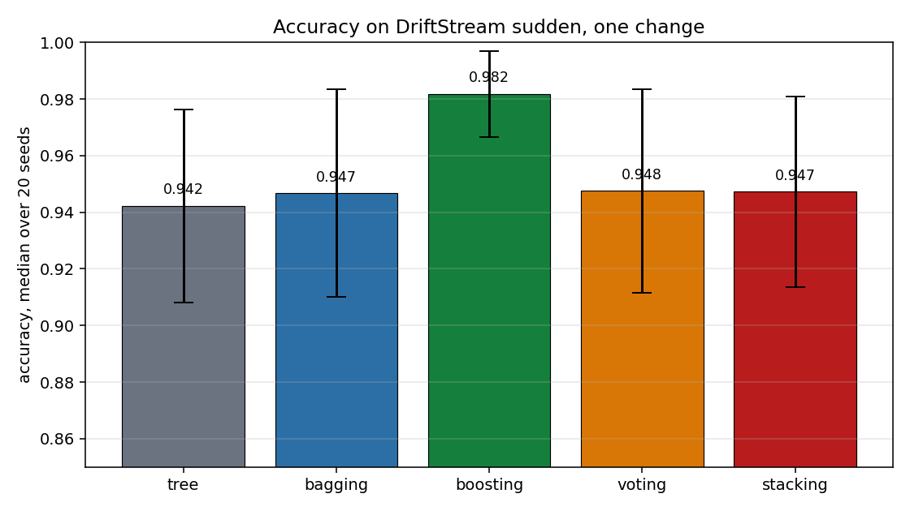
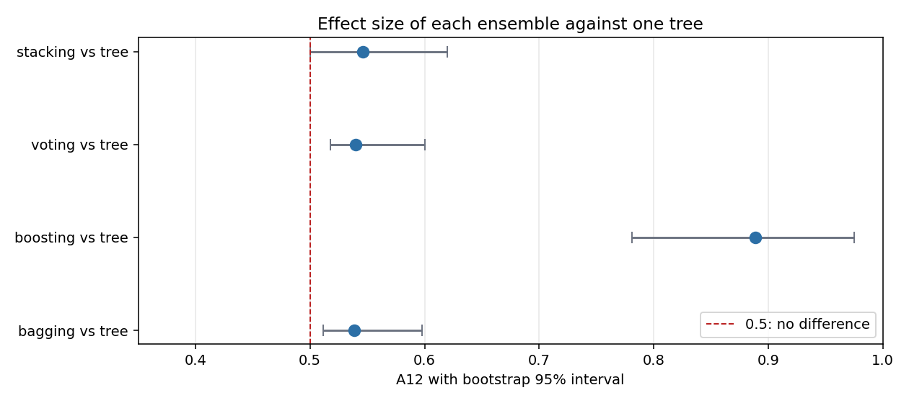
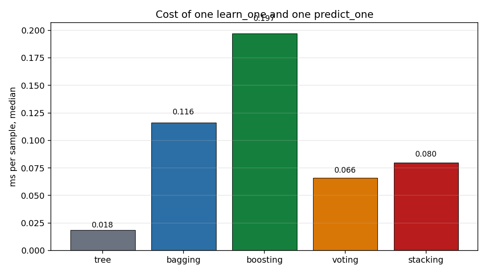
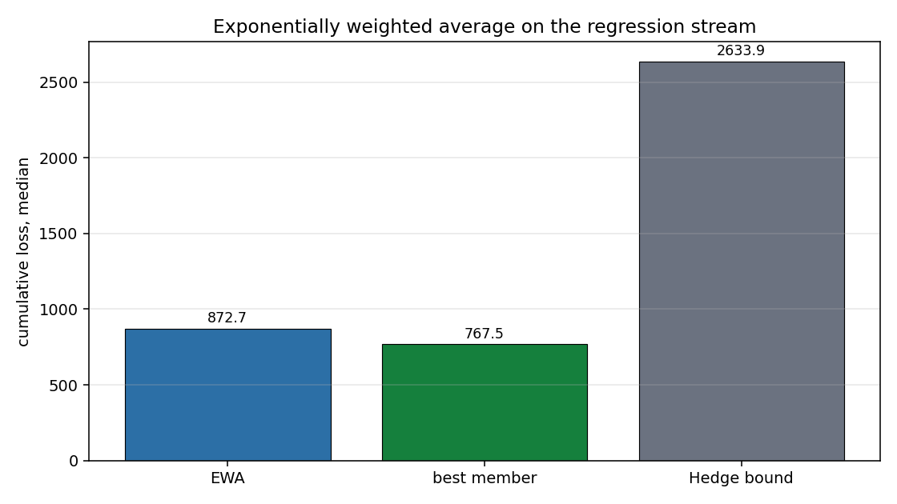

# Ensembles: many models that answer together

One model can be wrong in one direction, another in the opposite one, and a vote over both is
more reliable than either alone. An ensemble trains a group of models on the same stream and
combines their answers: by a vote, by an average, or by a weight that grows with how well each
member has done so far.

## 1. Why an ensemble

A single decision tree learns the rule of the stream one sample at a time. When the rule changes,
the tree has to notice, forget and relearn, and until it does it answers with the old rule. A
group of trees can recover faster: each one makes a different mistake, and the vote of the group
is right more often than any single member.

The rest of this page shows the five ensembles of the library, from the simplest (a vote) to
the one with a second model on top (stacking). Each step starts from a model the reader already
has (the tree of the forests pages), says what the ensemble adds, and shows the code. Section 7
measures what the ensembles gain and what they cost on a stream with a sudden change.

## 2. Voting: the majority decides

`VotingClassifier` trains a list of classifiers on the same stream and returns the class that
most members predict. In `"hard"` mode each member is one vote, whatever confidence it has; in
`"soft"` mode each member returns a probability for every class and the ensemble averages them.

```python
from dense_armor.utility.ensemble import VotingClassifier
from dense_armor.utility.tree.hoeffding import HoeffdingTreeClassifier

v = VotingClassifier(
    [HoeffdingTreeClassifier(grace_period=20),
     HoeffdingTreeClassifier(grace_period=50),
     HoeffdingTreeClassifier(grace_period=100)],
    mode="hard")
for i in range(200):
    x = (i % 20) / 19.0
    v.learn_one({"x": x}, 1 if x > 0.5 else 0)
print(v.predict_one({"x": 0.9}))
```

```
1
```

The three members differ in how often they reconsider a split, so they make different mistakes,
and the majority cancels some of them. A vote of three identical members cannot help: they would
all be wrong together. The members here differ by `grace_period`, which is enough on this
stream.

## 3. Bagging: a different sample for every member

`OnlineBaggingClassifier` follows Oza and Russell (2001), Section 2. Every member sees every
sample, but for each arriving sample it draws `k` from a `Poisson(1)` distribution and trains on
the sample `k` times. On average a sample reaches each member once, and a few samples reach it
twice or not at all, which is what a bootstrap sample of the batch algorithm does in the limit.

```python
import numpy as np
from dense_armor.utility.ensemble import OnlineBaggingClassifier
from dense_armor.utility.tree.hoeffding import HoeffdingTreeClassifier

rng = np.random.default_rng(0)
bag = OnlineBaggingClassifier(
    lambda: HoeffdingTreeClassifier(grace_period=20), n_models=5, seed=1)
for _ in range(500):
    x = float(rng.normal(0.0 if rng.random() < 0.5 else 4.0, 0.5))
    bag.learn_one({"x": x}, int(x > 2.0))
print(bag.predict_one({"x": 0.1}), bag.predict_one({"x": 4.0}))
```

```
0 1
```

The Poisson draw is what makes the members differ. On the drifted stream of Section 7 the bag of
five trees answers correctly more often than one tree in the median of 20 seeds (0.947 against
0.942, paired p = 0.003). The gain is small on this stream: the members share the same data,
and the diversity the Poisson draw gives is limited.

## 4. Boosting: weight the samples the members miss

`OnlineBoostingClassifier` follows the same paper, Section 3 and Figure 2. Each member has two
counters, one for the samples it classified correctly and one for the wrong ones. The weight of
the incoming sample for the next member grows with the fraction of its mistakes, so a sample a
member got wrong reaches the next member more often. The final vote weights each member by
`log(1 / beta_m)`, where `beta_m` is the error rate of that member.

```python
import numpy as np
from dense_armor.utility.ensemble import OnlineBoostingClassifier
from dense_armor.utility.tree.hoeffding import HoeffdingTreeClassifier

rng = np.random.default_rng(0)
boost = OnlineBoostingClassifier(
    lambda: HoeffdingTreeClassifier(grace_period=20), n_models=5, seed=1)
for _ in range(500):
    x = float(rng.normal(0.0 if rng.random() < 0.5 else 4.0, 0.5))
    boost.learn_one({"x": x}, int(x > 2.0))
print(boost.predict_one({"x": 0.1}), boost.predict_one({"x": 4.0}))
```

```
0 1
```

Boosting is the strongest of the four ensembles of this page on the drifted stream: 0.982
against 0.942 for the single tree, on 19 seeds out of 20 (Section 7). The price is the highest
cost per sample of the four, because every member trains on every sample with a weight, and the
weight depends on the mistakes of the member before it.

## 5. Exponentially weighted average: a regressor

`ExponentiallyWeightedAverageRegressor` is the regression version of the same idea. Each member
has a cumulative loss, and its weight is `exp(-eta * L_i)`, so a member that has been wrong
loses weight and its vote counts less. The prediction is the weighted average of the members'
predictions. This is the Hedge rule of Freund and Schapire (1997), Section 2.1.

```python
from dense_armor.roles import Regressor
from dense_armor.utility.ensemble import ExponentiallyWeightedAverageRegressor

class Const(Regressor):
    def __init__(self, v):
        self.v = float(v)
    def learn_one(self, x, y, t=None):
        return self
    def predict_one(self, x, t=None, return_std=False):
        return self.v

ewa = ExponentiallyWeightedAverageRegressor(
    [Const(0.0), Const(50.0), Const(90.0)], eta=0.5)
for _ in range(30):
    ewa.learn_one({"x": 0.0}, 100.0)
print(round(ewa.predict_one({"x": 0.0}), 1))
```

```
90.0
```

Three constant members predict 0, 50 and 90 and the truth is 100. The simple average would give
46.7, the weighted average gives 90.0: the best member's weight dominates. The `bound()` method
returns the bound of equation 9 of the paper, which limits how much worse the ensemble can be
than its best member. On the regression stream of Section 7 the ensemble's cumulative loss is
above the best member's and below the bound, which is what the bound promises: it caps the loss,
it does not promise the ensemble wins.

## 6. Stacking: a second model on top

`StackingClassifier` trains a list of base classifiers and a second classifier, the meta-model,
on the predictions of the base ones. For each sample the base members predict first, their
predictions become the input of the meta-model, and only then the members see the label. The
order matters: if the meta-model saw the labels before the members had predicted, it would learn
from information the members did not have, and the ensemble would look better on the stream than
it is.

```python
import numpy as np
from dense_armor.utility.ensemble import StackingClassifier
from dense_armor.utility.tree.hoeffding import HoeffdingTreeClassifier

rng = np.random.default_rng(0)
stack = StackingClassifier(
    [HoeffdingTreeClassifier(grace_period=20),
     HoeffdingTreeClassifier(grace_period=100)],
    HoeffdingTreeClassifier(grace_period=20))
for _ in range(500):
    x = float(rng.normal(0.0 if rng.random() < 0.5 else 4.0, 0.5))
    stack.learn_one({"x": x}, int(x > 2.0))
print(stack.predict_one({"x": 0.1}), stack.predict_one({"x": 4.0}))
```

```
0 1
```

The meta-model sees only the members' predictions, never the raw `x`. On the drifted stream of
Section 7 stacking is on par with voting and both are above the single tree.

## 7. What the ensembles cost

The four ensembles and the single tree were compared on `DriftStream` with one sudden change, 4
features, 2000 samples, 20 seeds, prequential (predict first, then learn). Voting and stacking
get members that differ from each other.



Boosting is the clear winner; bagging, voting and stacking are close to each other and above the
single tree. The paired two-sided Wilcoxon on 20 seeds and the A12 effect size with a bootstrap
95% interval say the same thing.



Boosting has the largest effect, with an interval that starts at 0.78. The other three
intervals sit just above 0.5, and the one of stacking starts exactly at 0.500: the paired
p-value (0.0064) is below 0.01, but the effect size is at the edge of no difference. The
improvement is real and small on this stream.



The cost follows the number of members. The single tree is the cheapest, boosting is the most
expensive of the four ensembles, and the difference between the cheapest and the most expensive
is about one order of magnitude. An ensemble buys accuracy with time.



On the regression stream the exponentially weighted average does not beat its own best member.
The best member is a large-window k-NN that predicts the rule well; the weighted average
blends it with two weaker members, so its loss is above the best member's. The bound is an
upper limit and the ensemble stays well below it.

## Details

### References

- Oza, N. C., Russell, S. (2001). Online bagging and boosting. In Artificial Intelligence and Statistics 2001, 105-112. Section 2 for the Poisson sampling, Section 3 and Figure 2 for the boosting weight update.
- Freund, Y., Schapire, R. E. (1997). A decision-theoretic generalization of on-line learning and an application to boosting. Journal of Computer and System Sciences 55(1), 119-139. Section 2.1 for the Hedge rule, Theorem 2 and equation 9 for the bound of the exponentially weighted average.
- Kivinen, J., Warmuth, M. K. (1997). Exponentiated gradient versus gradient descent for linear predictors. Information and Computation 132(1), 1-63. The exponentiated gradient gives the same multiplicative update of the weights, `w_i = exp(-eta * L_i)`, from the gradient of the relative entropy.

### What each paper states

The boosting update is the one of Figure 2 of Oza and Russell: the weight of the sample for the
next member is multiplied by `N / (2 * lambda_s)`, with `N` the number of samples seen so far
and `lambda_s` the accumulator of the member for the samples it classified correctly or wrongly.
The paper states the equivalence of the expected weights with batch AdaBoost, not a convergence
rate, and this page claims the same.

The bound of the exponentially weighted average is equation 9 of Freund and Schapire,
`L_ensemble <= (eta / (1 - exp(-eta))) * min_i L_i + ln(K) / (1 - exp(-eta))`, with `K` the
number of members. The factor `eta / (1 - exp(-eta))` tends to one as `eta` goes to zero, so a
small learning rate loses almost nothing over the best member, and the price of a large learning
rate is the second term. The bound assumes the loss is in `[0, 1]`; the script clips the squared
error to that interval before summing it, and reports the clipping in the JSON.

Voting and stacking have no paper in the task folder. Their rules are stated in the class
docstrings and tested.

### Choices the papers do not fix

- **The members of voting and stacking.** The papers give no rule for how different the members
  should be. Here they differ by `grace_period`; three identical members cannot help, and a test
  checks that a vote of diverse members is not worse than a single tree.
- **The Poisson draw of bagging.** The paper draws `Poisson(1)` per member per sample. The class
  draws one `k` per member and calls `learn_one` `k` times, which is the same rule.
- **The meta-model of stacking.** The paper gives no rule for what the meta-model sees. Here it
  sees the members' predicted labels, one key per member, and never the raw input.
- **The initial weights of the weighted average.** The paper's bound is for uniform initial
  weights, which is what the class uses.

### Limits

- The stacking meta-model receives the members' predicted labels, not their probabilities. A
  meta-model that could see the probabilities would have more to work with; the class does not
  pass them.
- The bound of the weighted average needs a loss in `[0, 1]`. A regression stream with squared
  errors outside that interval has a bound that is not meaningful, and the class does not clip
  the user's loss for them.
- An ensemble costs several times a single model. On the benchmark of Section 7 boosting costs
  about eleven times the single tree per sample.
- On the regression stream the weighted average does not beat its own best member. The rule of
  the stream is not hard enough for the weaker members to be useful, and blending them in costs.
  A stream where every member is wrong in a different way is where the weighted average pays.

### Checks

- `check_estimator` passes for all five classes with no check skipped.
- On the drifted stream of Section 7 the four ensembles beat the single tree, every paired
  p-value below 0.01.
- The bound of the weighted average is verified against equation 9 of the paper by a test that
  fails when `bound()` returns a constant.
- The stacking order (meta-model learns before the members see the label) is verified by a test
  with a spy classifier.
- Every class counts NaN, `None`, empty dicts and non-dict inputs in `n_missing` and does not
  crash.

### The numbers

Run: `python benchmarks/ensemble_quality.py`. Machine: x86_64 Linux, 2 cores, Python 3.13.16. JSON:
`benchmarks/ensemble_quality.json`.

| learner | accuracy, median | accuracy IQR | ms per sample |
|---|---|---|---|
| HoeffdingTreeClassifier | 0.9423 | 0.0341 | 0.018 |
| OnlineBaggingClassifier | 0.9467 | 0.0368 | 0.116 |
| OnlineBoostingClassifier | 0.9818 | 0.0151 | 0.197 |
| VotingClassifier | 0.9475 | 0.0360 | 0.066 |
| StackingClassifier | 0.9472 | 0.0337 | 0.080 |

| pair | median A | median B | p | A12 [95% interval] | seeds A better |
|---|---|---|---|---|---|
| bagging vs single tree | 0.9467 | 0.9423 | 0.0033 | 0.539 [0.511, 0.598] | 15/20 |
| boosting vs single tree | 0.9818 | 0.9423 | < 0.0001 | 0.889 [0.781, 0.975] | 19/20 |
| voting vs single tree | 0.9475 | 0.9423 | 0.0019 | 0.540 [0.517, 0.600] | 12/20 |
| stacking vs single tree | 0.9472 | 0.9423 | 0.0064 | 0.546 [0.500, 0.620] | 12/20 |

The regressor, cumulative loss over the stream, median of 20 seeds:

| model | cumulative loss |
|---|---|
| ExponentiallyWeightedAverageRegressor | 872.68 |
| best member | 767.53 |
| bound of equation 9 | 2633.93 |

The ensemble loses to the best member on all 20 seeds (p = 1.9e-06, A12 = 0.00), and stays well
below the bound. The bound caps the damage, it does not promise a win.

### Development diary

The first version of the regression stream was a plain linear rule with a sudden change, and the
best member fitted it to within `1e-29`, so the weighted average had nothing to improve. The
stream in the benchmark adds a sine term and Gaussian noise of standard deviation 0.1, so no
member fits it exactly and the four members lie on different scales.

The first version of the effect-size code oriented A12 for a smaller-is-better metric on both
the classifier and the regressor results, which flipped the sign on the accuracy table. The
convention is now: A12 is the probability that a random score of A is above a random score of B,
with the score oriented so that a larger number is a better result, and the regressor losses are
negated before the comparison.
