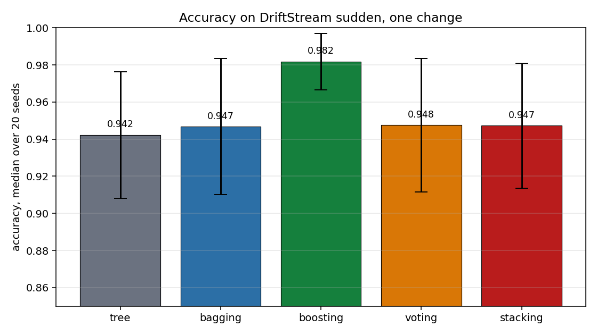
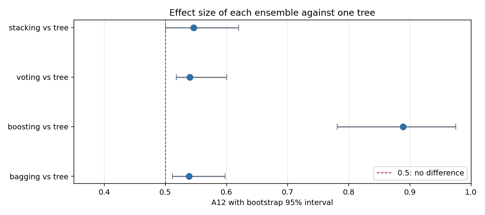
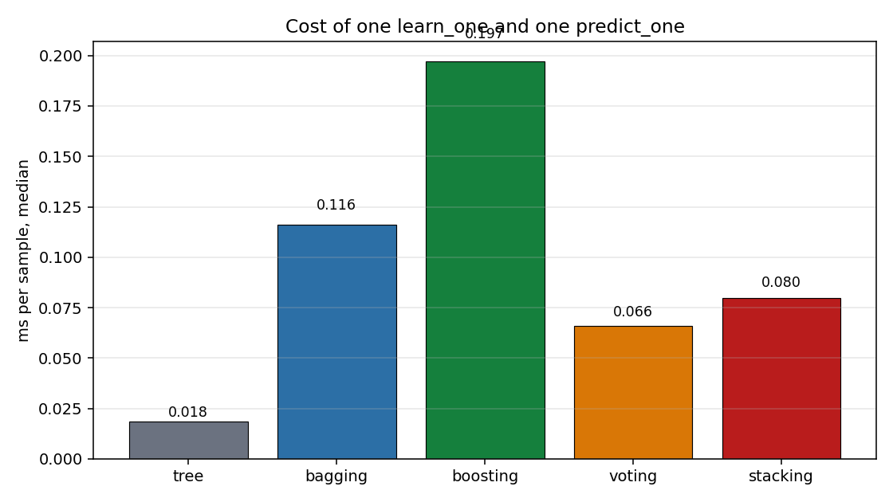
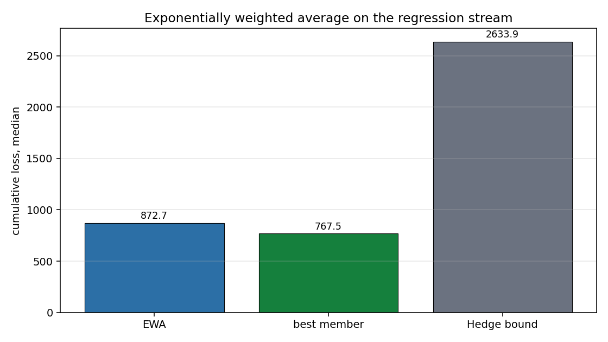

# Ensembles: many models that answer together

## The map of ensembles

Click a page to open it, or the job on the left (or the button at the top) to go back to the [map of the library](../index.md#the-library-folder-by-folder).

<object type="image/svg+xml" data="../assets/maps/ensemble.svg" style="width:100%"></object>

One model can be wrong in one direction, another in the opposite one, and a vote over both is
more reliable than either alone. An ensemble trains a group of models on the same stream and
combines their answers: by a vote, by an average, or by a weight that grows with how well each
member has done so far.

## Why an ensemble

A single decision tree learns the rule of the stream one sample at a time. When the rule changes,
the tree has to notice, forget and relearn, and until it does it answers with the old rule. A
group of trees can recover faster: each one makes a different mistake, and the vote of the group
is right more often than any single member.

The pages below show the five ensembles of the library, from the simplest (a vote) to
the one with a second model on top (stacking). Each step starts from a model the reader already
has (the tree of the forests pages), says what the ensemble adds, and shows the code. the last section of this page
measures what the ensembles gain and what they cost on a stream with a sudden change.

## A first example: a vote on a stock signal

A desk gets a signal between 0 and 1 for a stock every day, and buys when the signal is above 0.5. Three trees learn that rule from the stream, one sample at a time, and they vote: the class that most of them predict wins.

```python
from dense_armor.core.online.ensemble import VotingClassifier
from dense_armor.core.online.tree.hoeffding import HoeffdingTreeClassifier

vote = VotingClassifier([HoeffdingTreeClassifier(grace_period=g) for g in (20, 50, 100)], mode="hard")
for i in range(200):
    signal = (i % 20) / 19.0
    vote.learn_one({"signal": signal}, 1 if signal > 0.5 else 0)
print(vote.predict_one({"signal": 0.9}), vote.predict_one({"signal": 0.1}))
```

```
1 0
```

A signal of 0.9 is above 0.5, so the vote says 1 (buy); a signal of 0.1 says 0. The three trees differ in how often they reconsider a split (`grace_period` 20, 50 and 100), so they make different mistakes, and the majority cancels some of them.

## The pages of the section

| Page | Class | What it is for |
|---|---|---|
| [Voting](voting.md) | `VotingClassifier` | two or more classifiers; hard vote or averaged probability |
| [Bagging](bagging.md) | `OnlineBaggingClassifier` | members that train each sample a Poisson number of times |
| [Boosting](boosting.md) | `OnlineBoostingClassifier` | members that pass their mistakes to the next one |
| [Exponentially weighted average](ewa.md) | `ExponentiallyWeightedAverageRegressor` | the weighted average of regressors, with a bound on its loss |
| [Stacking](stacking.md) | `StackingClassifier` | a meta-model that learns from the predictions of the members |

## What the ensembles cost

The four ensembles and the single tree were compared on `DriftStream` with one sudden change, 4
features, 2000 samples, 20 seeds, prequential (predict first, then learn). Voting and stacking
get members that differ from each other.



Boosting is the clear winner; bagging, voting and stacking are close to each other and above the
single tree. The paired two-sided Wilcoxon on 20 seeds and the A12 effect size with a bootstrap
95% interval say the same thing.



Boosting has the largest effect, with an interval that starts at 0.78. The other three
intervals sit just above 0.5, and the one of stacking starts exactly at 0.500: the paired
p-value (0.0064) is below 0.01, but the effect size is at the edge of no difference. The
improvement is real and small on this stream.



The cost follows the number of members. The single tree is the cheapest, boosting is the most
expensive of the four ensembles, and the difference between the cheapest and the most expensive
is about one order of magnitude. An ensemble buys accuracy with time.



On the regression stream the exponentially weighted average does not beat its own best member.
The best member is a large-window k-NN that predicts the rule well; the weighted average
blends it with two weaker members, so its loss is above the best member's. The bound is an
upper limit and the ensemble stays well below it.

## Details

### References

- Oza, N. C., Russell, S. (2001). Online bagging and boosting. In Artificial Intelligence and Statistics 2001, 105-112. Section 2 for the Poisson sampling, Section 3 and Figure 2 for the boosting weight update.
- Freund, Y., Schapire, R. E. (1997). A decision-theoretic generalization of on-line learning and an application to boosting. Journal of Computer and System Sciences 55(1), 119-139. Section 2.1 for the Hedge rule, Theorem 2 and equation 9 for the bound of the exponentially weighted average.
- Kivinen, J., Warmuth, M. K. (1997). Exponentiated gradient versus gradient descent for linear predictors. Information and Computation 132(1), 1-63. The exponentiated gradient gives the same multiplicative update of the weights, `w_i = exp(-eta * L_i)`, from the gradient of the relative entropy.

### Limits

- An ensemble costs several times a single model. On the benchmark of the last section of this page boosting costs
  about eleven times the single tree per sample.

### Checks

- `check_estimator` passes for all five classes with no check skipped.
- On the drifted stream of the last section of this page the four ensembles beat the single tree, every paired
  p-value below 0.01.
- The bound of the weighted average is verified against equation 9 of the paper by a test that
  fails when `bound()` returns a constant.
- Every class counts NaN, `None`, empty dicts and non-dict inputs in `n_missing` and does not
  crash.

### The numbers

Run: `python benchmarks/ensemble_quality.py`. Machine: x86_64 Linux, 2 cores, Python 3.13.16. JSON:
`benchmarks/ensemble_quality.json`.

| learner | accuracy, median | accuracy IQR | ms per sample |
|---|---|---|---|
| HoeffdingTreeClassifier | 0.9423 | 0.0341 | 0.018 |
| OnlineBaggingClassifier | 0.9467 | 0.0368 | 0.116 |
| OnlineBoostingClassifier | 0.9818 | 0.0151 | 0.197 |
| VotingClassifier | 0.9475 | 0.0360 | 0.066 |
| StackingClassifier | 0.9472 | 0.0337 | 0.080 |

| pair | median A | median B | p | A12 [95% interval] | seeds A better |
|---|---|---|---|---|---|
| bagging vs single tree | 0.9467 | 0.9423 | 0.0033 | 0.539 [0.511, 0.598] | 15/20 |
| boosting vs single tree | 0.9818 | 0.9423 | < 0.0001 | 0.889 [0.781, 0.975] | 19/20 |
| voting vs single tree | 0.9475 | 0.9423 | 0.0019 | 0.540 [0.517, 0.600] | 12/20 |
| stacking vs single tree | 0.9472 | 0.9423 | 0.0064 | 0.546 [0.500, 0.620] | 12/20 |

The regressor, cumulative loss over the stream, median of 20 seeds:

| model | cumulative loss |
|---|---|
| ExponentiallyWeightedAverageRegressor | 872.68 |
| best member | 767.53 |
| bound of equation 9 | 2633.93 |

The ensemble loses to the best member on all 20 seeds (p = 1.9e-06, A12 = 0.00), and stays well
below the bound. The bound caps the damage, it does not promise a win.

### Development diary

The first version of the regression stream was a plain linear rule with a sudden change, and the
best member fitted it to within `1e-29`, so the weighted average had nothing to improve. The
stream in the benchmark adds a sine term and Gaussian noise of standard deviation 0.1, so no
member fits it exactly and the four members lie on different scales.

The first version of the effect-size code oriented A12 for a smaller-is-better metric on both
the classifier and the regressor results, which flipped the sign on the accuracy table. The
convention is now: A12 is the probability that a random score of A is above a random score of B,
with the score oriented so that a larger number is a better result, and the regressor losses are
negated before the comparison.
