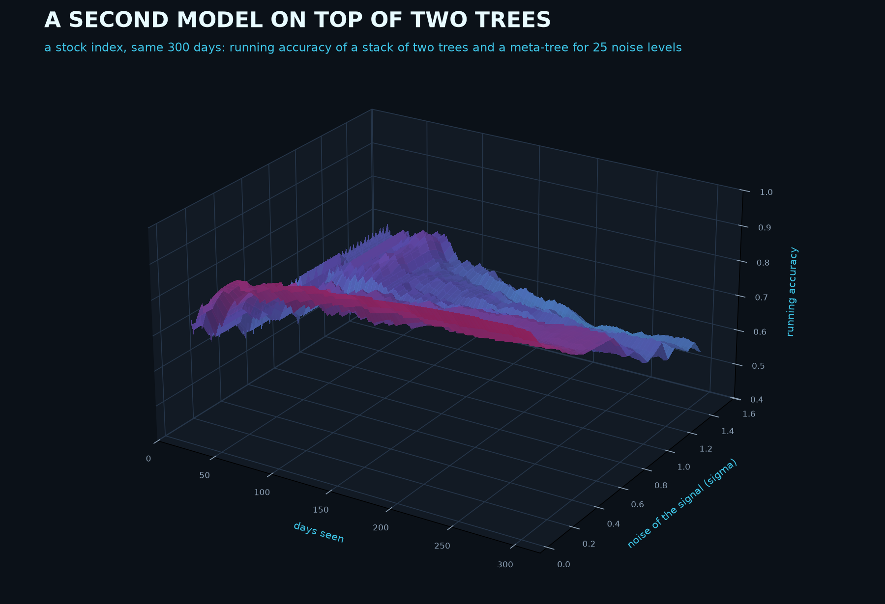
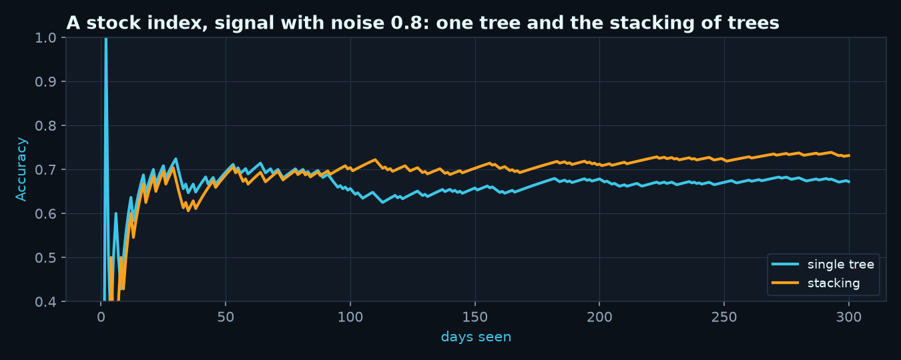

# Stacking: a second model on top

[← Ensembles](index.md)

A desk has two trees that read the same stock signal and sometimes disagree. A second model looks only at what the two trees predicted and learns when to trust each of them. A robot controller with the same setup is in the last section.



## 1. A first example: a stock signal that separates two regimes

On calm days the signal is around 0 and the index falls; on strong days the signal is around 4 and it rises. The label is 1 when the signal is above 2. Two trees and a meta-tree learn it from 500 days.

```python
import numpy as np
from dense_armor.core.online.ensemble import StackingClassifier
from dense_armor.core.online.tree.hoeffding import HoeffdingTreeClassifier

rng = np.random.default_rng(0)
stack = StackingClassifier(
    [HoeffdingTreeClassifier(grace_period=20),
     HoeffdingTreeClassifier(grace_period=100)],
    HoeffdingTreeClassifier(grace_period=20))
for _ in range(500):
    signal = float(rng.normal(0.0 if rng.random() < 0.5 else 4.0, 0.5))
    stack.learn_one({"signal": signal}, int(signal > 2.0))
print(stack.predict_one({"signal": 0.1}), stack.predict_one({"signal": 4.0}))
```

```
0 1
```

The meta-model sees only the members' predictions, never the raw `x`. On the drifted stream of
the cost section of the [index](index.md#what-the-ensembles-cost) stacking is on par with voting and both are above the single tree.



On a stock index with a signal of noise 0.8 the stack reads 0.688, 0.703 and 0.732 after 50, 150 and 300 days, and one tree reads 0.694, 0.658 and 0.672.

The picture follows the same 300 days of a stock index, where the desk sees a signal equal to the return plus a noise, for 25 levels of noise from 0.05 to 1.5. Each point of the surface is the running accuracy of the stack, scored before it learns each day. After 300 days it reads 0.946 for the noise 0.05, 0.735 for 0.78 and 0.544 for 1.5.

| class | what it does |
|---|---|
| `StackingClassifier` | a meta-model that learns from the predictions of the members |

## 2. What the ensemble does

`StackingClassifier` trains a list of base classifiers and a second classifier, the meta-model,
on the predictions of the base ones. For each sample the base members predict first, their
predictions become the input of the meta-model, and only then the members see the label. The
order matters: if the meta-model saw the labels before the members had predicted, it would learn
from information the members did not have, and the ensemble would look better on the stream than
it is.

**Source:** Stacking has no paper in the task folder. Its rule is stated in the class docstring and tested.

## 3. The parameters

| Parameter | Meaning | Default |
|---|---|---|
| `models` | the base classifiers (or factories) | none |
| `meta_model` | the classifier that learns from the members' predictions, one key per member, and never sees the raw input or a label before the members have predicted | none |

`StackingClassifier` raises `ValueError` on an empty `models`.

## 4. The same ensemble on a robot joint

A joint controller learns that a velocity `qd` above 2 is a fast joint (the label 1), from a stream where the velocity is around 0 or around 4.

```python
import numpy as np
from dense_armor.core.online.ensemble import StackingClassifier
from dense_armor.core.online.tree.hoeffding import HoeffdingTreeClassifier

rng = np.random.default_rng(0)
stack = StackingClassifier(
    [HoeffdingTreeClassifier(grace_period=20),
     HoeffdingTreeClassifier(grace_period=100)],
    HoeffdingTreeClassifier(grace_period=20))
for _ in range(500):
    qd = float(rng.normal(0.0 if rng.random() < 0.5 else 4.0, 0.5))
    stack.learn_one({"qd": qd}, int(qd > 2.0))
print(stack.predict_one({"qd": 0.1}), stack.predict_one({"qd": 4.0}))
```

```
0 1
```

A velocity of 0.1 is slow (0) and a velocity of 4.0 is fast (1).

## API reference

::: dense_armor.core.online.ensemble.stacking.StackingClassifier

---

## Details


### Choices

- **The meta-model of stacking.** The paper gives no rule for what the meta-model sees. Here it
  sees the members' predicted labels, one key per member, and never the raw input.

### Limits

- The stacking meta-model receives the members' predicted labels, not their probabilities. A
  meta-model that could see the probabilities would have more to work with; the class does not
  pass them.

### Checks

- The stacking order (meta-model learns before the members see the label) is verified by a test
  with a spy classifier.
