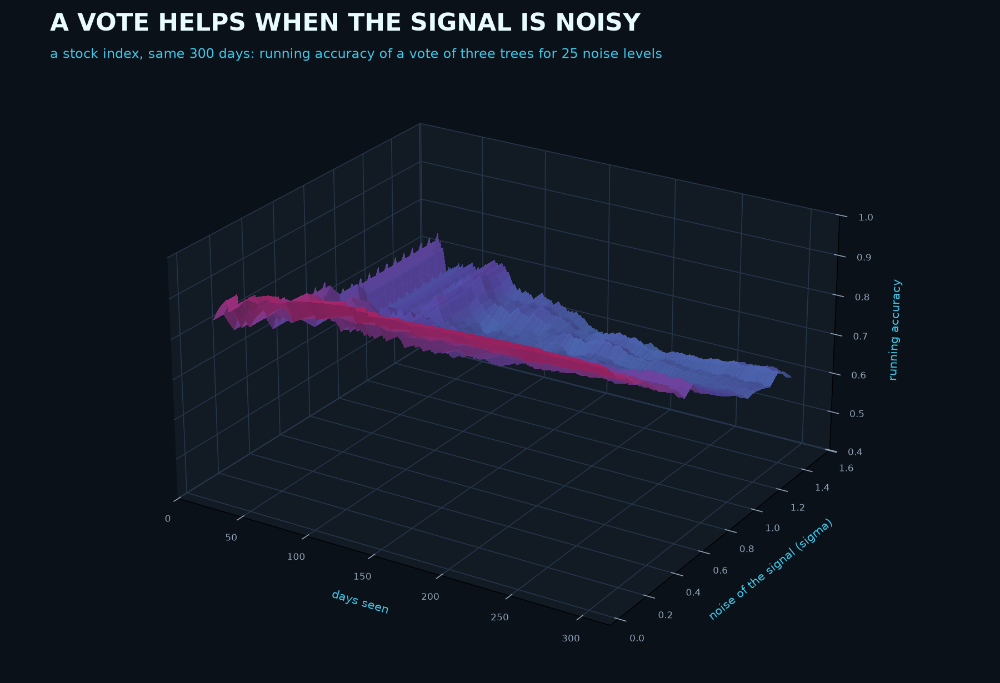
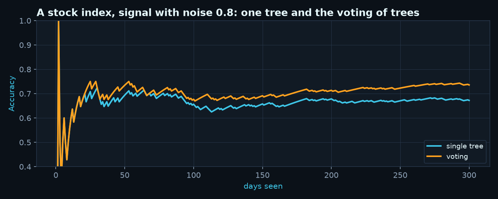

# Voting: the majority decides

[← Ensembles](index.md)

A desk gets a signal for a stock every day and wants to know whether the index will go up. One tree can be wrong in one direction and another in the opposite one, so a vote over several trees is right more often than any of them alone. A robot controller that votes on whether a joint is moving fast does the same, in the last section.



## 1. A first example: a stock signal

A signal between 0 and 1 arrives each day, and the desk buys when it is above 0.5. Three trees learn that rule from the stream and vote.

```python
from dense_armor.core.online.ensemble import VotingClassifier
from dense_armor.core.online.tree.hoeffding import HoeffdingTreeClassifier

vote = VotingClassifier(
    [HoeffdingTreeClassifier(grace_period=20),
     HoeffdingTreeClassifier(grace_period=50),
     HoeffdingTreeClassifier(grace_period=100)],
    mode="hard")
for i in range(200):
    signal = (i % 20) / 19.0
    vote.learn_one({"signal": signal}, 1 if signal > 0.5 else 0)
print(vote.predict_one({"signal": 0.9}))
```

```
1
```

The three members differ in how often they reconsider a split, so they make different mistakes,
and the majority cancels some of them. A vote of three identical members cannot help: they would
all be wrong together. The members here differ by `grace_period`, which is enough on this
stream.



On a stock index whose daily return is seen through a signal with noise 0.8, the vote of three trees reads 0.735, 0.691 and 0.736 after 50, 150 and 300 days, and one tree reads 0.694, 0.658 and 0.672.

The picture follows the same 300 days of a stock index, where the desk sees a signal equal to the return plus a noise, for 25 levels of noise from 0.05 to 1.5. Each point of the surface is the running accuracy of the vote of three trees, scored before it learns each day. After 300 days it reads 0.97 for the noise 0.05, 0.729 for 0.78 and 0.595 for 1.5: the more noise in the signal, the lower the accuracy, and a vote cannot make up for a signal that says nothing.

| class | what it does |
|---|---|
| `VotingClassifier` | a hard vote, or the mean of the probabilities, over a fixed list of classifiers |

## 2. What the ensemble does

`VotingClassifier` trains a list of classifiers on the same stream and returns the class that
most members predict. In `"hard"` mode each member is one vote, whatever confidence it has; in
`"soft"` mode each member returns a probability for every class and the ensemble averages them.

**Source:** Voting and stacking have no paper in the task folder. Their rules are stated in the class docstrings and tested.

## 3. The parameters

| Parameter | Meaning | Default |
|---|---|---|
| `models` | the base classifiers (or factories) | none |
| `mode` | `"hard"` (one vote each) or `"soft"` (mean of the probabilities) | `"hard"` |
| `weights` | optional per-member weights | `None` |

`VotingClassifier` raises `ValueError` on a bad `mode` or a mismatched `weights`.

## 4. The same ensemble on a robot joint

A joint controller learns whether a joint is moving fast (the label 1) from its velocity `qd`, scaled between 0 and 1. The same three trees vote.

```python
from dense_armor.core.online.ensemble import VotingClassifier
from dense_armor.core.online.tree.hoeffding import HoeffdingTreeClassifier

vote = VotingClassifier(
    [HoeffdingTreeClassifier(grace_period=20),
     HoeffdingTreeClassifier(grace_period=50),
     HoeffdingTreeClassifier(grace_period=100)],
    mode="hard")
for i in range(200):
    qd = (i % 20) / 19.0
    vote.learn_one({"qd": qd}, 1 if qd > 0.5 else 0)
print(vote.predict_one({"qd": 0.9}))
```

```
1
```

A velocity of 0.9 is above 0.5, so the vote says 1: the joint is moving fast.

## API reference

::: dense_armor.core.online.ensemble.voting.VotingClassifier

---

## Details

### Choices

- **The members of voting and stacking.** The papers give no rule for how different the members
  should be. Here they differ by `grace_period`; three identical members cannot help, and a test
  checks that a vote of diverse members is not worse than a single tree.
