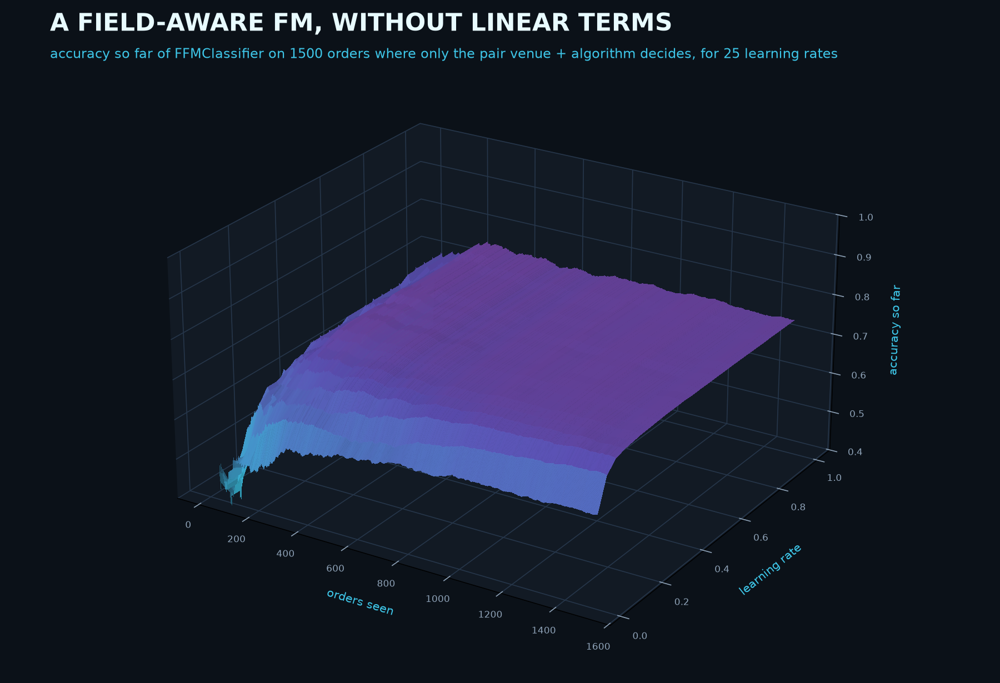
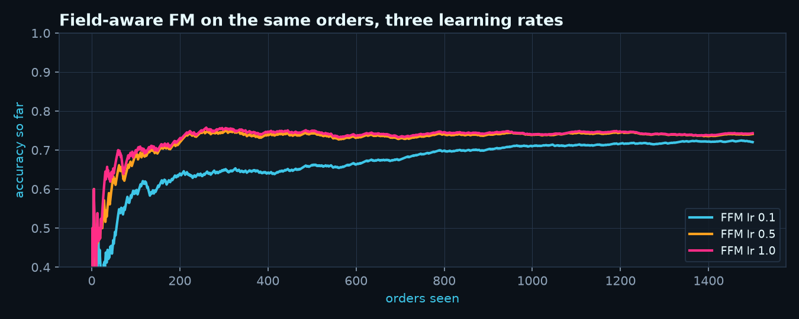

# Field-aware factorization machine: a vector for each field

[← Factorization machines](index.md)

The same desk, with a finer idea: a feature does not behave in the same way with every neighbour. The venue A has one vector when it meets an algorithm and another when it meets a time slot. The features are grouped in fields (venue, algorithm, slot) and each feature has one vector for each field. The model scores only the pairs, and gives no grade to a single feature. A robot whose joints behave differently with each load or each speed has the same structure.



## 1. A first example: the pair of venue and algorithm, with fields

The same orders as on the first page, with the time slot (open or close) added as a third feature that does not matter: the fill is good when the venue and the algorithm match. The fields are the venue, the algorithm and the slot. The model learns with AdaGrad and has a learning rate `lr`.

```python
import numpy as np
from dense_armor.core.online.facto import FFMClassifier


rng = np.random.default_rng(0)
models = {"FFMClassifier": FFMClassifier(fields={"venue=A": "venue", "venue=B": "venue", "algo=twap": "algo", "algo=pov": "algo", "slot=open": "slot", "slot=close": "slot"}, k=2, lr=0.5, seed=0)}
hits = {name: 0 for name in models}
for _ in range(1500):
    b0, b1, b2 = int(rng.integers(2)), int(rng.integers(2)), int(rng.integers(2))
    x = {"venue=" + ('A', 'B')[b0]: 1.0, "algo=" + ('twap', 'pov')[b1]: 1.0, "slot=" + ('open', 'close')[b2]: 1.0}
    y = b0 ^ b1
    for name, m in models.items():
        p = m.predict_proba_one(x)
        hits[name] += int((max(p, key=p.get) if p else 0) == y)
        m.learn_one(x, y)
print({name: round(h / 1500, 3) for name, h in hits.items()})
```

```
{'FFMClassifier': 0.741}
```

The model keeps a vector for each feature and each field. For the pair venue A and algorithm twap it uses the vector of A for the field of the algorithm and the vector of twap for the field of the venue, and multiplies them. It never has a grade for a feature alone: the paper does not include a bias nor linear terms. Here the fill depends on a pair only, and the model learns about three quarters of the orders, not as many as the plain machine of the first page: the model is the one of the paper and this is what it does on this stream.



On a stream with a third feature (the slot) that does not matter, and 5 seeds, the median accuracy so far after 50, 200 and 1500 orders reads 0.42, 0.51 and 0.618 for `lr` 0.02, 0.46, 0.64 and 0.721 for `lr` 0.1, and 0.64, 0.73 and 0.743 for `lr` 1.0. On this stream the field-aware model learns the pair less well than the plain factorization machine of the first page, which reaches 0.96, and a larger learning rate does not close the gap. On a stream with only the two features and the same orders, the same model stays at 0.477 for one seed and at 0.753 for three others: with two features alone this model did not learn the pair reliably, and the page uses the stream with the third feature.

| class or function | what it does |
|---|---|
| `FFMClassifier` | predicts the probability of class 1 from the pairs of features, with a vector for each field |
| `FFMRegressor` | predicts a number from the pairs of features, with the squared loss |

## 2. What it does

The model is eq. (4) of Juan et al.: the sum over the pairs of features of the dot product of the vector of the first feature for the field of the second and the vector of the second feature for the field of the first, weighted by the two feature values. Each feature has `f` latent vectors of length `k`, one for every field, so the parameters are `n * f * k`. There is no `O(k n)` shortcut: the prediction is `O(n_bar^2 k)`. The training is the logit loss solved with AdaGrad, with the accumulator `G` starting at one; the initialiser is uniform in `[0, 1 / sqrt(k)]`. The regressor reuses the model with the squared loss, which is a choice of the library, because the paper is written for binary classification.

**Source:** Juan, Y., Zhuang, Y., Chin, W.-S., Lin, C.-J. (2016). Field-aware Factorization Machines for CTR Prediction. In RecSys 2016. Eq. (4) page 3 (model), eq. (5)-(6) page 3 (gradients), Algorithm 1 page 3 (AdaGrad), initialiser and `G` start page 3 (below Algorithm 1).

## 3. The parameters

| Parameter | Meaning | Default |
|---|---|---|
| `fields` | mapping from the feature name to its field name | none |
| `k` | number of factors per field | 4 |
| `lr` | AdaGrad learning rate | 0.1 |
| `l2` | L2 strength | 0.0 |
| `feature_keys` | explicit list of feature names | `None` |
| `seed` | seed of the initialiser | 0 |

`budget_s` is 0.002 s and `memory_class` is `O(n * f * k)`.

## 4. The model as the paper writes it

### Field-aware FM, on the toy example

The FFM (Juan et al. 2016) learns a different factor vector for each feature, one for every
field: the interaction between feature `i` and feature `j` uses the factor of `i` for the
field of `j` and the factor of `j` for the field of `i`.

```python
from dense_armor.core.online.facto import FFMClassifier

fields = {"a": "F1", "b": "F1", "c": "F2"}
m = FFMClassifier(fields=fields, k=2, lr=0.1, seed=0)
for _ in range(500):
    _ = m.learn_one({"a": 1.0, "b": 0.5, "c": 0.3}, 1)
round(m.predict_proba_one({"a": 1.0, "b": 0.5, "c": 0.3})[1], 3)
```

```
0.99
```

The model is eq. (4) of Juan et al. (2016), page 3, and there is no `O(k n)` shortcut: each
pair uses a different slice of the `n x f x k` tensor, so the prediction is `O(n^2 k)`
(Table 2 of the same paper). The update is AdaGrad (Algorithm 1, page 3) with the
accumulator `G` initialised to one (page 3, below Algorithm 1).

The paper does not include the bias nor the linear terms (page 2, before Section 3): on
`DriftStream` the target depends on a linear threshold on one feature, so FFM without linear
terms cannot capture it and scores `0.504` (chance level), while the models that keep the
linear part score `0.999`. This is a property of the model as the paper defines it, not a
defect of the implementation (see `## Details`).

## 5. The same on a robot

The same on the robot: the joint and the load are the fields and a run tracks well when they match.

```python
import numpy as np
from dense_armor.core.online.facto import FFMClassifier


rng = np.random.default_rng(0)
models = {"FFMClassifier": FFMClassifier(fields={"joint=j1": "joint", "joint=j2": "joint", "load=light": "load", "load=heavy": "load", "speed=slow": "speed", "speed=fast": "speed"}, k=2, lr=0.5, seed=0)}
hits = {name: 0 for name in models}
for _ in range(1500):
    b0, b1, b2 = int(rng.integers(2)), int(rng.integers(2)), int(rng.integers(2))
    x = {"joint=" + ('j1', 'j2')[b0]: 1.0, "load=" + ('light', 'heavy')[b1]: 1.0, "speed=" + ('slow', 'fast')[b2]: 1.0}
    y = b0 ^ b1
    for name, m in models.items():
        p = m.predict_proba_one(x)
        hits[name] += int((max(p, key=p.get) if p else 0) == y)
        m.learn_one(x, y)
print({name: round(h / 1500, 3) for name, h in hits.items()})
```

```
{'FFMClassifier': 0.744}
```

The stream has the same structure as the finance one, so the model learns about as much.

## API reference

::: dense_armor.core.online.facto.ffm.FFMRegressor

::: dense_armor.core.online.facto.ffm.FFMClassifier

---

## Details

### Choices

- **The figures** are drawn by `docs/assets/facto/make_facto_style_figures.py` on the stream of the first page, median over 5 seeds.
- **The accuracy of 0.504 on the drifting stream** (the table of the index) and the 0.74 here are measured results of the model as the library implements it, which has no bias and no linear term, as in the paper. This page does not state the cause of the 0.74: no experiment here separates the missing linear part from the other choices of the model.
- **Seed-dependence on two features:** with the two features of the first page only, the model ends at 0.477 on seed 0 and at 0.753, 0.753 and 0.739 on seeds 1, 2 and 3, for the learning rates 0.1 and 1.0.
