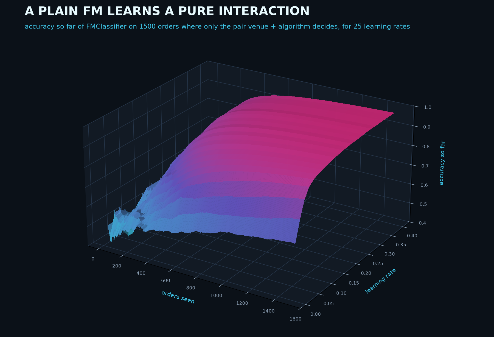
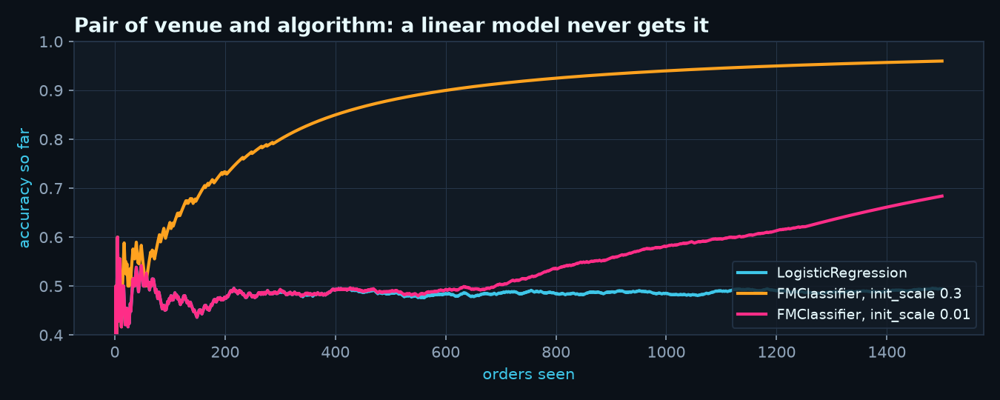
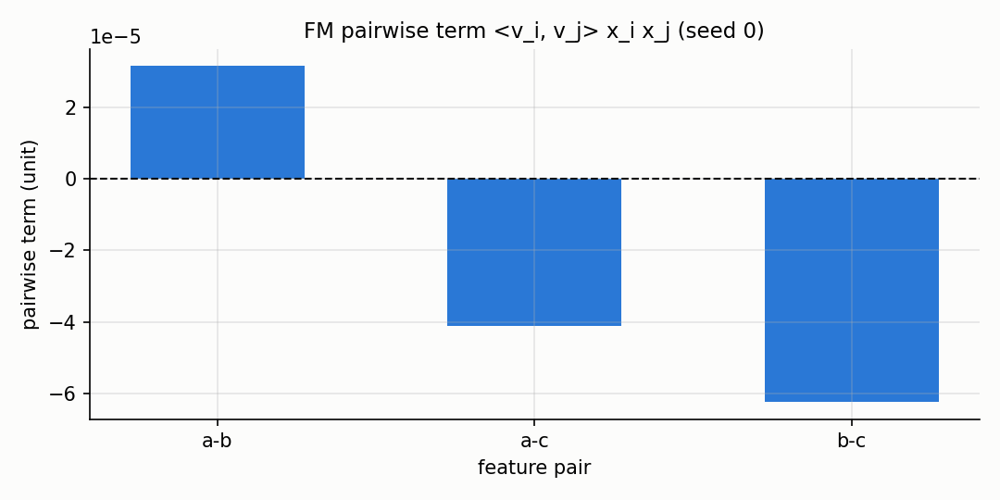
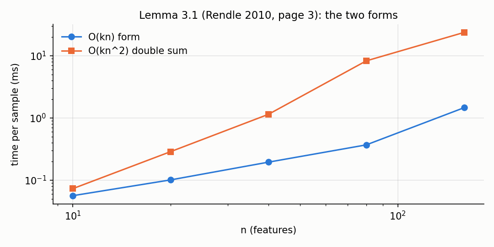

# Factorization machine: a short vector for each feature

[← Factorization machines](index.md)

A desk wants to know if a fill will be good. A venue alone says nothing, and an algorithm alone says nothing: what matters is the pair, for instance venue A with the algorithm twap, or venue B with pov. A linear model gives a grade to each feature and cannot see a pair. A factorization machine gives each feature a short vector of numbers, and the match of two features is the product of their two vectors. A robot that must pick a gain for a joint and a payload has the same problem.



## 1. A first example: a pair that no single feature can tell

An order has a venue (A or B) and an algorithm (twap or pov). The fill is good when the pair matches, venue A with twap or venue B with pov. Each order is one-hot, so it has two features equal to 1. A logistic regression and a factorization machine see the same 1500 orders, and each one predicts an order first and learns it after.

```python
import numpy as np
from dense_armor.core.online.facto import FMClassifier
from dense_armor.core.online.linear.glm import LogisticRegression
from dense_armor.core.online.optim import SGD


rng = np.random.default_rng(0)
models = {"LogisticRegression": LogisticRegression(optimizer=SGD(lr=0.05)), "FMClassifier": FMClassifier(optimizer=SGD(lr=0.2), k=4, init_scale=0.3, seed=0)}
hits = {name: 0 for name in models}
for _ in range(1500):
    b0, b1 = int(rng.integers(2)), int(rng.integers(2))
    x = {"venue=" + ('A', 'B')[b0]: 1.0, "algo=" + ('twap', 'pov')[b1]: 1.0}
    y = b0 ^ b1
    for name, m in models.items():
        p = m.predict_proba_one(x)
        hits[name] += int((max(p, key=p.get) if p else 0) == y)
        m.learn_one(x, y)
print({name: round(h / 1500, 3) for name, h in hits.items()})
```

```
{'LogisticRegression': 0.509, 'FMClassifier': 0.953}
```

The accuracy is the share of orders whose fill was predicted right before the model had seen the fill. A linear model sums a grade of the venue and a grade of the algorithm, and no choice of the two grades can say that A goes with twap and B with pov, so it stays near one half. The factorization machine multiplies the short vectors of the two features of the order, and this product can: it learns most of the orders. With the default `init_scale` of 0.01 the vectors start almost at zero and learn slowly, so the example starts them at 0.3.



On a stream with a third feature (the slot, open or close) that does not matter, and 5 seeds, the median accuracy so far reads 0.52, 0.475 and 0.494 for the logistic regression after 50, 200 and 1500 orders, 0.56, 0.73 and 0.96 for the factorization machine with `init_scale` 0.3, and 0.52, 0.475 and 0.684 with the default 0.01. The surface shows the learning rate: with 0.01 the model is still at 0.668 after 1500 orders, with 0.2 it reaches 0.961 and with 0.4 it reaches 0.973.

| class or function | what it does |
|---|---|
| `FMClassifier` | predicts the probability of class 1 from the pairs of features, with the log-loss |
| `FMRegressor` | predicts a number from the pairs of features, with the squared loss |

## 2. What it does

A factorization machine of degree two predicts the sum of a bias, a weight for each feature and, for each pair of features, the dot product of their two vectors of `k` factors weighted by the two feature values. The pairwise term is computed in `O(k n)` and not in `O(k n^2)` with the rewriting of Lemma 3.1. The classifier gives the probability of class 1 as the sigmoid of the score and learns with the binary log-loss; the regressor learns with the squared loss. The factor vectors start from a normal distribution with standard deviation `init_scale`; Rendle does not prescribe the initialisation.

**Source:** Rendle, S. (2010). Factorization Machines. In ICDM 2010. Eq. (1), (2), (3) page 2; Lemma 3.1 and eq. (4) page 3.

## 3. The parameters

| Parameter | Meaning | Default |
|---|---|---|
| `optimizer` | any optimizer of `dense_armor.core.online.optim` | none |
| `k` | number of factors, strictly positive | 8 |
| `l2` | L2 regularization strength, 0 for none | 0.0 |
| `feature_keys` | explicit list of feature keys; `None` sorts the keys of the first dict seen | `None` |
| `seed` | seed of the initialiser | 0 |
| `init_scale` | standard deviation of the initialiser | 0.01 |

Both classes raise `ValueError` if `k < 1` or `l2 < 0`. `budget_s` is 0.015 s and `memory_class` is `O(n * k)`.

## 4. The model as the paper writes it

### The plain FM

A factorization machine of degree two predicts:

    y_hat(x) = w0 + sum_i w_i x_i + sum_{i<j} <v_i, v_j> x_i x_j

with `w0` a global bias, `w_i` a weight per feature, `V` an `n x k` matrix of factors and
`<v_i, v_j> = sum_f v_{i,f} v_{j,f}` the dot product of two rows.

```python
from dense_armor.core.online.facto import FMRegressor
from dense_armor.core.online.optim import SGD

fm = FMRegressor(optimizer=SGD(lr=0.05), k=3, seed=0)
for _ in range(500):
    _ = fm.learn_one({"a": 1.0, "b": 0.5}, 2.0)
round(fm.predict_one({"a": 1.0, "b": 0.5}), 2)
```

```
2.0
```

The linear part of the model handles the easy effect of each feature; the pairwise part
handles the interaction. The interaction is not stored as one number per pair (that would
be `O(n^2)` parameters), it is stored as two factor vectors that are multiplied, so the
whole model has `O(n k)` parameters (eq. (2) of Rendle 2010, page 2).

### The pairwise term, one picture

The interaction between two features is `<v_i, v_j> x_i x_j`, the dot product of the two
factor vectors weighted by the two feature values.



The bars are the contribution of one pair each, with the linear part removed so the
picture shows only the pairwise term. The figure is built by `fig_fm_pairwise` in
`docs/assets/facto/make_figures.py` on a model with `k = 3` and seed `0`.

### The O(kn) form

The double sum over pairs costs `O(k n^2)` to compute; the same quantity can be computed
in `O(k n)` with the rewriting of Lemma 3.1 (Rendle 2010, page 3):

    sum_{i<j} <v_i, v_j> x_i x_j
        = 1/2 sum_f ( (sum_i v_{i,f} x_i)^2 - sum_i v_{i,f}^2 x_i^2 )

```python
from dense_armor.core.online.facto import FMRegressor
from dense_armor.core.online.optim import SGD

fm = FMRegressor(optimizer=SGD(lr=0.05), k=3, seed=0)
fm._resolve_keys({f"x{i}": 0.0 for i in range(6)})
fm._ensure_state(fm._keys)
x = {f"x{i}": float(i % 3) + 0.1 for i in range(6)}
round(abs(fm._y_hat(x) - fm._pairwise_naive(x)), 9)
```

```
0.0
```



The two methods agree to machine precision; the figure shows the cost per sample as `n`
grows, the `O(k n)` form (blue) and the `O(k n^2)` double sum (orange). The measurement is
in `docs/assets/facto/figures.json` under `checks.fm_ok_equals_double_sum`
(`max_abs_diff = 4.3e-19` on 200 random sparse inputs, from the benchmark script).

## 5. The same on a robot

A robot arm has two joints and two loads. A run tracks well when the joint and the load match, joint j1 with the light load or joint j2 with the heavy one. The code is the same, with the names of the robot.

```python
import numpy as np
from dense_armor.core.online.facto import FMClassifier
from dense_armor.core.online.linear.glm import LogisticRegression
from dense_armor.core.online.optim import SGD


rng = np.random.default_rng(0)
models = {"LogisticRegression": LogisticRegression(optimizer=SGD(lr=0.05)), "FMClassifier": FMClassifier(optimizer=SGD(lr=0.2), k=4, init_scale=0.3, seed=0)}
hits = {name: 0 for name in models}
for _ in range(1500):
    b0, b1 = int(rng.integers(2)), int(rng.integers(2))
    x = {"joint=" + ('j1', 'j2')[b0]: 1.0, "load=" + ('light', 'heavy')[b1]: 1.0}
    y = b0 ^ b1
    for name, m in models.items():
        p = m.predict_proba_one(x)
        hits[name] += int((max(p, key=p.get) if p else 0) == y)
        m.learn_one(x, y)
print({name: round(h / 1500, 3) for name, h in hits.items()})
```

```
{'LogisticRegression': 0.509, 'FMClassifier': 0.953}
```

The linear model is again near one half and the factorization machine learns the pair.

## API reference

::: dense_armor.core.online.facto.fm.FMRegressor

::: dense_armor.core.online.facto.fm.FMClassifier

---

## Details

### Choices

- **The figures** are drawn with the library by `docs/assets/facto/make_facto_style_figures.py`: 1500 orders, venue, algorithm and slot as one-hot features, the fill good when the venue and the algorithm match, accuracy so far computed before each order is learned, median over 5 seeds. The older figures of the paper's model are drawn by `docs/assets/facto/make_figures.py`.
- **`init_scale` 0.3 and `lr` 0.2** are choices of the examples, not defaults: with the default `init_scale` of 0.01 the model reaches 0.684 on the same stream after 1500 orders.
