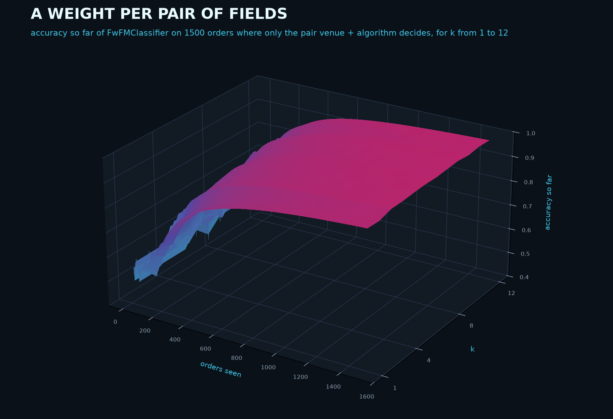
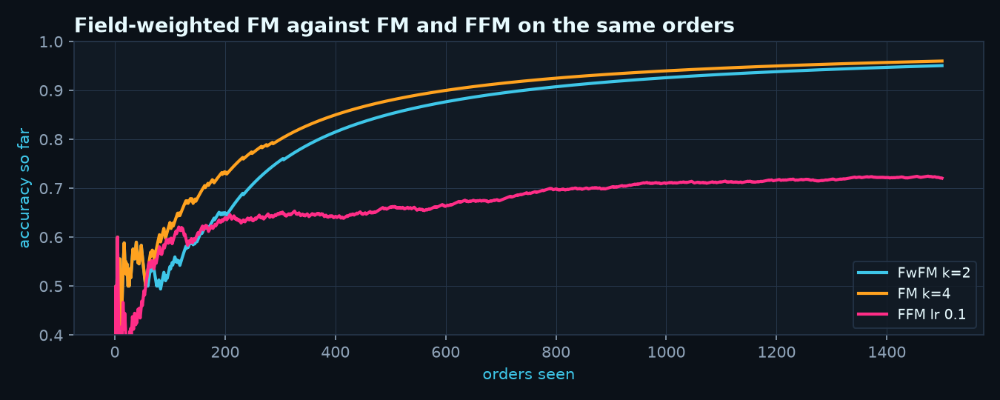

# Field-weighted factorization machine: a weight for each pair of fields

[← Factorization machines](index.md)

A middle way for the desk: one short vector per feature, as in the plain machine, and in addition a single number for each pair of fields. The pair venue and algorithm can matter much more than the pair venue and slot, and the model learns how much. It keeps the grade of each feature too. A robot with a few fields (joint, load, speed) can weigh the pairs in the same way.



## 1. A first example: the pair of venue and algorithm, with a weight per pair of fields

The same orders, the same fields, and the same learner as on the first page, with the weights of the pairs of fields.

```python
import numpy as np
from dense_armor.core.online.facto import FwFMClassifier
from dense_armor.core.online.optim import SGD


rng = np.random.default_rng(0)
models = {"FwFMClassifier": FwFMClassifier(optimizer=SGD(lr=0.2), fields={"venue=A": "venue", "venue=B": "venue", "algo=twap": "algo", "algo=pov": "algo"}, k=2, init_scale=0.3, seed=0)}
hits = {name: 0 for name in models}
for _ in range(1500):
    b0, b1 = int(rng.integers(2)), int(rng.integers(2))
    x = {"venue=" + ('A', 'B')[b0]: 1.0, "algo=" + ('twap', 'pov')[b1]: 1.0}
    y = b0 ^ b1
    for name, m in models.items():
        p = m.predict_proba_one(x)
        hits[name] += int((max(p, key=p.get) if p else 0) == y)
        m.learn_one(x, y)
print({name: round(h / 1500, 3) for name, h in hits.items()})
```

```
{'FwFMClassifier': 0.949}
```

The score is the one of the plain machine, with each pair multiplied by a number `r` that belongs to the pair of fields of the two features. The number is symmetric: the pair (venue, algorithm) and the pair (algorithm, venue) share it. It captures the strength of an interaction without the `n f k` parameters of the field-aware machine.



On a stream with a third feature (the slot) and 5 seeds, the median accuracy so far reads 0.56, 0.67 and 0.953 after 50, 200 and 1500 orders for `k = 1`, 0.58, 0.755 and 0.965 for `k = 4`, and 0.58, 0.795 and 0.973 for `k = 12`. A single factor is enough here, and more factors learn a little faster.

| class or function | what it does |
|---|---|
| `FwFMClassifier` | predicts the probability of class 1, with a weight for each pair of fields |
| `FwFMRegressor` | predicts a number, with the squared loss |

## 2. What it does

The model is eq. (7) of Pan et al.: a bias, a weight for each feature and the sum over the pairs of features of the dot product of the two vectors, the two feature values and the weight `r` of the pair of fields. The weight is symmetric, so only the upper triangle of the matrix of the fields is read. The classifier gives the probability as the sigmoid of the score and learns with the log-loss; the regressor reuses the model with the squared loss, a choice of the library.

**Source:** Pan, J., Xu, J., Ruiz, A. L., Zhao, W., Pan, S., Sun, Y., Lu, Q. (2018). Field-weighted Factorization Machines for Click-Through Rate Prediction in Display Advertising. In WWW 2018. Eq. (7) page 3 (model), Section 4 page 3 (the `r` weight).

## 3. The parameters

| Parameter | Meaning | Default |
|---|---|---|
| `optimizer` | any optimizer of `dense_armor.core.online.optim` | none |
| `fields` | mapping from the feature name to its field name | none |
| `k` | number of latent factors | 4 |
| `l2` | L2 strength | 0.0 |
| `feature_keys` | explicit list of feature names | `None` |
| `seed` | seed of the initialiser | 0 |
| `init_scale` | standard deviation of the initialiser | 0.01 |

`budget_s` is 0.002 s and `memory_class` is `O(n * k + f * f)`.

## 4. The model as the paper writes it

### Field-weighted FM, on the toy example

The FwFM (Pan et al. 2018) keeps one factor vector per feature like the FM, and adds a scalar
weight for every field pair:

    y_hat(x) = w0 + sum_i w_i x_i + sum_{i<j} <v_i, v_j> x_i x_j r_{F(i), F(j)}

The scalar `r` captures the interaction strength of the field pair, without the `n f k`
parameters of the FFM.

```python
from dense_armor.core.online.facto import FwFMClassifier
from dense_armor.core.online.optim import SGD

fields = {"a": "F1", "b": "F1", "c": "F2"}
m = FwFMClassifier(optimizer=SGD(lr=0.05), fields=fields, k=2, seed=0)
for _ in range(500):
    _ = m.learn_one({"a": 1.0, "b": 0.5, "c": 0.3}, 1)
round(m.predict_proba_one({"a": 1.0, "b": 0.5, "c": 0.3})[1], 3)
```

```
0.982
```

The model is eq. (7) of Pan et al. (2018), page 3. The weight `r` is symmetric (the pair
`(F(i), F(j))` is unordered), so only the upper triangle of the `f x f` matrix is read.

## 5. The same on a robot

On the robot: the joint and the load are the fields and the run tracks well when they match.

```python
import numpy as np
from dense_armor.core.online.facto import FwFMClassifier
from dense_armor.core.online.optim import SGD


rng = np.random.default_rng(0)
models = {"FwFMClassifier": FwFMClassifier(optimizer=SGD(lr=0.2), fields={"joint=j1": "joint", "joint=j2": "joint", "load=light": "load", "load=heavy": "load"}, k=2, init_scale=0.3, seed=0)}
hits = {name: 0 for name in models}
for _ in range(1500):
    b0, b1 = int(rng.integers(2)), int(rng.integers(2))
    x = {"joint=" + ('j1', 'j2')[b0]: 1.0, "load=" + ('light', 'heavy')[b1]: 1.0}
    y = b0 ^ b1
    for name, m in models.items():
        p = m.predict_proba_one(x)
        hits[name] += int((max(p, key=p.get) if p else 0) == y)
        m.learn_one(x, y)
print({name: round(h / 1500, 3) for name, h in hits.items()})
```

```
{'FwFMClassifier': 0.949}
```

The weights of the pairs of fields are learned together with the vectors, and the pair is found.

## API reference

::: dense_armor.core.online.facto.fwfm.FwFMRegressor

::: dense_armor.core.online.facto.fwfm.FwFMClassifier

---

## Details

### Choices

- **The figures** are drawn by `docs/assets/facto/make_facto_style_figures.py` on the stream of the first page, `lr` 0.2, `init_scale` 0.3, median over 5 seeds.
