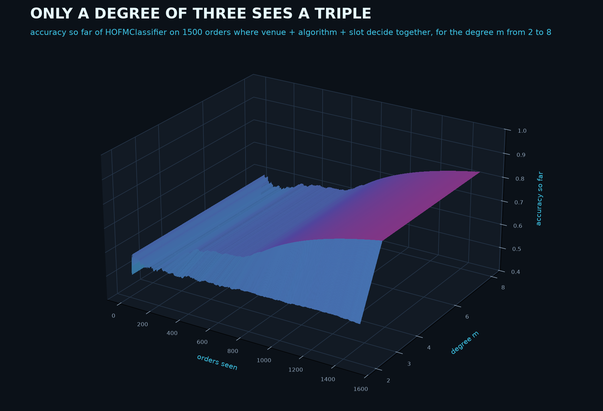
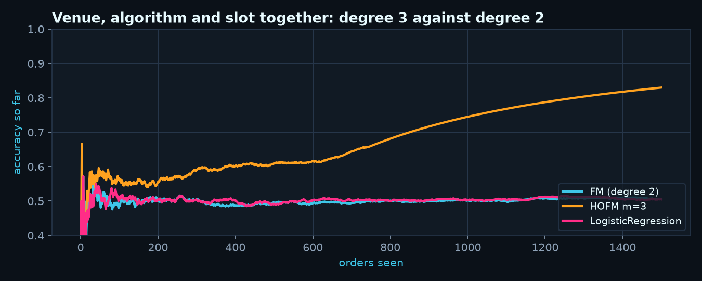

# Higher-order factorization machine: three features at once

[← Factorization machines](index.md)

Some effects need three features together: a venue, an algorithm and a time slot that are good together and bad when any one changes. A machine that looks at pairs cannot see them. The higher-order machine adds the effects of three, four or more features, up to a degree `m`, and a clever recursion keeps the cost proportional to the number of features that are present. A robot with a joint, a load and a speed has such triples.



## 1. A first example: three features that decide together

An order has a venue, an algorithm and a time slot. The fill is good when an odd number of the three are on the second value: no single feature and no pair says anything, only the three together. The plain machine of the first page and the higher-order machine of degree 3 see the same 1500 orders.

```python
import numpy as np
from dense_armor.core.online.facto import FMClassifier, HOFMClassifier
from dense_armor.core.online.optim import SGD


rng = np.random.default_rng(0)
models = {"FMClassifier": FMClassifier(optimizer=SGD(lr=0.2), k=4, init_scale=0.3, seed=0), "HOFMClassifier": HOFMClassifier(optimizer=SGD(lr=0.2), m=3, k=4, init_scale=0.3, seed=0)}
hits = {name: 0 for name in models}
for _ in range(1500):
    b0, b1, b2 = int(rng.integers(2)), int(rng.integers(2)), int(rng.integers(2))
    x = {"venue=" + ('A', 'B')[b0]: 1.0, "algo=" + ('twap', 'pov')[b1]: 1.0, "slot=" + ('open', 'close')[b2]: 1.0}
    y = b0 ^ b1 ^ b2
    for name, m in models.items():
        p = m.predict_proba_one(x)
        hits[name] += int((max(p, key=p.get) if p else 0) == y)
        m.learn_one(x, y)
print({name: round(h / 1500, 3) for name, h in hits.items()})
```

```
{'FMClassifier': 0.493, 'HOFMClassifier': 0.839}
```

The plain machine stays at one half, because every pair is useless. The machine of degree 3 learns most of the orders: it has a term for the triples. A degree above 3 changes nothing here, as the surface shows.



On the same stream and 5 seeds, the median accuracy so far after 50, 200 and 1500 orders reads 0.5, 0.5 and 0.505 for the plain machine, and 0.58, 0.555 and 0.83 for the degree 3. The surface shows the degree: for `m = 2` it ends at 0.561, for `m = 3` and for `m = 8` at 0.83. The degree 3 is the smallest that sees the triple, and the others do not do better on it.

| class or function | what it does |
|---|---|
| `HOFMClassifier` | predicts the probability of class 1 from the interactions up to degree `m` |
| `HOFMRegressor` | predicts a number from the interactions up to degree `m` |

## 2. What it does

The model adds to the linear part the ANOVA kernels of degree 2 up to `m`: the interactions of two, three, up to `m` different features, each with its own `k` factors. The kernel is computed with a dynamic programme, so the cost stays linear in the number of non-zero features, and its gradient has the same cost. At `m = 2` the model is the plain pairwise machine. The classifier gives the probability as the sigmoid of the score and learns with the log-loss. The paper takes the same number of factors for every degree, `k_2 = ... = k_m = k`.

**Source:** Blondel, M., Fujino, A., Ueda, N., Ishihata, M. (2016). Higher-Order Factorization Machines. In NIPS 2016. Eq. (5)-(6) page 2, Algorithm 1 and 2 page 4.

## 3. The parameters

| Parameter | Meaning | Default |
|---|---|---|
| `optimizer` | any optimizer of `dense_armor.core.online.optim` | none |
| `m` | maximum degree, at least 2 | 3 |
| `k` | number of latent factors, shared across degrees | 4 |
| `l2` | L2 strength | 0.0 |
| `feature_keys` | explicit list of feature names | `None` |
| `seed` | seed of the initialiser | 0 |
| `init_scale` | standard deviation of the initialiser | 0.01 |

`budget_s` is 0.015 s and `memory_class` is `O(d + (m - 1) * d * k)`.

## 4. The model as the paper writes it

### Higher-order FM, on the toy example

The HOFM (Blondel et al. 2016) adds interactions of degree up to `m`, but computes them
with a dynamic programme so the cost stays linear in the number of non-zero features:

    y_hat(x) = <w, x> + sum_{t=2}^{m} sum_{s=1}^{k} A_t(p_s^{(t)}, x)

where `A_t` is the ANOVA kernel of degree `t`.

```python
from dense_armor.core.online.facto import HOFMRegressor
from dense_armor.core.online.optim import SGD

m = HOFMRegressor(optimizer=SGD(lr=0.05), m=3, k=2, seed=0)
for _ in range(300):
    _ = m.learn_one({"a": 1.0, "b": 0.5, "c": 0.3}, 1.5)
round(m.predict_one({"a": 1.0, "b": 0.5, "c": 0.3}), 3)
```

```
1.5
```

The model is eq. (3) and eq. (6) of Blondel et al. (2016), page 2. `A_t` is computed with
Algorithm 1 (page 4) and its gradient with Algorithm 2 (page 4), both in `O(nz(x) t)`. At
`m = 2` the ANOVA kernel reduces to the plain pairwise FM (test
`test_m2_equals_plain_fm` in `test/core/online/facto/test_hofm.py`).

## 5. The same on a robot

On the robot: a run tracks well when an odd number of the joint, the load and the speed are on their second value.

```python
import numpy as np
from dense_armor.core.online.facto import FMClassifier, HOFMClassifier
from dense_armor.core.online.optim import SGD


rng = np.random.default_rng(0)
models = {"FMClassifier": FMClassifier(optimizer=SGD(lr=0.2), k=4, init_scale=0.3, seed=0), "HOFMClassifier": HOFMClassifier(optimizer=SGD(lr=0.2), m=3, k=4, init_scale=0.3, seed=0)}
hits = {name: 0 for name in models}
for _ in range(1500):
    b0, b1, b2 = int(rng.integers(2)), int(rng.integers(2)), int(rng.integers(2))
    x = {"joint=" + ('j1', 'j2')[b0]: 1.0, "load=" + ('light', 'heavy')[b1]: 1.0, "speed=" + ('slow', 'fast')[b2]: 1.0}
    y = b0 ^ b1 ^ b2
    for name, m in models.items():
        p = m.predict_proba_one(x)
        hits[name] += int((max(p, key=p.get) if p else 0) == y)
        m.learn_one(x, y)
print({name: round(h / 1500, 3) for name, h in hits.items()})
```

```
{'FMClassifier': 0.491, 'HOFMClassifier': 0.825}
```

Again the degree 3 learns the triple and the plain machine does not.

## API reference

::: dense_armor.core.online.facto.hofm.HOFMRegressor

::: dense_armor.core.online.facto.hofm.HOFMClassifier

---

## Details

### Choices

- **The figures** are drawn by `docs/assets/facto/make_facto_style_figures.py`: 1500 orders, the fill good when an odd number of venue, algorithm and slot are on the second value, `lr` 0.2, `init_scale` 0.3, median over 5 seeds.
