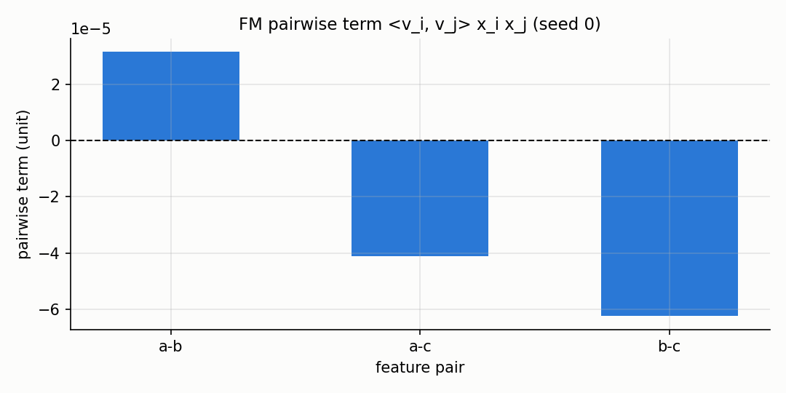
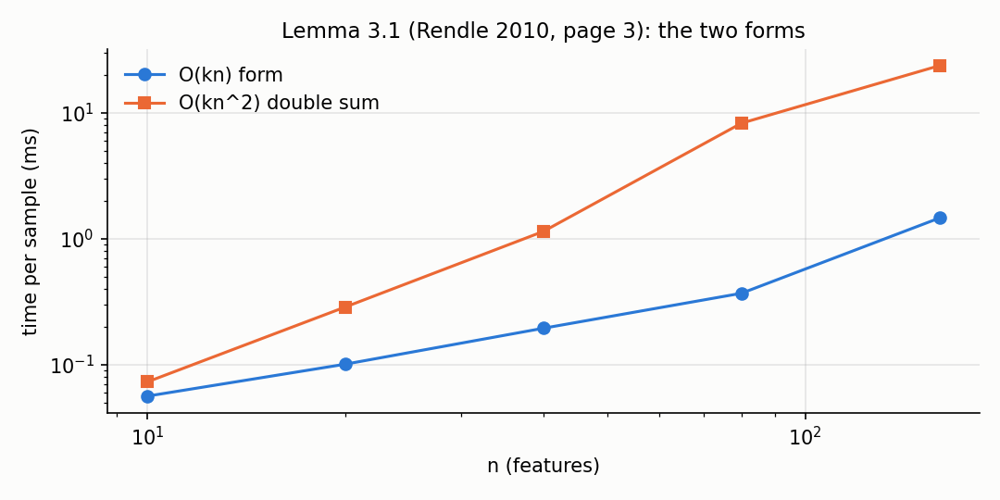
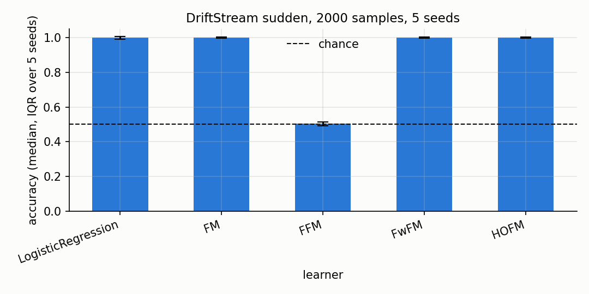

# Factorization machines, field-aware and higher-order

## The map of factorization machines

Click a page to open it, or the job on the left (or the button at the top) to go back to the [map of the library](../index.md#the-library-folder-by-folder).

<object type="image/svg+xml" data="../assets/maps/facto.svg" style="width:100%"></object>

## Gamestory

### The Great Sandwich Contest

Once upon a time there was the Great Sandwich Contest, a tournament in which four very special judges had to guess how good a sandwich would be by looking only at the list of ingredients (features) on the table.

The problem was this: if you put ham (good, grade +5) and mozzarella (good, grade +5) in the sandwich, the result was a marvel. But if you put Nutella (grade +5) and anchovies (grade +5) in it, taken alone they were delicious, but put together they gave a stomachache!

To win the contest, the judges had to learn to give a grade not only to the single ingredients, but above all to how well or poorly they went together (interaction).

### The secret of the flavor label

Instead of carrying around a giant recipe book with all the possible pairs in the world, the head of the judges (Factorization Machine) had a brilliant idea: he stuck a small "flavor label" (latent factor vector) on each ingredient with only three numbers: how sweet it was, how salty it was, and how crunchy it was.

To understand if two ingredients got along, it was enough to quickly compare their labels (dot product). And in order not to waste hours checking a hundred ingredients two at a time, a village mathematician invented a magic shortcut (Lemma 3.1 / O(kn) form) that did all the math in the blink of an eye.

### The four judges of the contest

At that point, the four judges of the contest entered the scene, each with their own style for evaluating the sandwich:

- The first judge was the simplest (FM / FMRegressor). He took the sandwich, read the flavor label of each ingredient, and calculated on the fly how they paired with each other. Simple, fast, and reliable.
- The second judge was a true perfectionist (FFM / FFMClassifier). He had divided the table into departments, called fields: the Cured Meats department, the Cheeses department, and the Sauces department. For him, every ingredient changed face depending on its neighbor: ham had one flavor when it touched cheese, and another when it touched a sauce. Unfortunately, the contest organizers played a nasty trick on him: they forbade him from giving a grade to the single ingredients alone (linear terms). So, poor thing, he looked only at the pairings, forgetting whether an ingredient by itself was good or bad, ending up getting almost everything wrong (0.504).
- The third judge was the smartest (FwFM / FwFMClassifier). He used only one label per ingredient to stay fast, but he had a secret table with an importance multiplier (scalar weight r) for each pair of departments. He knew very well that the pairing "Cheese + Sauce" could save or ruin the sandwich much more than the pairing "Bread + Lettuce".
- The fourth judge had a superpower (HOFM / HOFMRegressor). While the other judges managed to evaluate ingredients only in pairs (two at a time), he managed to sense the harmony of three or more ingredients all together (degree m), like the perfect trio tomato + mozzarella + basil. And thanks to a mathematical spell (ANOVA kernel), he succeeded without taking forever.

### The grand finale

The moment of the final test arrived: the chefs began changing the ingredients and tastes suddenly (DriftStream), to put the judges in difficulty.

The second judge, the one from whom they had taken away the grades on single ingredients, panicked and guessed at random. But the other three judges — the simple one, the smart one, and the one with the superpower — were not caught by surprise: they guessed the goodness of almost every single sandwich (0.999), winning together the cup of the Great Sandwich Contest!

## The problem, in one line

A desk wants to predict whether a fill will be good from the venue, the algorithm and the time slot of an order. Often a feature says nothing alone and the **pair** (or the triple) of features says everything: venue A with the algorithm twap is good, venue A with pov is not. A **factorization machine** predicts a target from a sparse vector of features by learning, for each feature, a short vector of latent factors; the interaction of two features is the dot product of their vectors. On a stream, each sample updates the bias `w0`, the weights `w` and the factor matrix `V` one step of gradient descent at a time.

## The words

| Word | What it means here | In the example |
|---|---|---|
| feature | one number that describes the sample; here a one-hot feature is 1 when the value is present | `venue=A`, `algo=twap` |
| interaction | the effect of two (or more) features together, that no feature has alone | venue A with twap is good, A with pov is not |
| latent factors | the short vector of `k` numbers that a feature learns | `k = 4` |
| field | a group of features | the venue, the algorithm, the slot |
| degree | how many features an interaction can have at most | 2 for the plain machine, `m` for the higher-order one |

## A first example: five models on the same orders

An order has a venue, an algorithm and a time slot, each one-hot. The fill is good when the venue and the algorithm match (A with twap, B with pov); the slot does not matter. The five models see the same 1500 orders and each predicts an order before it learns it. The number is the share of orders predicted right.

```python
import numpy as np
from dense_armor.core.online.facto import FFMClassifier, FMClassifier, FwFMClassifier, HOFMClassifier
from dense_armor.core.online.linear.glm import LogisticRegression
from dense_armor.core.online.optim import SGD

fields = {"venue=A": "venue", "venue=B": "venue", "algo=twap": "algo", "algo=pov": "algo", "slot=open": "slot", "slot=close": "slot"}
rng = np.random.default_rng(0)
models = {
    "LogisticRegression": LogisticRegression(optimizer=SGD(lr=0.05)),
    "FMClassifier": FMClassifier(optimizer=SGD(lr=0.2), k=4, init_scale=0.3, seed=0),
    "FFMClassifier": FFMClassifier(fields=fields, k=2, lr=0.5, seed=0),
    "FwFMClassifier": FwFMClassifier(optimizer=SGD(lr=0.2), fields=fields, k=2, init_scale=0.3, seed=0),
    "HOFMClassifier": HOFMClassifier(optimizer=SGD(lr=0.2), m=3, k=4, init_scale=0.3, seed=0),
}
hits = {name: 0 for name in models}
for _ in range(1500):
    v, a, s = int(rng.integers(2)), int(rng.integers(2)), int(rng.integers(2))
    x = {"venue=" + "AB"[v]: 1.0, "algo=" + ["twap", "pov"][a]: 1.0, "slot=" + ["open", "close"][s]: 1.0}
    y = v ^ a
    for name, m in models.items():
        p = m.predict_proba_one(x)
        hits[name] += int((max(p, key=p.get) if p else 0) == y)
        m.learn_one(x, y)
for name, h in hits.items():
    print(name, round(h / 1500, 3))
```

```
LogisticRegression 0.472
FMClassifier 0.963
FFMClassifier 0.741
FwFMClassifier 0.959
HOFMClassifier 0.97
```

The logistic regression, which gives a grade to each feature, stays near one half: no grade of a venue and no grade of an algorithm can say that a pair matches. The plain factorization machine, the field-weighted one and the higher-order one learn the pair. The field-aware machine learns about three quarters of it on this stream, and the page of the field-aware machine says what was measured. The pages below show each model alone, with its figure and its parameters.

## The pages of the section

| Page | Classes | What it does |
|---|---|---|
| [Factorization machine](fm.md) | `FMClassifier`, `FMRegressor` | a short vector per feature; the pair is the dot product |
| [Field-aware](ffm.md) | `FFMClassifier`, `FFMRegressor` | a vector per feature and per field, no linear terms |
| [Field-weighted](fwfm.md) | `FwFMClassifier`, `FwFMRegressor` | one vector per feature and a weight per pair of fields |
| [Higher-order](hofm.md) | `HOFMClassifier`, `HOFMRegressor` | interactions of up to `m` features at once |


## The same problem on a robot

A robot has a joint, a load and a speed, and a run tracks well or badly depending on the combination: the load alone or the joint alone say nothing. The four models are the same, and each page ends with the same code written for a robot. The older comparison above, on a drifting stream, is the one of the benchmark.

## Details` at the bottom).

## 1. The plain FM

A factorization machine of degree two predicts::

    y_hat(x) = w0 + sum_i w_i x_i + sum_{i<j} <v_i, v_j> x_i x_j

with `w0` a global bias, `w_i` a weight per feature, `V` an `n x k` matrix of factors and
`<v_i, v_j> = sum_f v_{i,f} v_{j,f}` the dot product of two rows.

~~~python
from dense_armor.core.online.facto import FMRegressor
from dense_armor.core.online.optim import SGD

fm = FMRegressor(optimizer=SGD(lr=0.05), k=3, seed=0)
for _ in range(500):
    _ = fm.learn_one({"a": 1.0, "b": 0.5}, 2.0)
round(fm.predict_one({"a": 1.0, "b": 0.5}), 2)
~~~

~~~
2.0
~~~

The linear part of the model handles the easy effect of each feature; the pairwise part
handles the interaction. The interaction is not stored as one number per pair (that would
be `O(n^2)` parameters), it is stored as two factor vectors that are multiplied, so the
whole model has `O(n k)` parameters (eq. (2) of Rendle 2010, page 2).

## 2. The pairwise term, one picture

The interaction between two features is `<v_i, v_j> x_i x_j`, the dot product of the two
factor vectors weighted by the two feature values.



The bars are the contribution of one pair each, with the linear part removed so the
picture shows only the pairwise term. The figure is built by `fig_fm_pairwise` in
`docs/assets/facto/make_figures.py` on a model with `k = 3` and seed `0`.

## 3. The O(kn) form

The double sum over pairs costs `O(k n^2)` to compute; the same quantity can be computed
in `O(k n)` with the rewriting of Lemma 3.1 (Rendle 2010, page 3)::

    sum_{i<j} <v_i, v_j> x_i x_j
        = 1/2 sum_f ( (sum_i v_{i,f} x_i)^2 - sum_i v_{i,f}^2 x_i^2 )

~~~python
from dense_armor.core.online.facto import FMRegressor
from dense_armor.core.online.optim import SGD

fm = FMRegressor(optimizer=SGD(lr=0.05), k=3, seed=0)
fm._resolve_keys({f"x{i}": 0.0 for i in range(6)})
fm._ensure_state(fm._keys)
x = {f"x{i}": float(i % 3) + 0.1 for i in range(6)}
abs(fm._y_hat(x) - fm._pairwise_naive(x))
~~~

~~~
0.0
~~~



The two methods agree to machine precision; the figure shows the cost per sample as `n`
grows, the `O(k n)` form (blue) and the `O(k n^2)` double sum (orange). The measurement is
in `docs/assets/facto/figures.json` under `checks.fm_ok_equals_double_sum`
(`max_abs_diff = 4.3e-19` on 200 random sparse inputs, from the benchmark script).

## 4. Field-aware FM

The FFM (Juan et al. 2016) learns a different factor vector for each feature, one for every
field: the interaction between feature `i` and feature `j` uses the factor of `i` for the
field of `j` and the factor of `j` for the field of `i`.

~~~python
from dense_armor.core.online.facto import FFMClassifier

fields = {"a": "F1", "b": "F1", "c": "F2"}
m = FFMClassifier(fields=fields, k=2, lr=0.1, seed=0)
for _ in range(500):
    _ = m.learn_one({"a": 1.0, "b": 0.5, "c": 0.3}, 1)
round(m.predict_proba_one({"a": 1.0, "b": 0.5, "c": 0.3})[1], 3)
~~~

~~~
0.99
~~~

The model is eq. (4) of Juan et al. (2016), page 3, and there is no `O(k n)` shortcut: each
pair uses a different slice of the `n x f x k` tensor, so the prediction is `O(n^2 k)`
(Table 2 of the same paper). The update is AdaGrad (Algorithm 1, page 3) with the
accumulator `G` initialised to one (page 3, below Algorithm 1).

The paper does not include the bias nor the linear terms (page 2, before Section 3): on
`DriftStream` the target depends on a linear threshold on one feature, so FFM without linear
terms cannot capture it and scores `0.504` (chance level), while the models that keep the
linear part score `0.999`. This is a property of the model as the paper defines it, not a
defect of the implementation (see `## Details`).

## 5. Field-weighted FM

The FwFM (Pan et al. 2018) keeps one factor vector per feature like the FM, and adds a scalar
weight for every field pair::

    y_hat(x) = w0 + sum_i w_i x_i + sum_{i<j} <v_i, v_j> x_i x_j r_{F(i), F(j)}

The scalar `r` captures the interaction strength of the field pair, without the `n f k`
parameters of the FFM.

~~~python
from dense_armor.core.online.facto import FwFMClassifier
from dense_armor.core.online.optim import SGD

fields = {"a": "F1", "b": "F1", "c": "F2"}
m = FwFMClassifier(optimizer=SGD(lr=0.05), fields=fields, k=2, seed=0)
for _ in range(500):
    _ = m.learn_one({"a": 1.0, "b": 0.5, "c": 0.3}, 1)
round(m.predict_proba_one({"a": 1.0, "b": 0.5, "c": 0.3})[1], 3)
~~~

~~~
0.982
~~~

The model is eq. (7) of Pan et al. (2018), page 3. The weight `r` is symmetric (the pair
`(F(i), F(j))` is unordered), so only the upper triangle of the `f x f` matrix is read.

## 6. Higher-order FM

The HOFM (Blondel et al. 2016) adds interactions of degree up to `m`, but computes them
with a dynamic programme so the cost stays linear in the number of non-zero features::

    y_hat(x) = <w, x> + sum_{t=2}^{m} sum_{s=1}^{k} A_t(p_s^{(t)}, x)

where `A_t` is the ANOVA kernel of degree `t`.

~~~python
from dense_armor.core.online.facto import HOFMRegressor
from dense_armor.core.online.optim import SGD

m = HOFMRegressor(optimizer=SGD(lr=0.05), m=3, k=2, seed=0)
for _ in range(300):
    _ = m.learn_one({"a": 1.0, "b": 0.5, "c": 0.3}, 1.5)
round(m.predict_one({"a": 1.0, "b": 0.5, "c": 0.3}), 3)
~~~

~~~
1.5
~~~

The model is eq. (3) and eq. (6) of Blondel et al. (2016), page 2. `A_t` is computed with
Algorithm 1 (page 4) and its gradient with Algorithm 2 (page 4), both in `O(nz(x) t)`. At
`m = 2` the ANOVA kernel reduces to the plain pairwise FM (test
`test_m2_equals_plain_fm` in `test/core/online/facto/test_hofm.py`).

## 7. The four models on a stream with a sudden change



The bars are the accuracy of the four classifiers and of a `LogisticRegression` on
`DriftStream` with one sudden change, 2000 samples, 4 features, 5 seeds. The error bar is
the interquartile range over the 5 seeds.

| learner | accuracy median | IQR | ms per sample |
|---|---|---|---|
| LogisticRegression | 0.9985 | 0.0005 | 0.0249 |
| FM (k=4) | 0.9990 | 0.0003 | 0.0983 |
| FFM (k=2) | 0.5040 | 0.0010 | 0.1347 |
| FwFM (k=2) | 0.9990 | 0.0003 | 0.1027 |
| HOFM (m=3, k=2) | 0.9990 | 0.0003 | 0.2558 |

The FFM is at chance because the paper has no linear terms (see step 4). The other four
models all reach 0.999 on this stream. The numbers are read from
`docs/assets/facto/figures.json` under `comparison.rows` (5 seeds, 2000 samples,
`benchmarks/facto_quality.py --seeds 5 --n-samples 2000`).

## Details

The factorization machine is Rendle, S. (2010). Factorization Machines. In ICDM 2010.
Eq. (1), (2), (3) page 2; Lemma 3.1 and eq. (4) page 3. The latent factors are
initialised from `N(0, 0.01)`; the paper does not prescribe an initialiser (my choice).
The L2 penalty also acts on `w0`; the paper does not exclude it (my choice).

The field-aware FM is Juan, Y., Zhuang, Y., Chin, W.-S., Lin, C.-J. (2016). Field-aware
Factorization Machines for CTR Prediction. In RecSys 2016. Eq. (4) page 3; eq. (5)-(6)
page 3 (gradients); Algorithm 1 page 3 (AdaGrad); page 3, below Algorithm 1 (`G` starts at
one, init `U[0, 1/sqrt(k)]`). The paper does not include the bias nor the linear terms
(page 2, before Section 3); the model as implemented keeps this choice, which is why FFM
is at chance on `DriftStream`.

The field-weighted FM is Pan, J., Xu, J., Ruiz, A. L., Zhao, W., Pan, S., Sun, Y., Lu, Q.
(2018). Field-weighted Factorization Machines for Click-Through Rate Prediction in Display
Advertising. In WWW 2018. Eq. (7) page 3 (model); Section 4 page 3 (the `r` weight). The
`r` matrix is symmetric; only the upper triangle is read.

The higher-order FM is Blondel, M., Fujino, A., Ueda, N., Ishihata, M. (2016).
Higher-Order Factorization Machines. In NIPS 2016. Eq. (5) page 2 (ANOVA kernel); eq. (6)
page 2 (model as sum of ANOVA kernels); eq. (8) page 3 (recursion); Algorithm 1 and
Algorithm 2 page 4 (evaluation and gradient of `A_m`); page 4 (sparse cost
`O(nz(x) m)`). `k_2 = ... = k_m = k` is the paper's simplification (page 2, below eq. (4)).

The `budget_s` of every class is the p99 of one `learn_one` plus one `predict_one` over
3000 samples, rounded up with a 5x margin: `1.5e-2` (FM), `2e-3` (FFM), `2e-3` (FwFM),
`1.5e-2` (HOFM). The machine of the run is reported at the top of `figures.json`.

The comparison uses `DriftStream` with `n_samples=2000`, `n_features=4`, `n_drifts=1`,
`kind="sudden"`; 5 seeds `[0, 1, 2, 3, 4]`. Same stream, same sample count, same seeds for
every learner, so the comparison is paired. A paired Wilcoxon on 5 seeds has a minimum
p-value of 0.0625, so no p-value is quoted; the test is the interquartile range, and a
20-seed run is the next step.
