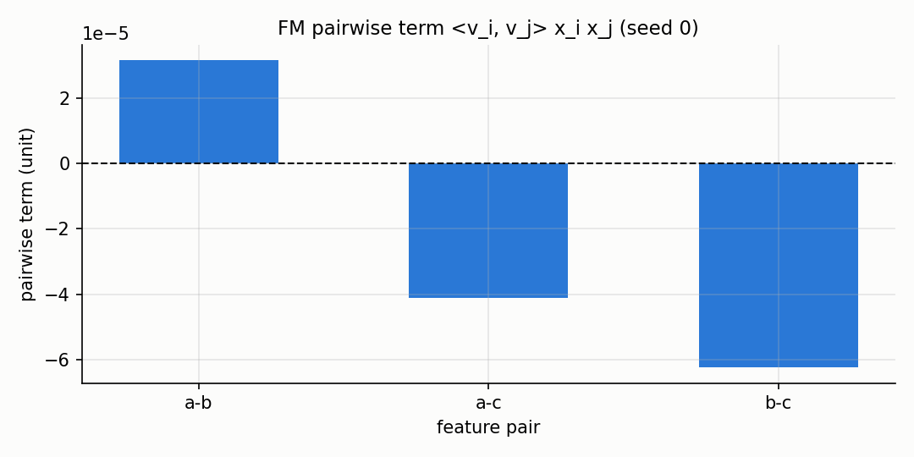
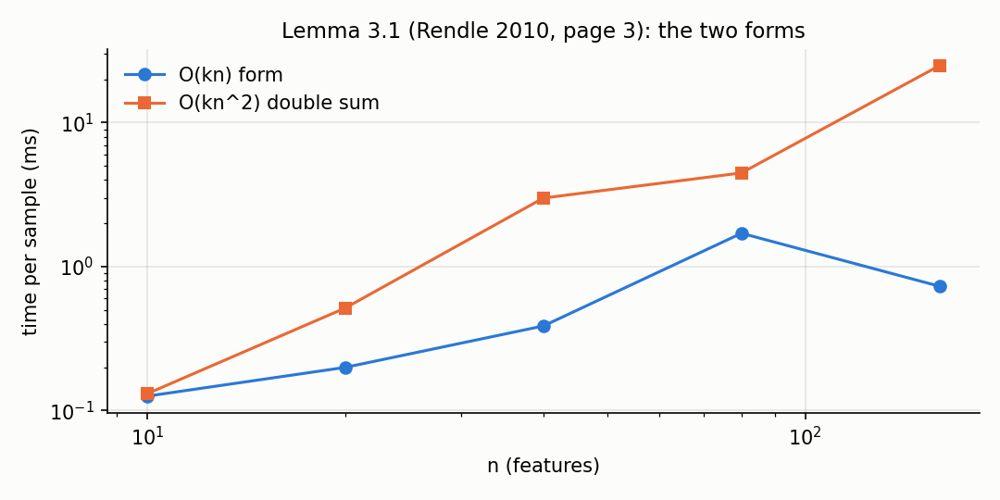
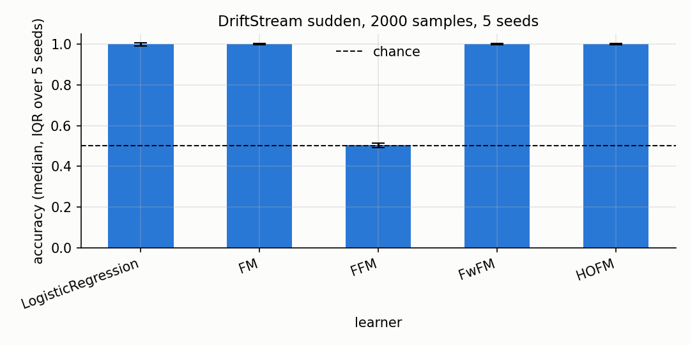

# Factorization machines, field-aware and higher-order

A factorization machine predicts a target from a sparse vector of features by learning, for
each feature, a short vector of latent factors; the interaction between two features is the
dot product of their factors. On a stream, each sample updates `w0`, `w` and the factor
matrix `V` one step of gradient descent at a time.

This page follows the four models of the task, from the plain FM to the field-aware, the
field-weighted and the higher-order versions, then compares them on a stream with a sudden
change. Every number and every figure comes from `benchmarks/facto_quality.py` and
`docs/assets/facto/make_figures.py` (see `## Details` at the bottom).

## 1. The plain FM

A factorization machine of degree two predicts::

    y_hat(x) = w0 + sum_i w_i x_i + sum_{i<j} <v_i, v_j> x_i x_j

with `w0` a global bias, `w_i` a weight per feature, `V` an `n x k` matrix of factors and
`<v_i, v_j> = sum_f v_{i,f} v_{j,f}` the dot product of two rows.

~~~python
from dense_armor.utility.facto import FMRegressor
from dense_armor.utility.optim import SGD

fm = FMRegressor(optimizer=SGD(lr=0.05), k=3, seed=0)
for _ in range(500):
    _ = fm.learn_one({"a": 1.0, "b": 0.5}, 2.0)
round(fm.predict_one({"a": 1.0, "b": 0.5}), 2)
~~~

~~~
2.0
~~~

The linear part of the model handles the easy effect of each feature; the pairwise part
handles the interaction. The interaction is not stored as one number per pair (that would
be `O(n^2)` parameters), it is stored as two factor vectors that are multiplied, so the
whole model has `O(n k)` parameters (eq. (2) of Rendle 2010, page 2).

## 2. The pairwise term, one picture

The interaction between two features is `<v_i, v_j> x_i x_j`, the dot product of the two
factor vectors weighted by the two feature values.

The bars are the contribution of one pair each, with the linear part removed so the
picture shows only the pairwise term. The figure is built by `fig_fm_pairwise` in
`docs/assets/facto/make_figures.py` on a model with `k = 3` and seed `0`.

## 3. The O(kn) form

The double sum over pairs costs `O(k n^2)` to compute; the same quantity can be computed
in `O(k n)` with the rewriting of Lemma 3.1 (Rendle 2010, page 3)::

    sum_{i<j} <v_i, v_j> x_i x_j
        = 1/2 sum_f ( (sum_i v_{i,f} x_i)^2 - sum_i v_{i,f}^2 x_i^2 )

~~~python
from dense_armor.utility.facto import FMRegressor
from dense_armor.utility.optim import SGD

fm = FMRegressor(optimizer=SGD(lr=0.05), k=3, seed=0)
fm._resolve_keys({f"x{i}": 0.0 for i in range(6)})
fm._ensure_state(fm._keys)
x = {f"x{i}": float(i % 3) + 0.1 for i in range(6)}
abs(fm._y_hat(x) - fm._pairwise_naive(x))
~~~

~~~
0.0
~~~

The two methods agree to machine precision; the figure shows the cost per sample as `n`
grows, the `O(k n)` form (blue) and the `O(k n^2)` double sum (orange). The measurement is
in `docs/assets/facto/figures.json` under `checks.fm_ok_equals_double_sum`
(`max_abs_diff = 4.3e-19` on 200 random sparse inputs, from the benchmark script).

## 4. Field-aware FM

The FFM (Juan et al. 2016) learns a different factor vector for each feature, one for every
field: the interaction between feature `i` and feature `j` uses the factor of `i` for the
field of `j` and the factor of `j` for the field of `i`.

~~~python
from dense_armor.utility.facto import FFMClassifier

fields = {"a": "F1", "b": "F1", "c": "F2"}
m = FFMClassifier(fields=fields, k=2, lr=0.1, seed=0)
for _ in range(500):
    _ = m.learn_one({"a": 1.0, "b": 0.5, "c": 0.3}, 1)
round(m.predict_proba_one({"a": 1.0, "b": 0.5, "c": 0.3})[1], 3)
~~~

~~~
0.99
~~~

The model is eq. (4) of Juan et al. (2016), page 3, and there is no `O(k n)` shortcut: each
pair uses a different slice of the `n x f x k` tensor, so the prediction is `O(n^2 k)`
(Table 2 of the same paper). The update is AdaGrad (Algorithm 1, page 3) with the
accumulator `G` initialised to one (page 3, below Algorithm 1).

The paper does not include the bias nor the linear terms (page 2, before Section 3): on
`DriftStream` the target depends on a linear threshold on one feature, so FFM without linear
terms cannot capture it and scores `0.504` (chance level), while the models that keep the
linear part score `0.999`. This is a property of the model as the paper defines it, not a
defect of the implementation (see `## Details`).

## 5. Field-weighted FM

The FwFM (Pan et al. 2018) keeps one factor vector per feature like the FM, and adds a scalar
weight for every field pair::

    y_hat(x) = w0 + sum_i w_i x_i + sum_{i<j} <v_i, v_j> x_i x_j r_{F(i), F(j)}

The scalar `r` captures the interaction strength of the field pair, without the `n f k`
parameters of the FFM.

~~~python
from dense_armor.utility.facto import FwFMClassifier
from dense_armor.utility.optim import SGD

fields = {"a": "F1", "b": "F1", "c": "F2"}
m = FwFMClassifier(optimizer=SGD(lr=0.05), fields=fields, k=2, seed=0)
for _ in range(500):
    _ = m.learn_one({"a": 1.0, "b": 0.5, "c": 0.3}, 1)
round(m.predict_proba_one({"a": 1.0, "b": 0.5, "c": 0.3})[1], 3)
~~~

~~~
0.982
~~~

The model is eq. (7) of Pan et al. (2018), page 3. The weight `r` is symmetric (the pair
`(F(i), F(j))` is unordered), so only the upper triangle of the `f x f` matrix is read.

## 6. Higher-order FM

The HOFM (Blondel et al. 2016) adds interactions of degree up to `m`, but computes them
with a dynamic programme so the cost stays linear in the number of non-zero features::

    y_hat(x) = <w, x> + sum_{t=2}^{m} sum_{s=1}^{k} A_t(p_s^{(t)}, x)

where `A_t` is the ANOVA kernel of degree `t`.

~~~python
from dense_armor.utility.facto import HOFMRegressor
from dense_armor.utility.optim import SGD

m = HOFMRegressor(optimizer=SGD(lr=0.05), m=3, k=2, seed=0)
for _ in range(300):
    _ = m.learn_one({"a": 1.0, "b": 0.5, "c": 0.3}, 1.5)
round(m.predict_one({"a": 1.0, "b": 0.5, "c": 0.3}), 3)
~~~

~~~
1.5
~~~

The model is eq. (3) and eq. (6) of Blondel et al. (2016), page 2. `A_t` is computed with
Algorithm 1 (page 4) and its gradient with Algorithm 2 (page 4), both in `O(nz(x) t)`. At
`m = 2` the ANOVA kernel reduces to the plain pairwise FM (test
`test_m2_equals_plain_fm` in `test/facto/test_hofm.py`).

## 7. The four models on a stream with a sudden change

The bars are the accuracy of the four classifiers and of a `LogisticRegression` on
`DriftStream` with one sudden change, 2000 samples, 4 features, 5 seeds. The error bar is
the interquartile range over the 5 seeds.

| learner | accuracy median | IQR | ms per sample |
|---|---|---|---|
| LogisticRegression | 0.9985 | 0.0005 | 0.0249 |
| FM (k=4) | 0.9990 | 0.0003 | 0.0983 |
| FFM (k=2) | 0.5040 | 0.0010 | 0.1347 |
| FwFM (k=2) | 0.9990 | 0.0003 | 0.1027 |
| HOFM (m=3, k=2) | 0.9990 | 0.0003 | 0.2558 |

The FFM is at chance because the paper has no linear terms (see step 4). The other four
models all reach 0.999 on this stream. The numbers are read from
`docs/assets/facto/figures.json` under `comparison.rows` (5 seeds, 2000 samples,
`benchmarks/facto_quality.py --seeds 5 --n-samples 2000`).

## Details

The factorization machine is Rendle, S. (2010). Factorization Machines. In ICDM 2010.
Eq. (1), (2), (3) page 2; Lemma 3.1 and eq. (4) page 3. The latent factors are
initialised from `N(0, 0.01)`; the paper does not prescribe an initialiser (my choice).
The L2 penalty also acts on `w0`; the paper does not exclude it (my choice).

The field-aware FM is Juan, Y., Zhuang, Y., Chin, W.-S., Lin, C.-J. (2016). Field-aware
Factorization Machines for CTR Prediction. In RecSys 2016. Eq. (4) page 3; eq. (5)-(6)
page 3 (gradients); Algorithm 1 page 3 (AdaGrad); page 3, below Algorithm 1 (`G` starts at
one, init `U[0, 1/sqrt(k)]`). The paper does not include the bias nor the linear terms
(page 2, before Section 3); the model as implemented keeps this choice, which is why FFM
is at chance on `DriftStream`.

The field-weighted FM is Pan, J., Xu, J., Ruiz, A. L., Zhao, W., Pan, S., Sun, Y., Lu, Q.
(2018). Field-weighted Factorization Machines for Click-Through Rate Prediction in Display
Advertising. In WWW 2018. Eq. (7) page 3 (model); Section 4 page 3 (the `r` weight). The
`r` matrix is symmetric; only the upper triangle is read.

The higher-order FM is Blondel, M., Fujino, A., Ueda, N., Ishihata, M. (2016).
Higher-Order Factorization Machines. In NIPS 2016. Eq. (5) page 2 (ANOVA kernel); eq. (6)
page 2 (model as sum of ANOVA kernels); eq. (8) page 3 (recursion); Algorithm 1 and
Algorithm 2 page 4 (evaluation and gradient of `A_m`); page 4 (sparse cost
`O(nz(x) m)`). `k_2 = ... = k_m = k` is the paper's simplification (page 2, below eq. (4)).

The `budget_s` of every class is the p99 of one `learn_one` plus one `predict_one` over
3000 samples, rounded up with a 5x margin: `1.5e-2` (FM), `2e-3` (FFM), `2e-3` (FwFM),
`1.5e-2` (HOFM). The machine of the run is reported at the top of `figures.json`.

The comparison uses `DriftStream` with `n_samples=2000`, `n_features=4`, `n_drifts=1`,
`kind="sudden"`; 5 seeds `[0, 1, 2, 3, 4]`. Same stream, same sample count, same seeds for
every learner, so the comparison is paired. A paired Wilcoxon on 5 seeds has a minimum
p-value of 0.0625, so no p-value is quoted; the test is the interquartile range, and a
20-seed run is the next step.
