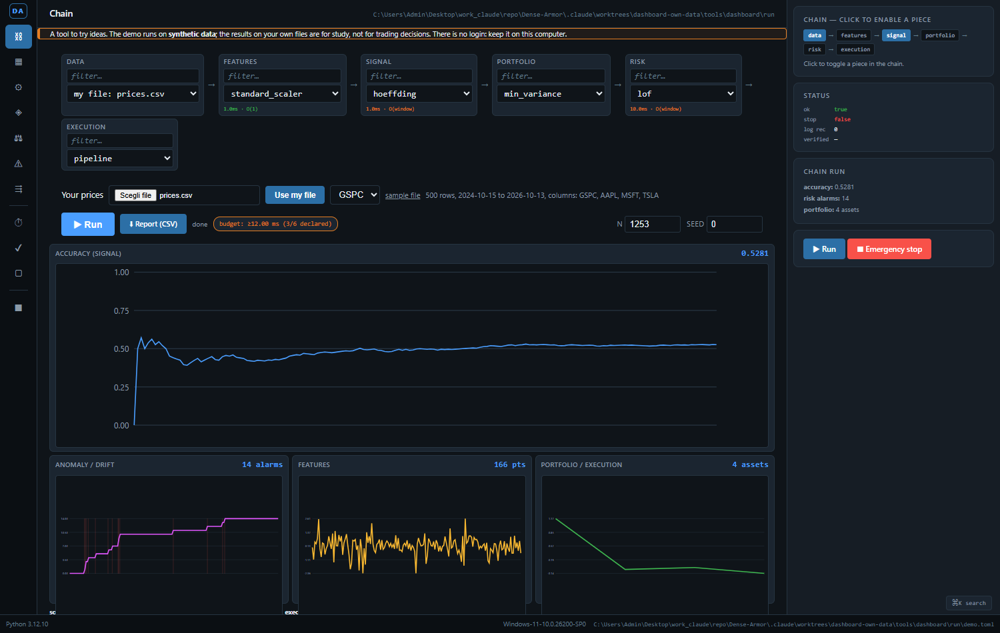
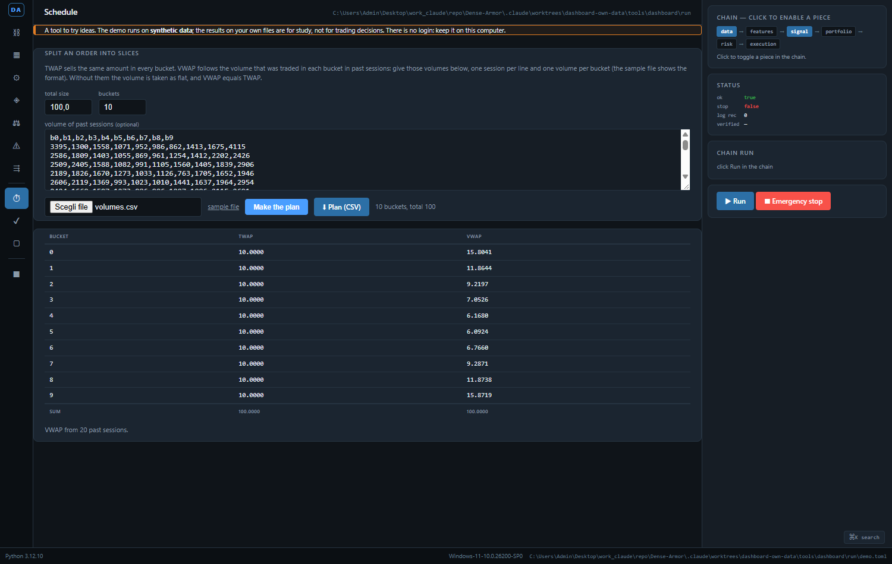
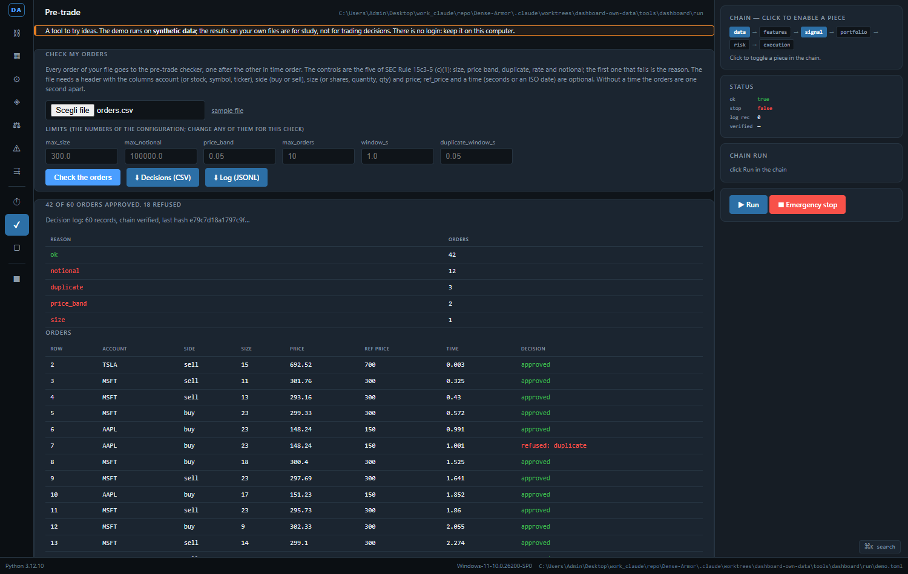

# Dashboard: status, emergency stop and a chart of the decisions

A command line is enough for a script. A person at a desk wants a screen: the
state of the system, a button, a chart of the decisions. The dashboard is a
Flask app with three routes. It is not a production server: it runs on
`127.0.0.1` and it has no login, so it must stay on the loopback or behind
something that has one.

It is a tool to try ideas. The demo runs on **synthetic data**, and the results on
your own files are for study, not for trading decisions.

## Use your own files

The dashboard works on your files, not only on the demo. There are three jobs; each
page has a sample file to download, so you see the format before you use your own.

| page | you give it | you get |
| --- | --- | --- |
| Chain (`/chain`) | a CSV of prices: the names of the columns in the first row, a date column, one column of prices for each asset | the chain (features, signal, risk, portfolio) run on your prices, with the accuracy, the alarms and a report to download as CSV |
| Order plan (`/schedule`) | a total size, a number of buckets and, if you have it, the volume of past sessions | the TWAP and VWAP slices, as a table and as a CSV |
| Check my orders (`/pretrade`) | a CSV of orders and, if you want, other limits | each order approved or refused with the reason, a log with a hash chain, and the decisions as a CSV |

*The chain on the sample prices (500 days of four assets). "Use my file" checks the file and says what it found; the second box picks which column the signal learns from; after a run, "Report (CSV)" downloads the result.*

**The prices.** The first row holds the names. A column called Date, Time, Timestamp or
Datetime is the date; every other column of numbers is the price of one asset. A file from
Yahoo Finance (Open, High, Low, Close, Volume) works: only Close is used. Commas, semicolons
and tabs separate the columns, and a semicolon file may use a decimal comma. A row with a missing
price is skipped and counted. A price of 0 or less, fewer than 30 usable rows, more than
200 000 rows or a file above 5 MB is refused, and the message names the column and the row.
The chain works on the log returns of the chosen column; the portfolio is built from all the
columns, so it needs at least two.

*An order of 100 in 10 buckets. TWAP is 10 in each bucket; VWAP follows the volume of the sample sessions, which is high at the open and at the close.*

**The volume.** One session on each line and one volume for each bucket, all above 0, with an
optional header line. Without it the volume is flat and VWAP equals TWAP.

*The sample orders: 42 of 60 approved; the others refused for the notional (12), a duplicate (3), the price band (2) or the size (1). The log has 60 records and its chain is verified.*

**The orders.** A header with the columns account (or stock, symbol, ticker), side (buy or sell),
size (or shares, quantity, qty) and price; ref_price and a time (seconds, or an ISO date) are
optional. Without ref_price the first price of the account is its reference, and without a time
the orders are one second apart. The orders are checked in time order, with the controls of
SEC Rule 15c3-5 (c)(1) and the limits of the configuration, or the ones you type. The log is the
`DecisionLog` of the finance system: every record holds the hash of the one before, and the
page says whether the chain verifies.

**The report of a chain run** is a CSV with the columns `section,name,index,value`: the chain you
picked, the data, the metrics, the series of the accuracy and the alarms, one value on each line, so
that a spreadsheet opens it as it is.

**From a script**, the same jobs are routes: `POST /api/data/upload` (the CSV in the form field
`file`) answers with an `id` that starts with `up_`; `POST /api/chain/run` with `data` set to that
id (and `column` if the file has several) answers with a `run_id`; `GET /api/report/<run_id>.csv`
(or `.json`) is the report; `POST /api/pretrade/check` takes the CSV and the limits and `GET
/api/pretrade/<run_id>.csv` (or `.jsonl`) gives the decisions and the log; `POST /api/schedule`
takes `total`, `n` and `history`. `POST /api/demo/run` runs the demo and `GET /api/demo/summary` gives
the last result: a GET never runs it.

## 1. Run the demo, then start the dashboard

**One command.** From a clone of the repository, `tools\dashboard\start-dashboard.bat` (Windows) or `sh tools/dashboard/start-dashboard.sh` (Linux, macOS) installs flask if it is missing, copies the demo configuration to `tools/dashboard/run/` and starts the dashboard on http://127.0.0.1:8080/. Options such as `--port 9000` are passed on.

The demo of F10 writes a synthetic feed, sends the orders through the pre-trade
checker, records the decisions in the log. The dashboard reads that log.

~~~python
import os, shutil, subprocess, sys, tempfile
from pathlib import Path

work = Path(tempfile.mkdtemp())
shutil.copy(
    "/content/Dense-Armor/test/fixtures/finance/demo.toml",
    work / "demo.toml",
)
env = os.environ.copy()
env["PYTHONPATH"] = "/content/Dense-Armor"
r = subprocess.run(
    [sys.executable, "-m", "dense_armor.core.finance.demo",
     "--config", str(work / "demo.toml"), "--n", "200"],
    capture_output=True, text=True, cwd=str(work), env=env,
)
import json
payload = json.loads(r.stdout)
print("exit:", r.returncode)
print("n_messages:", payload["n_messages"])
print("n_orders:", payload["n_orders"])
print("counts:", payload["counts"])
print("verified:", payload["log"]["verified"])
~~~

~~~
exit: 0
n_messages: 200
n_orders: 99
counts: {'notional': 8, 'ok': 21, 'size': 70}
verified: True
~~~

`demo --n 200` writes 200 messages; 99 of them are `A` or `F` (orders), the
others are `E`, `C`, `X`, `D`, `U`. The checker refused 8 orders for the
notional, 70 for the size, and approved 21. The log has 99 records and
`verify()` is `True`.

## 2. Read the status

`create_app(config_path)` loads the configuration once and returns a Flask
app. `GET /status` returns the same dict as `collect_status(config_path)`, the
function the status command of F8 uses: the command and the dashboard cannot
disagree.

~~~python
import json, os, shutil, subprocess, sys, tempfile, threading
import urllib.request
from pathlib import Path

work = Path(tempfile.mkdtemp())
shutil.copy(
    "/content/Dense-Armor/test/fixtures/finance/demo.toml",
    work / "demo.toml",
)
env = os.environ.copy()
env["PYTHONPATH"] = "/content/Dense-Armor"
subprocess.run(
    [sys.executable, "-m", "dense_armor.core.finance.demo",
     "--config", str(work / "demo.toml"), "--n", "200"],
    capture_output=True, text=True, cwd=str(work), env=env,
)
from werkzeug.serving import make_server
from dashboard.app import create_app

app = create_app(str(work / "demo.toml"))
server = make_server("127.0.0.1", 0, app)
port = server.server_port
thread = threading.Thread(target=server.serve_forever, daemon=True)
thread.start()
try:
    with urllib.request.urlopen(f"http://127.0.0.1:{port}/status") as resp:
        body = resp.read().decode()
    payload = json.loads(body)
    payload["config"] = "<tmp>/demo.toml"
    payload["feed"]["path"] = "<tmp>/feed.bin"
    payload["log"]["path"] = "<tmp>/log.jsonl"
    print(json.dumps(payload, indent=2, sort_keys=True))
finally:
    server.shutdown()
    thread.join(timeout=2)
~~~

~~~
{
  "config": "<tmp>/demo.toml",
  "emergency_stop": false,
  "feed": {
    "exists": true,
    "path": "<tmp>/feed.bin"
  },
  "log": {
    "exists": true,
    "last_hash": "e4afd4b67d53c1324c2a9cd4a013d15e74b5984f128f2cc5efd7513106f43bd3",
    "path": "<tmp>/log.jsonl",
    "records": 99,
    "verified": true
  },
  "ok": true
}
~~~

The `config`, `feed.path` and `log.path` fields are filtered to `<tmp>`: the
folder of the run is a fresh `tempfile.mkdtemp()`. The `last_hash` and
`records` are stable for `--n 200` on seed 0.

## 3. The chart of the decisions

`GET /decisions.svg` reads the log line by line, counts the `payload.reason`,
and writes one `<rect data-reason="..." data-count="...">` per reason, sorted
by reason, with a text label. The SVG is written by hand: the dashboard does
not need a plotting library.

~~~python
import os, shutil, subprocess, sys, tempfile, threading
import urllib.request
from pathlib import Path

work = Path(tempfile.mkdtemp())
shutil.copy(
    "/content/Dense-Armor/test/fixtures/finance/demo.toml",
    work / "demo.toml",
)
env = os.environ.copy()
env["PYTHONPATH"] = "/content/Dense-Armor"
subprocess.run(
    [sys.executable, "-m", "dense_armor.core.finance.demo",
     "--config", str(work / "demo.toml"), "--n", "200"],
    capture_output=True, text=True, cwd=str(work), env=env,
)
from werkzeug.serving import make_server
from dashboard.app import create_app

app = create_app(str(work / "demo.toml"))
server = make_server("127.0.0.1", 0, app)
port = server.server_port
thread = threading.Thread(target=server.serve_forever, daemon=True)
thread.start()
try:
    with urllib.request.urlopen(f"http://127.0.0.1:{port}/decisions.svg") as resp:
        svg = resp.read().decode()
    print("length:", len(svg), "bytes")
    print("rects:", svg.count("<rect"))
    print("first 200 chars:", svg[:200])
finally:
    server.shutdown()
    thread.join(timeout=2)
~~~

~~~
length: 720 bytes
rects: 3
first 200 chars: <svg xmlns="http://www.w3.org/2000/svg" viewBox="0 0 400 200"><rect x="20" y="164" width="110" height="16" data-reason="notional" data-count="8"/><text x="75" y="159" text-anchor="middle" font-size="1
~~~

Three reasons (`notional` 8, `ok` 21, `size` 70) give three `<rect>`. The
counts sum to 99, the number of orders. A garbage line in the log is ignored:
a log with a line that is not JSON, or a record whose `payload.reason` is not
a string, is counted only for its valid lines. A missing log gives an SVG with
no bar.

## Details

**References.**
- Flask documentation, *Testing Flask Applications*
  (flask.palletsprojects.com). Used for `app.test_client()`, the same client
  that the tests of G2 use.
- The dashboard uses `flask`, `sqlalchemy`, `alembic`, `psycopg2-binary` as
  optional dependencies of the extra `finance-ops`, not of the base
  `dependencies`. `flask` is imported inside `create_app`, so importing
  `dense_armor.core.finance` does not need it.

**Choices stated explicitly.**
- The SVG is written by hand. A plotting library would add a dependency and a
  large output; a bar chart of a few reasons fits in 720 bytes of SVG.
- `GET /decisions.svg` tolerates a garbage line and a record without a reason.
  The dashboard shows what it can count, not a 500.
- `POST /emergency-stop` creates the file `paths.emergency_stop`, the same
  action as creating it by hand. There is no route that removes the file:
  lifting the stop is a decision for a person, made on the server.
- `GET /emergency-stop` is 405. Creating a stop is a POST, and a GET must not
  change the state.
- The status of the dashboard is `collect_status` from `status.py`; the
  dashboard does not duplicate that logic.

**Declared limits.**
- There is no login. The dashboard must stay on `127.0.0.1` or behind a
  reverse proxy that has one. The `emergency-stop` route creates a file that
  the status command and the demo read at their start; it does not stop any
  running process.
- The stop is a file. A second click leaves one file, not two; lifting the
  stop is a manual operation on the server.
- The alarms of the chain: a drift detector fires on its own flag; a risk detector with a score fires when the score
  is more than 3 standard deviations above the running mean of its own scores (below it when the score is
  inverted), after 30 scores. The scales of the scores differ from one detector to the other, so no fixed threshold is used.
- `POST /emergency-stop` answers `403` when the request carries an `Origin`
  of another host, so a page open in the same browser cannot press the
  button; a request with no `Origin` (curl, a test client) is accepted. It is
  not a login: anything that can reach the port can still post.
- The playground (`/playground`, `POST /api/playground/run`) **executes the
  Python code that is posted**, in a subprocess with a timeout of 20 s. It is
  off by default and answers `403`. `--enable-playground` turns it on and is
  refused unless `--host` is `127.0.0.1`, `localhost` or `::1`. The subprocess
  gets only `PATH`, the system and temp folders, `HOME`, the locale variables
  and `PYTHONPATH`: the database URL and any token of the server stay out. It
  is not a sandbox: the code can read and write the files of the user that
  runs the dashboard.
- `GET /status`, `POST /emergency-stop` and `GET /decisions.svg` read the
  configuration file again at each request; the other pages use the
  configuration loaded at the start.
- The server is Flask's development server, not a production server. It is
  started with `make_server` in the tests and with `app.run` in `main`.
- One process. A second dashboard on the same port is refused by the
  operating system.
- The `last_hash` in the output depends on the log written by the demo, and
  the demo depends on its seed. The delivery of G2 shows one run; the page
  filters the folder to `<tmp>` and keeps `last_hash` as one value of one run.

*These pages describe what the code does on the data shown. Not a forecast, not financial advice.*
