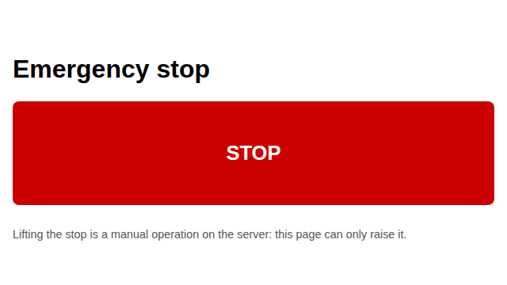
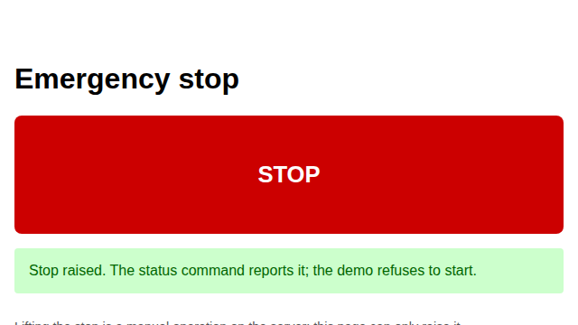

# Red button: raise the emergency stop from a browser

The stop of the finance system is a file: the status command reads it, and the
demo refuses to start when it exists. Raising the stop from a terminal means
remembering the path of the file. A page with one button does the same thing
with one click.

## 1. What the page is

`GET /` returns `static/emergency.html`, a single file with no external script,
style or font. It has a red `<button id="stop">`, a `
` hidden at
the start, and a `
` hidden at the start. When the page loads it
reads `GET /status`; if the stop is already raised, `#stopped` is shown.

~~~python
import threading
import urllib.request
from werkzeug.serving import make_server
from dense_armor.utility.finance.dashboard import create_app

app = create_app("/tmp/emergency_demo/c.toml")
server = make_server("127.0.0.1", 0, app)
port = server.server_port
thread = threading.Thread(target=server.serve_forever, daemon=True)
thread.start()
try:
    with urllib.request.urlopen(f"http://127.0.0.1:{port}/") as resp:
        print("status:", resp.status)
        print("content-type:", resp.headers.get("Content-Type"))
        print("has id=stop:", 'id="stop"' in resp.read().decode())
finally:
    server.shutdown()
    thread.join(timeout=2)
~~~

~~~
status: 200
content-type: text/html; charset=utf-8
has id=stop: True
~~~

## 2. The page before and after the click

The button, before a click:

After a click, `fetch("/emergency-stop", {method: "POST"})` creates the stop
file. The page shows `#stopped` and the file is on disk:

The screenshots come from `tools/finance_emergency_screenshots.py`, which starts
the dashboard as the tests do and takes the two images with Playwright on the
same Chromium.

## 3. The same thing without a browser

The page is a thin client over the same route the test uses. Without a browser,
a POST creates the file and a GET `/status` reports it:

~~~python
import json
import threading
import urllib.request
from werkzeug.serving import make_server
from dense_armor.utility.finance.dashboard import create_app

app = create_app("/tmp/emergency_demo/c.toml")
server = make_server("127.0.0.1", 0, app)
port = server.server_port
thread = threading.Thread(target=server.serve_forever, daemon=True)
thread.start()
try:
    with urllib.request.urlopen(f"http://127.0.0.1:{port}/status") as resp:
        print("before:", json.loads(resp.read())["emergency_stop"])
    req = urllib.request.Request(
        f"http://127.0.0.1:{port}/emergency-stop", method="POST"
    )
    with urllib.request.urlopen(req) as resp:
        print("status:", resp.status)
        print("body:", resp.read().decode().strip())
    with urllib.request.urlopen(f"http://127.0.0.1:{port}/status") as resp:
        print("after:", json.loads(resp.read())["emergency_stop"])
finally:
    server.shutdown()
    thread.join(timeout=2)
~~~

~~~
before: False
status: 200
body: {"emergency_stop":true}
after: True
~~~

The POST is idempotent for the file: a second click leaves one file, not two.
`GET /emergency-stop` is 405: a read does not change the state.

## Details

**References.**
- Playwright documentation, *Browser* and *Page*
  (playwright.dev/python). Used for `chromium.launch()`, `page.goto`,
  `page.click` and `page.wait_for_selector`, the same calls the tests use.
- Flask documentation, *Testing Flask Applications*
  (flask.palletsprojects.com). The server of the tests is
  `werkzeug.serving.make_server` on a free port, the same approach.

**Choices stated explicitly.**
- The page has no external resource: no CDN, no font, no script. It works with
  no network other than the local server.
- The page lifts nothing. There is no button that removes the stop file: a stop
  raised by a button is a decision for a person, made on the server. The page
  says so in a paragraph.
- At load the page reads `/status`. If the stop is already raised, the page
  shows `#stopped` without a click. This is a real difference between a page
  that only reacts to a click and a page that reports the state.
- The error branch is tested with the server stopped after the load: the click
  fails, `#error` becomes visible, `#stopped` stays hidden. A click that fails
  is not a click that succeeded.
- The screenshots are committed in `docs/assets/finance/emergency/`. They are
  regenerated by the tool; the tool is in `tools/` and it is not a test.

**Declared limits.**
- The button does not stop any running process. It creates the file
  `paths.emergency_stop`; the status command of F8 reports it and the demo of
  F10 reads it at its start.
- There is no login. The page must stay on `127.0.0.1` or behind a proxy that
  has one. Anyone who reaches the page can raise the stop.
- One browser engine, Chromium, tested. Firefox and WebKit are not.
- The screenshots are from one machine, one browser version and one screen size
  (640x360). A different size changes the layout, not the behaviour.
- Lifting the stop is a manual operation on the server: the page has no route
  that removes the file, and this is a declared limit, not a missing feature.

*These pages describe what the code does on the data shown. Not a forecast, not financial advice.*
