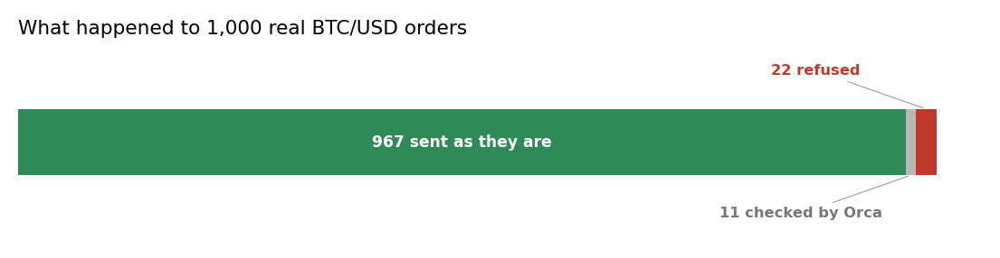

# Execution: high-frequency pre-trade risk validation and algorithmic order damping

When an automated trading strategy accidentally tries to buy an enormous amount of crypto or stock in a single shot, it can move the market and cause massive financial losses. This pipeline acts as a high-speed protective shield: it compares each incoming order size against historical averages, allowing safe trades to pass in microseconds while safely shrinking suspicious volumes or blocking extreme anomalies before they hit the exchange.

## The scene

A desk in London. The automated strategy wants to buy 700 BTC in one shot. On a normal day it buys 5. If the order goes through, the desk moves the market against itself and loses money on the way in.

The pipeline sees the size, compares it to the usual one, and either sends it smaller or refuses it. **The whole check takes 2 microseconds for the typical order.**

## What is in the box

| Tool | Its one job | Example |
|---|---|---|
| Rolling mean | Remember the usual order size | Size 5 is normal, 50 is suspicious |
| Orca | Dampen a suspicious order before it leaves | A 6x order goes out at 3x, smaller but valid |

*Green: orders that left as they were. Grey: orders checked by Orca. Red: orders refused.*

## 1. Refusing the enormous orders (rolling mean)

The first check is the simplest: is this order ten times bigger than the usual one? If yes, it is refused. No legitimate model sends an order that big by accident, and if it does, the desk wants to know before it goes out.

## 2. Dampening the suspicious ones (Orca)

Between 5x and 10x the rolling mean there is a middle ground. The order is not absurd, but not ordinary either. Orca is called here, and only here: it dampens the size, the order still goes out, but smaller.

Orca costs about 3 milliseconds per call. On real BTC/USD trades only 11 orders out of 1,000 (1.1%) fell in this range, so the typical check stays at 2 microseconds.

## The chain

For every order:

1. The order size is compared to the **rolling mean**.
2. Above 10x: refused outright.
3. Between 5x and 10x: goes through **Orca**, comes out smaller.
4. Below 5x: passes without further check.

## What you get on 1,000 real BTC/USD trades

One thousand trades from the Coinbase public API on 14 October 2026. Sizes from 0.00000001 to 0.7 BTC.

| Metric | Value |
|---|---|
| Passed directly (no Orca) | 967 (96.7%) |
| Went through Orca | 11 (1.1%) |
| Refused (10x rule) | 22 (2.2%) |
| Dampened by Orca (went out smaller) | 9 |
| Time per order | 2 microseconds median; 3 milliseconds at the 99th percentile (the Orca calls) |

Of the 11 orders sent to Orca, 9 went out smaller. The 5x-10x range is thin on real trades, and Orca covers it. The times were measured on a Kaggle CPU with 4 cores.

## When you need it

- Any desk that executes automated strategies.
- A broker that wants a last line of defence before the order reaches the exchange.
- Compliance: every refused or dampened order is logged.

## Details

### Implementation

The pipeline is in `pipelines/finance/execution.py`.
Primitives chained, each with its own page:

- [RunningMoments](../stats/moments.md)
- [Orca](../shields/orca.md)

### References

- Running moments: Welford, B. P. (1962). Technometrics 4(3), 419-420.
- Trade data: Coinbase Exchange public API, endpoint `/products/BTC-USD/trades`, 14 October 2026, 1,000 rows.

*These pages describe measurements on historical data. Not a forecast, not financial advice.*
