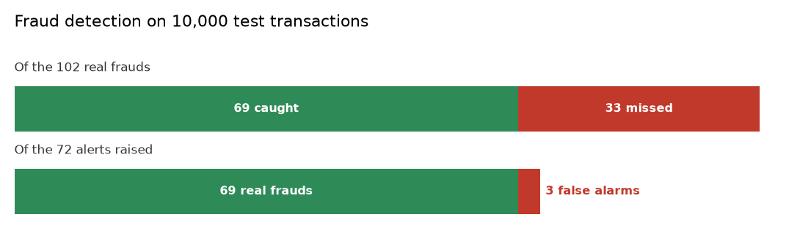

# Fraud detection: is this transaction real?

**In plain words:** A card is used, somewhere in the world. Two online trees decide in less than a second if the transaction is normal or stolen.

## The scene

3:14 in the morning, a card that has never left Italy is used in Malaysia for 470 dollars. Then again in Brazil. Then again in Poland.

The bank's system has one second to decide. If it says no and the card is fine, the customer is angry. If it says yes and the card is stolen, the money is gone. In 2022 the world lost **more than 45 billion dollars** to payment fraud (Huang et al., 2025).

Most fraud systems use a static threshold: the score passes a cutoff, the transaction is blocked. That works until the fraudsters change their behaviour and the threshold that was right last year is wrong this year.

The fraud pipeline changes this. Two online trees learn from every transaction, one at a time. When a card is stolen, they notice.

## What is in the box

| Tool | Its one job | Real example |
|---|---|---|
| MondrianForest | Partition the space into random rectangles | A transaction very far from everything else is flagged |
| SGTClassifier | Split the space with Newton steps and t-tests | A second opinion on the same transaction |

*Green: right. Red: wrong. Top bar: what happened to the 102 real frauds. Bottom bar: what the 72 alerts were.*

## 1. A random partition of the space (MondrianForest)

Imagine writing every past transaction on a sheet of paper. Green dots for normal, red for fraud. The sheet gets divided into rectangles, random, one split at a time. A new transaction falls somewhere on the sheet: if it lands in a rectangle full of green, it is normal. If it lands in a rectangle that has only red, it is fraud.

The Mondrian forest builds ten of these sheets at once. Each one is different. The answer is the average of the ten.

## 2. A second opinion (SGTClassifier)

The SGD tree does the same job but each rectangle is chosen carefully, not randomly. It uses the gradient of the loss to decide where to cut, and a t-test to decide when a cut is worth it. Slower to learn, but sharper.

## The chain

For each new transaction:

1. The transaction features go to **MondrianForest**. A score between 0 and 1 comes out.
2. The same features go to **SGTClassifier**. A second score comes out.
3. The two scores are averaged. If the average is above 0.5, the transaction is flagged.

## What you get on real fraud data

The pipeline was trained on 40,000 real credit card transactions from the OpenML creditcard dataset. The dataset has 284,807 rows in total and 492 frauds (0.17%). To keep training time reasonable, all the frauds are kept and the normal transactions are subsampled to 50,000 rows. Of these, 40,000 are training and 10,000 are test.

| Metric | Value |
|---|---|
| ROC-AUC, Mondrian | 0.969 |
| ROC-AUC, SGT | 0.926 |
| ROC-AUC, ensemble | 0.969 |
| Threshold | 0.5 |
| Alerts raised (out of 10,000) | 72 |
| True positives | 69 |
| False positives | 3 |
| Recall on frauds | 67.6% |
| Precision | 95.8% |
| Training time (Kaggle CPU) | 189 s |

**What this means**: the system catches 2 out of 3 frauds, and when it raises an alert 19 times out of 20 the alert is real. The customers whose cards are wrongfully blocked are 3 in 10,000 transactions.

## When you need it

- A card issuer with an online transaction stream.
- A payment processor that wants to check every transaction before approving it.
- A bank that wants a second layer of defence on top of a static rule engine.

## Details

### Implementation

The pipeline is in `pipelines/finance/fraud.py`.
Primitives chained, each with its own page:

- [Mondrian Forest](../tree/index.md#5-a-prediction-with-its-uncertainty-mondrian-forests)
- [Stochastic Gradient Trees](../tree/index.md#4-predicting-a-number-the-torque-of-a-two-link-arm)

### References

- Lakshminarayanan, B., Roy, D. M., Teh, Y. W. (2014). *Mondrian Forests: Efficient Online Random Forests.* NeurIPS.
- Lakshminarayanan, B., Roy, D. M., Teh, Y. W. (2016). *Mondrian Forests for Large-Scale Regression when Uncertainty Matters.* AISTATS.
- Gouk, H., Pfahringer, B., Frank, E. (2019). *Stochastic Gradient Trees.* ACML.
- Huang, A., Wang, Y., Zhou, P., Zhang, X. (2025). *Dynamic Calibration of Decision Thresholds for Financial Anomaly Detection.* Journal of Global Information Management 33(1), doi: 10.4018/JGIM.395852. Numbers: 45 billion USD of global payment-fraud losses in 2022.
- Dataset: OpenML creditcard, version 1. Original source: Machine Learning Group, Université Libre de Bruxelles (ULB). 284,807 transactions, 492 frauds.

*The numbers on this page come from a single run on real historical data. Not a forecast, not financial advice.*
