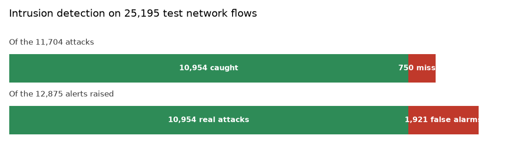

# Intrusion detection: is this packet an attack?

**In plain words:** A bank sees millions of network packets a day. Most are normal. A few are an attack. Two online trees learn the difference, one packet at a time, and the attack shape keeps changing.

## The scene

A bank's data centre is under attack. The attackers change the shape of the traffic every few days: what worked last week no longer works. A classifier trained once on January's traffic is blind to February's attack.

Two online Hoeffding trees learn from every packet. The adaptive one has a drift detector at each node: when the traffic changes, the tree notices and grows a new branch, without throwing the whole model away.

## What is in the box

| Tool | Its one job | Real example |
|---|---|---|
| HoeffdingAdaptiveTree | A tree with a drift detector at every node | When the attack shape changes, a new branch grows |
| HoeffdingTree | A tree that never revises a split | The stable baseline on the same traffic |

*Green: right. Red: wrong. Top bar: the 11,704 real attacks. Bottom bar: the 12,875 alerts.*

## 1. Splits that survive the change (HoeffdingAdaptiveTree)

A classic Hoeffding tree chooses a split once and never revisits it. The adaptive version puts an ADWIN detector at every node. When the detector warns, a new subtree grows on the recent samples. When the new subtree is significantly more accurate, it replaces the old branch. The rest of the tree stays as it was.

This is what matters for intrusion detection: the attack families change, and the tree keeps up without a full retrain.

## 2. The stable baseline (HoeffdingTree)

The classic Hoeffding tree (Domingos and Hulten 2000) decides a split only when the best attribute beats the second by more than the Hoeffding bound. It never revises. Slower to adapt, but a fair reference.

## The chain

For each new packet:

1. The 41 features of the packet go to **HoeffdingAdaptiveTree**. A score comes out.
2. The same features go to **HoeffdingTree**. A second score comes out.
3. The two are averaged. Above 0.5, the packet is flagged as an attack.

## What you get on real intrusion data

The pipeline was trained on **125,973 real labelled network flows** from the NSL-KDD benchmark (Tavallaee et al. 2009). The attacks are 46% of the stream, so this is not an imbalanced problem: the classifier must genuinely separate normal traffic from an attack.

| Metric | Value |
|---|---|
| ROC-AUC, adaptive tree | 0.9553 |
| ROC-AUC, base tree | 0.9503 |
| ROC-AUC, ensemble | **0.9755** |
| Threshold | 0.5 |
| Attacks predicted (out of 25,195) | 12,875 |
| True positives | 10,954 |
| False positives | 1,921 |
| False negatives | 750 |
| Recall on attacks | 93.6% |
| Precision | 85.1% |
| Training time (Kaggle CPU) | 65 s |

**What this means**: out of every 100 attacks, 93 are caught. Of every 100 alerts raised, 85 are real. The two trees together beat either alone.

## When you need it

- A network operations centre that watches a live flow.
- A bank or a payment processor that needs intrusion detection on its own traffic.
- A system that must adapt to a new attack family without a full retrain.

## Details

### Implementation

The pipeline is in `pipelines/finance/intrusion.py`.
Primitives chained, each with its own page:

- [Hoeffding Adaptive Tree](../tree/index.md#3-following-a-sudden-change-the-adaptive-tree)
- [Hoeffding Tree](../tree/index.md#1-a-tree-that-learns-a-robot-state)

### References

- Domingos, P., Hulten, G. (2000). *Mining High-Speed Data Streams.* KDD.
- Bifet, A., Gavalda, R. (2009). *Adaptive Learning from Evolving Data Streams.* IDA.
- Tavallaee, M., Bagheri, E., Lu, W., Ghorbani, A. (2009). *A Detailed Analysis of the KDD CUP 99 Data Set.* IEEE CISDA. NSL-KDD is the cleaned version.
- Dataset: NSL-KDD, KDDTrain+ file. 125,973 labelled network flows.

*The numbers on this page come from a single run on real historical data. Not a forecast, not financial advice.*
