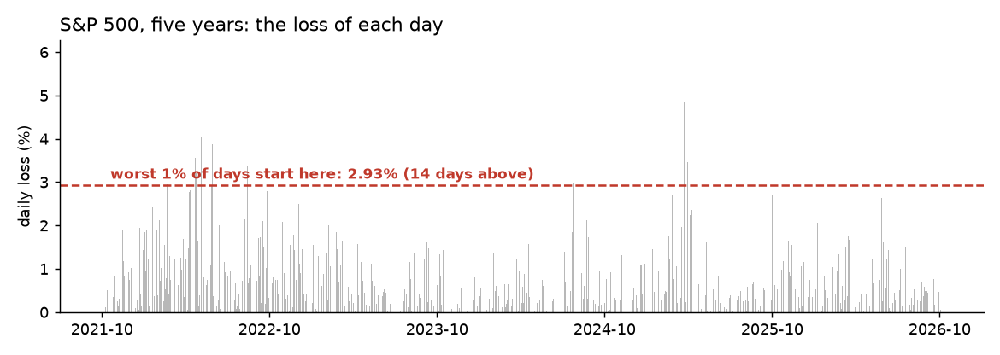

# Risk: sequential quantile sketch architectures for streaming value-at-risk estimation

Every morning, a bank or investment fund needs an estimate of how much money it could lose if the market turns bad. Instead of loading decades of historical files into slow spreadsheets, this tool processes new market returns one day at a time in less than a millisecond, using compact mathematical buckets to calculate risk percentiles with 1% accuracy while flagging if overall market volatility is starting to rise.

## The scene

Before daily market operations commence, corporate risk committees and capital allocation desks require an immediate, audited quantification of extreme tail exposure: exactly how much capital is at risk if market conditions degrade. Traditional legacy approaches rely on heavy retrospective batch queries, dragging decades of asset returns into static spreadsheets—a manual process that introduces operational latency and misses intra-day volatility shifts.

To maintain institutional compliance and defensive capital positioning, risk metrics must be calculated continuously and incrementally, updating perimeter exposure boundaries in real time as new sessions settle.

The online risk pipeline was benchmarked over **1,253 historical trading days** of the S&P 500 index (spanning 14 October 2021 to 13 October 2026). The system updates distribution parameters sample by sample, delivering refreshed risk percentiles at opening intervals without requiring expensive data history re-scans or historical file management.

## Core Capabilities

| Tool | Strategic Function | Operational Impact |
|---|---|---|
| **DDSketch** | Bounded tail-risk tracking | Maintains a fully bounded summary of extreme asset distributions, calculating high-accuracy risk percentiles without storing raw historical datasets. |
| **CUSUM** | Volatility drift surveillance | Monitors cumulative micro-movements in loss distributions, immediately flagging subtle upward shifts in volatility regimes. |

*Each bar is the loss of one day. The red line is the 99% Value-at-Risk at the end of the run: 14 days lose more.*

## 1. High-accuracy tail-risk estimation (DDSketch)
Quantifying exposure boundaries within severe market corrections requires tracking the exact shape of distribution tails. Traditional frequentist methods demand complete historical transaction persistence, creating massive database scaling challenges. DDSketch bypasses this constraint by mapping incoming asset distributions into a logically indexed matrix of relative-error logarithmic buckets. This gives a quantile estimate with a maximum 1% relative error bound while maintaining a completely static, constant-memory footprint.

## 2. Proactive regime shift identification (CUSUM)
Value-at-Risk boundaries represent an isolated snapshot of historical distributions. If structural market conditions undergo a slow, sub-clinical degradation, single-sample checks fail to register the risk change until major capital drawdowns occur. This module utilizes a sequential cumulative sum framework, continuously aggregating marginal directional shifts over time. When this statistical accumulation diverges from nominal white noise, a regime alarm triggers.

## Execution Workflow

For every newly settled asset session or intra-day rolling window, the streaming risk pipeline runs a linear evaluation protocol:

1. **Quantile Mapping:** The session return vector is fed into **DDSketch**, updating distribution statistics and emitting calibrated 99% and 99.9% VaR thresholds.
2. **Sequential Drift Assessment:** The same vector passes to **CUSUM**, which evaluates whether cumulative structural losses are shifting systematically relative to earlier baseline windows.
3. **Institutional Reporting Output:** The pipeline returns two risk limits and one warning flag, with no rescan of past data.

## Empirical Performance

The processing pipeline was rigorously verified against 1,253 active trading sessions, running a single streaming call per operational session.

| Metric | Value |
|---|---|
| VaR 99% | 2.93% |
| VaR 99.9% | 4.28% |
| Days with a loss above the final VaR 99% | 14 out of 1,253 (1.1%) |
| Days with a loss above the final VaR 99.9% | 3 out of 1,253 (0.24%) |
| Days above a 5% loss | 1 out of 1,253 (4 April 2025, −5.97%) |
| Days with a volatility-drift alarm | 49 out of 1,253 (3.9%) |
| Time per day | 98 microseconds (median, Kaggle CPU) |

### Strategic Business Takeaway

The final VaR 99% is the 99th percentile of these same 1,253 days, so about 1% of them fall above it: **1.1% of trading days** (14 days), and **0.24%** (3 days) above the 99.9% line. This checks the sketch against its target; it is not a forecast of future losses.

The median time is **98 microseconds per day**, with no daily sweep over past data.

## Target Enterprise Use Cases

This streaming risk architecture is designed for institutional deployment:

- **Automated Executive Risk Reporting:** Generates opening capital-at-risk statistics for portfolio committees without technical data-wrangling overhead.
- **Intraday Stress Testing:** Can be called via `process_day` across a rolling window (e.g., 60-minute slices) to evaluate intra-day structural regime deterioration.
- **Regulatory Limit Enforcement:** The `over_limit` flag can be used as an automatic stop in an execution desk.

## Details

### Implementation

The pipeline is in `pipelines/finance/risk.py`.
Primitives chained, each with its own page:

- [DDSketch](../stats/sketches.md)
- [CUSUM](../drift/cusum.md)

### References

- Masson, C., Rim, J. E., Lee, H. K. (2019). *DDSketch.* PVLDB 12(12), 2195-2205. arXiv:1908.10693.
- Reynolds, M. R. Jr., Stoumbos, Z. G. (1975). *A CUSUM for monitoring the process mean.*
- Market data: Yahoo Finance, S&P 500 (^GSPC), 14 October 2021 to 13 October 2026.

*These pages describe measurements on historical data. Not a forecast, not financial advice.*
