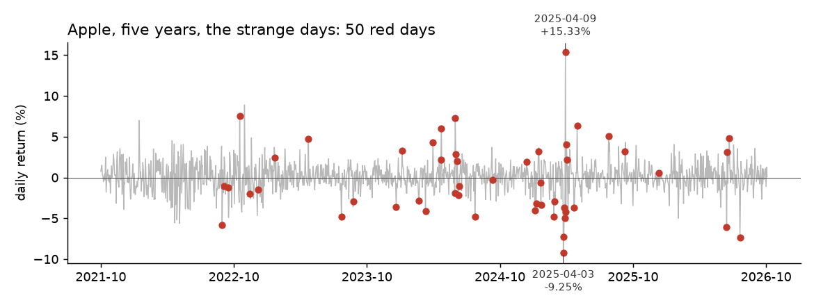

# Single ticker: is today strange?

**In plain words:** For the monitoring of a single financial asset, this section demonstrates the efficacy of the two integrated detectors in identifying anomalous deviations from ordinary market conditions.

## The scene

A portfolio manager follows Apple. Every morning she opens the charts and wants one thing: is today one of those days when Apple behaves differently, or is it a normal Thursday?

Two detectors answer the question together. Only when **both** agree, the day is flagged. A single detector is not enough: one can be wrong, two rarely are.

## What is in the box

| Tool | Its one job | Real example |
|---|---|---|
| LODA | Score how strange a day is, given several numbers | Price and volume together, not just price |
| Half-Space Trees | Same job as LODA, done another way | A second opinion on the same day |

*Each red dot is a day flagged by both LODA and Half-Space Trees on Apple.*

## 1. A strangeness score (LODA)

Price and volume usually move together. When they do not, something is off. LODA looks at the pair and gives a score: low for an ordinary day, high for a strange one.

## 2. A second opinion (Half-Space Trees)

Half-Space Trees does the same job, but by cutting the space into rectangles instead of projections. When both detectors give a high score, the day is flagged.

## The chain

For each new day:

1. The return and the relative volume go to **LODA**.
2. The same pair goes to **Half-Space Trees**.
3. If both scores are above their adaptive thresholds, the day is flagged. Otherwise it is not.

## What you get on Apple over five years

Apple, 1,253 trading days. Ranges calibrated on the first 250 days.

| Metric | Value |
|---|---|
| Days tested | 1,253 |
| Days flagged anomalous | 50 (47 after the 250-day calibration) |
| Time per day | 0.59 ms median (Kaggle CPU) |

The 50 days include the crashes of April 3rd and 4th 2025 (−9.25% and −7.29%), the rebound of April 9th 2025 (+15.33%), the rise of June 11th 2024 (+7.26%, the day after the Apple Intelligence announcement), and 7 quarterly-expiration Fridays, when volume moves without the price moving much.

**The same detectors on other stocks.** Over the same 1,253 days, Microsoft has 66 flagged days and Tesla 38. Each stock is compared with its own recent past.

## When you need it

- A single stock that a portfolio manager follows closely.
- A pair trade where one leg is watched and the other is hedged.
- A retail investor who wants one number a day for one ticker.

## Details

### Implementation

The pipeline is in `pipelines/finance/single_ticker.py`.
Primitives chained, each with its own page:

- [LODA](../anomaly/loda.md)
- [Half-Space Trees](../anomaly/hst.md)

### References

- Lou, B., Boland, D., Leong, P. H. W. (2024). *fSEAD.* arXiv:2406.05999. Section 2.1 (Loda).
- Tan, S. C., Ting, K. M., Liu, T. F. (2011). *Fast anomaly detection for streaming data.* IJCAI. (Half-Space Trees.)
- Ulrich (2025). *Half-Space Trees for Novelty Detection.* arXiv:2505.08489.
- Market data: Yahoo Finance, Apple (AAPL), 14 October 2021 to 13 October 2026.

*These pages describe measurements on historical data. Not a forecast, not financial advice.*
