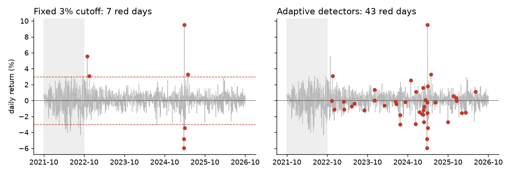

# Static vs online: what changes when the thresholds move

**In plain words:** A fixed cutoff and an adaptive detector look at the same five years of market data and disagree on 38 of the 1,004 days after the warm-up. This page shows both, side by side.

## The scene

The simplest way to find an anomalous day is a fixed number: if the return is bigger than 3%, call it anomalous. It is one line of code, it is what every tutorial does, and it works until the market regime changes.

Five years of S&P 500 data show the limit of that approach. On August 5th 2024 the index closed at −2.997%: three thousandths of a point under the cutoff, and the fixed rule let the day go. On the 1,004 days after the warm-up, the fixed threshold and the two adaptive detectors disagree on **38 days**. The next sections show which days each of them catches.

## What is in the box

| Tool | Its one job | Real example |
|---|---|---|
| StaticAnalysis | Flag days above a fixed cutoff | 7 days above 3% after the warm-up |
| OnlineAnalysis | Same job, adaptive thresholds | 43 days flagged by LODA and HST together |

*Same five years of S&P 500 returns in both panels. Red dots are flagged days after the 250-day warm-up (grey band).*

## 1. The static baseline (StaticAnalysis)

You pick a number. Anything above it is anomalous. On the S&P 500, with daily closing prices:

| Threshold | Days flagged, all 1,253 days | Days flagged after the 250-day warm-up |
|---|---|---|
| 2% | 74 | 36 |
| 3% | 17 | 7 |
| 4% | 6 | 4 |

The number moves with the threshold. The data does not say which threshold is right.

## 2. The online version (OnlineAnalysis)

No threshold to pick. Two detectors (LODA and Half-Space Trees) each build their own baseline from the data they see, and a day is flagged only when **both** agree.

On the same series, after the warm-up of 250 days: **43 days flagged**, with final LODA threshold 4.0 and final HST threshold 0.467.

## 3. Where they agree

Six days are caught by both, 2022-11-30 (+3.09%), 2025-05-12 (+3.26%) and four sessions of the April 2025 tariff weeks:

| Date | Return |
|---|---|
| 2025-04-03 | −4.84% |
| 2025-04-04 | −5.97% |
| 2025-04-09 | +9.52% |
| 2025-04-10 | −3.46% |

These are big price moves, above 3% by definition, so the fixed cutoff catches them too.

## 4. What only the static catches

One day: **2022-11-10, +5.54%**. The online detectors did not flag it. The fixed cutoff flags every day above 3% whatever the recent past looks like; the online detectors compare each day with the recent past of both return and volume.

## 5. What only the online catches

37 days. Two groups.

**Quarterly expiration.** 12 of these dates are the third Friday of March, June, September and December:

| Date | Return |
|---|---|
| 2022-12-16 | −1.11% |
| 2023-03-17 | −1.10% |
| 2023-06-16 | −0.37% |
| 2023-09-15 | −1.22% |
| 2023-12-15 | −0.01% |
| 2024-03-15 | −0.65% |
| 2024-06-21 | −0.16% |
| 2024-09-20 | −0.19% |
| 2024-12-20 | +1.09% |
| 2025-03-21 | +0.08% |
| 2025-06-20 | −0.22% |
| 2026-03-20 | −1.51% |

Each has a return smaller than 3%, so the fixed cutoff never sees them. The **ratio between price and volume** differed from a normal day: expiration Fridays move large volumes without moving the price much.

**Other days.** 25 more, five of them with a move of 2% or more:

| Date | Return |
|---|---|
| 2024-08-05 | −3.00% (−2.997% before rounding) |
| 2024-11-06 | +2.53% (the day after the US election) |
| 2024-12-18 | −2.95% |
| 2025-03-10 | −2.70% |
| 2025-10-10 | −2.71% |

All five stayed under the 3% cutoff. The online detectors saw the price-and-volume pair shift and flagged them.

## When to use which

**Static** if you want the simplest possible baseline, or if you already know what size of move matters to you. Fast and readable; it sees only the size of the move.

**Online** if the market you watch changes its behaviour over time, and if the events you care about are not always big price moves. You get the extreme days plus the structural ones, and the thresholds follow the volatility of the moment.

The two work together. The static pipeline is the baseline; the online pipeline covers the days the baseline cannot see.

## Details

### Implementation

The pipelines are in `pipelines/finance/static_analysis.py` and `pipelines/finance/online_analysis.py`.
The online one chains two primitives, each with its own page:

- [LODA](../anomaly/loda.md)
- [Half-Space Trees](../anomaly/hst.md)

### References

- Market data: Yahoo Finance, S&P 500 (^GSPC), daily close, 14 October 2021 to 13 October 2026.
- Lou, B., Boland, D., Leong, P. H. W. (2024). *fSEAD.* arXiv:2406.05999. Section 2.1 (Loda).
- Tan, S. C., Ting, K. M., Liu, T. F. (2011). *Fast anomaly detection for streaming data.* IJCAI. (Half-Space Trees.)
- Ulrich (2025). *Half-Space Trees for Novelty Detection.* arXiv:2505.08489.

*These pages describe measurements on historical data. Not a forecast, not financial advice.*
