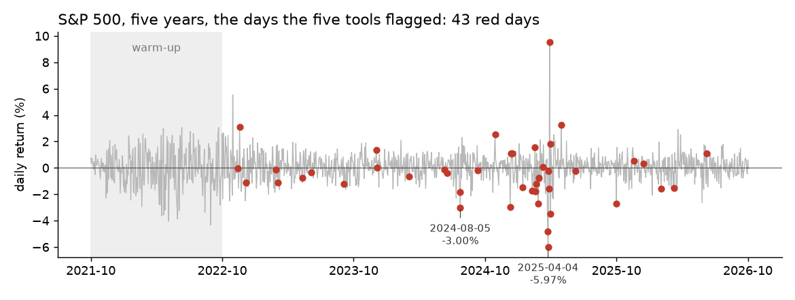

# Surveillance: is the market behaving differently today?

**In plain words:** Five Dense-Armor tools read five years of real stock-market data. After a 250-day warm-up, two of them flagged 43 of the remaining 1,004 days, among them the crashes of August 2024 and April 2025.

## The scene

On August 5th, 2024, Tokyo stocks crash and within hours the panic crosses the ocean: the S&P 500 closes the day at **−3.00%**. Traders call it "Black Monday". Days later, the market recovers as if nothing happened.

On April 2nd, 2025, after the close, the American tariffs are announced. On the 3rd the S&P 500 loses 4.84%, on the 4th another 5.97%, and on the 9th it jumps +9.52%. Anyone reading the news caught up **after** the fact.

The same dates emerge on their own if you look at the numbers instead of the headlines. Five Dense-Armor tools run in sequence on **1,253 real trading days** (14 October 2021 to 13 October 2026). After a warm-up of 250 days, LODA and Half-Space Trees flag **43 of the 1,004 remaining days** on the S&P 500: 11 are moves of 2% or more, 12 are quarterly-expiration Fridays, and 20 are quieter days that the two detectors found unusual in return and volume together. (See [Static vs online](static_vs_online.md) for the comparison with a fixed cutoff.)

Nobody told the tools what to look for. On those days the market behaved differently from usual, and the numbers noticed.

## What is in the box

| Tool | Its one job | Real example |
|---|---|---|
| Armatura | Replace an absurd price with a sensible one | A network glitch writes 9,999 € instead of 89 € |
| CUSUM | Add up small changes until a bell rings | The index loses two cents an hour: nobody notices, it does |
| Quantile sketch | Remember how big an extreme value is, without storing all the data | The worst 1% loss of the year in one number |
| LODA | Score how strange a day is, given several numbers | A day with an unusual mix of return and volume |
| Half-Space Trees | Same job as LODA, done another way | A second opinion on the same day |

All examples run on **real stock-market prices** from Yahoo Finance: S&P 500, Apple, Microsoft, Tesla, five years each, daily closing prices. Every number on this page comes from a run of the pipeline on those files.

*Each red dot is a day flagged by both LODA and Half-Space Trees. The grey band is the 250-day warm-up.*

## 1. Cleaning broken prices (Armatura)

On the market, prices change thousands of times per second. Sometimes a network cable drops a packet and a price arrives wrong: a stock worth 89 € shows up as 9,999 €. The automated trading system takes it and buys.

Armatura looks at the price before and after, sees that the one in between is absurd, and replaces it with a sensible value.

**Across five years of S&P 500 data**, Armatura discarded 1 tick out of 1,253. That one would have been a wrong order.

## 2. Noticing that the market changed mood (CUSUM)

A 20% crash in a day, everybody sees. A loss of two cents every hour, nobody. CUSUM adds every small move to the previous one. When the sum is too large to be chance, it rings the bell.

**Across five years of S&P 500 data**, CUSUM rang on 22 days out of 1,253 (1.8%).

## 3. Knowing how big the risk is (Quantile sketch)

Every bank, every day, has to answer one question: how much can we lose on the worst day of the year? A normal computer reads years of history every time.

The quantile sketch keeps only a summary of the extreme values and drops the ordinary days. On the S&P 500 it updates its answer in 98 microseconds per day (see [Risk](risk.md)).

## 4. Spotting an anomalous day (LODA + Half-Space Trees)

Price and volume usually move together. If the price rises, the trades rise. When they diverge, something is off.

LODA looks at price and volume together and gives a strangeness score. Half-Space Trees does the same job in a different way. **When both give a high score, the day is flagged.**

On the 1,004 days after the warm-up, the two detectors flagged **43 days**. The largest:

- **August 5th, 2024**: Black Monday, S&P 500 at −3.00%
- **November 6th, 2024**: the day after the US election, +2.53%
- **April 3rd and 4th, 2025**: the tariff reaction, −4.84% and −5.97%
- **April 9th, 2025**: the tariff pause, +9.52%

Apple, on the same stream of days (single-ticker pipeline, 1,253 days): 50 days flagged, among them June 11th, 2024 (+7.26%, the day after the Apple Intelligence announcement) and April 3rd and 4th, 2025 (−9.25% and −7.29%). Microsoft: 66 days. Tesla: 38 days, fewer than Microsoft although Tesla moves more; the thresholds adapt to how much a stock usually moves.

## 5. Getting protected (Orca)

When an automated model has to send a trade, Orca checks both ends. It dampens the order and lets it go out smaller.

**Across five years of S&P 500 data**, Orca dampened 1 simulated order out of 1,253.

## The chain

For every tick arriving from the market:

1. **Armatura** receives the price. If it is absurd, it replaces it with a sensible value.
2. The clean price goes to **CUSUM** (has the market mood changed?) and to the **Quantile sketch** (how much do we risk today?).
3. Price and volume together go to **LODA** and **Half-Space Trees**. If both say "anomalous", the day is flagged.
4. If the model wants to send an order, **Orca** dampens it before it leaves.

Time per tick: **3.85 milliseconds** median and 5.27 milliseconds at the 99th percentile, on a Kaggle CPU with 4 cores and 31 GB of RAM. A trading day with one tick per second has 23,400 ticks: about 90 seconds of compute in total.

## What the papers say

Detection delay is the most expensive thing. On 2.7 million loan accounts, a streaming model raised its alerts on average **9.2 days** earlier than a batch gradient-boosting model at the same false-positive rate; for more than half of the accounts that became 30 days late, the first alert came at least one billing cycle before the missed payment (Li, Thompson and Chen, 2026, preprint).

Payment fraud cost the world more than **45 billion dollars** in 2022 (Huang et al., 2025). The same paper proposes a decision threshold that follows the fluctuations of the score and reports fewer false alarms than a fixed one.

## Details

### Implementation

The pipeline is in `pipelines/finance/surveillance.py`.
Primitives chained, each with its own page:

- [Armatura](../shields/armatura.md)
- [CUSUM](../drift/cusum.md)
- [LODA](../anomaly/loda.md)
- [Half-Space Trees](../anomaly/hst.md)
- [Orca](../shields/orca.md)

### References

- Lou, B., Boland, D., Leong, P. H. W. (2024). *fSEAD.* arXiv:2406.05999. Section 2.1 (Loda).
- Tan, S. C., Ting, K. M., Liu, T. F. (2011). *Fast anomaly detection for streaming data.* IJCAI. (Half-Space Trees.)
- Ulrich (2025). *Half-Space Trees for Novelty Detection.* arXiv:2505.08489.
- Pearson, R. K., Neuvo, Y., Astola, J., Gabbouj, M. (2016). *Generalized Hampel Filters.* EURASIP JASP 2016:87.
- Li, E., Thompson, D., Chen, M. (2026). *Real-Time Early-Default Detection Using Streaming Machine Learning with Multi-Source Behavioral Signals.* Preprints.org, doi: 10.20944/preprints202601.0866.v1 (not peer reviewed).
- Huang, A., et al. (2025). *Dynamic Calibration of Decision Thresholds for Financial Anomaly Detection.* Journal of Global Information Management 33(1), doi: 10.4018/JGIM.395852.
- Market data: Yahoo Finance, S&P 500 (^GSPC), Apple (AAPL), Microsoft (MSFT), Tesla (TSLA), daily close, 14 October 2021 to 13 October 2026.

*These pages describe measurements on historical data. Not a forecast, not financial advice.*
