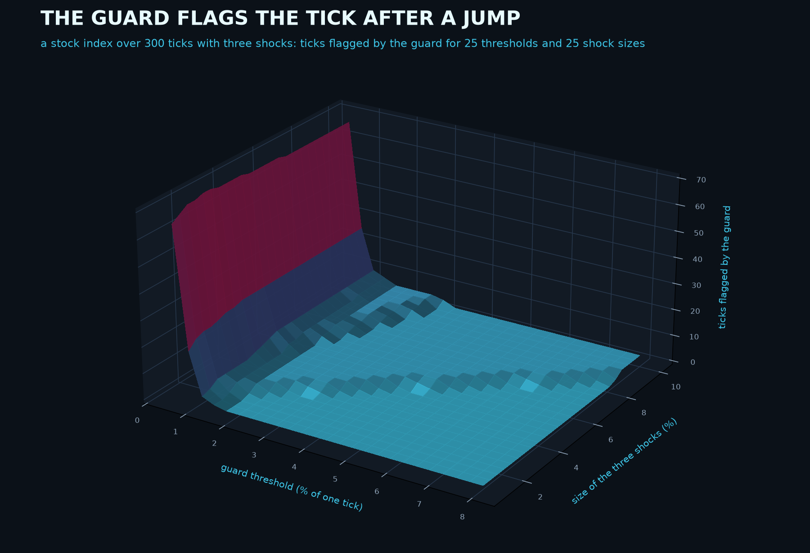
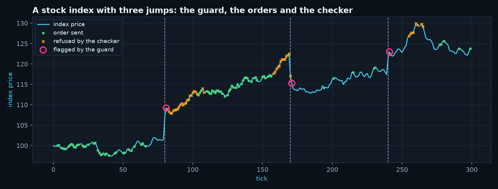

# Trading guard: an online model that stops when the market jumps

[← Finance](index.md)

A desk watches a stock index at every tick. An online model predicts the next return from the last one, and a guard stops it when the last tick moved more than 3%: the model does not learn from that tick and answers a fallback of zero, which means no order. The orders that remain go to a pre-trade checker that refuses a size, a price, a duplicate, a rate or a notional that is out of its limits. A robot controller whose joint speed jumps is handled the same way, in the last section.



## 1. A first example: four ticks of a stock index

Four returns of a stock index arrive one tick at a time. The guard stops the model when a return is above 3%.

```python
from dense_armor.roles.safety import SafeEstimator
from dense_armor.core.online.linear.glm import LinearRegression
from dense_armor.core.online.optim import SGD

model = LinearRegression(optimizer=SGD(lr=0.1), feature_keys=["ret_n"])
safe = SafeEstimator(model=model, guard=lambda x: abs(x["ret"]) > 0.03, fallback=0.0)
for ret in (0.004, -0.002, 0.05, 0.003):
    x = {"ret": ret, "ret_n": ret / 0.01}
    print(safe.is_flagged(x), round(safe.predict_one(x), 4))
    safe.learn_one(x, ret / 0.01)
print(safe.n_blocked_)
```

```
False 0.0
False 0.0736
True 0.0
False 0.0382
2
```

Count by hand. The returns 0.4%, −0.2% and 0.3% are below 3%: the guard does not flag them and the model predicts (0.0 on the first tick, because it has not learned yet) and learns. The return 5% is above 3%: the guard flags the tick, the prediction is the fallback 0.0 and the model does not learn from it. `n_blocked_` is 2 because the flagged tick was stopped twice, once in `predict_one` and once in `learn_one`.

## 2. Tick by tick: predict, order, learn

On 300 ticks the index follows its last return (a momentum of 0.3) plus a small noise, and three jumps hit it at ticks 80, 170 and 240. At each tick the model predicts the next return from the last one, the guard looks at the last return, the pre-trade checker validates the order, and then the model learns from the return that arrived.

```python
import random
from dense_armor.roles.safety import SafeEstimator, HealthMonitor
from dense_armor.core.online.linear.glm import LinearRegression
from dense_armor.core.online.optim import SGD
from dense_armor.core.finance import PreTradeChecker
from dense_armor.core.signals.stats.moments import RunningMoments

rng, norm = random.Random(42), RunningMoments(feature="ret")
model = LinearRegression(optimizer=SGD(lr=5e-3), l2=1e-3, intercept=True, feature_keys=["ret_n"])
safe = SafeEstimator(model=model, guard=lambda x: abs(x["ret"]) > 0.03, fallback=0.0, monitor=HealthMonitor(window=50, warmup=20))
checker = PreTradeChecker(max_notional=100_000.0, max_size=0.5, price_band=0.02, max_orders=40, window_s=60.0, duplicate_window_s=1.0)
shocks, prev, ref, last, flagged, reasons = {80: 0.06, 170: -0.05, 240: 0.04}, 100.0, 100.0, 0.0, [], {}
for i in range(300):
    std = norm.std if norm.std > 1e-6 else 1.0
    x = {"ret": last, "ret_n": last / std}
    pred = safe.predict_one(x)
    if safe.is_flagged(x):
        flagged.append(i)
    elif abs(pred) > 0.2:
        d = checker.check("acct1", "buy" if pred > 0 else "sell", min(abs(pred), 0.5), prev, ref, t=float(i))
        reasons[d.reason] = reasons.get(d.reason, 0) + 1
    ret = 0.3 * last + rng.gauss(0, 0.004) + shocks.get(i, 0.0)
    price = prev * (1 + ret)
    safe.learn_one(x, ret / std, t=float(i))
    norm.update({"ret": ret})
    ref, prev, last = 0.9 * ref + 0.1 * price, price, ret
print(flagged, safe.n_blocked_, reasons)
```

```
[81, 171, 241] 6 {'ok': 86, 'price_band': 40, 'rate': 6}
```



The guard flags exactly the ticks 81, 171 and 241, the tick after each jump: it looks at the last return, so it stops the model one tick after the jump, and `n_blocked_` is 6 because each flagged tick is stopped twice (prediction and learning). Of the other orders, 86 were approved by the checker and 46 refused: 40 for `price_band` (after a jump the reference price, which follows the price slowly, stays more than 2% away for a while) and 6 for `rate` (more than 40 orders approved in the last 60 seconds).

The picture follows the same 300 ticks for 25 guard thresholds between 0.5% and 8% and 25 sizes of the three shocks between 1% and 10%; each point of the surface is the number of ticks the guard flagged. With the guard at 3.0% the shocks of 5.88% are flagged on 3 ticks and the shocks of 2.12% on none. With the guard at 1.12% and shocks of 5.88% the guard flags 10 ticks, because ordinary ticks now cross it too; with the guard at 0.5% and shocks of 1.0% it flags 65, and with the guard at 8.0% and shocks of 10.0% it flags 3.

## 3. What each piece does

| Component | Role |
|---|---|
| `LinearRegression` | Online model, one gradient step per sample; `budget_s = 1e-3`, `memory_class = "O(1)"` |
| `SGD(lr=5e-3)` | Optimizer with a small learning rate to avoid weight explosion |
| `RunningMoments(feature="ret")` | Online mean and variance of the return, to normalize the feature |
| `SafeEstimator` | Wraps the model with a guard and a fallback; if the guard flags a sample, the model does not learn and the output is the `fallback` |
| `HealthMonitor` | Health state: `warming_up`, `nominal`, `drifting`, `degraded` |
| `PreTradeChecker` | Five pre-order controls in this order (size, price band, duplicate, rate, notional) from SEC Rule 15c3-5 (c)(1) |

## 4. Parameters

`SafeEstimator(model, guard=None, fallback=None, monitor=None)`

| Parameter | Meaning | Default |
|---|---|---|
| `model` | Estimator to wrap | none |
| `guard` | Callable `x -> bool`, `True` flags the sample | `None` (no guard) |
| `fallback` | Value returned while flagged | `None` |
| `monitor` | Optional `HealthMonitor` | a default `HealthMonitor()` |

`PreTradeChecker(max_notional, max_size, price_band, max_orders, window_s, duplicate_window_s)`

| Parameter | Meaning | Default |
|---|---|---|
| `max_notional` | Maximum open notional per account | none |
| `max_size` | Maximum size per order | none |
| `price_band` | Maximum deviation of the order price from the reference price | none |
| `max_orders` | Maximum orders approved per account in the window | none |
| `window_s` | Time window for the rate, in seconds | none |
| `duplicate_window_s` | Window for the duplicate check, in seconds | none |

All six parameters of `PreTradeChecker` are required.

## 5. The same system on a robot

A joint controller receives the velocity `qd` of a joint at every sample. An online model predicts the expected movement of the joint; if the sensor shows a jump above 0.5, the guard returns the fallback (zero torque) and the motor does not move.

```python
from dense_armor.roles.safety import SafeEstimator, HealthMonitor
from dense_armor.core.online.linear.glm import LinearRegression
from dense_armor.core.online.optim import SGD

model = LinearRegression(optimizer=SGD(lr=5e-4), intercept=True, feature_keys=["qd_n"])
safe = SafeEstimator(model=model, guard=lambda x: abs(x["qd"]) > 0.5, fallback=0.0,
                     monitor=HealthMonitor(window=50, warmup=20))
print(safe.predict_one({"qd": 0.1, "qd_n": 0.1}), safe.health.value, safe.is_flagged({"qd": 0.9, "qd_n": 0.9}))
```

```
0.0 warming_up True
```

A velocity of 0.1 is below the guard, and the model has not learned yet, so it predicts 0.0 and the monitor is still `warming_up`. A velocity of 0.9 is above 0.5: the guard flags it.

## API reference

::: dense_armor.roles.safety.SafeEstimator

::: dense_armor.core.finance.pretrade.PreTradeChecker

## References

- Page, E. S. (1954). Continuous inspection schemes. Biometrika 41, 100-114. (cited in the docstring of the module `dense_armor.roles.safety`, where `SafeEstimator` is)
- SEC Release 34-63241, Rule 15c3-5 (c)(1): pre-trade controls (cited in the docstring of `PreTradeChecker`)
- Orabona, F. (2019). A Modern Introduction to Online Learning. (cited in the docstring of the module of `LinearRegression`)
- Welford, B. P. (1962). Technometrics 4(3), 419-420. (cited in the docstring of `RunningMoments`)

---

## Details

### Choices stated explicitly

- **The guard reads the last return:** `x` carries both `ret` (read by the guard) and `ret_n` (the only feature of the model). The guard stops the model on the tick after a jump, not on the tick of the jump, because the order of the tick is decided before its return is known.
- **`fallback=0.0` means "no order":** a flagged tick gives a prediction of zero, which is below the threshold of 0.2 (in units of the standard deviation) that the loop needs to send an order. `None` would keep the last good prediction instead.
- **`budget_s` of the wrapper sums components:** `SafeEstimator` declares `budget_s = sum_budgets([(2.0, model)])` because each `learn_one` costs one `predict_one` and one `learn_one` of the model.
- **The figures are drawn from the code of the loop:** `make_trading_guard_figures.py` runs the same loop with `SafeEstimator` and `PreTradeChecker`. The surface runs it 625 times (25 thresholds, 25 shock sizes); the second figure is the run of section 2.

### Declared limits

- The data is synthetic (a momentum of 0.3, noise of 0.4% and three scheduled jumps), not a real market feed. Not a forecast, not investment advice.
- `PreTradeChecker` does not replace a broker's controls nor full Rule 15c3-5 (missing paragraph (c)(2) and restricted lists).
- The orders of the loop are never closed, so the open notional only grows; the limit `max_notional` of 100,000 is not reached in 300 ticks.
- The guard looks at the last return only: it does not see a jump of the tick that is being decided, and the model does not measure its own uncertainty or its latency here.
- `HealthMonitor` uses a fixed window; it does not adapt to long-period volatility changes.
- `PreTradeChecker` is single-process in-memory; no shared state across processes.
- No order is actually sent to an exchange: `checker.check` returns a `Decision`, it does not execute.
