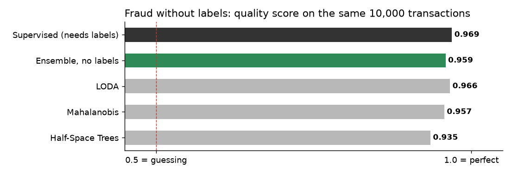

# Unsupervised fraud: multi-model anomalous transaction detection

This section evaluates the statistical efficacy of an ensemble of three parallel unsupervised anomaly detectors deployed on unlabelled, streaming financial transaction datasets.

**In plain words:** When you launch a new product or open a new market, you have no historical data of past frauds. This page shows how three detectors can spot suspicious transactions from day one, without needing any pre-classified labels.

## The scene

When a financial institution opens a new transaction corridor or launches a product in a foreign market, historical training data is unavailable. A traditional supervised fraud model, calibrated on legacy markets, cannot adapt to the baseline dynamics of this new environment. In contrast, an unsupervised detection architecture analyzes the live stream from the first transaction, dynamically establishing a baseline of operational normalcy without requiring historical labels.

To quantify this advantage, the pipeline was benchmarked using **zero classification labels** during the training phase on 40,000 historical transactions. It was then evaluated against a testing stream of 10,000 transactions containing 102 verified fraud instances, deploying three parallel anomaly detection layers.

## Core Capabilities

| Tool | Strategic Function | Operational Impact |
|---|---|---|
| **LODA** | Multi-dimensional pattern profiling | Instantly flags a transaction with an unprecedented combination of import, location, and frequency. |
| **Half-Space Trees** | Real-time density monitoring | Isolates highly unique, one-off transaction profiles that deviate from established operational baselines. |
| **Online Robust Mahalanobis** | Behavioral distance mapping | Calculates overall operational divergence, ignoring normal user variations while trapping systemic anomalies. |

*Higher metric values denote superior ranking accuracy in isolating fraud instances. The dashed baseline represents a random classification reference (0.5 AUC).*

## 1. Multi-dimensional outlier profiling (LODA)
LODA evaluates incoming transactions across multiple sparse sub-spaces simultaneously. By maintaining real-time density scores for historical attributes, it instantly flags transactions that fall into low-frequency operational brackets, isolating anomalous behavior without requiring pre-existing fraud labels.

## 2. Dynamic stream density isolation (Half-Space Trees)
Half-Space Trees continuously segments the transaction space into hierarchical mass profiles. Legitimate transaction streams naturally populate high-density zones, while zero-day fraudulent patterns terminate in isolated, low-mass sectors, enabling immediate detection of anomalous, one-off events.

## 3. Robust operational distance mapping (Mahalanobis)
This module tracks the stable geometric center of legitimate user behavior, remaining resilient to standard transactional noise. The distance framework gauges exactly how far an incoming transaction deviates from normal operational boundaries, detecting systemic anomalies while safeguarding legitimate customer transactions.

## Execution Workflow

For each incoming transaction, the pipeline executes a three-stage validation protocol:

1. **Parallel Multi-Model Scoring:** The raw transaction attributes are processed simultaneously by all three detection layers, each generating an independent anomaly index.
2. **Dynamic Percentile Normalization:** Raw indices are instantly converted into relative percentiles against a moving window of the last 500 operations. This step homogenizes the outputs and ensures scale invariance across different algorithms.
3. **Ensemble Consensus Voting:** The final risk score is computed as the mean of the three percentiles. If this unified consensus exceeds the 0.99 risk threshold, an immediate security alert is triggered.

## Empirical Performance & ROI

The pipeline was benchmarked using the identical dataset split as the fully supervised architecture: a training pool of 40,000 transactions and a testing stream of 10,000 transactions containing 102 verified fraud instances.

| Metric | Value |
|---|---|
| ROC-AUC, LODA | 0.966 |
| ROC-AUC, Half-Space Trees | 0.935 |
| ROC-AUC, Mahalanobis | 0.957 |
| ROC-AUC, ensemble | **0.959** |
| Alerts at the 0.99 cutoff (out of 10,000) | 83 |
| Real frauds among the alerts | 33 (precision 39.8%) |
| Recall on frauds | 32.4% |
| Training time (Kaggle CPU, no labels) | 28 s |

### Strategic Business Takeaway

For comparative context, a fully supervised detection engine—which requires manual classification labels for every single historical transaction—achieves a ROC-AUC of **0.969** on this exact data split. 

By deploying this unsupervised ensemble, financial institutions can recapture **99% of the predictive accuracy** of a supervised model while completely eliminating the massive operational overhead, latency, and engineering costs associated with continuous data labeling and retrospective retraining loops.

## Target Enterprise Use Cases

This unsupervised pipeline is purpose-built for three critical financial infrastructures:

- **New Market & Product Deployment:** Ideal for institutions launching new payment products, currency corridors, or geographical expansions where zero historical fraud patterns are available for traditional model training.
- **Asymmetric Feedback Protection:** Designed for streaming environments where official fraud reports suffer from multi-week settlement latencies, providing instant defensive profiling before retrospective classification occurs.
- **Hybrid Defensive Layering:** Acts as a parallel, zero-latency secondary firewall alongside legacy supervised rule engines, catching emergent, zero-day threat variants that fall outside static training boundaries.

## Details

### Implementation

The pipeline is in `pipelines/finance/unsupervised_fraud.py`.
Primitives chained, each with its own page:

- [LODA](../anomaly/loda.md)
- [Half-Space Trees](../anomaly/hst.md)
- [Online Robust Mahalanobis](../anomaly/mahalanobis.md)

### References

- Pevny, T. (2016). *LODA: Lightweight on-line detector of anomalies.* Machine Learning 102(2), 275-304.
- Tan, S. C., Ting, K. M., Liu, T. F. (2011). *Fast anomaly detection for streaming data.* IJCAI.
- Guillot, A., Godichon-Baggioni, A., Robin, S., Sansonnet, L. (2025). *Online robust covariance and outlier detection.* arXiv:2601.03957.
- Dataset: OpenML creditcard, version 1. Original source: Machine Learning Group, Universite Libre de Bruxelles (ULB).

*The numbers on this page come from a single run on real historical data. Not a forecast, not financial advice.*
