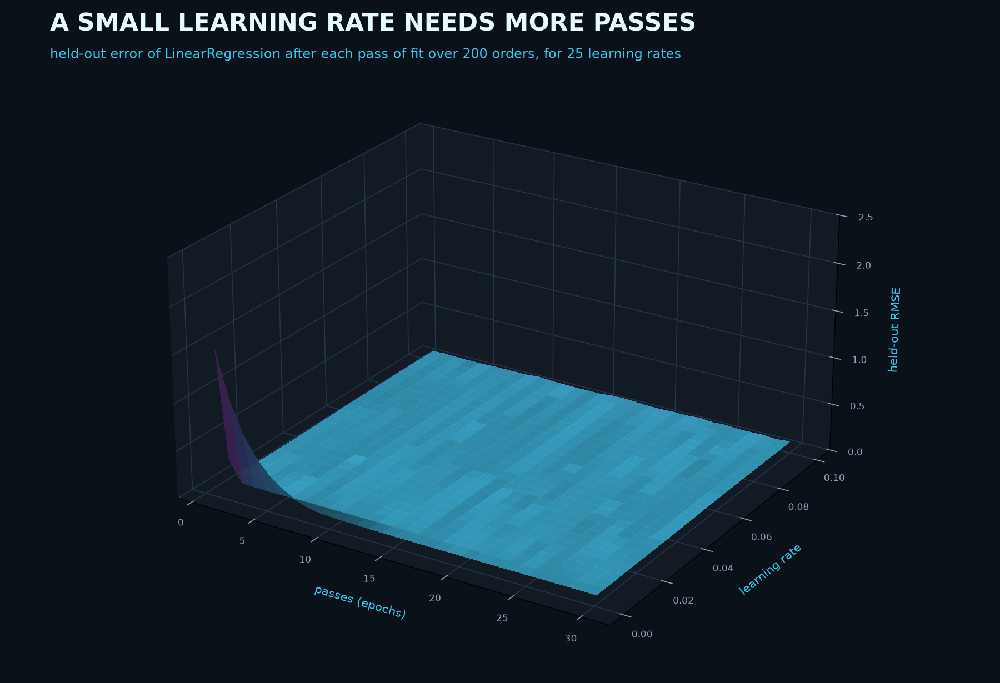
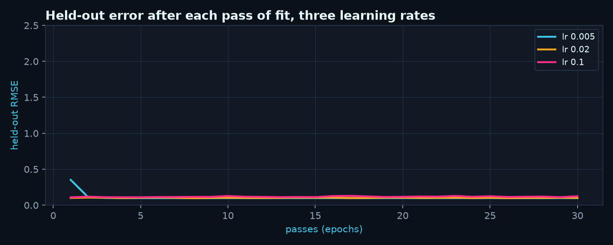

# Fit on an estimator: the same algorithm on the whole table

[← Fit](index.md)

A desk keeps a table of 200 past orders, with the size and the depth of the book for each one and the slippage that the order paid. It wants a model of the slippage. Learning the orders one by one is what the library does on a live stream; with a table already in hand, `fit` hands all the rows to the model in one call, and the result is the same as the loop that you would write by hand. A robot that has logged a run can do the same with its own table.



## 1. A first example: a model of the slippage

The slippage follows `2 * size - depth` plus a small noise. The model sees the first 200 orders, five passes in a shuffled order, and is judged on the 100 orders that it has not seen. The number is the root mean squared error (RMSE), in the unit of the slippage.

```python
import numpy as np
from dense_armor.core.online.linear.glm import LinearRegression
from dense_armor.core.online.optim.sgd import SGD

rng = np.random.default_rng(0)
A = rng.normal(size=(300, 2))
X = [{"size": float(u), "depth": float(v)} for u, v in A]
y = [float(2 * u - v + rng.normal(0, 0.1)) for u, v in A]
m = LinearRegression(optimizer=SGD(lr=0.02)).fit(X[:200], y[:200], epochs=5, shuffle=True, seed=0)
err = [(m.predict_one(x) - t) ** 2 for x, t in zip(X[200:], y[200:])]
print(round(float(np.sqrt(np.mean(err))), 3))
```

```
0.077
```

`fit(X, y, epochs=5, shuffle=True, seed=0)` reads the table five times, changes the order at every pass, and the seed makes the order repeatable. It returns the model itself, so the call can be chained. The error is of the order of the noise of 0.1 that was put in the slippage (a test sample of 100 orders can land a little under it): the model has found the rule.



Over 5 tables, the median held-out RMSE after 1, 5 and 30 passes reads 1.525, 0.368 and 0.098 for a learning rate of 0.001, 0.336, 0.099 and 0.099 for 0.005, 0.1, 0.104 and 0.102 for 0.022, and 0.11, 0.11 and 0.124 for 0.1. A small learning rate needs several passes, which is what `epochs` is for; a large one is at its best from the first pass and drifts a little above it.

| class or function | what it does |
|---|---|
| `fit` | feeds all the rows to `learn_one`, `epochs` times, optionally shuffled |
| `LinearRegression` | an online linear regression that learns from `fit` as from a stream |
| `StandardScaler` | learns the mean and the spread of every feature, without a label |

## 2. What it does

`fit` is defined once on the base class `Root`, so every estimator that has `learn_one` has it. It is a loop over `learn_one`: `y` is passed when the estimator is supervised, `t` is none or one timestamp per row, and `epochs` and `shuffle` decide the passes. The result is the same as the loop that you would write by hand.

**Source:** the method is defined in `dense_armor/roles/root.py`; its docstring has no paper, because it is a loop and not an algorithm.

## 3. The arguments

| Argument | Meaning | Default |
|---|---|---|
| `X` | a list of rows, each one a dict from a feature to a number | none |
| `y` | a list of labels of the same length, or none for an algorithm without a label | `None` |
| `t` | a list of timestamps, one per row, with a single pass | `None` |
| `epochs` | the number of passes, at least 1 | 1 |
| `shuffle` | change the order at every pass | `False` |
| `seed` | the seed of the order | `None` |

A mismatch of lengths, `epochs < 1`, or `t` with more than one epoch raises `ValueError`. An object without `learn_one` raises `TypeError`. The metric learners `LEGO`, `POLA` and `OASIS` learn from pairs and triplets, not from rows: see [LEGO, POLA and OASIS](metric_learners.md).

## 4. Without a label, and with timestamps

Without `y` the call feeds `learn_one(x)`, which is what the statistics, the detectors and the transformers need. A list `t` with one timestamp per row is passed row by row and needs a single pass, because the time of a row cannot go back.

A desk that wants the scale of its features, without any label, fits the scaler on the orders and then transforms a new one.

```python
import numpy as np
from dense_armor.core.signals.preprocessing.scale import StandardScaler

rng = np.random.default_rng(0)
X = [{"size": float(u), "depth": float(10 + 3 * v)} for u, v in rng.normal(size=(200, 2))]
scaler = StandardScaler().fit(X)
z = scaler.transform_one({"size": 1.0, "depth": 13.0})
print({k: round(float(v), 2) for k, v in z.items()})
```

```
{'size': 1.12, 'depth': 0.97}
```

The mean of `depth` is near 10 and its spread near 3, so the value 13 is about one spread above the mean and the answer for `depth` is near 1; `size` has mean 0 and spread 1, and 1.0 is again about one spread.

## 5. The same model on the toy example

An online algorithm learns one row at a time with `learn_one`. `fit` takes all the rows and feeds them to `learn_one` in order, so the result is the same as the loop you would write by hand.

```python
import numpy as np
from dense_armor.core.online.linear.glm import LinearRegression
from dense_armor.core.online.optim.sgd import SGD

rng = np.random.default_rng(0)
X = [{"a": float(u), "b": float(v)} for u, v in rng.normal(size=(200, 2))]
y = [2 * x["a"] - x["b"] for x in X]
m = LinearRegression(optimizer=SGD()).fit(X, y)
print(round(m.predict_one({"a": 1.0, "b": 1.0}), 2))
```

```
1.0
```

The rule behind the data is `2a - b`, so the answer for `a = 1, b = 1` is 1.0. `fit` returns the estimator itself, so the call can be chained.

### Several passes, in a shuffled order

A dataset you already have can be read more than once. `epochs` sets the number of passes, `shuffle` changes the order at every pass, and `seed` makes the order repeatable.

```python
import numpy as np
from dense_armor.core.online.linear.glm import LinearRegression
from dense_armor.core.online.optim.sgd import SGD

rng = np.random.default_rng(0)
X = [{'a': float(u), 'b': float(v)} for u, v in rng.normal(size=(200, 2))]
y = [2 * x['a'] - x['b'] for x in X]
m = LinearRegression(optimizer=SGD()).fit(X, y, epochs=5, shuffle=True, seed=0)
print(round(m.predict_one({"a": 1.0, "b": 1.0}), 2))
```

```
1.0
```

## 6. The same on a robot

A robot has logged a run: the torque that a joint needed for a given speed and a given load. The model of the torque is `2 * speed - load`, with the same noise.

```python
import numpy as np
from dense_armor.core.online.linear.glm import LinearRegression
from dense_armor.core.online.optim.sgd import SGD

rng = np.random.default_rng(1)
A = rng.normal(size=(300, 2))
X = [{"speed": float(u), "load": float(v)} for u, v in A]
y = [float(2 * u - v + rng.normal(0, 0.1)) for u, v in A]
m = LinearRegression(optimizer=SGD(lr=0.02)).fit(X[:200], y[:200], epochs=5, shuffle=True, seed=0)
err = [(m.predict_one(x) - t) ** 2 for x, t in zip(X[200:], y[200:])]
print(round(float(np.sqrt(np.mean(err))), 3))
```

```
0.105
```

The error is again of the order of the noise of 0.1, because the structure is the same as for the slippage.

## API reference

::: dense_armor.roles.root.Root.fit

---

## Details

### Choices

- **The figures** are drawn with the library by `docs/assets/fit/make_fit_figures.py`: 300 orders, size and depth drawn from a normal law, the slippage `2 * size - depth` plus a noise of 0.1, 200 orders for the fit and 100 for the error, `SGD` with the learning rate on the figure, one pass per call of `fit` with a new shuffle each time, median over 5 seeds.
