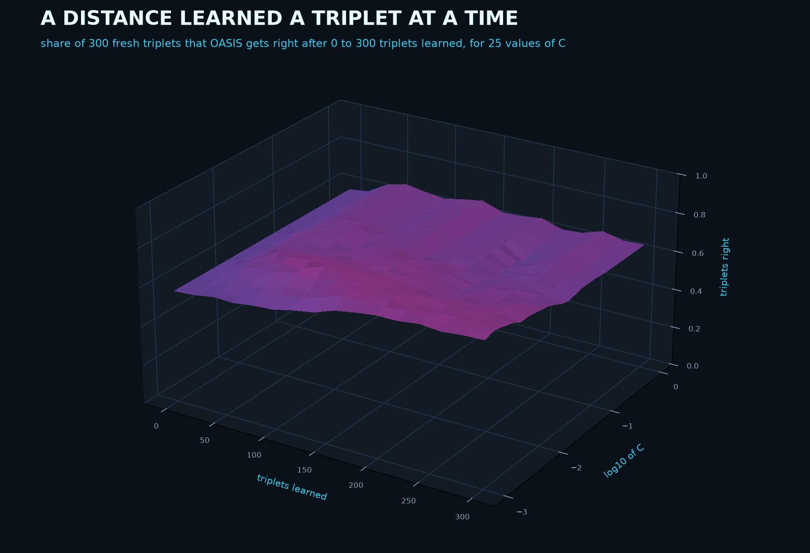
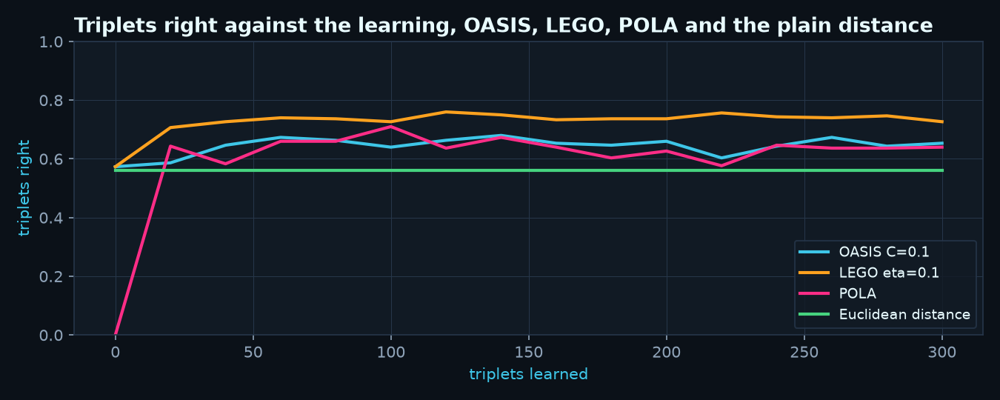

# LEGO, POLA and OASIS: online metric learning

[← Fit](index.md)

`LEGO`, `POLA` and `OASIS` are online metric learners: the first three algorithms that the library made online. A metric learner does not predict a label. It learns a distance, and to learn a distance one sample is not enough: there must be at least two on the table, to say if they are near or far. So the unit of these algorithms is not a row `(x, y)`: it is a **pair** (`LEGO`, `POLA`) or a **triplet** (`OASIS`), and the stream that they read is a stream of pairs or triplets, one at a time, that never ends. They learn with `learn_pair` and `learn_triplet`, and the matrix that they update is used to measure the distance between two points for another algorithm, a nearest-neighbour search for example. Their own pages are [LEGO](../learn/lego.md), [POLA](../learn/pola.md) and [OASIS](../learn/oasis.md), under the [metric learning](../learn/metric_learning.md) overview.



## 1. A first example: a distance between orders, learned a pair at a time

A desk wants a distance in which two good fills are near each other and a good fill and a bad fill are far. A good fill has a larger size and a lower depth than a bad one. `LEGO` learns a Mahalanobis distance from pairs, each with a target squared distance: a small target for two good fills, a large one for a good fill and a bad one. The answer says if, after the learning, two good fills are nearer than a good fill and a bad one.

```python
import numpy as np
from dense_armor.core.online.learn.metric_learning import LEGO

rng = np.random.default_rng(0)
good = [{"size": float(a), "depth": float(b)} for a, b in rng.normal([1.5, -1.5], 1.0, size=(100, 2))]
bad = [{"size": float(a), "depth": float(b)} for a, b in rng.normal([0.0, 0.0], 1.0, size=(100, 2))]
lego = LEGO()
for i in range(0, 100, 2):
    lego.learn_pair(good[i], good[i + 1], 0.05)
    lego.learn_pair(good[i], bad[i], 4.0)
close = lego.distance(good[0], good[1])
far = lego.distance(good[0], bad[0])
print(close < far)
```

```
True
```

Each `learn_pair(u, v, target)` updates the matrix with one pair, and the learned distance puts the two good fills nearer than the good and the bad one.

## 2. Triplets: OASIS

`OASIS` learns a bilinear similarity from triplets: an order, one of its own kind and one of the other kind. Each `learn_triplet(x, x_pos, x_neg)` is one update.

```python
import numpy as np
from dense_armor.core.online.learn.metric_learning import OASIS

rng = np.random.default_rng(0)
good = [{"size": float(a), "depth": float(b)} for a, b in rng.normal([1.5, -1.5], 1.0, size=(100, 2))]
bad = [{"size": float(a), "depth": float(b)} for a, b in rng.normal([0.0, 0.0], 1.0, size=(100, 2))]
oasis = OASIS()
for i in range(99):
    oasis.learn_triplet(good[i], good[i + 1], bad[i])
close = oasis.distance(good[0], good[1])
far = oasis.distance(good[0], bad[0])
print(close < far)
```

```
True
```

The similar pair is nearer than the different one.



On orders with two features that carry the signal (size and depth) and two that carry noise, 300 fresh triplets are scored: the share in which an order is nearer to one of its own kind than to one of the other kind. The plain distance gets 0.56. After 75, 150 and 300 triplets learned, the median over 5 sets reads 0.64, 0.653 and 0.653 for `OASIS` with `C` = 0.1, 0.727, 0.733 and 0.727 for `LEGO` with `eta` = 0.1, and 0.71, 0.64 and 0.64 for `POLA`; `POLA` reads 0 at the start, where it has learned nothing. The surface shows `C`: with `C` = 0.001, `OASIS` learns slowly and reaches 0.737 at 300 triplets; with `C` = 0.01 it reads 0.683, 0.723 and 0.69 after 75, 150 and 300 triplets; with `C` = 1 it stays near 0.65.

## 3. Pairs with a label: POLA

`POLA` learns a pseudo-metric from pairs that are labelled +1 for similar and -1 for dissimilar, and projects the matrix onto the positive semi-definite cone after every update. The number printed is the bound `b`, which the projection keeps at 1 or above.

```python
import numpy as np
from dense_armor.core.online.learn.metric_learning import POLA

rng = np.random.default_rng(0)
good = [{"size": float(a), "depth": float(b)} for a, b in rng.normal([1.5, -1.5], 1.0, size=(100, 2))]
bad = [{"size": float(a), "depth": float(b)} for a, b in rng.normal([0.0, 0.0], 1.0, size=(100, 2))]
pola = POLA()
for i in range(0, 100, 2):
    pola.learn_pair(good[i], good[i + 1], +1)
    pola.learn_pair(good[i], bad[i], -1)
print(round(pola.b, 3))
```

```
1.284
```

| class or function | what it does |
|---|---|
| `LEGO` | a Mahalanobis matrix from pairs with a target squared distance, with a LogDet step |
| `POLA` | a pseudo-metric `(A, b)` from pairs labelled +1 or -1, with a projection onto the PSD cone |
| `OASIS` | a bilinear similarity from triplets, with a passive-aggressive step |
| `distance` | the learned distance between two samples |

## 4. What it does

`LEGO` learns a Mahalanobis matrix `A` from pairs `(u, v)` with a target squared distance `y`: same-class pairs should have small targets, different-class pairs large ones. `POLA` learns `(A, b)` from labelled pairs `(x, x2, y)` with `y = +1` for similar and `y = -1` for dissimilar, and after every update projects `A` onto the positive semi-definite cone and `b` onto `[1, +inf)`. `OASIS` learns a bilinear similarity `S(x, y) = x^T W y` from triplets `(query, positive, negative)` such that `S(x, x_pos) > S(x, x_neg) + 1`; `W` is not constrained to be symmetric or positive semi-definite, and the induced distance uses `M = W^T W`, which is always positive semi-definite. Features are dicts; the first call fixes the feature order (sorted keys), and a feature not seen at that time counts as 0 in later calls.

**Source:** Jain, P., Kulis, B., Dhillon, I.S. and Grauman, K., 2008. Online metric learning and fast similarity search. In NIPS (`LEGO`). Shalev-Shwartz, S., Singer, Y. and Ng, A.Y., 2004. Online and batch learning of pseudo-metrics. In ICML (`POLA`). Chechik, G., Sharma, V., Shalit, U. and Bengio, S., 2009. An online algorithm for large scale image similarity learning. In NIPS (`OASIS`).

## 5. The parameters

| Class | Parameter | Meaning | Default |
|---|---|---|---|
| `LEGO` | `eta` | learning rate of the LogDet gradient step; the paper uses 0.1 | 0.1 |
| `POLA` | `b_init` | the initial value of the bound `b` | 1.0 |
| `OASIS` | `C` | aggressiveness: the passive-aggressive step is `min(C, loss / ‖V‖²)`; the paper recommends a small value, 0.01 to 0.1 | 0.01 |

## 6. The same on a robot

A robot has logged runs, each with a speed and a load: a stable run has a higher speed and a lower load than a shaky one. `OASIS` learns the distance from triplets, a stable run, another stable one and a shaky one.

```python
import numpy as np
from dense_armor.core.online.learn.metric_learning import OASIS

rng = np.random.default_rng(1)
stable = [{"speed": float(a), "load": float(b)} for a, b in rng.normal([1.5, -1.5], 1.0, size=(100, 2))]
shaky = [{"speed": float(a), "load": float(b)} for a, b in rng.normal([0.0, 0.0], 1.0, size=(100, 2))]
oasis = OASIS()
for i in range(99):
    oasis.learn_triplet(stable[i], stable[i + 1], shaky[i])
print(oasis.distance(stable[0], stable[1]) < oasis.distance(stable[0], shaky[0]))
```

```
True
```

The same: two stable runs are nearer than a stable run and a shaky one.

## API reference

::: dense_armor.core.online.learn.metric_learning.LEGO

::: dense_armor.core.online.learn.metric_learning.POLA

::: dense_armor.core.online.learn.metric_learning.OASIS

---

## Details

### Choices

- **The figures** are drawn with the library by `docs/assets/fit/make_fit_figures.py`: 300 training triplets, 300 fresh triplets, two features with the signal and two with noise of a spread of 3, and one update after another with `learn_triplet` for `OASIS` and with two `learn_pair` calls for each triplet for `LEGO` (targets 0.05 and 4.0) and `POLA` (labels +1 and -1), median over 5 seeds.
- **Why there is no `learn_one(x, y)`:** a single sample does not say anything about a distance, and the metric learners do not predict. The pair or the triplet is the unit of the algorithm, as in the papers.
