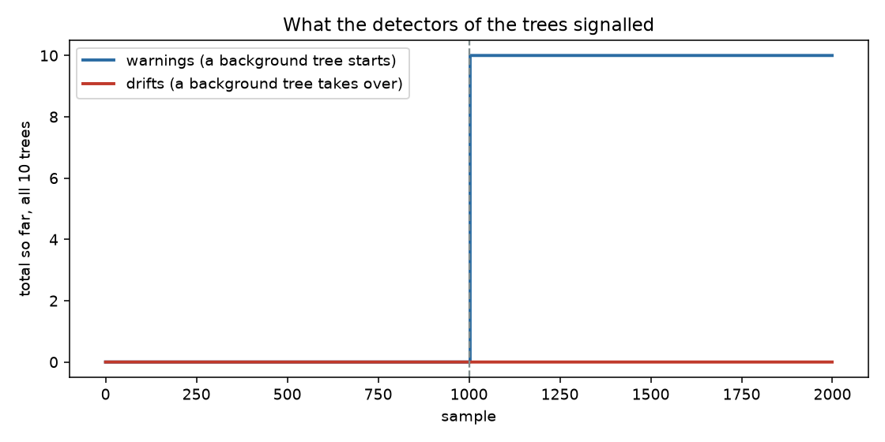

# AdaptiveRandomForestClassifier: replace the trees that go wrong

`AdaptiveRandomForestClassifier` is the forest of Gomes and colleagues (2017). It has four ideas, each one simple.

Every tree sees every sample, but with a random weight: a sample counts as many times as a Poisson draw with mean 6, so no two trees train on the same data. Every tree also looks at only a few randomly chosen features when it considers a split, which makes the trees differ from one another. Every tree has two small detectors fed with its own mistakes: a warning detector, which is easy to trigger, and a drift detector, which needs more evidence. A warning starts a second tree in the background that trains on the stream but does not vote. If the drift detector then fires, the background tree takes the place of the old one. Finally the forest votes, and each tree's vote is weighted by its recent accuracy.

```python
import numpy as np
from dense_armor.core.online.forest import AdaptiveRandomForestClassifier

rng = np.random.default_rng(0)
f = AdaptiveRandomForestClassifier(n_models=5, seed=1)
for i in range(1500):
    x = float(rng.normal(0.0 if rng.random() < 0.5 else 5.0, 0.4))
    y = int(x > 2.5) if i < 750 else int(x <= 2.5)
    f.learn_one({"x": x}, y)
print(f.predict_one({"x": 0.1}), f.predict_one({"x": 5.0}))
print(f.n_warnings_, f.n_drifts_)
```

```
1 0
11 3
```

The stream gives class 0 to small `x` for the first 750 samples and then swaps the two labels. After the swap the forest answers 1 for `x = 0.1` and 0 for `x = 5.0`, so it has followed the change. Along the way the detectors raised 11 warnings and 3 drifts.

### Following a sudden change

A longer test makes the effect visible. `DriftStream` produces four numbers per sample and changes its rule at sample 1000. The figure shows the accuracy over the last 50 samples, as the median of five seeds, for one adaptive Hoeffding tree and for the forest of ten trees.


Both fall when the rule changes, and both come back to 1.0. In the median of the five seeds the forest falls less and returns sooner: in the first 100 samples after the change it is right 0.910 of the time and the single tree 0.540. Seed by seed the forest scores 0.90, 0.98, 0.96, 0.91 and 0.84 and the tree 0.12, 1.00, 0.98, 0.53 and 0.54, so the tree is the better one on two seeds and the difference is not significant (see [the numbers](index.md#the-numbers)).

The detectors tell the same story from the inside. The next figure counts, for one seed, how many warnings and drifts the ten trees raised.



Before the change there are two warnings and no drift: a warning alone replaces nothing. At the change the drift line jumps as the trees are replaced one after another. The forest raised 29 warnings and 23 drifts in total on this stream, and a second burst appears between samples 1550 and 1700, when the rule is no longer changing. With the fast detector setting that is the price of reacting quickly: a tree may be replaced without need. Slower detectors, passed as `drift_detector` and `warning_detector`, trade reaction time for fewer false replacements.

The forest costs about 4.3 ms per sample for ten trees against 0.24 ms for the single tree, roughly eighteen times more.

## The parameters

| Parameter | Meaning | Default |
|---|---|---|
| `n_models` | number of trees | 10 |
| `max_features` | features tried per split attempt; `None` takes `int(sqrt(M)) + 1` | `None` |
| `lambda_` | mean of the Poisson weight of a sample for a tree | 6.0 |
| `drift_detector` | template of the drift detector, cloned for every tree; `None` takes `ADWIN(delta=0.001)` | `None` |
| `warning_detector` | template of the warning detector; `None` takes `ADWIN(delta=0.01)` | `None` |
| `seed` | seed of the Poisson weights and of the feature subsets | `None` |
| `grace_period` | samples at a leaf before a split is attempted | 50 |

## API reference

::: dense_armor.core.online.forest.arf

---

## Details

The references, the choices the papers do not fix, the checks, the cost and the memory of the forests are in the Details of [Streaming forests](index.md#details).
